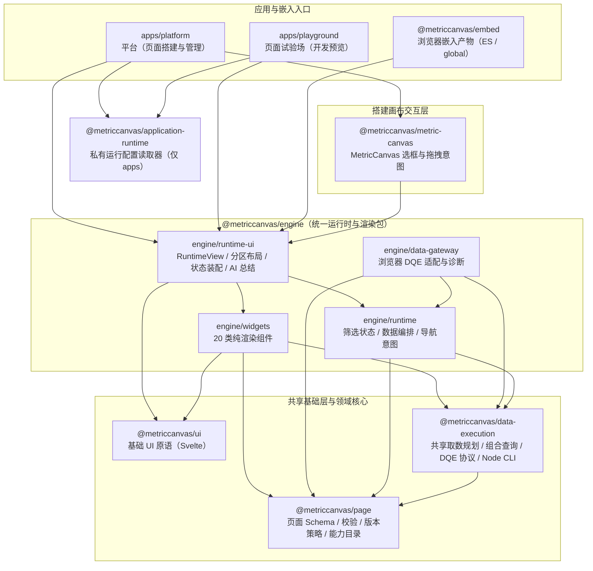

# MetricCanvas 代码架构与维护者指南

本文面向仓库维护者与工程 Agent，提供包职责划分、静态依赖方向、自动化治理门禁、改动落点决策树与按包快速验证矩阵。产品背景见 [origin.md](origin.md)，领域术语以 [CONTEXT.md](CONTEXT.md) 为唯一真源，页面协议入口见 [PAGE-METADATA.md](PAGE-METADATA.md)。

## 1. 工作区包拓扑与依赖方向

### 核心包职责一览

| 路径 / 包名 | 交付属性 | 核心职责 | 明确不承担 |
|---|---|---|---|
| `packages/page` (`@metriccanvas/page`) | 对外交付物 | 页面 Zod/JSON Schema、语义校验、规范化升级、`versionPolicy` 唯一版本真源、组件能力目录 | 网络请求、UI 渲染、浏览器 API |
| `packages/data-execution` (`@metriccanvas/data-execution`) | 对外交付物 | 跨浏览器与 Node 共享的取数编排、条件/定稿/候选准备、`pagedJoin`/`pagedUnion`、`compute` 算子与 DQE 协议执行 | Svelte/DOM、组件呈现、应用路由 |
| `packages/ui` (`@metriccanvas/ui`) | 共享基础库 | 通用无领域 UI 原语组件（输入、弹层、选择、滚动等） | 页面协议、数据快照、业务查询 |
| `packages/engine/runtime` (`@metriccanvas/engine`) | 对外交付物 | 筛选状态与 URL 同步、按需取数与条件裁剪、数据快照存储、导航意图解析 | 具体框架壳、DOM 渲染、HTTP 传输细节 |
| `packages/engine/data-gateway` (`@metriccanvas/engine`) | 对外交付物 | 浏览器 DQE 执行适配、独立/批量调度、超时与脱值诊断 | 组件状态、页面导航、资产管理 |
| `packages/engine/widgets` (`@metriccanvas/engine`) | 对外交付物 | 20 类纯渲染组件、格式化展示与受控语义 HTML 解析渲染 | 发起查询、直接读筛选状态、路由跳转 |
| `packages/engine/runtime-ui` (`@metriccanvas/engine`) | 对外交付物 | `RuntimeView` 正式入口、内容分区网格、筛选控件、详情视图、导出与 AI 总结垂直 Module | 资产持久化、发布治理、NL2DQE |
| `packages/metric-canvas` (`@metriccanvas/metric-canvas`) | 对外交付物 | 叠在 `RuntimeView` 渲染主体上的搭建画布选框、拖拽与编辑意图回传 | 持有持久化文档、属性面板、第二套渲染器 |
| `packages/embed` (`@metriccanvas/embed`) | 对外交付物 | Shadow DOM 挂载、ES/global 入口、`mount/update/destroy` 生命周期与分包产物 | 集成应用路由栈、鉴权实现、资产存储 |
| `packages/application-runtime` | 仓内私有 | `apps/platform` 与 `apps/playground` 共用的运行配置读取器 | 对外发布或被引擎反向依赖 |
| `apps/platform` / `apps/playground` | 第一方应用 / 开发工具 | 平台（页面目录、搭建工作台、保存与发布）；页面试验场（开发态样例浏览与实时校验预览） | 绕过 `@metriccanvas/engine` 另建渲染路径 |

> 创作侧（Relay、Python 内容工具与独立分发 Skill）的架构边界见 [metriccanvas-authoring/ARCHITECTURE.md](metriccanvas-authoring/ARCHITECTURE.md)。

## 2. 强制边界与自动化不变式

| 门禁命令 | 守护的不变式 | 规则说明 |
|---|---|---|
| `pnpm verify:fast` | 一次跑通 `lint` + `hygiene:check` + `architecture:check`（秒级本地必跑基线） | [ci-delivery.md](docs/agents/ci-delivery.md) |
| `pnpm architecture:check` | 零新增循环依赖与跨层依赖：`page` 仅自依赖；`data-execution` 仅依赖 `page`；`runtime` 仅依赖 `data-execution`/`page`；`widgets` 不得引入 `runtime`/`runtime-ui`；四个纯逻辑层禁止引入 Svelte/ECharts/导出编码依赖 | [architecture-ratchet.md](docs/agents/architecture-ratchet.md) |
| `pnpm complexity:check` | TS/JS/Svelte 与 Python 各自平均 `CC < 5`；新增函数 `selfCC ≤ 15`；生产/工具嵌套闭包 `subtreeCC ≤ 45`；TS/JS/Svelte 生产文件 `≤ 600` 行；存量台账只降不升 | [code-complexity.md](docs/agents/code-complexity.md) |
| `pnpm hygiene:check` | 全部跟踪文件（加 `--staged` 查暂存区 blob）单文件 `≤ 1,000,000` 字节；`docs/evidence/` 除 `README.md` 外禁止入仓 | [AGENTS.md](AGENTS.md#提交内容与文件体积必选) |
| `pnpm lint` | Biome 静态代码检查（配合 `pnpm format:check` 核对变更格式） | `biome.json` |
| `pnpm packages:check` | 校验真实 tarball 导出入口、`.d.ts` 类型声明与组件闭合；Embed 另受单 JS 文件 `≤ 1,000,000` 字节门禁约束 | [embed-distribution.md](docs/agents/embed-distribution.md) |

关键跨包不变式：

1. **单一协议版本真源**：`schemaVersion` 当前作者版本、可读范围与能力下限只在 `packages/page/src/version.ts` 定义，不在文档或下游包重复硬编码。
2. **纯渲染隔离**：`packages/engine/widgets` 只消费数据快照与 props，不得发起网络请求或直接读写 `runtime` 全局状态。
3. **派生契约单向生成**：`contracts/` 与 `metriccanvas-authoring/` 内的参考文档、知识模型与校验器必须由 `pnpm authoring:contracts` 从真源派生，禁止手改生成副本。

## 3. 维护者改动落点决策树

> “这次改动应该落在哪个包？”——自上而下匹配首个命中项：

1. **改页面 JSON 字段、Schema 结构、版本号、语义校验、升级迁移或组件目录？**
   → 落 `packages/page/src/`；先按 [page-metadata-changes.md](docs/agents/page-metadata-changes.md) 做 Schema 最小化评估，再同步 `pages/`、`docs/page-metadata/` 与 `pnpm authoring:contracts`。
2. **改 DQE 请求/响应编码、筛选/定稿/候选异步准备、`pagedJoin` / `pagedUnion`、表格远程视图求值或 `compute` 算子？**
   → 落 `packages/data-execution/src/`（浏览器与 Node 共享，不引入 DOM 或 Svelte）。
3. **改筛选状态机、URL 参数解析/清理、按需取数裁剪、数据源编排、缓存/竞态或导航意图解析？**
   → 落 `packages/engine/runtime/src/`（若仅涉及浏览器 HTTP 传输或网关诊断，落 `packages/engine/data-gateway/src/`）。
4. **改单个组件（表格、图表、指标卡、地图等）的纯展示、格式化、受控语义 HTML 或交互事件上抛？**
   → 落 `packages/engine/widgets/src/`；若为跨组件通用的无领域基础控件，落 `packages/ui/src/`。
5. **改 `RuntimeView` 挂载装配、分区网格/吸顶布局、筛选控件连接、详情浮层、表格/报告导出或 AI 总结垂直 Module？**
   → 落 `packages/engine/runtime-ui/src/`。
6. **改搭建画布选框、拖拽排序或就地编辑意图？**
   → 落 `packages/metric-canvas/src/`（状态持久化、属性面板与撤销历史落 `apps/platform/`）。
7. **改 Shadow DOM 封装、ES/global 入口、分包策略或面向集成应用的浏览器接入 API？**
   → 落 `packages/embed/`（须满足 [embed-distribution.md](docs/agents/embed-distribution.md) 体积与分包门禁）。
8. **改开发态场景导航或第一方页面目录/工作台壳？**
   → 分别落 `apps/playground/` 或 `apps/platform/`；共用运行配置读取落 `packages/application-runtime/`。

## 4. 按包快速验证矩阵

先跑定向包测试与 `pnpm verify:fast` 获得秒级反馈，再按影响面补全类型、构建与契约门禁：

| 修改范围 | 定向快速验证 | 交付前必补门禁 |
|---|---|---|
| 任意源码或文档变更 | `pnpm verify:fast` | `pnpm hygiene:check`（提交前可加 `--staged`） |
| `packages/page/` | `pnpm test:page`、`pnpm validate <file> --json` | `pnpm check`、`pnpm authoring:contracts:check`、`pnpm complexity:check` |
| `packages/data-execution/` | `pnpm test:data-execution` | `pnpm test:engine`、`pnpm check`、`pnpm complexity:check` |
| `packages/ui/` | `pnpm test:ui` | `pnpm --filter @metriccanvas/ui check`、`pnpm build:packages` |
| `packages/engine/` | `pnpm test:engine` | `pnpm check`、`pnpm --filter @metriccanvas/embed build`、`pnpm complexity:check` |
| `packages/metric-canvas/` | `pnpm --filter @metriccanvas/metric-canvas check` | `pnpm test:platform`、`pnpm build:packages`、`pnpm packages:check` |
| `packages/embed/` | `pnpm --filter @metriccanvas/embed build && pnpm test:embed` | `pnpm --filter @metriccanvas/embed check`、`pnpm packages:check` |
| `apps/platform/` | `pnpm test:platform` | `pnpm --filter platform check`、`pnpm --filter platform build` |
| `apps/playground/` 或 `pages/` | `pnpm test:playground`、`pnpm validate <path> --json` | `pnpm build:playground`、`pnpm authoring:contracts:check`（若为引用夹具） |
| 协议文档 / Skill / 契约真源 | `pnpm exec vitest run tests/page-reference.test.ts` | `pnpm authoring:contracts:check`、`pnpm skills:check` |
