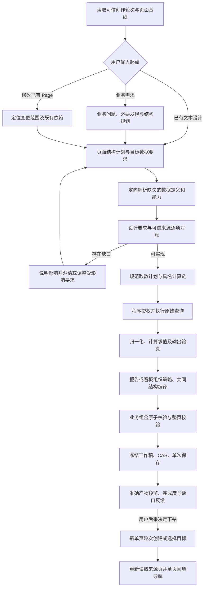

# 平台创作整体流程：文本设计、数据推导与架构冲击

日期：2026-10-12。状态：更新后的实施提议，生产 Skill 和工具尚未切换。本文件是本批**整体流程的阅读入口**；[编码计划](2026-10-12-dashboard-authoring-coding-plan.md) 是任务真源，[外部依赖](2026-10-12-dashboard-authoring-external-dependencies.md) 是接入对账真源，[computed 专项](2026-10-12-dashboard-computed-gap.md) 解释计算语义。既有 D1–D7 以 [ADR-0098](../../adr/0098-profiled-page-composition-and-incremental-navigation.md) 为准；新增的设计状态、求值部署及消费接线不自动成为已批准决策。

目标仍是通过平台创作生成真实 IOC 概览与机会点列表，支持先概览、后决定下钻；普通问数不进入目标。内部 Agent 不支持多模态，所以正式路径必须仅凭文本及受控结构输入完成。图片识别、OCR 或多模态转换服务不作为前置依赖。

## 1. 输入：设计可以是一段业务文字

| 输入来源 | Agent 实际消费 | 信任范围 |
|---|---|---|
| 自然语言、Markdown、表格形式规格 | 阅读目的、模块顺序、组件关系、显示字段、交互及用户钉住项 | 用户表达设计要求；不自动证明指标口径、物理字段、编码或权限 |
| 上游提供的结构化文本 | 经闭集 Schema 校验的设计要求；具体结构字段在 C01 冻结 | 创作输入，不是可直接执行的 Page JSON、查询体或脚本 |
| 用户指定且有权限读取的参考 Page | 程序读取准确修订，投影有界结构摘要及可引用能力 | 引用须绑定来源与修订；复制设计不意味着可复用原数据授权 |
| 只有图片的外部材料 | 由用户或上游先提供可读文本规格，正式 Agent 再处理文本 | 自动转换是可选外部能力；无法取得文本时明确输入缺口，不臆测图片内容 |

例如，用户可以直接提供以下规格，不必了解字段 ID 或算子名称：

```text
页面：区域经营概览，供区域负责人看本月执行情况。
顶部：月份、区域、行业筛选。
主体：地图作为背景，覆盖三个指标模块：机会金额、项目金额、达成率。
底部：三个标签页，分别看重点项目、流失订单、机会分层。
达成率按实际金额除以目标金额；没有目标时显示缺失，不显示零。
指定：保留地图和三个标签页，不能自动换成一张汇总表。
先生成概览；下钻页面稍后再决定。
```

程序保留文本来源和版本；模型将其转换为有界页面结构计划与业务数据要求。达成率描述只构成待核验规则，程序还须识别真实字段、单位和粒度，必要时记录明确的规则确认。设计示意数字不进入真实取数证据。

参考 Page 的结构摘要与用于评分的完整目标 JSON 分开：两个验收目标的 JSON 和评分器仍不进入模型消息。已有页面编辑必须读取 Java 当前准确基线，不能用设计文本重建旧文档。

## 2. 三种起点，汇入一条受控生成链



这是职责顺序，不要求每格对应一个 MCP 工具或一次模型调用。纯外观编辑沿现有 edit 路径跳过发现、取数和计算；已具备本轮有效事实与结果的任务复用证据，不强制重复发现。报告也能从文本设计开始，看板也能从业务需求开始；layout 只参与表达组织。

| 阶段 | 需要形成什么 | 门禁及反馈 |
|---|---|---|
| 可信准备 | 单页 binding、权限、模式、当前基线与 workVersion | 未准备不得执行创作工具；existing 使用准确当前文档 |
| 设计归一化 | 页面结构计划、稳定逻辑标识、目标数据要求、钉住项和允许调整项 | 未解析数据要求是创作期内容，不生成占位查询或提前保存不完整 Page |
| 定向发现与对账 | 每个要求对应可信指标/字段、规则、执行能力或明确缺口 | discover_data_context 解析缺失语义；不能凭模型知识补公司事实 |
| 取数与计算规划 | 规范取数单元、依赖、闭集算子顺序、预期输出、范围及单位 | 设计确认、业务规则确认与查询授权分别记录；计划授权精确匹配规范请求 |
| 执行与验真 | 获授权原始结果、归一化字段、计算后输出证据 | 窗口不得冒充完整聚合；键、粒度、可加性、0/null、错误传播逐项核验 |
| 结构编译 | 按 report/dashboard 策略组织，绑定真实字段与算后字段 | 复用共同计算/筛选/组件构造；钉住项不静默降级；业务组合及依赖闭包原子处理 |
| 保存与交付 | 合法 Page、准确保存回执、artifactRef、完成度 | 合法 partial 可保存，但明确未实现的要求；unknown 不重发，预览失败不重新保存 |
| 后续下钻 | 实际目标身份/参数证据、来源页新基线、独立编辑回执 | 不开跨页事务，不持久化未来下钻待办；目标创建成功不代表来源回填成功 |

缺口反馈至少区分：文本需求歧义、缺可信口径、缺字段或执行能力、缺现有算子表达能力、缺组件/布局能力。反馈定位到具体设计要求并说明受影响模块。现有合法内容是否形成 partial 与用户要求是否全部满足分别报告；不能删模块后宣称完成。

## 3. 原计划缺少的核心：要求、证据和产物之间的对应关系

页面结构计划与数据要求之间需要稳定逻辑标识，避免按显示标题或数组位置猜对应关系。创作期至少维护以下映射；它是编译与验真信息，不新增页面资产种类：

| 设计要求 | 数据或计算解析 | 产物及验收 |
|---|---|---|
| 某个指标卡显示本月区域达成率 | 分子、分母的可信来源，区域/月粒度，单位、ratio 与缺失规则 | 源/字段/组件 ID、当前结果或计算证据、筛选后的显示值 |
| 地图显示分层区域结果 | 地域键与层级编码、取数粒度、聚合或关联要求 | 地图 variant、绑定字段、层级切换实际请求与结果 |
| 明细列表 40 列、固定前两列、按月份下钻 | 实体键、45 结果字段、隐藏导航字段、分页与排序事实 | 列配置、过滤后总数、翻页行稳定性、行月份导航参数 |

该映射还承担变更影响分析：只改标题或列宽，不重新查数；改变时间、口径、分组或关联键，重建受影响取数与计算依赖，重新取得适用的精确授权。变更后旧计划派生的结果不能仅因字段名相同而继续使用。不得让计算后结果进入 raw initial 或绕过现有查询结果绑定规则。

版本不能混用：设计来源版本、计划修订、数据上下文版本、工作稿版本、Java 页面修订和产物引用分别标识不同事实。设计来源与模型归一化结果也需区分，避免将模型推断升级为用户原文。上下文丢失后靠聊天总结重建“已确认计划”不合格。

## 4. 与此前计划相比，新增或扩大了哪些架构冲击

| 项目 | 原计划覆盖情况 | 这次补齐及冲击 | 归属与决策状态 |
|---|---|---|---|
| A1–A6：数据契约、组织策略、原子组合、事实消费、跨页轮次、整体切换 | 已列入编码计划，原则已通过 D1–D7；具体接线尚有 Q8/Q9 | 继续沿用；文本设计不要求再拆服务或复制生命周期 | MC 公共层与 Relay/工作台按已有任务推进 |
| A7：computed 规划与实际输出验真 | 用户指出后已补充；最初只围绕四个 ratio | 从显示要求反推查询和算子链，并证明算后结果可供组件使用；Python 创作与 TS 运行时求值一致性必须落实 | MC 共同数据推导；求值部署方式待 grill，不能靠 Schema 校验代替 |
| **A8：文本设计输入与要求对账** | 之前提到设计优先，但未明确文本契约、稳定映射与来源 | 新增可独立于数据发现存在的页面结构计划与目标数据要求；保持受控树，对每项要求解析、诊断和追踪 | MC 新输入/规划/编译职责；Relay 传递原始文本和可信引用。扩展创作契约，不要求升级 Page Schema |
| **A9：设计阶段状态与跨轮次恢复** | 既有 work/results 和 discovery task 被默认当作足够的状态基础 | 没有结果甚至没有可执行 Page 时也有待澄清设计；必须定义来源快照、计划修订、作用域、恢复与失效规则 | MC 与 Relay 对账。推荐先复用可信请求上下文，按轮重建/验证受控计划；确需存储时另定有界记录，不直接引入任务引擎 |
| **A10：变更影响与联合依赖校验** | 已考虑组合原子性，尚未串起设计变化到数据/计算失效 | 将设计要求、取数、算子、组件、筛选、导航的依赖与诊断贯通；校验跨查询/计算依赖的悬空和循环 | MC 公共编译与验真；复用现有运行时依赖规则，不开放任意 DAG 或计算结果反向驱动查询的新语义 |
| 文本设计验收 | 原来主要验两页自然语言生成和最终结构 | 加入等价文本表达、歧义澄清、设计固定项、缺口归因、跨轮恢复与数据变更后的失效 | C00/C11 新必需用例；真实文本设计的结构/视觉实施仍按仓库 SDD 规则验收 |

**A9 的实际现状**：[authoring-turn Schema](../../../metriccanvas-authoring/contracts/authored/authoring-turn.schema.json) 为闭集单页绑定，未包含设计来源/计划修订字段；[discovery_tasks](../../../metriccanvas-authoring/tool/metriccanvas_authoring/work/discovery_tasks.py) 是定向数据发现记录，不能直接解释为通用设计或多页流程存储；[PlatformAuthoring](../../../metriccanvas-authoring/tool/metriccanvas_authoring/pages/platform_authoring.py) 的工作稿与保存链不能替代尚未形成 Page 的设计计划。原计划“authoring-turn/1.0 保留”的判断因此需要增加条件：若设计身份必须进入 binding，就明确升级；若走独立可信上下文，则需严格绑定当前身份/请求/轮次，不能让模型自报 designRef。

## 5. 外部系统依赖变化

- **Relay 新增 R6**：传入纯文本设计、来源身份/版本及可信引用；澄清后恢复相关设计约束，绑定新轮次；确认语义、权限、取消、迟到消息与预算明确。内部 Agent 保持文本能力即可，不默认新增工具、图像模型或设计存储服务。现有 R2/R3 扩展到新增查询、计算规则及依赖；R4 的单意图跨页驱动仍待确定。
- **Java 页面资产没有新增必需职责**：接收已合法编译的 Page，仍按现行草稿保存、读取与修订检查链路。未解析设计、计划状态和计算验真不会塞进 page_metadata_definition。只有决定新增独立设计持久化产品能力时，才另审服务与存储所有权；本批不默认归 Java。
- **Java 元数据与 DQE 的事实要求扩大**：字段、实体粒度、关联键、可加性、单位、日期编码和完整性证据共同支撑 computed，不能以文本设计或人工确认制造不存在的物理能力。现有 D1–D3 对账需补计算输入约束。
- **计算求值部署是独立依赖**：推荐优先评估复用 TS 权威内核，核实离线 Bundle/内部部署是否可提供执行环境；否则比较 Python 实现加 TS 一致性门禁。不能假设 Relay 提供计算服务，也不能默认为 Java 执行 compute。

## 6. 修订后的编码推进与审查点

1. B0 / C00–C01：在写正式输入契约前冻结文本设计样例、要求映射、来源与恢复方案；输出新的正反例及 R6 消费说明。设计解析期与真实数据解析期的字段分开，不把 unresolved 要求混入生产查询。
2. C01a：实现纯文本到受控计划的校验/归一化、稳定逻辑标识和有界诊断；由模型提议、程序校验。计划来源和跨轮恢复接线以 A9 审查为前置，不硬编码新必填 Adapter。
3. C02–C03 / C03a：先有目标数据要求，再按可信事实解析取数和计算；不是等所有原始查询执行完才倒推需求。实际原始结果可促使修订，但变更先更新规范请求及授权再执行。
4. C04–C06 / C05a：编译共享依赖并验证实际算后输出，按策略组织；保持报告行为、合法 partial、单次保存与精确预览。
5. C07–C09：完成两页能力与增量关联；C10/C11 完成纯文本正式工作流、协议整体迁移、真实模型和真实 Relay/Java/DQE/浏览器验收。

编码前新增的具体 grill 是：**设计来源与计划跨轮次由哪个可信程序保存/恢复，是否改变 authoring-turn 契约；计算验真选共享 TS 内核还是 Python 实现**。Q8 的事实消费和 Q9 的跨页驱动继续保留，不重复审已批准的拆分原则和用户生成顺序。相关方案、约束、迁移与回退须可审查后再冻结。

不默认扩范围：独立设计管理资产、长期工作流引擎、未绑定数据的可持久 Page、专用设计预览协议、图像转换服务、任意公式/脚本和新的运行时查询/计算语义均需单独决策。当前计划只要求可解释的文本创作与恢复，以及对真实 Page 的可核验生成。

文档校验不等于实施验收：本轮更新计划与依赖，未更改生产 Skill、工具、内部 Adapter、Relay、Java 或计算运行时；未新增真实模型/服务/浏览器通过结论。
