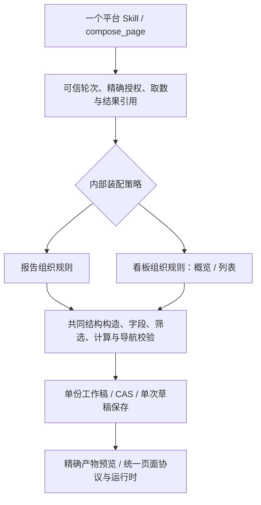

# 概览与列表生成实施方案及架构审查

本方案承接 [两页调整目标](2026-10-12-dashboard-authoring-targets.md)，覆盖平台创作生成 IOC 概览与机会点列表。普通问数不进入目标。架构 grill 的 D1–D7 已全部确认，决策见 [ADR-0098](../../adr/0098-profiled-page-composition-and-incremental-navigation.md)。这些原则已收口；后续发现的文本设计状态、计算求值与具体消费接线尚待审查，生产代码尚未实施。下文 Interface 为职责示意，正式字段、预算与版本在契约任务中落定。

**整体流程的最新入口**为 [文本设计、数据推导与架构冲击](2026-10-12-authoring-flow-and-impact.md)：设计以纯文本或受控结构提供，允许先有设计、再定向发现数据；新增要求映射、设计跨轮恢复与变更失效。本文作为原始拆分与生命周期方案保留，新增A7–A10/C01a/C03a/C05a以及协议条件以最新流程和编码计划为准，不据本文旧任务分解缩减计算覆盖。

已确认保留一个平台 Skill、MCP 服务和 compose_page 入口，按任务加载报告、概览与列表工作流，在可信结果解析之后分派内部装配策略。共享取数、字段与单位证据、工作稿、保存、预览和最终页面协议。报告与看板的表达规则分别组织，可组合的组件、筛选、计算和导航仍由共同确定性构造能力实现。

具体编码与退出条件见 [编码计划](2026-10-12-dashboard-authoring-coding-plan.md)，Relay、Java和数据提供方的逐项对账见 [外部依赖清单](2026-10-12-dashboard-authoring-external-dependencies.md)。后续实施按这两份文件推进；原型仅供状态讨论，不是最终管理或业务页面原型。

计算范围按用户补充修正：见 [computed缺口与调整方案](2026-10-12-dashboard-computed-gap.md)。从目标数据形状反推取数与受控计算链，增加计算后结果验真及跨语言执行一致性；本页原先四ratio分解只是两页目标中的具体计算，不覆盖完整复杂计算能力。

## 已确定的范围和约束

- 目标为 ioc-project-overview 与 ioc-opportunity-list 的业务、结构和交互等价生成。工程可以先实现列表能力，再完成概览能力，但用户可以先创建概览、后决定下钻，或先建列表、选择已有目标；工程依赖不转化为产品生成顺序限制。既有详情和机会点分析是导航目标，不新增其生成任务。
- 当前两页合法且可由现有页面协议表达，输出采用当前作者版本；新增创作输入本身不要求页面 Schema 升级。
- report/dashboard 是布局形态，不是两种资产、权限或生命周期。布局不得隐式决定查询是否冻结、定时刷新或发布。report 已支持日期筛选；当前保存定义统一移除 query initial，预览另保留初始行。
- 可信 context_ref、计划授权、单份工作稿、CAS、单次草稿保存、未知写入不重发、精确 artifactRef 预览继续沿用现行架构。
- 延续此前确认的内部 Adapter 隔离：不修改 adapters 私有目录，不默认新增其必填方法、字段或配置。新增事实来源和授权行为变化需单列接入与迁移任务。
- 新路径验收通过后退役被替代的公共实现；迁移测试可保留旧输入向量，不能让历史生产流程成为失败回退。

依据：[ADR 0082](../../adr/0082-explicit-business-sections-in-platform-authoring.md)、[ADR 0083](../../adr/0083-platform-evidence-work-and-internal-draft-save.md)、[ADR 0090](../../adr/0090-authoring-flow-hard-cutover-and-version-vocabulary.md)、[ADR 0095](../../adr/0095-cross-source-computation-and-ioc-schema-compatibility.md)、[ADR 0097](../../adr/0097-report-date-filter-and-instance-export-view.md)。历史内部本体与声明式变更集讨论的未决部分不视为本批已批准设计。

## 当前可用的拆分位置

PlatformAuthoring.mutate 已在一个 Module 中完成创作轮次和基线验证，解析本轮 resultRef，调用 referenced.compose，再统一冻结工作稿并提交草稿。referenced.compose 是纯内存装配，不执行 DQE。因而适合拆分的 seam 位于“可信证据解析后，工作稿冻结前”，不需要复制生命周期实现。

依赖分类如下：字段绑定、装配、布局与页面校验属于进程内计算；StateStore/CAS 有本地替身；Java、DQE、Relay 是外部提供方，经既有注入的 Adapter 消费。拆分内部装配不会自动要求独立网络服务。

| 方案 | 模型 Interface | 内部 Implementation | 主要取舍 |
|---|---|---|---|
| 统一表达与装配 | 一个入口、共同受控结构树、不同阅读意图 | 一个编译器，共用组合原语 | Interface 小，但需防止所有任务都学习过大的统一 Schema；共同逻辑中的布局条件容易扩散 |
| 统一入口与分派装配（已选择） | 一个入口、显式创作表达判别；按任务加载工作流 | 报告、看板策略分开，共同子树编译与可信执行链 | 表达规则分别组织，公共规则集中；新输入验收后整体切换 |
| 独立任务工具 | compose_report 与 compose_dashboard，可独立 Skill | 共享数据、工作稿、保存和预览 | 模型各自只学习对应任务输入，但改变工具可见性、Relay 路由与生产协议，需要协同迁移 |
| 完整独立链路 | 两个服务、各自状态和输出协议 | 两套部署与生命周期 | 对 ADR 0090 与页面聚合根冲击最大；当前两页没有独立部署、权限或容量隔离的事实依据 |

共同代码应集中承载真实不变量，不能仅把现有编辑原语包装进新参数后继续由模型安排几十个依赖步骤。报告和看板策略只拥有章节/模块组织、标题归属、默认占位、页头与工具栏呈现等差异；字段、单位、筛选与计算验真不能各维护一份。

## 第一轮已确认事项

| 决定 | 问题 | 推荐 | 状态 |
|---|---|---|---|
| D1 | 拆内部装配与工作流，还是拆 Skill/任务工具，或完整独立链路 | 共用平台入口，内部策略分派 | 用户已确认 A |
| D2 | 模型提交意图、可信引用与受控结构树，还是逐项操作序列 | 受控结构树，由工具维护关系和步骤 | 用户已确认 A |
| D3 | 核心能力缺失时保留合法 partial 草稿，还是整页完整才保存 | 保留 partial 保存，业务组合原子处理；保存/预览与完成判定分开 | 用户已确认 A |

以上确认来自本轮用户“都 ok”，仅确认 Q1–Q3，不代表所有候选字段或尚未提出的协议变化均已批准。

## 第二轮已确认事项

| 决定 | 问题 | 推荐 | 状态 |
|---|---|---|---|
| D4 | 新创作输入整体切换，还是在新编译器上长期兼容旧 report 请求形状 | 验收后整体切换 Skill/工具输入，保留 report 行为回归及历史页面读取，退役旧生产输入 | 用户已确认 A |
| D5 | 新比率口径、地域层级和业务映射只能来自提供方元数据，还是也可来自可信程序记录的用户明确确认 | 两种来源均可；用户确认仅确立业务规则，字段、编码和执行能力仍需可信元数据及执行证据 | 用户已确认 A |
| D6 | 是否把两页的生成绑定为固定顺序 | 用户自由逐步生成；通常先概览再决定下钻，亦支持先目标页及选择已有目标 | 用户已纠正并确认顺序自由 |

D4 不重开已确认的旧公共实现退役原则。D5 不能由模型自报 origin=user 或 confirmed=true；若新可信回执超出现有 Adapter 事实面，必须单列公共消费契约与内部接入。D6 不限制用户一轮提出几个业务意图；涉及多个页面时，由可信程序为各页分别建立对应轮次，仍不引入双页原子保存或模型自分配目标身份。

精确计划授权继续为必需约束。新增取数字段、分页和排序后，同一规范请求必须用于用户计划审核、授权摘要和 DQE 派生；方法签名不变也需验证内部接入行为。正式契约任务冻结输入判别、版本及消费者迁移清单，不重开已确认的整体切换决策。

## 第三轮已确认事项

| 决定 | 问题 | 推荐 | 状态 |
|---|---|---|---|
| D7 | 已明确但尚未创建目标的下钻计划是否需要跨会话持久化 | 随用户意图增量创建与绑定，不自动预建未来目标，不新增长期下钻待办或页面占位状态 | 用户已确认 A |

现有页面协议只表达完整 href 与 query，不存在 pending/disabled 导航。当前 work 按完整创作轮次 binding 寻址，不是跨会话下钻待办。本批依当前需求与已保存页面增量创作，不承诺恢复未来下钻意图，不新增持久记录、占位导航或运行期状态。若未来需要长期任务恢复，另行设计授权、持久化和恢复边界。

## 创作 Interface 的实施约束

以下是已确认“统一入口与分派装配”的职责示意，字段名在 P1/P3/P6 正式契约中冻结；不是当前工具的可调用 Schema：

```ts
compose_page(context_ref, {
  compositionInputVersion,
  title,
  layout,                       // 页面外框，不定义数据执行语义
  sources,                      // 稳定源 ID -> 本轮 resultRef
  expression: {
    kind,                       // 创作表达判别，不成为页面资产类型
    sections,                   // 受控业务结构，报告章节或看板模块
    controls,
    computations,
    navigation
  }
}, expected_version)
```

expression.kind 由用户的阅读目的和组织要求决定，模型显式选择，工具校验适用性；不根据筛选数量、组件种类或目标文件名猜测。创作表达判别与 layout 独立：前者选择组织规则，后者声明布局形态。可交互的 report、带 Tab 的报告和纯展示的 dashboard 都应继续合法。

结构树仅开放产品已允许的内容组合：数据视图与文字叶子、受控组合卡、Tab 子表格、分区布局。每种节点有闭集字段与深度上限，保留产品对子组件类型和递归的限制。节点引用可信源与字段；用户明确指定的内容、宽度、字段及组件为显式钉住项，无法满足时精确报告，不静默换形态或删除。

筛选与查询目标的关系、计算输入/输出、共享源、导航参数和布局位置由声明表达。工具在完整业务组合的候选上解析引用、排序依赖、派生字段、建立绑定、校验最终页面并给出逐组合回执。模型不提交 DSL、原始 Page JSON、任意属性补丁或脚本，不传身份与自授权确认。

新增树扩展页面结构计划，不持久化为第二份页面资产，不建立独立本体仓储。数据上下文与取数证据约束表达，最终页面文档是运行时唯一消费对象。edit_page 保留简单属性操作；目标所需复杂子树和导航回填复用共同构造及校验能力，不扩大为重写全部编辑系统。



## 公共能力实施分解

| 工作包 | 改动真源与实现位置 | 交付判据 |
|---|---|---|
| P0 目标与报告回归冻结 | test-harness/model-evals 的用例、可信语义/HTTP夹具及评分器 | 两页需求、字段/源/筛选/导航矩阵与原页哈希冻结；主用例先概览再下钻，兼测先列表和选择已有目标；已有 report 创建、日期、编辑及回执行为有基线 |
| P1 数据需求契约独立 | contracts/authored；data/results.py、data/query.py、data/executable_units.py | 数据输入从报告结构计划中独立为真源；支持目标多度量及明细投影、实体粒度、分页/排序；数据来源、类型和范围仍可信 |
| P2 证据与筛选能力 | data/results.py、data/semantic_catalog.py；新的公共证据类型 | 结果字段与筛选专用目标分开；能力绑定源身份、快照版本和轮次；模型只见稳定引用/规范业务名，未知能力有精确缺口 |
| P3 共同结构编译 | pages/composition 与 pages/components 的公共构造/校验能力 | 一源多组件、完整子树、标题与 variant、字段格式、隐藏导航字段、布局引用及组合原子性可验真 |
| P4 列表完整纵切 | 共同结构编译、筛选与表格表达、Skill 列表工作流 | 40 显示列及导航字段、10 筛选、固定列、分页、排序、表头条件和详情导航完成 |
| P5 概览完整纵切 | 看板装配策略、公共计算/地图/容器表达、Skill 概览工作流 | 7 源、6 筛选、4 比率、3 组合卡、3 Tab、铺底地图、层级与权重列轨完成 |
| P6 分派与公共编辑接入 | pages/referenced.py、pages/platform_authoring.py、entrypoints/mcp/platform_mcp.py | 明确新输入路由；共用版本/CAS/保存/预览；旧 report 语义保持；同轮复杂结构由工具原子构造，跨轮按用户意图增量编辑和回填导航 |
| P7 Skill 与分发迁移 | skill/metriccanvas-platform-authoring、SOURCES、Bundle、契约导出器 | Skill、实际注册 Schema 与安装包同源；report/overview/list 参考按需加载；切换完成后退役替代的公共旧路径 |

目录名称是定位建议，不先做批量目录重排。P1–P3 应先形成共同能力，P4/P5 再通过真实目标验证它们。report 路径不复制新公共算法，也不被迫提交地图或宽表无关字段。

当前 QueryResults 还将平台请求包装成 Page Build Spec 再调用共同执行器，后者另有 metrics=6 的限制。P1 必须解除平台数据执行对该旧包装形状的限制；只修改平台请求 Schema 会在下层再次失败。兼容入口原有数据执行行为保持，本批不新增问数产品能力或重写其编排。

### 规模与取数

当前整页 sources 上限 6、每单元 metrics 上限 6、显示字段和 record-list 列上限 30，分别卡住 7 源、20/15 度量和 40 列。查询单批 6 项与整页 7 源是不同预算：允许多批取数可解决批次规模，但不能解决整页 compose 限制。

实施时分别声明整页规模、单批并发、结果大小和模型证据约束，保证目标完整，不靠拆错口径或隐式少取数绕过。累计预算当前为可选配置，不借本批重设默认硬停止阈值。确切上限依据目标规模、执行成本和失败证据确定，禁止简单全部设为无限。

列表明细字段不能一律当聚合分组处理。必须验证机会点实体粒度、显示字段与导航字段关系，避免仅通过字段数量检查却改变行含义。分页窗口、完整结果和模型样本覆盖分别表达；窗口不得供全局占比计算使用。

### 筛选与可信事实

现有查询派生可使用未出现在输出分组中的可信维度，现有装配编辑却要求该维度属于结果字段。P2 把可绑定目标保存在本轮查询记录中，不往结果契约塞虚假字段，不为总量卡增加分组。能力引用必须与当前查询、来源身份和版本匹配；未建立指标维度关系时按现行策略保留 unknown，不将通用维度卡当组合支持证明。

可以从现有公共语义面获取规范维度名、类型、timeGranularities、filterDimension 和部分指标维度关系。地域逐级字段/编码、行业级联关系与候选、boolean 真值、金额 metric 目标、日期编码、分页排序能力及可读导航目标尚需逐项确认来源。下游 DQE 执行成功某个静态查询，不证明任意筛选值或层级映射合法。

新的能力引用是候选消费者 Interface，不是已存在的提供方能力。若既有输入有可信事实，公共层投影即可；若没有，保留缺口并单列供给迁移。不得为了保持 Adapter 不改而从字段名、标签、样例行或目标页面配置推断生产事实。

### 计算与物化证据

概览中的四个 ratio 需要可信分子/分母定义、0–100 刻度与零分母行为。当前 MetricRelationsPort 只描述主值/变化值及期间，不是通用 ratio 定义接口，不能冒充覆盖这些事实。

优先消费已有可信元数据；缺少业务定义时，按 D5 经可信程序记录用户明确确认，回执绑定具体规则、来源页与修订/轮次。新增权威指标目录不在本批范围；确认不把临时业务定义升级为公司口径，也不能补出物理字段或执行能力。新回执的供给和授权接线列入外部接入任务。工具只装配产品闭集具名算子，验证结果字段、单位和范围，以完整执行证据计算；组合卡消费计算后的证据，渲染期继续用既有计算实现。

当前容器构造拒绝 computed source，并要求可物化行证据。新的共同构造能力需要区分原始执行证据、受控计算结果、完整性和字段契约，而非删除拒绝检查后直接信任模型。

### 导航与页面关系

两页各自拥有可信新建轮次和页面 ID，沿用单页工作稿与保存。正常主流程是先创建可用概览；用户随后决定下钻问题、选定已有页面或创建新列表；目标可用后，以来源页当前修订建立新的 existing 创作轮次，原子写入入口、实际 href 与全部 query 参数绑定。先创建列表再概览、将已存在目标直接关联，也沿用相同能力。

用户没有要求下钻时，概览无需预先枚举未来目标、生成占位入口或被判为未完成。用户明确要求建立下钻但目标尚未可用时，准确报告该项未完成，仍可保留可用概览。当前轮次的完成判据取自用户需求；最终两页基线验收仍包含实际可用的导航。不得使用空 href、# 或虚构页面 ID 伪装待绑定链接。

目标地址/资源映射由可信程序或已核验业务要求供给；模型不能根据原样例文件名猜生产资源 ID。概览使用当前筛选的月份、区域值与层级，列表到详情使用行月份。草稿可保存不证明外部发布地址已可访问，必须校验当前消费模式下的真实地址、访问权限与参数契约。

回填不能复用创建概览时的旧 context_ref、workVersion、resultRef 或 artifactRef。可信程序重新读取来源页精确文档/ref，再授权对应编辑轮次；工具核对入口、字段与目标仍匹配，只改本次导航，不覆盖其他用户编辑。来源已变化时重新读取并核对意图，不以旧候选自动重放。目标创建失败保留来源页；回填失败保留目标页并报告未关联，未知写入按原 operation 核对，不重发。两页不使用跨页事务。

若用户在一条指令里明确要求“创建下钻页并关联到这个入口”，该指令可作为两项动作的业务意图，由平台/Relay 分别供给目标创建及来源回填的可信轮次；不得要求用户仅为技术步骤机械地再次发指令。实际轮次切换与目标证据接线列为集成配合，Python 不自行伪造跨页授权。

## 协议与部署影响

| 层次 | 已选方案的影响 | 实施门槛 |
|---|---|---|
| 创作输入契约 | 新受控结构表达、共享 data request、能力引用；当前结构计划与操作契约需整理 | 新输入版本、显式判别、旧消费者切换和退役规则；不能把结构计划版本与页面 Schema 混用 |
| MCP 平台工具协议 | 保持工具名及一个 server，模型可见工具数不增加，输入发生不兼容变化 | 从当前 platformProtocolVersion 2.0 升级公共工具协议主版本；正式版本值与消费者一起冻结。旧输入整体退出，不因工具名没变宣称兼容 |
| 最终页面协议 | 两页当前均可合法表达，复用现有筛选/计算/布局声明 | 仅创作表达变化不升级页面 Schema；新增运行期语义才进入产品契约和 Java/渲染兼容审查 |
| 产物信封与预览 | 沿用 definition/previewJson、精确 artifactRef 与两个预览占位符 | 新完成度/组合回执字段若进入结构化返回，需检查 Relay 解码与状态映射；ready 只表示 Adapter 接收 |
| Adapter Interface | 优先复用 authoring-adapters/1.0 与现有方法 | 方法签名相同不保证行为兼容；新事实、请求白名单和 canonical 授权摘要必须单列验证 |
| 可信轮次与状态 | 继续 authoring-turn/1.0、单份 work 与 CAS | 新查询记录字段有版本/旧记录缺能力的处理；升级或回退不得擦除 pending/unknown 提交 |
| 外部 HTTP | 原则上不新增 Java/DQE/Relay 外部端点 | 新查询能力由真实提供方验证；公共 Python 类型不能当作已经存在的 HTTP 接口 |
| Bundle 与快照 | 软件、Skill、输入 Schema、导出锁和包摘要锁步更新 | 分发版本与上述协议独立；从固定公共/内部提交和产物 hash 核验部署 |

特别注意 query_data 的授权摘要：新增分页、排序、投影或取数范围后，canonical request 和 requestSha256 可能变化。analysis_authorization 方法可保持原签名，但 Relay 的可信计划核对和内部旧字段白名单需采用同一规范输入，否则会拒绝。不能由模型自行生成授权摘要或确认标记。

本批沿用一个服务和现有工具名，更新实际注册输入及 Skill 说明；不新增 report/dashboard 专属任务工具、独立资产或输出协议。Java 页面资产、发布所有权与统一运行时保持现行边界。

### Relay 与内部接入配合清单

- 将审核计划、canonical request、requestSha256 和真实 DQE 派生同步到新数据需求字段，覆盖明细投影、分页和排序；验证旧字段白名单及授权回执。
- 在现有元数据之外仍缺事实时，提供绑定来源身份与版本的层级编码、级联、真值/日期编码及执行能力；业务定义确认由程序形成可信回执。
- 为跨页请求分别建立目标新建和来源页当前修订的编辑轮次，提供实际目标地址、访问权限与参数契约；支持一条用户意图完成创建与关联。
- 对新组合回执和完成度字段核对 Relay 解码、状态映射与双通道预览；保存成功、预览接收与业务完成分别呈现。
- 公共工具、Skill、Bundle 与部署注册锁步升级；真实 Relay/Java/DQE/权限/门户联调独立验收。公共侧提供消费契约和探针，内部 Adapter 的修改由其维护方执行。

## 迁移与回退

先冻结现有实际注册 Schema、Skill 来源、真实消费者以及 report 创建和编辑回执。为新输入编写确定性协议/生成验收，在新发布中整体更新公共实现、Skill、导出契约与安装包。依 D4，测试兼容映射仅存在于迁移夹具；验收后删除旧生产输入解析与被替代装配，不长期维护双入口。

新路径验收通过后移除被替代的公共实现，不保留旧路径作为新 dashboard 失败重试入口。既有保存页面不原地迁移，仍由页面协议兼容读取。正式决策及其主题结论见 ADR-0098；实施出现新架构冲击时再进行定向 grill。

回退恢复上一批公共实现、Skill、Bundle 和部署注册的匹配版本；内部 Adapter 与已有页面资产保留。任何 pending/unknown 写入先按原 operation 核对，不能通过回退重发保存。预览失败只修复交付，不重新执行查询和保存。

## 验收与实施门槛

| 阶段 | 退出条件 |
|---|---|
| 方案收敛（已完成） | D1–D7 已确认；ADR-0098 记录取舍；共同依赖、输入切换、外部配合及自由生成顺序明确 |
| 用例冻结 | 机器清单包含指令、mode=new、空基线、可信快照、工具范围、核心内容及禁止变化；两页各三种同义需求；目标 JSON 与模型消息隔离 |
| 共同能力验收 | 输入/证据/公共构造、源与字段规模、原子组合、错身份/版本/引用/计算及字段负向探针通过 |
| 列表验收 | 确定性、真实 DS、页面产物、保存后浏览器分别验证完整列表及其全部查询交互 |
| 概览验收 | 同样四层验证完整概览、层级地图、铺底安全区、Tab、筛选后重算和导航 |
| 联动与报告回归 | 主用例先概览，再创建下钻页并回填；兼测目标先建/已有目标、来源修订变化、创建或回填失败；既有报告、日期、参数、局部编辑、partial、冲突/unknown、预览失败和单位格式回归 |
| 分发验收 | 最终树上的契约导出、全量 authoring、平台检查、Bundle、验证一致性和复杂度门禁通过；内部采用与真实服务联调另列结论 |

浏览器需记录实际 DQE 请求与当前条件，并人工查看宽屏、窄屏和短屏截图；静态 JSON 合法不替代视觉和交互验收。按外部参考还原视觉时使用仓库 sdd-dev-frontend 流程。真实 DS 与确定性传输共用用例和评分器，保留首次失败与复测，不用筛选成功样本代替全量结论。

本轮交付为源码核对、实施方案和已接受的架构决策；未更改生产模块、正式 Skill、工具 Schema 或 Adapter，未执行新目标的真实模型与生产联调。实施从 P0 用例与 report 回归冻结开始，不能把方案收口计为 dashboard 生成能力已完成。

## 架构逻辑原型

2026-10-12 按用户请求生成独立 HTML 逻辑原型，保存在 `codex/authoring-logic-prototype` 分支，提交 `d2b1a978`。入口为 `metriccanvas-authoring/prototypes/profiled-composition.prototype.html`，双击即可运行；使用说明、浏览器观察与截图在同目录。原型代码未并入 main。

原型包含自由操作与 8 个引导场景，展示报告/看板内部装配分派、共同取数与保存链路、先概览或先列表、已有目标、partial、来源冲突、保存未知、预览失败及不可信输入拒绝。所有数据、轮次、授权、保存和预览均为内存模拟；输出为结构摘要，不是完整 Page JSON，不构成真实模型、页面渲染或生产集成通过证据。用户体验反馈用于审视设计，正式模块实施仍从 P0 开始。

## 源码与规则定位

- [PlatformAuthoring](../../../metriccanvas-authoring/tool/metriccanvas_authoring/pages/platform_authoring.py)：可信结果解析、统一工作稿及保存。
- [referenced composition](../../../metriccanvas-authoring/tool/metriccanvas_authoring/pages/referenced.py)：当前平铺输入、源规模和纯内存装配。
- [QueryResults](../../../metriccanvas-authoring/tool/metriccanvas_authoring/data/results.py)：批次、受限引用、精确授权摘要与模型证据。
- [维度语义投影](../../../metriccanvas-authoring/tool/metriccanvas_authoring/data/semantic_catalog.py)：filterDimension、来源身份和 unknown 能力。
- [筛选编辑](../../../metriccanvas-authoring/tool/metriccanvas_authoring/pages/editing/interaction_editing.py)：结果维度绑定限制和日期处理。
- [容器构造](../../../metriccanvas-authoring/tool/metriccanvas_authoring/pages/components/container_building.py)、[地图及源证据](../../../metriccanvas-authoring/tool/metriccanvas_authoring/pages/components/text_map_building.py)：子树、计算源和铺底地图限制。
- [MetricRelationsPort](../../../metriccanvas-authoring/tool/metriccanvas_authoring/data/metric_relations.py)：当前主值/变化关系证据。
- [定义与预览](../../../metriccanvas-authoring/tool/metriccanvas_authoring/delivery/preview.py)：保存移除 query initial 及精确交接。
- [契约来源](../../../metriccanvas-authoring/SOURCES.md)、[平台协议](../../../metriccanvas-authoring/contracts/authored/platform-v2-protocol.md)、[DS 验收规则](../../agents/skill-ds-model-acceptance.md)。
