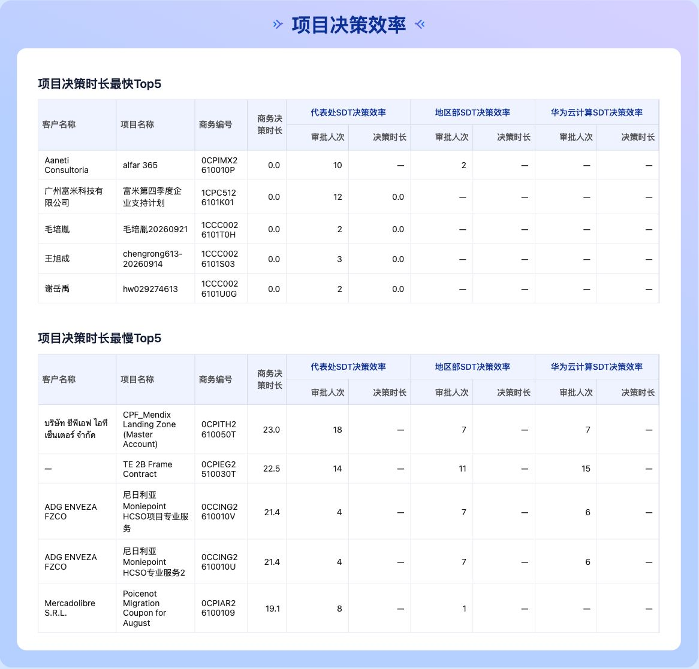

# 商务 SDT 项目效率当前页面基线

本基线记录2026年10月12日本次讨论中打开 `http://localhost:5173/pages/business-sdt-report` 核对的真实页面。用于确认表格元素与请求设计的对应关系，实施计划见[讨论入口](../../archive/2026-10-12-business-sdt-cascade/discussion.md)。

## 项目效率区域截图



上方为项目决策时长最快Top5，下方为最慢Top5。每表左侧为客户名称、项目名称、商务编号和商务决策时长；右侧为三个阶段的审批人次与决策时长。最快首行为Aaneti Consultoria / alfar 365，最慢首行为CPF_Mendix Landing Zone (Master Account)。

## 原页面数据形态

源文件为[当前报告](../../../pages/business-sdt-report.json)。截图对应本次讨论中的原单查询页面；没有实现拟新增resultBindings、多度量透视和级联调度。

| 页面数据源 | DSL项数 | 内嵌初始行数 | compute声明 |
| --- | --- | --- | --- |
| `project-efficiency-bottom5` | 1 | 5 | 无 |
| `project-efficiency-top5` | 1 | 5 | 无 |

两源现有单查询均同时声明总体时长和六个阶段指标，截图显示内嵌初始行。用户提供的级联示例将其拆为先选Top5、再查阶段明细，这是目标请求设计，不是本基线中的执行事实。

## 当前商务编号集合

以下编号是原始内嵌行中的业务值；截图中窄列会换行，不能按截图换行拼出另一编号。正式级联由本轮主结果动态提取，不在新查询中硬编码这些值。

```json
{
  "project-efficiency-bottom5": [
    "0CPIMX2610010P",
    "1CPC5126101K01",
    "1CCC0026101T0H",
    "1CCC0026101S03",
    "1CCC0026101U0G"
  ],
  "project-efficiency-top5": [
    "0CPITH2610050T",
    "0CPIEG2510030T",
    "0CCING2610010V",
    "0CCING2610010U",
    "0CPIAR26100109"
  ]
}
```

## 证据限制与文件指纹

截图中的次数、0.0和缺失符号均来自已有初始行。实际时长可能经number-1四舍五入，显示0.0不证明原值为0；缺失符号也不证明阶段请求能够补齐。此证据不证明动态请求时序、真实DQE响应或生产集成成功。

- 原页面SHA256：`3fa4fcc28708072369cf7dbe0d3c495d1e4f016ce2de27840e16e7acc33550dc`。
- 截图SHA256：`f0164a2bfb5bee3c8f38ee5a1af6fd6f4815395fb30b7bb9fae69f4d03995333`。
- 原结构草案SHA256：`8880f262ffd858922b328113f51158f418742bbaf3cd33db0741acabf87143cc`。

页面是可修改工作文件；hash只标记本次观察的字节。实施前另存原页面字节以支持回滚。结构草案不含schemaVersion，JSON语法合法不代表当前页面校验器接受。

## 本批实施结果

上述内容保留为实施前基线。新增能力及验证见[验收结论](result.md)；最终页面已包含四源级联，不能把当前页面文件当作原单查询字节。
