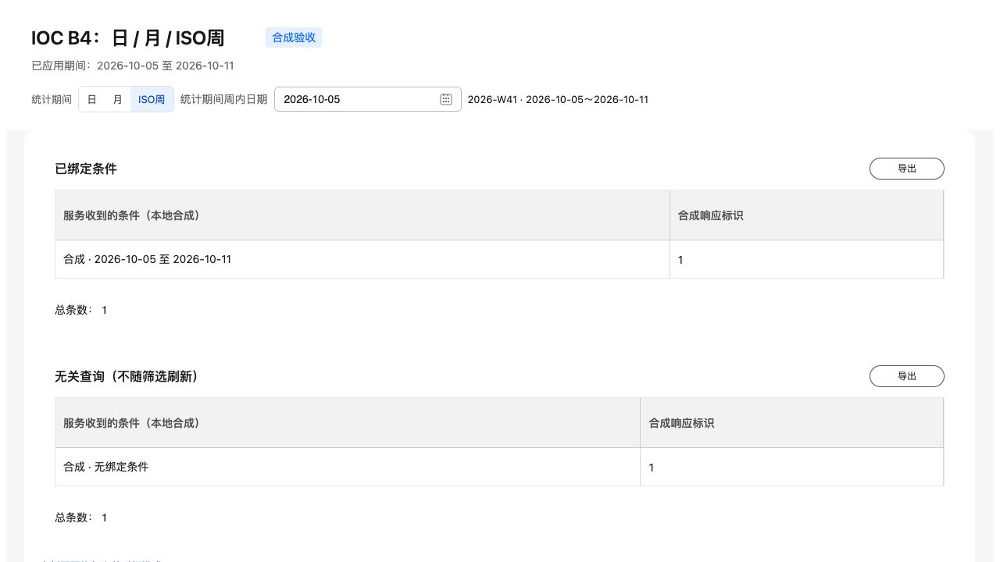

# IOC公共页头B4本地实施结果

按唯一主计划§17落地Schema6.35：日/月/ISO周模式与完整静态查询case、时间预设、可信数据期间事实、latest/latestComplete独立初始化与最大期策略、日期禁选和V2日历月份窗口。自然年季月、详情单月、离散月份的语义保持独立；同次读取和导出冻结条件、时钟及事实。

合法URL先于动态默认初始化；事实刷新保留当前选择并重查相关条件，身份变化停止旧实例。未证明的旧initial/seed不绕过门禁。候选事实失效时取消旧请求、推进代次并清除回执，恢复重新请求；迟到成功和失败均有针对性验证。

实施仅位于`/Users/moon/.codex/worktrees/ioc-header-b0-b1/DataDashboard`，原工作区27项并行修改保留。未暂存、提交或推送，未批量迁移业务页，未默认启用可选操作。B5/B6、Condition、通用权限和私有周码继续保留规划。

## 可交互预览

- [日/月/ISO周与深链恢复](http://127.0.0.1:4204/pages/ioc-header-time-modes-demo?period.mode=isoWeek&period.from=2026-10-05&period.to=2026-10-11)
- [时间预设与禁选边界](http://127.0.0.1:4204/pages/ioc-header-time-presets-demo)
- [可信最新期/完整期与订阅状态](http://127.0.0.1:4204/pages/ioc-header-availability-demo)
- [十二日历月、离散月份与时间模型交集](http://127.0.0.1:4204/pages/ioc-header-calendar-window-demo)

预览为明确标注的本地合成HTTP，可信输入控制位于测试宿主。原4196/4198/4200预览服务保留。

## 验证状态

| 层次 | 结果 |
| --- | --- |
| 本地源码 | 最终完整267文件、2346通过、5跳过；pnpm check及完整build通过；构建保留既有chunk体积提示 |
| 协议及受控创作 | 41页通过；550项Python、1跳过；原子时间程序保存重开、非法写入回滚及窗口编辑通过 |
| 分发 | 821产品、4authoring及1interface生成物current；Bundle2930摘要检查；Radon最高15、0超限；六包全新仓外安装 |
| 源码浏览器 | 最终37项通过，含原期间、详情单月、离散月、金额/币种、XLSX及事实失效后迟到响应 |
| 安装包浏览器及Node | 最终30项通过；Node ESM解析12个IOC验收页，实际本地HTTP执行ISO周case和可信完整期并产出fresh initial |
| 呈现 | 四页×1440/1024/390及ShadowRoot共13帧；5条冻结规则最大偏差0。窄屏双日历由184px内部溢出修正为0；静态呈现保留已应用模式/范围与可信时间戳 |
| 真实服务 | DQE、CloudIOC、Relay、DS模型、门户、真实业务数据、私有周码、CI与部署均NOT_RUN；本地契约不替代真实服务验收 |

完整Python及页面/复杂度记录在最后候选显示修复之前执行，其输入未因该修复变化；修复后的完整前端测试、check/build、浏览器、静态、生成物、Bundle及全新安装重新执行。新增候选修复另有RED/GREEN记录，不能把历史全量结果冒充修复后的全量结果。

[正式验收](acceptance.md)由SDD聚合器生成；[声明账本](alpha-tests.md)、[共享原始证据](evidence/review-evidence.json)、[B4净增量](evidence/b4.diff)、[代码清单](evidence/code-manifest.json)与[隔离保护核验](evidence/preservation.json)可复核。B4起点是未提交6.34快照，HEAD累计差异不等于本批净增量。
