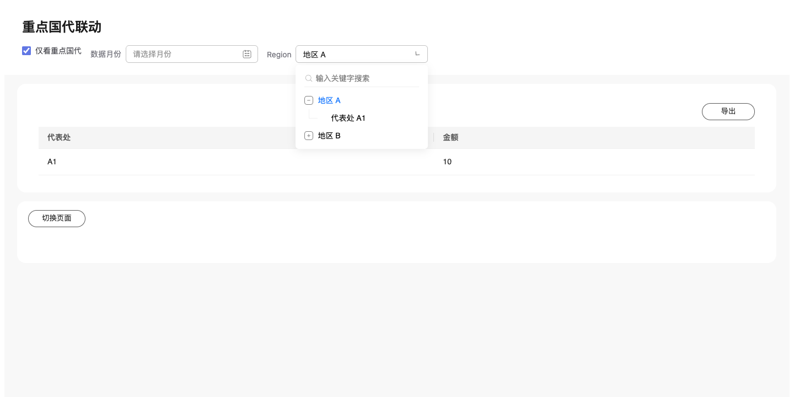

# 重点国代集成与 IOC Region 收紧：本地验收

2026-10-29。本仓实现与本地合成验收完成；未提交、未推送，未运行远端 CI、真实 HeaderOptionService 或真实 DQE/Relay。

用户最新口径：只限制 IOC 业务页，普通维度筛选保留。使用 iocHeader 的页面中，公共输入 region 必须由 Header 认领，只允许一个可搜索、单选、treeSelection:level 的组织树。平面 Region、外部 tabs、hidden 切层、多选、独立层级树、不可搜索树、Header 外 Region 与重复拆出的组织层级筛选被拒绝。普通平面、多选与显式切层能力保留；不可见的表格父级定位等查询参数也保留。决定见 [ADR-0124](../../adr/0124-ioc-region-single-tree.md)。

## 已实现

- boolean 成为候选依赖，constraints.booleans 传递声明的 true/false，缓存区分取值并取消过期回执。
- boolean enabledWhen 复用统一条件求值；无地区时禁用，有地区时启用；禁用保留已有应用值。
- 候选更新后保留合法交集；原本未选不额外等待确认，已有选值全失效则阻断查询与导出，必须重选或明确清空。Region 的清空确认在同一个树形下拉内完成。
- 宿主共享 Adapter 示例在单个活动页面挂载时继承 key-office、region 与 mtime，并回写 false/清空；显式 URL 优先，候选授权与导出状态不跨页复用。
- 两个重点国代示例改为同一个 Region 树，删除独立 rep-office；另迁移 10 个旧式 IOC 页面/契约夹具，dense 场景移除拆出的 department 与 office 控件。迁移清单见 region-migrated-pages.json。
- Schema 6.75、协议正文、参考示例、错误向量与 local-authoring 独立校验器同步。隔离基线为 d24a41721，6.74 留给主工作区的并行能力；未复制其脏改动。

## 可直接验收

Playground 使用本工作树的服务：

- 来源：[重点国代联动](http://127.0.0.1:5187/pages/key-office-filter-demo)
- 目标：[重点国代下钻](http://127.0.0.1:5187/pages/key-office-filter-target)
- 页面声明：[来源 JSON](../../../pages/capabilities/filters/key-office-filter-demo.json)、[目标 JSON](../../../pages/capabilities/filters/key-office-filter-target.json)
- 操作与数据说明：[筛选示例 README](../../../pages/capabilities/filters/README.md#重点国代筛选集成)
- 合成数据：[gateway.ts](../../../apps/playground/fixtures/key-office-filter/gateway.ts)，A1=重点/10，A2=普通/20，B1=重点/30，B2=普通/40。

密集页折叠验收先等待完整 Region 候选授权后的首轮查询完成，再核对折叠/展开不触发请求，避免把初始化请求误计为布局动作。

在 Region 树选地区 A，勾选重点国代：候选仅保留 A1，表格与实际 XLSX 仅含 A1。取消勾选恢复 A2。选 A2 后勾选重点国代，旧选择失效并阻断，树内重新选地区 A 或明确清除才继续。切页/返回保留 true、false 与月份，URL false 优先。

## 执行结果

| 层级 | 实际命令与结果 |
| --- | --- |
| 页面 | pnpm validate：136/136 |
| 类型与 Svelte | pnpm check：全部包通过，0 error / 0 warning |
| 单元与集成 | vitest run packages/page/tests packages/data-execution/tests packages/engine/runtime/tests，另加 local-authoring tools/row-expansion/skill/upgrade、page-reference 与 ioc-header-showcase：191 文件、1861 测试通过；随后 IOC 收紧追加回归 41/41 通过 |
| 构建 | pnpm --filter @metriccanvas/embed build：通过 |
| 真实浏览器 | embed key-office-filter.spec.ts 与 ioc-header.spec.ts：11/11；包括桌面/390px、树内地区部与代表处选择、重试、失效阻断、树内清空确认、跨页与实际 ExcelJS 回读导出 |
| Playground | 内置浏览器 5187 页直接观察唯一 Region 下拉，展开地区 A 后同树显示 A1/A2；无外部层级按钮 |
| 创作生成 | pnpm authoring:contracts：1305 product / 4 authoring / 1 interface files；mc:content:check 生成一致、覆盖一致、33 测试通过 |
| 独立安装 | 复制 local-authoring 到仓外，校验来源/目标页通过，flat/external-picker/multiple 三种非法声明按预期拒绝 |
| ADR | pnpm adr:index:check：通过 |
| 复杂度 | metriccanvas-ts-ast/1、TS 5.9.3，新增函数均 ≤15；详见 [复杂度报告](complexity.md) |

相关日志在本目录。未将全仓 pnpm test、authoring-export-isolation、其他 Skill、真实 DS 模型或真实服务列为通过。

## 剩余接入与保留项

真实集成应用仍需接上 HeaderOptionService 的共享状态与完整候选 Adapter，确认重点名单、权限、queryField 和 0/1 字符串编码；宿主原仓未在此任务修改。普通维度能力未全局移除。多个同时挂载页面的实时同步不在本批宿主示例契约内。

本任务工作树 /Users/moon/.codex/worktrees/key-office-filter/DataDashboard 保留用于评审，5187 服务仍运行；主工作区的并行修改保留。尚未要求 Git 交付，因此没有远端 SHA 或 CI 成功回执，也未执行交付后的工作树清理。
