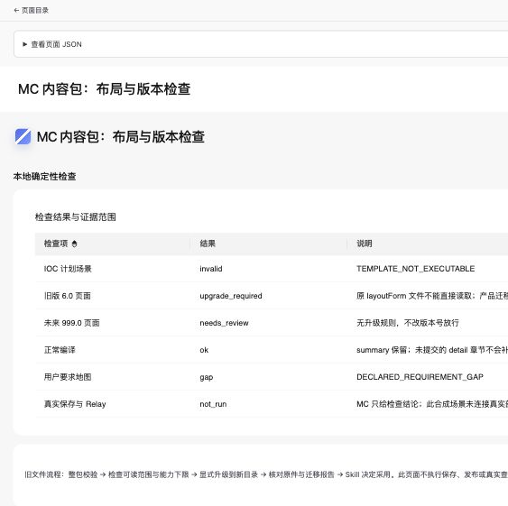

# MC 内容包、布局能力与 Schema 兼容：本地验收

日期：2026-10-24。结论：MC 侧第一批实现及本地验收完成；调用方 Skill / Relay 接线和真实部署未验。未提交、未推送，未运行远端 CI。

本记录描述本地验收阶段的状态；后续 Git 交付及该提交的远端 CI 结论以交付消息和 GitHub 记录为准。

检出：`/Users/moon/.codex/worktrees/mc-content-layout/DataDashboard`。基线：`b740d397829ab85f180ed427afd39912ab115bc0`。主工作区并行未提交内容未纳入；本轮未 fetch，不把该基线称为远端实时状态。

## 实现与职责

- MC 作者源：[tools/mc-content](../../../tools/mc-content/README.md)。交付目录：[mc-content](../../../metriccanvas-authoring/mc-content/README.md)，包含独立脚本、布局模板、原子内容、产品快照、版本与完整性清单。更新采用整体替换，重载调用进程归调用方；未建设激活、回退或热更新管理器。
- MC 提供 query_content、compile_layout、inspect_assembly、evaluate，并补充 inspect_schema、upgrade_page。检查只返回事实、调整、缺口及未验范围；采用规则、流程和保存交付决定仍由 Skill / 集成应用负责。
- 活动 COMPOSE_SCHEMA 抽到 stdlib-only 的 compose_contract.py，供现有装配与构建导出共用。与基线结构完全相等，规范化摘要为 `5cb13bbd2559e79e56ba0958fcfa91d95abf93bdfec82cfba536185a11268b14`。存量装配/结构函数体的 AST 对比保持；obj 仅迁移职责。详见[契约提取证明](contract-extraction.json)。现有 MCP 签名、保存、CAS 和产物通道未调整。
- 工具参数名称、注解与默认值从活动 MCP 定义提取；compose request 同步有效 JSON Schema。实际部署 list_tools 仍是参数 Schema 真源。产品查询错误闭集、页面错误类型和 Python 字面量诊断分别标记来源；不宣称包含外部服务的全部动态错误或所有专门修复策略。
- MC 事实改为独立作者源。原 Platform tools/errors/execution/scenarios/layouts 参考由 MC 单向生成；Skill 入口去掉旧版本字面量，保留既有流程和作者扩展。local-authoring 保持整目录独立安装，按产品正文重新生成知识。

内容清单：Interface 1.0，页面写出版本 6.58；387 个受摘要保护资源，9 个活动工具参考，348 个错误原子。本次内容版本 `1-e9aba00bba96353d`，完整摘要 `e9aba00bba96353d204bb30549fe3c0b395f290474842dd1b1487cc420662295`。这里只记录本次交付身份，后续版本以生成清单为准。

## Schema 兼容与升级

页面 schemaVersion、内容版本、模板版本与 Interface 格式分别标识。可读范围来自 supportedVersions()，能力下限来自产品检查器，迁移直接复用 upgradePageDocument；本批没有修改产品 Schema 版本或读取策略。

流程为：整体替换并校验内容包 → 检查旧页读取合法性、能力下限和可迁移性 → 默认仅检查迁移 → 明确指定新目录后保存原始字节、SHA256、目标页面和报告 → 由 Skill 决定采用并继续业务任务。原件、历史修订和查询口径不被自动改写。

未知/未来版本、能力下限冲突和未提供规则的旧语义明确报告缺口。6.13/6.14 旧页头自动期间语义不靠改版本号放行。旧页仍可读取且只做旧版本能力内修改时，不强制整页升级。目标运行时须支持迁移输出版本；部署版本未提供时明确 deploymentAlignment=not_run。

已在隔离临时目录模拟下一 minor：同步临时版本说明、重生成整包，验证原当前版本页面仍可读取、另目录迁移到新版本、原文件与 original 备份字节一致。主工作树 version.ts 未改动。测试也保留了产品“新增版本需补语义说明”的检查，没有放宽该检查。

## 验证

| 检查 | 结果 | 证据 |
|---|---|---|
| pnpm authoring:check | 5 文件、171 项通过，含 MC 单源双投影、Schema 下一版演练及仓外 local-authoring | [日志](authoring-check.log) |
| MC / 结构计划 / 容错 / 创建 / MCP 相关 Python 回归 | 51 项通过；使用 Bundle 锁定依赖 | [日志](python-tests.log)、[依赖环境](python-environment.log) |
| 最终生成内容的 MC 接口回归 | 22 项通过；属于上述 Python 范围的再核验，不重复累计 | [日志](mc-content-tests.log) |
| 契约与分发 | 导出无漂移，Bundle 4317 次摘要检查通过 | [契约日志](contracts-check.log)、[Bundle 日志](bundle-check.log) |
| 生成场景与实际诊断一致 | fixtures --check 通过 | [日志](fixtures-check.log) |
| 类型 | 仓库 tests 配置及新工具的 strict 类型检查通过 | [工具日志](typecheck.log)、[仓库日志](repo-typecheck.log) |
| Python wheel | 新契约 Module 入包；仓外解包后能加载活动 COMPOSE_SCHEMA | [构建日志](wheel-build.log)、[仓外加载](wheel-check.json) |
| 页面静态合法性 | layout 目录 12 页通过，包含本批三页 | 独立 validate-page.mjs 实跑 |
| 浏览器 | Codex IAB 三页实测，排序、图表和明细正常，无捕获错误 | [机器记录](browser.json)、下方截图 |

独立内容安装用例复制整包到仓库外执行，并验证篡改、混装、版本对齐和精确产物检查声明。原始字节保留、已有输出目录拒绝覆盖、未来版本与已知旧语义阻止错误迁移均有回归。

一次初始回归暴露了缺文件错误覆盖既有漂移列表的问题，已改为汇总诊断并复验。Schema 演练最初遗漏了版本语义说明，补齐的是隔离发布输入，产品完整性检查保持严格。

## 可观察页面

- [诊断页](../../../pages/capabilities/layout/mc-content-layout-demo.json)：`http://127.0.0.1:5175/pages/mc-content-layout-demo`；展示 ok / gap / invalid / upgrade_required / needs_review / not_run，表格排序已验证。
- [经营 Report](../../../pages/capabilities/layout/mc-layout-business-report.json)、[用量 Report](../../../pages/capabilities/layout/mc-layout-usage-report.json)：编译计划经现有 compose 内存装配及产物检查生成，无保存调用；实际呈现合成总量 50、折线 20→30 与两行明细。
- 本任务服务监听 127.0.0.1:5175，原主工作区 5173 服务未替换。宽屏记录 CSS 宽度 900；窄屏显式请求 390 的浏览器覆盖，IAB 实际 CSS 宽度为 244，页面宽度同为 244，保留六行记录。记录实际尺寸，不把请求尺寸当作测得尺寸。

[窄屏](browser-mobile.png)、[经营 Report](browser-business-report.png)、[用量 Report](browser-usage-report.png)、[宽屏用量 Report](browser-usage-report-wide.png)。

## 复杂度

测量口径为 metriccanvas-ts-ast/1（TypeScript 5.9.3，自身 CC，闭包另测）与 Radon 6.0.1（函数/方法/嵌套辅助函数）。生成的第三方代码不作为新增作者函数重复计数。

| 函数 / 范围 | 前 | 后 | 处理 |
|---|---:|---:|---|
| export-authoring-contracts.writeOutputs | 10 | 10 | MC 写入由专门辅助函数承担 |
| export-authoring-contracts.assertCurrent | 15 | 15 | 内容漂移汇总独立实现 |
| export-authoring-contracts.buildSkillProjections | 53 | 52 | 提取参考投影职责；仍超限，保留为后续债务 |
| check_bundle.main | 12 | 12 | 增加 MC 校验调用，分支不增加 |
| obj（从 page_structure 迁至 compose_contract） | 1 | 1 | 同一契约初始化职责 |
| 新增 TS/JS 函数与回调 | — | 最大 9 | 均 ≤15 |
| 新增 Python 函数、方法与闭包 | — | 最大 15 | 均 ≤15 |

固定 Python 公共模块门禁 15 文件、368 函数，最大 15，超限 0。[门禁](complexity-gate.json)、[TS 当前逐函数](complexity-current-ts.json)、[TS 基线](complexity-before-ts.json)、[Python 逐函数及基线](complexity-python.json)。

未关闭项：buildSkillProjections 仍为 52；同文件原 validate_skills 为 59，未改其函数体，不因增加新校验自动扩大为旧 Skill 校验重构。原装配与结构构造函数体未改，既有复杂度见基线；本记录不宣称全仓复杂度清零，也不替代外部 CodeCheck 复扫。

## 尚未验收

真实 Relay 的脚本注册、权限隔离、整包替换后的脚本重载、inspectionSpec 与精确产物关联、程序通道调用及有界模型摘要尚未复验。真实 DQE、Java 保存、预览交接和发布未运行。IOC 能力扩展不属于第一批。

MC 交付可运行脚本和事实结论；上述外部条件由调用方接线后验收。CI 配置已增加本批检查，但远端 CI 未运行。工作树保留用于审阅；没有可清理的本批已合并分支或工作树。

## Relay 交付文档补充

按用户要求增加 [MC 交付说明](../../../metriccanvas-authoring/MC-CONTENT-OVERVIEW.md) 和 [Relay 对接 handoff](../../../metriccanvas-authoring/MC-CONTENT-RELAY-HANDOFF.md)，并从既有 README / RELAY-HANDOFF 互链。文档区分能力交付、调用方接线、真实部署验收及固定提交交付；R01–R12 均保留为待 Relay 确认，没有把建议记录字段声明为新协议。

文档查询、编译和示例评测已在仓外临时内容安装运行；用配对的合成 document / inspectionSpec 验证检查调用，结果为 ok。示例评测为 passed=1、failed=0、not_run=1，部署项仍未验。详见 [文档样例执行记录](handoff-doc-check.json)。本次仅增加文档和更新分发摘要，MC 内容身份未变，没有产品运行代码改动。

补充文档后的契约导出无漂移，Bundle 4319 次摘要检查通过，见 [契约检查](handoff-contracts-check.log)、[分发检查](handoff-bundle-check.log)。原 4317 次是补充文档前的检查记录。Markdown 链接和 Python 代码片段语法已核对；未新增真实 Relay、DQE、保存或发布证据。
