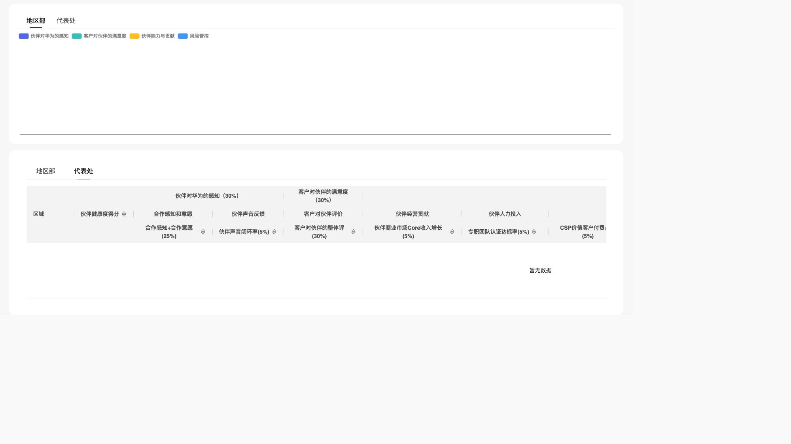

# partner-health同步main与真实HTTP查询验收

本轮按用户要求同步main、保留本地改动、整理partner-health并复验execute与.length异常。以下为提交前实施验收记录；后续交付按用户要求仅包含partner-health相关修改，提交信息标记[skip ci]。真实业务服务仍未验真。

## 基线与本地改动保留

- 当前检出：`/Users/moon/Documents/Code/公司项目/DataDashboard`，分支main，9ee7e6ac6快进到5c084bffb690409556df4b35a8f813a52145c862。
- 同步前1478个本地路径以文件归档、SHA256清单、暂存/未暂存补丁保存在 `/Users/moon/.codex/backups/metriccanvas-main-sync-20261029-4fr90u6x/`。Git stash `1620dcaf2a42d07abe95bc46241361151729cbd8`保留，未pop或drop。
- 1053个恢复冲突已关闭。新版协议、已交付生成产物和已推进的过程记录采用main；用户本轮partner-health页面与说明采用本地修订。冲突逐路径决策在备份目录的 `conflict-resolutions.json`。AGENTS.md及Platform代理说明的独立本地改动保留，不并入本轮交付范围。
- 旧6.70知识文件经官方导出器清理，源身份及锁清单重新生成。额外本地sum-fields-zero演示保留，仅将旧开发版本6.70对齐6.73；原件在备份中。
- partner-health同步前后逐对象比较，仅schemaVersion从6.70变为6.73；24个query源和全部组件/绑定相同，13个inline源数据行均为空。旧得分能力测试改用冻结修订，不把该能力的历史页面重新覆盖回当前业务页。

## 根因与修复

main中的页面入口与场景入口仍引用 `apps/playground/fixtures/partner-preview/gateway.ts`。其partnerHealthResult在第65行读取item.output_metrics.length；当前页面的object查询只有output_fields，没有output_metrics。模拟fetch在HTTP前抛TypeError，统一网关包装为“DQE 请求不可达”，造成没有execute请求且整表失败。

同步后先运行 `pnpm test apps/playground/tests/partner-health-dqe.test.ts`，3项失败，指标请求HTTP调用0、对象请求复现.length异常；原始输出见[修复前回归](before-regression.log)。浏览器 `http://localhost:5173/pages/partner-health` 同时复现完全相同的DQE_TRANSPORT_ERROR。

移除两处partner专属接管、模拟输入登记及提示，删除应用中的旧模拟器。合成数据与对象/指标测试适配器仅在 `tests/fixtures/partner-health/` 使用。保留main新增的层级表格、零总数和分页合并演示接线。运行时、DQE请求协议与业务查询声明均未更改。

## 验证与边界

| 检查 | 结果 |
|---|---|
| 28个页面查询分支（指标、对象及queryModes） | 每个均向共享execute端点POST；保持原查询体；空响应不造演示行 |
| 完整页面默认条件 | 经共享执行器发HTTP，覆盖批次、字段映射和空结果；不修改输入文档 |
| 传输失败 | 向页面报告失败，不回填模拟行 |
| 相关回归 | 9个文件106项通过，见[回归日志](regression.log) |
| 产品页面目录 | `pnpm validate pages`：135/135通过 |
| 类型检查 | `pnpm --filter playground check`通过，见[类型检查](typecheck.log) |
| 生产构建 | `pnpm build:playground`通过 |
| 生成知识与分发 | 官方导出器对齐并通过contracts一致性检查；local-authoring复制到仓外后独立校验当前页面通过 |
| 本地实际HTTP | 默认页面5次HTTP、11次生效查询，见[HTTP探针结果](full-page-http.json) |
| 浏览器 | 默认页与代表处切换可呈现，模拟提示和模拟组织行消失；控制台只有本地服务的DQE_SIM_UNSUPPORTED_QUERY拒答，没有.length异常 |
| 真实业务DQE | 未验收。本机代理仍指向本地DQE Sim；需要真实端点、网络和有效凭据的环境 |

回归命令：

```sh
pnpm test apps/playground/tests/partner-health-dqe.test.ts apps/playground/tests/runtime-config.test.ts tests/partner-health-preview.test.ts tests/partner-health-object-preview.test.ts tests/partner-health-scores.test.ts packages/data-execution/tests/dqe-object-query.test.ts packages/data-execution/tests/dqe-result-compatibility.test.ts packages/page/tests/version.test.ts packages/engine/data-gateway/tests/dqe.test.ts
```

修复后页面（本地服务拒答，保留空态）：



## 复杂度

工具 `metriccanvas-ts-ast/1`，TypeScript5.9.3；Svelte只提取script测量，未将模板当作TS。前后报告见[修改前](complexity-before.json)、[修改后](complexity-after.json)。

| 函数 | 修改前selfCC | 修改后selfCC |
|---|---:|---:|
| pageExternalInputs | 14 | 13 |
| scenarioEnvironment | 11 | 10 |
| loadPage | 13 | 13 |

新增传输回归所有函数/回调最高3；迁移夹具最高9，调整的历史得分/预览测试最高3，无本轮超限项。未修改正式引擎可执行函数。

## 范围交付复验

本次交付从main的5c084bffb隔离检出，只承接partner-health页面、两处入口接线、测试夹具及本目录证据。AGENTS.md、Platform说明和本地sum-fields-zero演示不在提交范围；MC源身份和分发清单在隔离检出重新生成，不带入该额外演示。交付checkout为 `/Users/moon/.codex/worktrees/partner-health-dqe-delivery/DataDashboard`。CI按用户要求跳过，不能将本地验证记为CI通过。原工作区、备份和stash保留。

隔离交付复验：106项测试、134个页面、类型检查、生产构建和contracts一致性检查全部通过；134页不包含原工作区额外的sum-fields-zero演示。详见[交付检查](delivery-checks.json)、[交付回归](delivery-regression.log)、[交付复杂度](delivery-complexity.json)。页面与三处查询接线与之前浏览器验收输入逐字节一致，复用其截图与HTTP证据。
