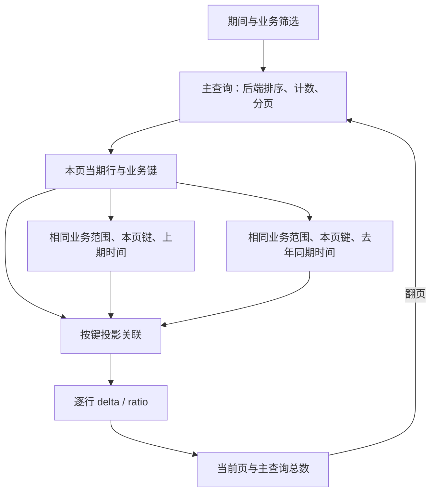

# 同比环比按当前页补查的实施方案

日期：2026-10-30。状态：产品及本地验收已完成，核心、浏览器、类型、独立Skill、MC及作者工具隔离场景已收口；未提交、未推送，真实服务另验。此文件保留实施设计及历史决策过程，当前结果见同目录验收记录。

设计核对基线为`50ba76eba`。实施前刷新并快进至origin/main `e6a7cc8d5`，保留新合入的零总数兼容修复；实施使用Schema **6.78**、local-authoring **1.15.0**（分别由6.77/1.14.2升级）。按需分页`9bad2e81d`、同比环比`f0993f114`和SourceProgram预检修复均已在基线。

## 1 已确认的目标和口径

主查询按已提交条件、顺序和页码取得当前页，比较期查询按当前页的稳定业务键及相同业务口径补齐数据，受控计算阶段产出增长率和百分点差值。补查结果按键关联，返回次序不影响计算；补查成功但缺记录按显式策略处理，查询失败不能视为缺记录。



必须区分两类条件：

- **业务范围条件**：页面参数、区域/产品等筛选、固定业务条件和权限约束，所有适用成员继续消费。各期仍使用显式查询定义，期间字段和绑定不能靠名称猜测。
- **选页条件**：本轮表头条件、排序及 offset/limit 只施加在主查询。比如“当期销售额≥100”用于选客户，不能再给上期销售额施加≥100，否则改变基期。补查只接收本页键、其业务条件和派生时间。

期间推导、可信统计截止事实、同进度裁剪、月末/闰日、带符号分母、零分母取空、百分刻度和百分点显示沿用6.77。可信统计截止日决定期间范围，与后端为三次读取提供事务快照是两件事；后者不作为此方案的额外前置条件，沿用已有取消、总数与窗口契约并明确真实服务证据边界。

## 2 当前代码事实与缺口

| 能力 | 当前事实 | 本批处理 |
|---|---|---|
| 当前页选页后补列 | `paged-join/query-page.ts` 已实现，内部 `restrictKeys` 对静态/页面键条件求交 | 直接复用，不建立第二套级联图 |
| 每页与补列批次 | `pagedJoin.source.pagination` 已有 `mode:query / pageSize / batchSize` | 沿用显式10/10，补查批次不等于业务页码 |
| 三期日期推导 | `period-comparison.ts` 已有 current/previousPeriod/previousYear | 复用纯日历计算 |
| 比较期作为组合成员 | `period-comparison-validation.ts` 当前一律拒绝 | 仅开放具备本方案契约的按需组合；历史分页组合/pagedUnion继续拒绝 |
| 可信事实上下文 | 普通 SourceProgram 查询已冻结并传入；`compilePagedJoin`、`memberQuery`、预检目前未传入 | 补齐内部执行上下文，从 SourceProgram 传到底层 composition |
| 组合结果受控计算 | `pagedJoinDataSourceZ` 无 compute，TS 类型为 compute?:never | 在按需分支开放行数不变的 delta/ratio；保持位置与其他页面数据源一致 |
| 按度量缺记录补零 | joinAggregate.values 已有；pagedJoin.projection 当前只有 member/field，统一缺项 null | projection 增加显式 onMissing，保持缺记录和已返回 null 的区别 |
| 全匹配范围导出 | `paged-join/export.ts` 已逐页选页、补列、核验总数和身份 | 复用，最终快照执行相同逐行计算；不是只导出当前页 |
| 共享执行与交互 | SourceProgram / QueryRunner / TableSession 已具备职责分工 | 保持统一入口及成员普通结果隔离 |

## 3 选择：扩展现有 pagedJoin

| 路径 | 评估 |
|---|---|
| **pagedJoin 按需分页 + 投影后逐行计算（采用）** | 已有选页、键约束、完整窗口核验、成员隔离、候选能力分流和全表导出；补齐小的声明缺口即可 |
| 普通 query + resultBindings + 外置 joinAggregate | 可传当前页键，但组合表视图所有权、完整导出、计算依赖范围还要额外连接；现有 resultBindings 导出固定窗口，不能静默改成全表 |
| 新建 periodComparison 数据源或组件查询器 | 重复分页/关联/取消/导出职责，增加一套公开形状，无需引入 |
| 三期各自 offset/limit 后按位置关联 | 不保证同一批对象，不能采用 |

数据网关和 DQE 原始协议不新增端点或跨期 JOIN。首版使用已有单个非空 string/number 稳定业务键，成员查询必须在该键粒度返回一行。真实粒度为多维组合且无稳定单键时，是明确的独立缺口：不能用多个独立 IN 条件或字符串拼接伪造元组匹配，本批不宣称已支持复合关联键。

## 4 Schema 设计

完整作者声明在 [page.proposed.json](page.proposed.json)，包含顶部筛选、三期查询、结果字段契约、组合声明、计算与表格。它是设计时的完整草案；6.77应拒绝新位置。当前可运行6.78页面在`pages/capabilities/data/period-comparison/period-comparison-query-page.json`，字段名为合成示例，真实DQE映射仍以实际契约为准。

### 4.1 继续复用的形状

```json
{
  "source": {
    "type": "pagedJoin",
    "rowKey": "customer",
    "domainMember": "current",
    "members": {
      "current": {"source":"current","key":{"field":"customer","queryField":"customer"},"canSelectPage":true},
      "previous": {"source":"previous","key":{"field":"customer","queryField":"customer"},"canSelectPage":false},
      "year-ago": {"source":"year-ago","key":{"field":"customer","queryField":"customer"},"canSelectPage":false}
    },
    "pagination": {"mode":"query","pageSize":10,"batchSize":10},
    "onMissing": "null"
  }
}
```

本场景固定 current 为业务行域和选页成员，仅给它 canSelectPage；上期、去年同期用于补列。成员普通查询仍声明 resultScope:complete，表示无内置 TopN 的普通查询定义；组合内部选页是明确的窗口执行角色，不能通过把其 totalCount 改成页长伪装为完整普通结果。表格绑定 comparison，使用 pagination:{mode:query}；页大小由组合源拥有。

`periodComparison` 不增加分页开关和重复角色，仍位于各成员 `query.filterBindings.period`；三期引用同一筛选和同一个 fact，分别声明 current / previousPeriod / previousYear。主查询排序不能使用未完成计算的产出字段。

### 4.2 新增组合源的 compute

与 inline/query 一样，compute 是页面数据源的同层字段，不放入 source/projection/表格 columns：

```json
{
  "compute": [
    {"op":"delta","minuend":"current-sales","subtrahend":"previous-sales","output":"previous-sales-delta"},
    {"op":"ratio","numerator":"previous-sales-delta","denominator":"previous-sales","output":"previous-growth","scale":100,"onZeroDenominator":"null"}
  ]
}
```

- 第一阶段仅开放 delta、ratio，顺序消费已投影字段和此前产出，产出就地声明在 fields，不能覆盖 rowKey 或原始投影。
- 只对显式 pagination.mode=query、无 records 的一键一行 pagedJoin 开放；其他组合分支不自动改变语义。
- 不开放 unionKeys、joinAggregate、timeFill、pivot、小计或总计等改变行域/行数、要求完整行集或引入新外部依赖的算子。既有完整跨源计算约束保持。
- totalCount 与行顺序始终来自主查询，计算不能重新计数、分页或本地筛选已选页结果。
- compute 字段不能列入 ordering.sortableFields/default，也不能用于 query 表头筛选、候选或搜索；非法静态声明报路径，非法恢复视图在 SourceProgram 预检拒绝，保留原有效视图。

### 4.3 新增按投影字段的缺记录策略

```json
{
  "projection": {
    "previous-sales": {"member":"previous","field":"sales","onMissing":"zero"},
    "previous-rate": {"member":"previous","field":"rate"}
  }
}
```

`onMissing: null | zero` 与 joinAggregate.values 的命名、枚举和省略行为一致；仅业务度量允许 zero。成员**成功返回且该键没有记录**时补零；返回记录中该字段为 null/降级标量保持原状态；网络、权限、截断、重复键或超时均失败。默认 null，现有 source.onMissing:null 继续定义未覆盖投影的默认规则，显式局部声明优先。非数值字段、身份字段和不相容类型拒绝 zero；金融单位/币种继续继承原字段契约。

不增加通用 coalesce 算子：它会混淆缺记录和空单元格，改变已经确认的业务语义。

### 4.4 版本与兼容

新增“组合源逐行计算/投影缺记录策略”及“期间比较进入按需组合”能力门禁；旧版本使用新增位置必须拒绝。6.77 期间比较、旧 pagedJoin 与原字段缺失语义保持。旧完整比较示例继续支持三期业务键并集和计算列全局操作；新分页示例显式选择主查询业务行域，不能自动迁移或退回全量读取。

`periodComparisonErrors` 要按**消费位置**处理：普通比较源继续无窗口完整读取；合法新组合的内部选页/补查允许窗口；比较源直接绑定普通 query 分页表、legacy pagedJoin 或 pagedUnion 仍拒绝。不能删除现有所有保护后统称支持分页。

## 5 架构职责与执行顺序

| Module | Interface / 实施职责 | 不进入该模块的职责 |
|---|---|---|
| page | Schema、字段契约、版本和消费位置语义；复用日历解析 | 不执行查询，不探测 canSelectPage |
| SourceProgram | 预检/读取共用可信上下文；冻结筛选、事实、权限版本、now和表格视图；组装组合计划；发布统一结果 | 不让 UI 重建生效查询；维持50ba76eba的预检归属 |
| paged-join planner/reader | 主查询选页、本页键交集、受控补查、缺记录投影和准确总数 | 不改写固定 resultBindings，不污染成员普通快照 |
| compute/snapshots | 投影字段齐备后复用 applyComputation，统一产生计算快照 | 不发网络，不把窗口标为全量，不重复执行两次计算 |
| QueryRunner / gateway | 现有指纹、并发、缓存、取消及执行适配 | 不理解同比环比公式，不持有表格状态 |
| TableSession / UI / widgets | 唯一已提交视图、合法操作能力、加载/失败/重试和现有格式化 | 不调度补查、不关联结果、不单独重算 |
| export | 冻结视图与期间事实、逐页复用同一查询/补列流程，再统一逐行计算与格式化 | 不沿用 resultBindings 的“当前窗口导出”冒充全表，不导出失败比较结果 |

执行细节：

1. SourceProgram 预检和 read 都从已有可信输入取得上下文。内部 `PagedJoinPlan` 带该轮 now/displayInputs/filterRevision；所有 composeEffectiveQuery 调用（包括默认排序探测、成员选页、补查、候选和导出）使用同一来源。改内部 Interface，不新增页面时间事实或网关公开参数。
2. 在一次读开始时冻结三期日期。当前页返回后校验准确 totalCount、窗口长度及业务键唯一性，不再次查询当期指标。
3. 按本页键构造上期/去年同期请求，沿用 restrictKeys 与原条件求交。空主窗口跳过全部补查；空交集不发无约束查询。独立补查可走 QueryRunner 现有并发，首版不为性能再建调度器。
4. 每批最多 batchSize 个键，补查读取范围限这些键；检查响应完整性、唯一键和范围外键，不能以返回行少就判定全部缺失。重复/截断保留已有严格错误，首版不进入完整恢复扫描。
5. 投影时保存“记录是否存在”，实现 onMissing，仅补无记录。projectRows 的输入字段校验排除尚未计算的 outputs；computedSnapshots 完成后校验最终字段契约。计算阶段只执行一次，保留 totalCount、行顺序及 cellFallbacks。
6. 翻页、排序、业务筛选、期间、可信截止事实或权限改变时，整轮失效/取消；迟到的任何一期不能与新页混合。复用既有代次与请求作用域，不要求后端预先对齐三期顺序。
7. periodComparison 组合首版不复用/采集未携带可信事实证明的 initial。避免 SourceProgram 在计算前把缺 outputs 的投影行保存成最终初始行；普通无比较组合的 initial 保持。
8. 失败状态沿用按需组合整轮失败；比较表显示可重试错误，导出失败。必须检查现有“重试”是否只识别 unionKeys，补上新组合消费位置，不能只给控制台日志。

### 5.1 选页与业务语义边界

| 项目 | 本方案 |
|---|---|
| 当期原始列的后端全局排序/筛选 | 支持，必须有映射和真实 canSelectPage 证明 |
| 当前页同比环比与百分点展示 | 支持，查询上期/同期的本页对象后计算 |
| 同比环比计算列的全局排序、过滤和候选 | 本路径不提供；不能做页内伪全局操作。若业务仍要求，使用原完整模式，或由后端提供该计算结果的选页能力 |
| 历史独有对象 | 本路径只展示主查询行域。若主查询本身可返回包含历史对象的完整业务域，则随之展示；不再由三期 unionKeys 自动扩域。这是与原完整模式的明确差别 |
| 全表导出 | 冻结条件，逐页取主行域并补查计算，沿用10000行/60秒总预算；任一期失败不给不完整文件 |
| 浏览总量 | 首屏请求和计算只受页大小/批次影响，不受主查询 totalCount 线性影响；导出预算不反向限制浏览总数 |

与已有ADR的关系：延续 ADR-0108/0125 的组合内部选页补列及 SourceProgram 职责；局部扩展组合源不支持 compute 的既有接口。保持 ADR-0095 对完整跨源算子的完整性要求，本批仅开放行数不变的组合后计算。保持 ADR-0107 的 resultBindings 固定依赖与当前窗口导出，不能为本功能静默重解释。实施时补充针对性ADR或修订主题页，记录上述局部扩展和未采用路径；本方案不提前改写 accepted ADR。

## 6 实施分解与影响文件

| 阶段 | 修改范围 | 完成判据 |
|---|---|---|
| P0 本方案 | 本目录与计划索引 | 已对齐流程、作者完整草案、Schema/架构影响和验收边界；无产品代码变更 |
| P1 协议 | `schema/paged-join.ts`、`schema/compute.ts`、`paged-join.ts`、`validate-paged-join.ts`、`period-comparison-validation.ts`、`version.ts`及受影响字段/算子校验 | 新增位置门禁；旧页结果和错误顺序不漂移；完整草案转成合法产品夹具 |
| P2 执行 | `source-program/session.ts`、`paged-join/plan.ts`、`member-query.ts`、`query-page.ts`、`rows.ts`、`compute/snapshots.ts` | 本页选页→键补列→投影→计算；可信上下文、计数、缺值与取消成立；无全量回退 |
| P3 周边 | `paged-join-view.ts`、候选读取、TableSession/controller、失败重试、initial与export | 当前成员列合法操作；计算列能力拒绝；预检仍在SourceProgram；完整导出有计算值，无初始行污染 |
| P4 文档与分发 | PAGE-METADATA及queries/data-sources/compute/table正文、reference-map、产品向量、local-authoring、MC、ADR现行主题 | 从产品真源生成；独立安装、版本/哈希/知识和页面校验通过；Skill新旧模式选型明确 |
| P5 页面与验收 | 新 `/pages/period-comparison-query-page` 及专属合成网关/README/浏览器脚本；保留旧演示 | 页码、请求范围、计算、失败、重试、导出可观察；真实DQE/Relay另记 |

不在产品实现前修改正在看的 `/pages/period-comparison-demo`，该页继续代表完整集合比较。计划示例不是页面试验场可运行产物。

## 7 行为与架构验收

- 十万客户、pageSize10/batchSize10：正常首屏最多一次主查询和两次本页键补查；总数增加不触发全集扫描。一般上界 `1 + 2 × ceil(本页不同键数 / batchSize)`；同请求的现有缓存合并可使实际请求更少，年/近一年基期相同也允许复用。
- 翻第二页主查询 offset10；补查是第二页业务键，不沿用主查询offset；改变页大小回第一页，末页不足10正常；空页不发补查。
- 捕获真实构造请求，断言区域/产品/权限/固定参数保留，主查询销售额条件没有错误下推到上期销售额，键谓词与静态条件正确求交。
- 月、季、年、近一年；可信截止事实缺失、过期、变化；闰日、月末；年度/近一年基期相同；使用冻结范围，不在翻页或导出时重新读取时钟推导。
- 缺历史记录可配置0或null；已返回null、0/0、负基期、百分点；重复、截断、范围外键、错误总数、失败与超时；失败不能补0。
- 快速翻页、切期间、权限变化、取消和忽略取消的迟到响应；不得出现跨轮混合值。独立图表、其他表格和普通成员初始行不受内部页污染。
- computed字段的非法排序/筛选、恢复视图、候选请求在预检拒绝；合法当前字段的后端操作与准确totalCount保持。
- 浏览器核对第1/2/末页数值、无全集读取、错误持续展示与重试；导出包含全部主行域、所有计算值、当前排序与筛选、数值及P格式；导出总数变化或中途失败不给文件。
- 保留6.77完整比较示例与现有pagedJoin按需场景回归。新草案在旧版本及legacy组合中拒绝，算子白名单/输出覆盖/类型/可空性/原件不变性有针对性向量。
- 按 feature-acceptance 同批完成页面试验场、产品参考与local-authoring；官方生成、独立仓外安装和MC全链路验收。静态、行为测试、浏览器、CI和真实服务分层报告。

复杂度按 metriccanvas-ts-ast/1、TypeScript5.9.3 已做设计基线观察：periodComparisonErrors12、validateBinding14、projectionErrors15、compilePagedJoin12、memberQuery5、fillMember6、executeQueryPagedJoin8、projectRows2、computeSnapshot6、evaluateRows9、captureJoinedResult10。实施前重测；靠近阈值的校验函数先按消费位置/输出字段职责拆分，修改函数和全部新辅助函数逐个测量，新增selfCC≤15。计划本身没有新增可执行分支，不能宣称代码复杂度已经改善。

## 8 本轮完成状态

- [x] 读取当前Schema、按需组合、期间比较、SourceProgram预检/执行/导出、受控计算与相关ADR。
- [x] 明确主查询选页、当前页键补查、计算位置和可信上下文的架构职责。
- [x] 给出完整作者声明及逐字段Schema增量，记录兼容、全局操作与历史独有对象边界。
- [x] 制定分阶段实施与行为/浏览器/分发验收，登记代码复杂度基线。
- [x] P1—P3协议、执行、上下文、计算、失败重试和导出实现。
- [x] P4产品文档、ADR-0127、知识/示例/独立校验器、仓外Skill和MC同步验收。
- [x] P5核心、类型、页面静态、新旧浏览器和窄屏验收。
- [x] 作者工具长耗时隔离回归收口：全组227项通过，唯一预算失败修复后对应32项全部通过；其余5文件通过，未扩大知识预算。

本批未提交或推送，真实DQE/Relay和DS模型未验。[本地验收记录](acceptance.md)。

本轮方案校核：JSON可解析；完整草案被当前6.77解析器拒绝，包含未来版本、组合compute和投影onMissing等尚未开放位置；移除拟议增量/期间绑定/计算产出后，其余现有pagedJoin形状通过当前parsePage。`git diff --check`通过。以上为设计阶段的历史校核；当前实际运行和浏览器结果见验收记录。
