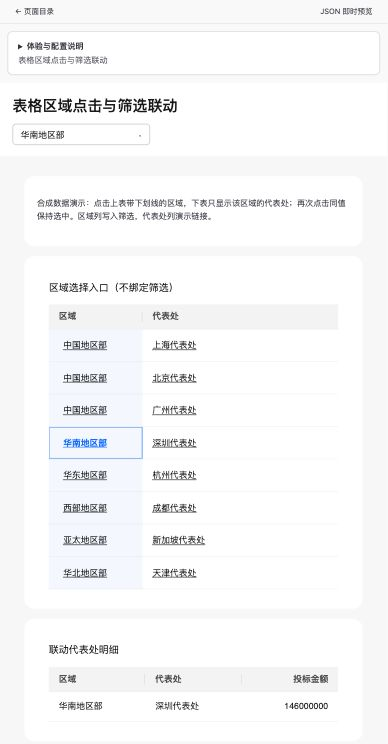
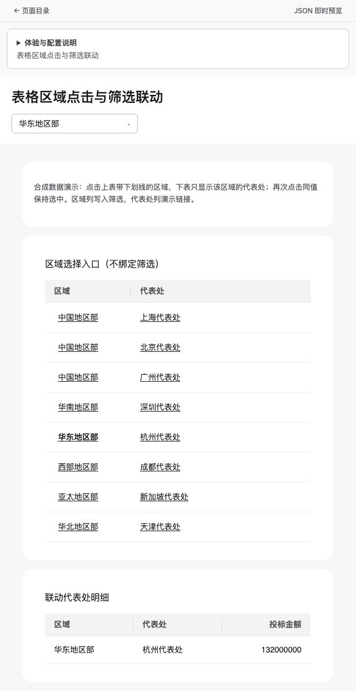

# Table 点击下划线与 selection.writes 验收

日期：2026-10-21。范围：选择列和链接列下划线恢复，以及既有选择写筛选行为的复现；未修改动作能力或 DQE 编码。

## 对应产物

- Playground：`pages/table-cell-selection.json`，目录已注册，直接入口 `/pages/table-cell-selection`。
- 页面元数据：`PAGE-METADATA.md`、`docs/page-metadata/components/table.md`，说明选择写入、查询订阅及纯内联入口限制。
- local-authoring：由产品真源生成 `references/page-metadata/components/table.md` 及知识和分发哈希。生成前确认原工作区导出一致；在 HEAD 独立源码副本加入本次语义节并通过导出/检查后，再同步工作区。工作区生成差异仅为 Table 正文副本和对应哈希，保留既有未提交知识。

## 浏览器结果

在当前工作区的 `http://127.0.0.1:5183/pages/table-cell-selection` 使用 DQE Sim；5173 属于其他工作树，未替换它。点击“华南地区部”后，URL 与筛选控件取值改变，区域单元格选中，下表从 8 行变为 1 行“深圳代表处”；上表保留 8 行。选择列与链接列均显示下划线。

`pnpm --filter @metriccanvas/embed exec playwright test table-cell-selection.spec.ts --workers=1`：4 项通过。自动验收直接加载本次页面，保留其选择配置，覆盖查询写筛选、键盘选择、重复点击、未订阅下游、纯内联入口，以及普通/forecastMatrix/embedded/reportCompact 的控件和主文字下划线。修复前同一检查得到 `text-decoration-line: none`；修复后为 `underline`。

相关回归：`presentation.spec.ts -g 'linked, selected'` 1 项通过；`table-tiny-os.spec.ts -g 'business colors|ordinary, forecastMatrix'` 2 项通过，主次/徽标字段、显式业务颜色和其他变体外观保持。

## 验证命令

- `pnpm validate`：33/33 页面通过。
- `pnpm --filter @metriccanvas/embed build`：通过。
- `pnpm --filter @metriccanvas/embed check`：0 error / 0 warning。
- `pnpm exec tsc --noEmit -p tests/tsconfig.json`：通过。
- `pnpm exec vitest run apps/playground/tests/page-catalog.test.ts`：9 项通过。
- `pnpm authoring:contracts` 与 `pnpm authoring:contracts:check`：生成一致。
- `python3 metriccanvas-authoring/scripts/check_bundle.py`：2718 个摘要检查通过。
- `pnpm exec vitest run tests/local-authoring-skill.test.ts tests/page-reference.test.ts tests/authoring-export-isolation.test.ts`：46 项通过。
- 仓外完整复制 local-authoring，无软链接；用副本 `scripts/validate-page.mjs --expected-layout dashboard` 验证本次页面：通过。

仅证明本地统一运行时、合成查询和分发自洽性。未进行真实 DQE、Relay、CloudIOC、真实模型或远端 CI 验收。

## 颜色修订（同日）

用户要求去除选择列蓝底和选中蓝字。删除 `td.selectable` 蓝底与 `td.selected` 蓝字、蓝底和蓝色内框；选择按钮继承普通单元格颜色，键盘焦点框使用 `currentColor`。下划线、选中加粗、`aria-pressed` 以及筛选写入保持。

Playground 点击“华东地区部”，下游仅显示“杭州代表处”；点击前后该列保持白底和普通文字颜色。

新增浏览器回归对四种变体比较选择单元格和普通单元格的背景与文字颜色，覆盖键盘选中后的颜色、无选择内框、焦点颜色及下划线，继续检查下游剩 1 行。修复前在浅蓝底断言失败（`rgba(33, 111, 240, 0.05)`）；修复后与普通单元格一致。

## main 交付基线适配

交付检出基线：9fabdacf877d6f5fb28d010252f8de24a3f300d9。原开发检出早于 main 的可观察动作与筛选候选门禁；上述原检出的纯内联入口受限结论仅记录当时行为。交付示例采用当前 6.37 协议并显式声明区域完整候选。当前 main 的内联选择入口可写入联动下游查询的筛选，已更新本批说明与浏览器断言，保留现有动作资格与候选可信门禁。

交付检出复测：`pnpm build:packages`、Embed build/check、`pnpm build:playground` 通过；`pnpm validate` 59/59、目录测试 9 项、根测试 TypeScript 检查、5 项本批浏览器测试与 3 项相关外观/颜色/复合字段回归通过。浏览器使用正式生产构建、Chrome headless、`MC_EMBED_EXAMPLE_PORT=4196`。`pnpm authoring:contracts:check` 一致，`pnpm authoring:check` 46 项通过；更新候选说明后另复验仓外目录复制与哈希检查通过。未进行真实服务、模型或部署验收。

交付输入摘要：

- `pnpm-lock.yaml` SHA256 `63f17f9b6cf5abb75bdcb9217e01bdba3d12ef2578403e256beb4316376d72a0`。
- `packages/engine/widgets/src/components/table/Table.svelte` SHA256 `62fcb4c81d195ed8c67b7fd0d2d70361faff3288e5c463983f38a45a0f9c29da`。
- `pages/table-cell-selection.json` SHA256 `d4f786576ec15bf8298cf62aa035736d740b916e50fd64b7594c1fa7fd4b91b5`。
- `packages/embed/tests/browser/table-cell-selection.spec.ts` SHA256 `dee1c96fea5de0f036c54b250804c9e01cf238fc4c8b14149e1eedf25cac9d4c`。
