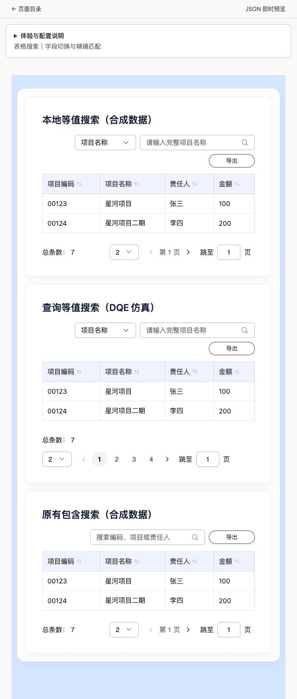

# 搜索字段下拉框图标对齐修复

日期：2026-10-20。基线：`3d607d26280cd0a83cd008c1b2be0d406b8c0086`，工作区：`/Users/moon/.codex/worktrees/table-search-options/DataDashboard`，锁文件未改动。页面：[表格搜索字段切换](http://127.0.0.1:5173/pages/table-search-options-demo)。

## 原因与修复

通用 Theme 的 `.mc-ui-theme .mc-ui-input__inner` 比 Select 的 scoped `.select-trigger` 优先级高，将 `display:flex` 覆盖成 `inline-block`。箭头紧跟文字，无法靠右或垂直居中。Select 在组件内部增加布局选择器的优先级，箭头禁止收缩；不修改通用输入框主题。

## 验证

- 修复前，Playground 实际按钮测量右边距 43px，垂直偏移 -2px。
- 新增 UI 浏览器回归先运行失败：普通 DOM 和 ShadowRoot 均得到右边距 409px（期望 10–16px）。
- 修复后，`pnpm --filter @metriccanvas/ui exec playwright test components.spec.ts --grep 'select arrow|select and menu'` 的 Chrome 四项通过：普通 DOM 与 ShadowRoot、1440px 与390px、键盘与菜单。Edge 四项未执行成功：本机未安装 Microsoft Edge。
- `pnpm --filter @metriccanvas/ui check` 通过，0 errors / 0 warnings。
- `pnpm --filter @metriccanvas/ui build` 通过。
- 实际 Playground 两张搜索表均测得右边距 13px、垂直偏移 0px。手动切换责任人后 placeholder 为“请输入完整责任人姓名”，DQE 仿真表可正常加载。

本次仅修复中性 UI 布局，不改变页面协议、搜索语义或创作方式；沿用既有示例、页面元数据文档与 local-authoring 产物。真实 DQE 与 Edge 不由这些本地证据覆盖。

## 本地预览

5173 已切换到本功能独立工作区（codex/select-arrow-alignment）；用户原工作区文件保持原状。DQE Sim 仍使用18239，Playground 经相对路径代理访问。
