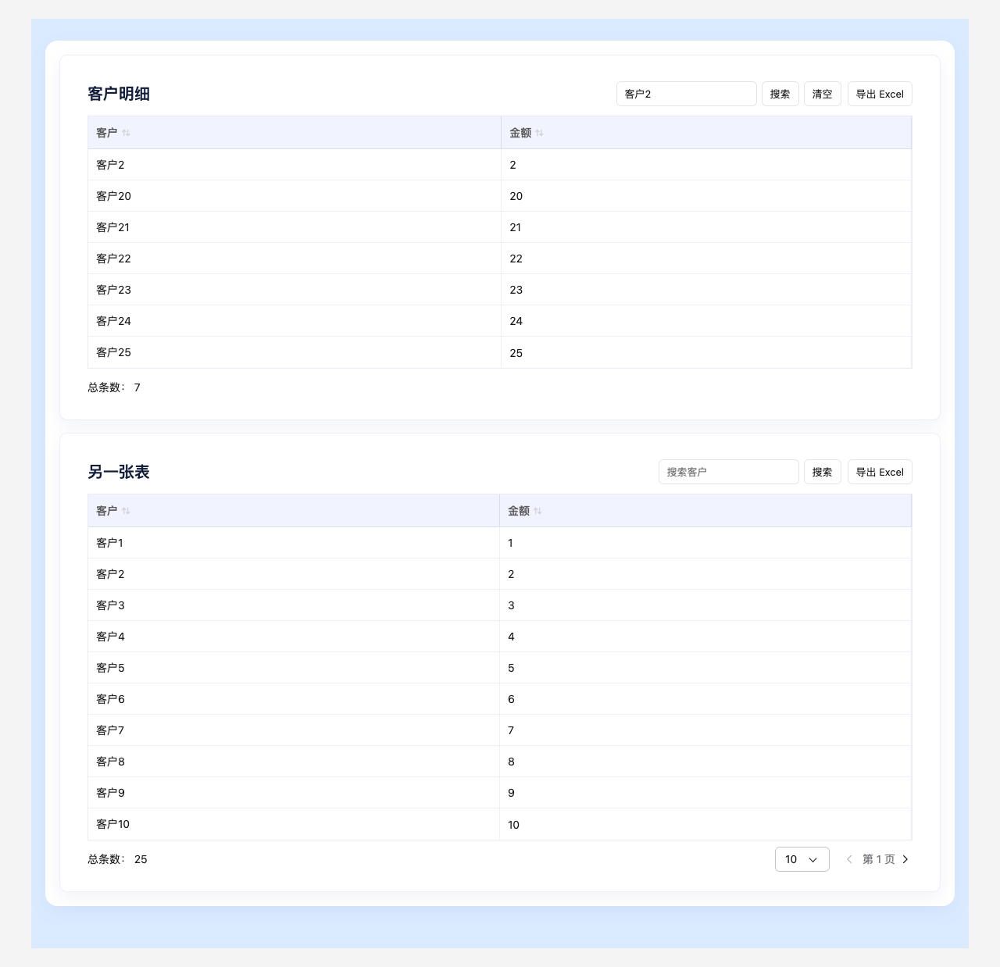
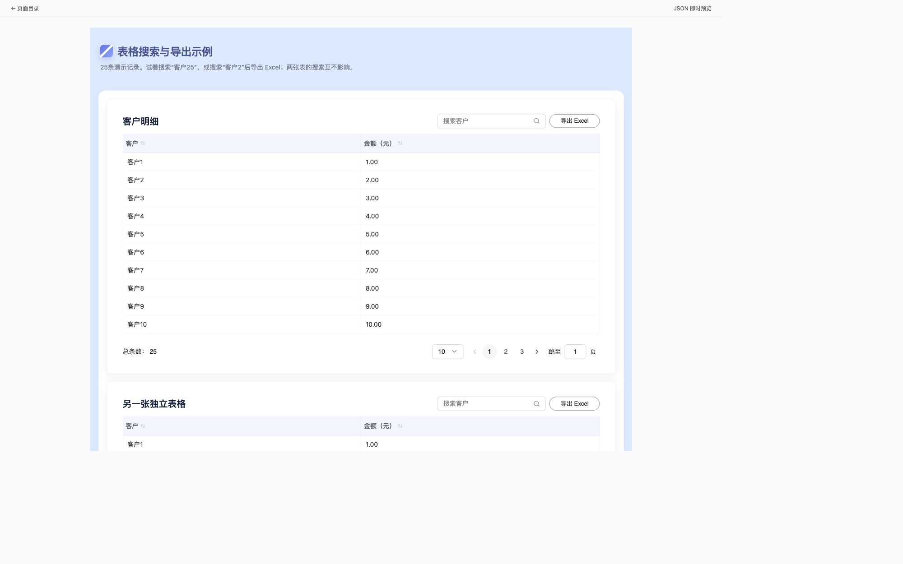

# 表格搜索与 Excel 导出验收

日期：2026-10-14。范围：页面Schema6.21、本仓运行时与创作分发；工作区其他在途改动保留，未提交／推送／发布。

## 实现与行为

每张表通过 `props.toolbar` 分别开启搜索与Excel导出。关键词和导出状态按表格隔离；本地搜索先于分页；查询搜索经稳定字段映射进入生效查询，保留排序与其他筛选并复位页码。未配置真实DQE搜索编码器时显式失败，工具区仍可清空条件。

导出冻结提交后的关键词、筛选和排序，只获取目标表及其依赖。目标分页表展开全部匹配结果，上游作为查询输入的分页窗口保持捕获范围。工作簿保留多级表头、槽对齐与数值类型；次字段和徽标展开独立列，富文本转可读文本。复杂缩放的数值格式冻结展示，底层数值保留；在Excel中编辑后不会自动重算此类展示格式。

组件／实现入口：

- [Schema](../../../packages/page/src/schema/components/table.ts)、[版本与能力门禁](../../../packages/page/src/version.ts)。
- [工具区](../../../packages/engine/widgets/src/components/table/TableToolbar.svelte)、[表格渲染](../../../packages/engine/widgets/src/components/table/Table.svelte)。
- [表格运行时](../../../packages/engine/runtime-ui/src/RuntimeSurface.svelte)、[详情表格](../../../packages/engine/runtime-ui/src/DetailContent.svelte)。
- [完整数据准备](../../../packages/engine/runtime-ui/src/table-export.ts)、[Excel编码](../../../packages/engine/runtime-ui/src/table-workbook.ts)。
- [共享查询](../../../packages/data-execution/src/effective-query.ts)、[DQE搜索编码接缝](../../../packages/data-execution/src/dqe/dqe.ts)。

## 本地证据

- 页面协议套件495项通过；单表导出6项独立通过。目标TypeScript回归44项通过，涵盖版本、字段、跨页搜索、完整取数、原报告导出、查询结果过滤及公共导出面。[目标回归日志](typescript.txt)。
- 6项真实浏览器测试通过：独立搜索与Excel下载、查询分页的跨页搜索／完整导出、缺少搜索能力后的清空恢复、窄屏与Tab状态、取消后晚到结果不下载、详情查询作用域内搜索／导出。[浏览器日志](browser.txt)。
- 创作端538项无模型测试通过，包含新增受控属性编辑与创建呈现；使用Bundle现有Python虚拟环境。[创作日志](authoring.txt)。系统Python缺少jsonschema的首次运行不计为产品测试结果。
- Page、Data Execution、Engine及Embed类型检查通过；Svelte检查无错误／警告。[Engine检查](engine-check.txt)、[Embed检查](embed-check.txt)。
- 共享包构建及HTML发行构建通过。[共享包构建](packages-build.txt)。HTML单文件ES产物约4.27MB、gzip约1.08MB；IIFE约3.17MB、gzip约0.96MB，包含ExcelJS代码，未以CDN规避发行依赖。
- 独立副本生成并同步契约／创作知识／安装校验器；契约检查通过（601个产品文件、4个创作文件、1个接口文件），Bundle2256项摘要核验通过。[契约检查](contract-check.txt)、[Bundle检查](bundle-check.txt)。
- 创作Skill隔离安装、协议参考、导出隔离和公共面回归38项通过。[分发回归](distribution.txt)。

## 真实接入与交付边界

查询分页浏览器使用注入网关，证明字段映射、搜索范围、分页总数和完整取数协作，不能证明真实DQEJSON谓词已兼容。本仓没有假定新增远端请求字段，也没有当前页搜索或自动拉全表降级。

真实DQE接入仍需要文本包含、多个字段OR、与既有条件AND、字面量转义、大小写规则、匹配总数及分页／排序协作的请求／响应证据，并配置 `encodeSearch`。接线说明见[单表搜索与导出](../../table-export.md)。

未执行真实DS模型、Java／Relay联通、生产部署、Git提交或远端CI。当前可使用内联／显式完整结果的搜索与Excel导出；真实查询搜索在编码器接入前明确不可用。

## OpenTiny 样式还原

2026-10-14 按用户要求直接实现，未运行 SDD。对照官方 OS Theme 的 [Search](https://opentiny.design/tiny-vue/zh-CN/os-theme/components/search) 和 [Grid Pager](https://opentiny.design/tiny-vue/zh-CN/os-theme/components/grid-pager) 实际 DOM、计算样式及官方 Less 源码：

- 搜索框高32px、圆角6px、边框`#c2c2c2`，悬停／聚焦边框`#191919`；14px文字、12px左内边距、16px官方图标；内嵌清空、分隔线及搜索按钮。
- 分页数字高32px，当前页浅灰背景和加粗；18px前后翻页按钮、官方 SVG、16px／8px间距；每页条数选择器及48×32px跳页输入框，分页区上下内边距24px／8px。图标常态`#808080`、禁用`#c2c2c2`。
- 演示页两张表显式开启`numbered: true`，保留既有简易页码配置语义；导出／取消使用共享 OS Theme Button。
- 本轮浏览器验证：数字翻页、上一页、输入跳页、越界限制、无效输入恢复、切换每页20条、放大镜搜索、Enter搜索、清空恢复及独立表格状态均通过。搜索“客户2”下载的Excel重新读取后为客户2及客户20–25，共7行。
- 桌面及390／320宽度的布局已检查，无文档横向溢出；浏览器缩放导致CSS视口实测为487／400px。Engine检查无错误／警告，Embed构建通过。

此处记录组件属性对照及浏览器操作验证，未执行逐像素图片差分。

