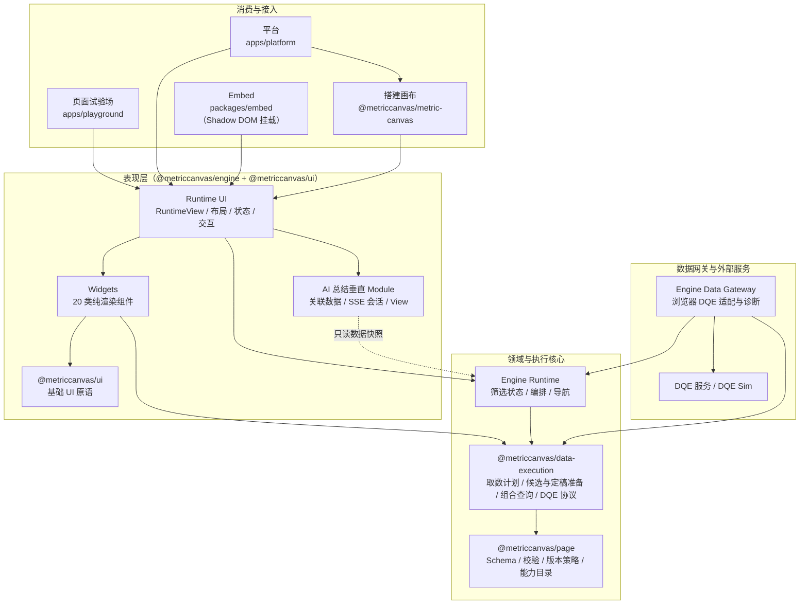
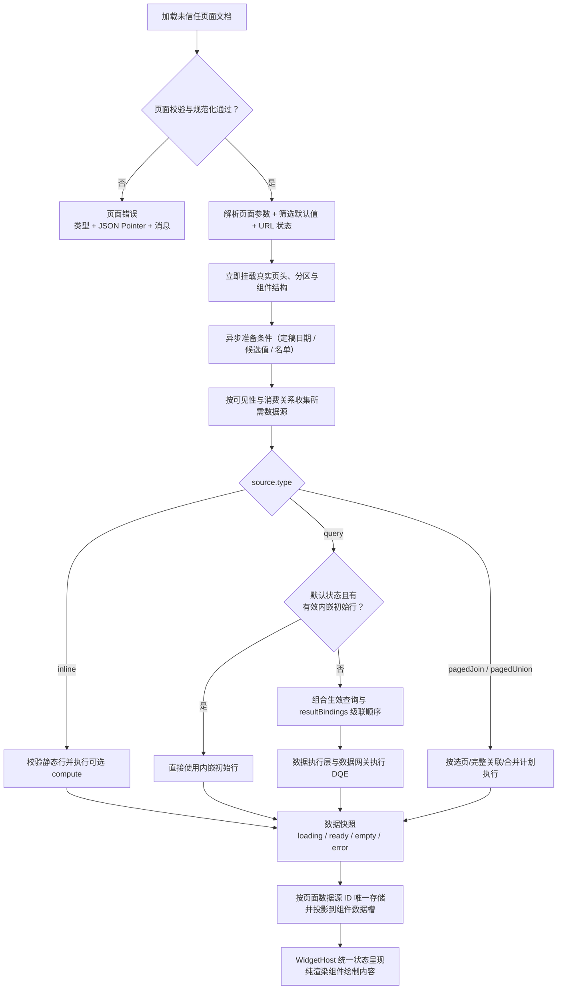
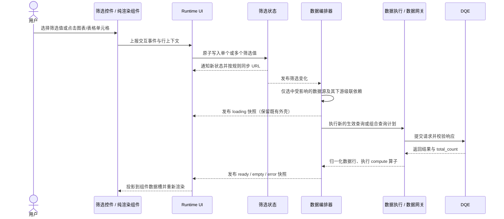

# 前端渲染引擎：能力、架构、运行逻辑与扩展点

> **一句话定位**：MetricCanvas 渲染引擎（统一运行时）是一个以页面文档为唯一输入、确定性执行领域 DSL 的受控渲染引擎，不是通用低代码容器。代码包边界与验证矩阵见 [ARCHITECTURE.md](../ARCHITECTURE.md)。

## 阅读摘要

| 维度 | 当前结论 |
|---|---|
| 页面输入 | 消费符合页面协议的声明式 JSON 文档；当前作者版本与兼容读取范围以 [`packages/page/src/version.ts`](../packages/page/src/version.ts) 为唯一真源 |
| 数据模式 | 支持 `inline`、`query`（含 DQE 指标查询与对象查询）、`pagedJoin`（组合查询源）、`pagedUnion`（分页合并源）及混合页面，支持 `resultBindings` 级联查询与 `compute` 具名算子 |
| 布局与组件 | 支持 `dashboard` / `report` 两种布局形态、默认 12 列与受控正整数权重列轨、分区容器与铺底层，内置 20 类封闭组件 |
| 交互能力 | 页面参数与多类筛选器（维度/层级/时间范围/时间点/布尔/数值区间/搜索）、URL 同步与清理、页内下钻、跨页下钻、行内子表格、详情视图、本地/查询/自动分页、Excel 与 PDF/PNG 导出 |
| 运行原则 | 纯渲染组件不取数；数据快照按页面数据源 ID 唯一存储，多个消费者共享数据 |
| 主要扩展方式 | 替换页面仓储、数据网关、导航、展示输入（期间事实/权限/地图视口/指标定义）和集成应用接入适配器 |

## 1. 范围与设计原则

### 1.1 文档范围

| 包含 | 不包含 |
|---|---|
| 页面协议与校验（`@metriccanvas/page`） | Platform 页面管理与目录接口 |
| 共享取数规划与执行（`@metriccanvas/data-execution`） | 页面修订和回滚管理 |
| 统一运行时、Runtime UI 与 Widgets（`@metriccanvas/engine`） | 页面模板与资产持久化 |
| 基础 UI 原语（`@metriccanvas/ui`） | 发布租约与人工确认发布 |
| 搭建画布交互层（`@metriccanvas/metric-canvas`） | NL2DQE、Relay 与数据上下文检索 |
| 页面试验场与 Embed 嵌入产物（`@metriccanvas/embed`） | 集成门户自身路由与鉴权实现 |

### 1.2 设计原则

- **页面是统一运行时的唯一页面输入**：页面使用严格声明式领域 DSL，不携带任意脚本、原始 HTML、通用表达式、自定义样式或组件代码。
- **数据与呈现解耦**：纯渲染组件只消费数据快照、结果字段契约和展示属性，不发起查询、不访问页面全局状态。
- **显式声明边界**：外部系统通过端口和适配器接入，执行端点、鉴权和长期凭据不进入页面文档。
- **最小化 Schema，引擎承接可复用能力**：容错、格式化、按需取数裁剪、级联编排和导出能力沉淀在引擎与共享取数层。

## 2. 核心概念与能力

### 2.1 概念关系

```mermaid
flowchart LR
  subgraph declaration["页面元数据（声明态）"]
    page["页面"]
    params["页面参数"]
    source["页面数据源"]
    contract["结果字段契约"]
    compute["具名算子 compute"]
    filter["筛选器声明"]
    section["内容分区"]
    component["组件"]
    slot["组件数据槽"]
    query["查询定义 / 组合源"]
    page -->|"包含"| params
    page -->|"包含"| source
    page -->|"包含"| filter
    page -->|"包含"| section
    section -->|"组织"| component
    source -->|"声明"| contract
    source -. "query / pagedJoin / pagedUnion" .-> query
    source -. "可选计算阶段" .-> compute
    component -->|"声明"| slot
    slot -->|"引用"| source
  end
  subgraph execution["统一运行时（运行态）"]
    state["筛选状态与参数输入"]
    effective["生效查询 / 取数计划"]
    snapshot["数据快照"]
    view["纯渲染组件"]
    state -->|"按绑定参与"| effective
    effective -->|"执行与算子计算后形成"| snapshot
    snapshot -->|"渲染时投影"| view
  end
  query -->|"与字段映射组合"| effective
  contract -->|"校验与格式依据"| snapshot
  component -->|"选择 View"| view
```

### 2.2 页面数据源与受控计算

| 类型 | 内容 | 首次呈现 | 交互与组合能力 |
|---|---|---|---|
| `inline` | 结果字段契约 + 静态数据行 | 同步形成数据快照 | 不访问数据网关；**仅内联页面**仍可声明页面参数、筛选器、本地表格操作、条件显隐、页内/跨页导航与 `compute`，仅依赖生效查询重查的交互不生效 |
| `query` | 结果字段契约 + DQE 查询定义（指标或对象查询，支持 `queryModes` / `timeModes` / `periodComparison` / `periodAggregation`） | 默认状态优先使用内嵌初始行，否则执行 DQE | 支持参数/筛选绑定、`resultBindings` 级联输入、查询分页（含上游排序与表头筛选）、按需字段裁剪 |
| `pagedJoin` | 组合查询源：按稳定业务行键组合多个普通查询成员，支持记录模式 `records` 与自动分页 `auto` | 按主成员选页或完整关联执行 | 支持跨成员全局排序、数值范围筛选、工具栏搜索、渐进补列与完整导出 |
| `pagedUnion` | 分页合并源：按显式字段/常量投影合并多个查询来源并逐行保留全部记录 | 读取成员并整体排序计数分页 | 支持 `rowKey` / `rowKeyFields` / `rowKeyGeneration: "uuid"` 行身份与按行来源导航 |
| `mixed` | 同一页面同时包含静态、查询及组合数据源 | 各数据源按依赖图编排执行 | 组件能力按其实际绑定的数据源推导 |

关键数据能力：

- **结果字段契约**：声明 `string`、`number`、`money`（`CNY` / `USD`）、`boolean`、`date`、`datetime`，以及 `recordList`（嵌套明细）和 `semanticHtml`（受控语义 HTML）字段；区分 `dimension` / `measure` / `detail` 角色，查询数据源通过 `queryField` 显式映射外部字段。
- **级联查询（`resultBindings`）**：下游查询从上游查询数据源的原始维度字段集合（支持 `where` 行筛选与查询分页窗口）构造受控输入，空集合自动跳过下游执行；详见 [cascading-queries.md](./cascading-queries.md)。
- **具名算子（`compute`）**：封闭命名的确定性后处理算子（如 `joinAggregate`、`unionKeys`、`pivot`、`sumFields`、`delta`、`ratio`、`timeFill`、`selectField`），输出字段就地声明于同一结果字段契约，不引入通用公式或表达式脚本。

### 2.3 组件与布局

页面协议内置 **20 类封闭组件**（真源见 `packages/page/src/schema/component.ts`）：

| 分类 | 组件类型 | 核心能力 |
|---|---|---|
| 页头与控制 | `iocHeader`、`reportHeader`、`filterGroup`、`button` | IOC 公共页头（身份、返回、内置 Region 与组合筛选控件）、报告页头（标题、筛选工具带、PDF/PNG 导出）、独立筛选按钮/下拉组、条件动作按钮 |
| 指标与概览 | `metricCard`、`gauge`、`keyValuePanel` | 单/多行指标卡（主次变体、变化项条件显隐、颜色规则、定义气泡、Tab 切换与条件导航）、环形仪表、键值信息面板 |
| 图表与地理 | `barChart`、`lineChart`、`pieChart`、`mapChart` | 柱图/折线/柱线混合图（双轴对齐、字段排序、均值系列、系列条件显隐、常量基准、悬浮提示着色与受控 `echartsOption`）、饼图（表格式图例与着色）、中国/世界地图与组织视口/散点标签 |
| 表格与明细 | `table`、`rankingCard`、`rankingDetailCard`、`categoryBreakdown` | 多级表头、固定列、序号列、置顶汇总行、列条件显隐、本地/查询/自动分页、表头枚举与动态候选搜索、行内子表格、单元格选择、工具栏搜索与 Excel 导出；排行卡、详细排行卡、分类明细 |
| 容器与文本 | `tabContainer`、`compositeCard`、`text`、`fieldText`、`aiSummary` | Tab 容器（混合内容、12 列栅格、按需取数与 URL 初值）、组合卡（组件级容器与筛选工具栏）、静态/字段长文本（支持受控语义 HTML）、Report 区域 AI 总结组件 |

布局与视图能力：

- **布局形态（`layout`）**：`dashboard`（全宽看板）与 `report`（定宽居中报告）两档。
- **内容分区（`sections`）**：默认 12 列网格，支持受控正整数权重列轨（`columnTracks`）、封闭外观档位（`plain` / `panel` / `card`）以及铺底层（`layer: "backdrop"` 与运行时安全区计算）。
- **页内组织**：支持 `sectionGroups` / `sectionAnchors` 分区切换与锚点定位，以及 `detailViews` 单层详情浮层（快照或查询模式）。

### 2.4 参数、筛选、交互与导出

| 能力 | 当前行为 |
|---|---|
| 页面参数与文本取值 | 支持分层参数 `params.query.{dimensions,times}` 与 `params.display`；支持整值参数/筛选引用及 `parts` 文本组合；详见 [PAGE-PARAMETERS.md](../PAGE-PARAMETERS.md) |
| 筛选器家族 | 维度（单/多选、必选多选、普通树与层级树、静态枚举、动态与数据源候选）、时间范围（含自然年/季/月/近一年与日/月/周模式、定稿日期默认值）、时间点、布尔（含覆盖与交集）、数值区间（含币种档位）、搜索 |
| 条件显隐与资格 | 统一的 `visibleWhen` / `enabledWhen` 展示条件，覆盖组件、表格列、图表系列、指标变化项与按钮，并参与按需取数裁剪 |
| URL 同步与清理 | 合并 `location.search` 与 hash 路由查询串，初始化通过后清理未声明参数；支持 `urlParams: false` 关闭单筛选 URL 同步及 `strictURLInputs` 严格校验 |
| 页内与跨页交互 | 组件 action 回写筛选状态、切换 Tab 或打开详情视图；跨页下钻使用声明式 `href + query` 普通 URL 导航，可由集成应用按需接管 |
| AI 总结组件 | 垂直组件 Module：Report 中非空 `body` 直接呈现，否则按 `relatedDataSources` / `relatedSections` 通过集成应用注入的 SSE 配置异步生成与缓存 |
| 导出能力 | 表格完整匹配行 Excel 导出（含父子同工作表缩进导出与数字格式保留）；Report 内置 PDF 与单张高清 PNG 下载 |

## 3. 架构分层

### 3.1 整体架构

### 3.2 模块职责

| 模块 | 职责 | 不负责 |
|---|---|---|
| `@metriccanvas/page` | JSON Schema、语义校验、类型、版本策略、结果字段契约、组件能力目录与文档升级 | 页面加载、HTTP 取数和 UI 渲染 |
| `@metriccanvas/data-execution` | 跨浏览器与 Node 共享的取数编排、异步条件/定稿/候选准备、`pagedJoin` / `pagedUnion`、计算算子与 DQE 协议执行 | DOM 渲染、框架状态与集成应用路由 |
| `@metriccanvas/ui` | 底层基础 UI 原语组件（输入框、弹层、滚动容器等） | 页面领域协议与业务查询 |
| `@metriccanvas/engine` (`runtime`) | 筛选状态、URL 解析与同步、生效查询调度、数据快照、条件裁剪与导航意图 | 具体应用壳 UI 和 DQE HTTP 传输细节 |
| `@metriccanvas/engine` (`data-gateway`) | 浏览器侧 DQE 执行、批量/独立调度、字段归一化、容错告警、超时与诊断 | 组件展示与页面导航 |
| `@metriccanvas/engine` (`runtime-ui`) | `RuntimeView` 正式入口、内容分区网格、筛选控件、详情视图、导出与组件分发 | 业务查询生成与资产持久化 |
| `@metriccanvas/engine` (`widgets`) | 消费数据快照与 props 绘制 20 类组件，上报交互事件 | 数据获取、筛选状态与页面导航 |
| `@metriccanvas/metric-canvas` | 叠加在渲染主体之上的搭建画布交互（选中、拖拽、就地编辑意图回传） | 持有持久化文档、属性面板或独立渲染实现 |
| `@metriccanvas/embed` | Shadow DOM 挂载、ES/global 入口、`mount/update/destroy` 生命周期与面向集成应用的事件 | 修改集成应用路由栈或提供资产存储 |
| `apps/playground` | 页面试验场：开发态仓库页面浏览、能力场景索引与 JSON 即时校验预览 | 生产资产管理与发布治理 |

## 4. 运行逻辑

### 4.1 页面加载与渲染

#### 结构优先加载与空/错误快照的稳定呈现

- **结构优先**：合法页面立即挂载真实页头、筛选控件、内容分区和组件外壳；表格保留表头与工具栏并在表体显示骨架行，指标卡与图表在内容区原位等待并填充。
- **空与错误态稳定投影**：`empty` 与 `error` 快照在运行时保留原始状态、结构化错误分类与控制台诊断；投影到组件数据槽时转为统一空行视图，组件继续呈现标题、坐标轴、表头与底图，不以整块遮罩覆盖布局。
- **单元格容错**：查询结果中的 `number` / `money` 异常值归一化为 `null` 并告警；表格异常标量可保留展示原文证据，同时保持有效类型值用于排序与计算。

### 4.2 查询执行保障

| 能力 | 实现方式 |
|---|---|
| 按需取数与条件裁剪 | 隐藏的表格列、图表系列与无消费者的数据源/关联计算在本轮自动跳过，恢复可见时按当前条件读取 |
| 去重、缓存与竞态隔离 | 以生效查询的确定性 JSON 为键复用会话内结果，以请求代次丢弃过期响应，支持 `AbortSignal` 取消 |
| 独立调度与超时预算 | 就绪 DQE 查询独立请求，默认与最小超时 180 秒；记录关联按批独立计时并受字节预算约束 |
| 结构化查询错误与认证失效 | 统一封闭 `QueryErrorCode`（定义于 `@metriccanvas/page`）贯通数据快照、`data-error` 事件与诊断；支持可选 `onAuthRequired` 处理 401/403/419 失效 |
| 查询诊断 | 每次执行记录封闭形状的脱值诊断（标识、耗时、行数、状态、错误分类），不泄露业务数据行或凭据；详见 [runtime-architecture.md](./runtime-architecture.md) |

### 4.3 页内下钻时序

## 5. 扩展点

| 扩展点 | 接口 / 形式 | 可替换内容 | 保持不变的部分 |
|---|---|---|---|
| 页面仓储 | `PageRepository` | 静态文件、Java 资产 API 或自定义存储 | 加载后统一执行页面校验与规范化 |
| 数据网关 | `DataGateway` / 候选端口 | DQE 环境、鉴权、HTTP 适配、定稿日期与维度候选值服务 | 组件仍只消费标准化数据快照 |
| 展示输入 | `displayInputs` / 地图视口 / 指标定义端口 | 可信数据期间事实、权限状态、组织地图地理资料、指标定义查询 | 外部上下文不写入页面文档或 URL |
| 导航与认证 | `RuntimeNavigation` / `onAuthRequired` | 集成应用路由接管、返回逻辑、URL 地址替换与登录失效跳转 | action 的页内/跨页声明语义 |
| Embed 接入 | `mount/update/destroy` + 运行时事件 | 集成应用的框架接入方式（ES 模块或 global 脚本） | Shadow DOM 内复用同一 `RuntimeView` |
| AI 总结 | 集成应用注入的连接配置 | 连接地址、鉴权与环境参数 | 端点与协议参数不进入页面文档 |
| 搭建画布 | `@metriccanvas/metric-canvas` | 集成应用对选中、移动、跨度与标题修改意图的处理 | 复用同一渲染主体，不另建渲染器 |

### 新增或演进能力

协议扩展属于受控演进，必须先执行 [Schema 最小化与修改流程](./agents/page-metadata-changes.md) 与 [功能与协议能力验收要求](./agents/feature-acceptance.md)：优先由引擎承接可复用逻辑；确需扩展 Schema 时，在 `@metriccanvas/page` 完成定义、校验与版本登记，再同步运行时/组件、页面试验场场景、页面元数据文档与本地创作 Skill。

## 6. 当前能力边界

| 边界 | 当前约束 |
|---|---|
| 页面表达 | 不支持任意脚本、原始 HTML、通用表达式、自定义样式或第三方组件逃生舱 |
| 查询与计算 | 数据源间级联仅通过显式 `resultBindings`、`pagedJoin`、`pagedUnion` 和封闭 `compute` 具名算子完成，不存在隐式联动或自由公式 |
| 地图底图 | 内置底图覆盖中国与世界，组织级地理资料与显示名可通过集成应用注入或页面 `mapOverrides` 覆盖 |
| 数据刷新 | 默认不提供静默后台轮询刷新；页面数据随参数初始化、筛选变化、分页/排序或集成应用显式 `update` 更新 |
| 发布与持久化 | 渲染引擎与页面试验场不持有资产持久化或发布状态，统一由集成应用及后端服务负责 |
