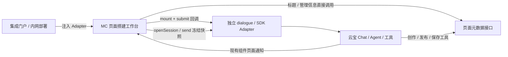

# 云宝创作接入与独立 dialogue 交接

MC 是页面搭建工作台和统一运行时的聚合应用；云宝提供 Chat 与 Agent。两者由集成门户注入的 `dialogueAdapter` 连接。MC 不加载另一套 Agent，不把内网 SDK 编译进平台。接口真源为 `apps/platform/src/lib/integration/contract.ts`，发布包会将它作为无仓内依赖的 `portal-contract.d.ts` 分发；`dialogue/port.ts` 复用此定义，独立维护的 dialogue 可只接收这份契约。

## 部署实现的公开接口

`PlatformDialogueAdapter.mount(element, context?)` 挂载现有 Chat 并返回清理函数。云宝模式额外提供 `agent: DialogueAgentPort`，旧的单参数挂载仍兼容。SDK 名称、实例创建、身份和会话 API 由内网 Adapter 映射，不能从接口示例推断私有 SDK 已具有某个同名方法。

仅迁移资源配置读取时，可注入 `props.readPanguDeployment` 使用默认实例 SDK；它不提供 agent 能力。已有云宝创作接线继续注入完整 `dialogueAdapter`，该 adapter 优先且不读取默认 SDK 配置。移动旧 runtime 时须保留 context、agent 和现有 authoring/pageInfo 等 props，实施顺序见[内网迁移方案](plan/2026-10-16-intranet-dialogue-sync.md)。

- `agent.openSession({sessionId?}, signal)`：有 ID 则恢复该会话，回执必须返回原 ID；没有则真正新建。失败显式报错，MC 不生成伪会话 ID。取消不能产生重复创建。平台复用同一准备请求，并在身份失效时取消。
- `mount` 的 `context.sessionId`：当前真实云宝会话。SDK 的发送前回调调用并等待 `context.submit(question)`，**由这一入口接管本轮发送**；SDK 不得再自行发送第二次。
- `agent.send(request, signal)`：消费 `request.input.documentJson` 的完整前端快照（新建为空）、SHA256、已有精确修订引用、requestId 和 intent。`persistedRef` 只是保存基线，不可据此用远端文档替换快照。问题文本不承担结构化上下文的传输。
- intent 为 `create / adjust / publish / confirm-save`。底层怎样映射云宝消息、工具与用户确认由部署实现；发布链接和确认交互仍由现有组件处理。
- send 返回同 requestId 的 `completed / failed / unknown`；完成前要等待本轮已有组件更新已提交给 MC。现有 `metriccanvas:apply-page`（页面 ID）或预览更新走工作台原通道。Adapter 必须隔离旧实例、旧轮次回调，释放 SDK 订阅，并停止失效身份的结果。MC 不增加第二次应用或结果确认面板。
- 异常、回执不匹配和 unknown 表示结果未核实，工作副本与锁保留，不自动重试。重新打开可恢复已保护副本；对远端是否落库仍须人工/部署侧核实。明确 failed 则保留副本并解锁。

发送顺序为：收齐正在编辑的输入 → 等待标题接口完成 → 本地保护工作副本 → 获取编辑锁 → 冻结全文和 hash → 云宝 send → 等待现有组件通知 → 明确回执后解锁。不会先执行远端保存或重新读取 latest。组件仅返回页面 ID 时，MC 按该 ID 查询元数据；不承诺查回特定历史版本。

## URL 与恢复

标准入口 `/create?page=<pageId>&resource=<resourceId>&sessionId=<sessionId>`，`routeBase` 仍由门户指定。`pageId` 是兼容输入别名，规范地址沿用 `page`；两者冲突或参数重复直接拒绝。`resource` 维持现有 Java 定位用途。

| URL 状态 | 行为 |
|---|---|
| 页面 + 会话 | 元数据加载页面，云宝恢复指定会话 |
| 只有页面 | 加载页面；自动新建云宝会话并回填 URL |
| 只有会话 | 恢复对话；无页面 ID 时不要求恢复历史画布 |
| 都没有 | 空画布；自动新建云宝会话 |
| 删除会话 ID | 保留页面；新建另一个云宝会话 |
| 云宝恢复失败 | 页面仍可独立查询和预览，报告会话错误 |

首次组件返回页面 ID 后 MC 回填 URL，保留当前会话。会话不写入页面 params 或筛选器，不依赖 localStorage 中的旧会话来补删掉的参数。会话准备可能仍有远端副作用，实际 SDK 应保证失败/取消语义；MC 不假设远端提供查询未知创建的能力。

## 标题与管理接口

门户可注入 `pageInfo: PageInfoPort`，以资源/页面/修订引用读取和更新标题、描述、可访问路径。它与 dialogue 分开，管理页没有 Chat。更新必须基于返回的 revisionId，失败保留输入；路径限定站内相对路径且保留当前页面 ID。

未注入时沿用实际 Java 元数据接口修改 `meta.title / meta.description`，保留当前发布状态和文档其余部分；没有已确认的路径字段，路径输入因此禁用。实际路径 DTO、发布工具生成链接及云宝 SDK 接入由内网实现提供，不伪造 `meta.url`。绑定标题需在独立表单明确允许替换为文字。

工作台标题保存先保护本地副本，读取实际接口基线，只提交标题，再以回执合入工作副本，保留其他手改。管理修改与同页的脏副本/执行中任务互斥；云宝工作台中的历史信息只读，不再提供绕过对话的删除/回退按钮。目录每页最多 20 条，基本信息并行读取；读取失败保留列表摘要并显示缺省字段，编辑时仍显式报告错误。

## 接入与验收边界

`pnpm --filter platform dev:agent-flow` 启动真实 MC 界面 + 合成云宝/元数据服务的本地夹具。页面源与 Playground 共用 `pages/platform/flow-page.json`。不注入 agent 的旧 mount-only 部署继续现有 v1 行为，不宣称已启用最新工作副本模式。默认 `runtime.ts` 只具备已经核实的 SDK 挂载能力，不能替代私有 SDK 接线。

本地单元、浏览器、打包与独立契约检查见验收记录。真实云宝会话新建/恢复、发送前拦截、结构化上下文进入 Agent、现有组件更新顺序、真实保存/发布与路径更新均需要内网真实服务验收，当前为 NOT_RUN。
