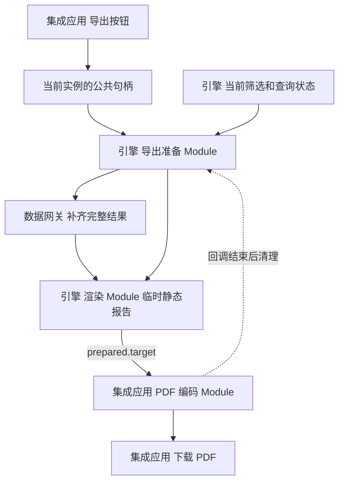

# report 页头日期筛选调整方案

建议让 `reportHeader` 显式引用需要放在右上角的页面筛选器，复用统一运行时的筛选状态和控件。日期框的出现、位置、初始化输入及查询影响范围分别声明；渲染引擎确定性消费这些声明，创作期负责识别业务日期、选择查询目标和验证改写结果。

日期：2026-10-09，2026-10-10 扩充 grill 与 prototype，并确认第一轮 Q1—Q7。状态：2026-10-11 用户批准全部方案并执行；已实现，验证记录见 [实施验收](report-date-filters/acceptance.md)。现状依据为工作区源码，HEAD 为 `e95086c9`，工作区还有其他在途改动。当前源码版本真源为 `packages/page/src/version.ts`，实施起点次版本为 6.12，本次增量为 6.13；部分参数说明与 ADR 主题页保留了较早版本的描述，应结合源码和 ADR-0088、ADR-0089 读取。

2026-10-10 用户已明确：覆盖月份单选、月份范围、日期单选、日期范围；初次创作没有参数，确认日期提取后在产物中增加日期选择器；采用 C 页头工具带，形态在提取时确定；页内改变日期刷新关联查询；完整 PDF 展开全部正文、Tab 和筛选后的全部表格行，详情浮层不在本次范围；引擎准备导出视图，集成应用生成 PDF；PDF 隐藏日期筛选框但保留期间文字，文字必须与当前筛选值联动。

日期业务角色包括数据月份或截止日，以及驱动当期、累计、趋势等多个查询窗口的报告基准期。两类业务含义不同，即使选择器外观相同，也需要不同的筛选绑定。

## Prototype 与本轮 grill

在既有页面试验场 `/preview` 路由下增加仅开发环境启用的 prototype，复用报告页头与正文组件，日期变化不真实取数，参数提取过程为内存模拟。

- 启动：`pnpm --filter playground dev --host 127.0.0.1 --port 5186`。
- [方案 A 右上角常驻控件](http://127.0.0.1:5186/preview?prototype=report-date&variant=A)：单选或范围输入直接常驻封面右上角。
- [方案 B 期间按钮与浮层](http://127.0.0.1:5186/preview?prototype=report-date&variant=B)：封面右上角显示当前期间，点开浮层修改。保留为对比原型。
- [方案 C 页头工具带 已选择](http://127.0.0.1:5186/preview?prototype=report-date&variant=C)：在封面上方增加一条专用工具带，日期输入右对齐，期间文字与已应用选择保持一致。

原型默认打开已提取示例，避免重开后控件隐藏被误认为页面不可用。点击“初次创作”可以演示“初次创作 → 模拟提取日期 → 确认候选并生成控件”；URL 的 stage 可显式打开 draft、candidate 或 applied。输入形态下拉框用于查看四种控件，不代表生产页面允许读者自由切换形态。导出视图预览移除日期框并保留当前期间；浏览器打印按钮仅演示视图，尚未实现引擎公共导出方法。

原型文件为 [ReportDatePrototype.svelte](../../apps/playground/src/lib/ReportDatePrototype.svelte)，接入点为[既有 preview 路由](<../../apps/playground/src/routes/(viewer)/preview/+page.svelte>)。C 已选定，后续按生产约束重写并在交付时将原型留作独立设计证据，原型不作为生产实现交付。

## 现状与缺口

| 链路 | 已有行为 | 本次需要补齐 |
|---|---|---|
| report 渲染 | `RuntimeSurface.svelte` 在内容分区之前渲染整条 `FilterBar` | 把指定筛选器放进页头右上角，其他筛选器保留在原筛选栏，避免重复 |
| 页头组件 | `reportHeader` 展示标题、副标题、标签、`asOf`，有默认、`shortBar`、`projectDetail` 三种外观分支 | 声明控件引用；三种分支提供一致的控件插入位置，处理窄容器及弹层 |
| 日期控件 | `TimePointFilter` 支持月或日；`TimeRangeFilter` 支持日期或日期时间区间 | 页头紧凑呈现与可访问性；现有区间控件不能直接表达月份区间 |
| 日期查询 | `timePoint` 通过 `queryField` 下推等值维度谓词；`timeRange` 通过 `target: time` 下推时间范围 | 报告基准期改变时按每个查询声明的窗口重新派生范围 |
| 页面参数 | 打开时确定且保持不变；`timePoint.initialParam` 可从单点 `params.query.times` 初始化 | `timeRange` 尚无 `initialParam`；不能把页内改日期实现为反向修改页面参数 |
| 参数提取 | 从已验证查询的简单维度条件及固定月/日时间区间生成候选，按精度与原值合并时间候选 | 识别已经由日期筛选器控制的输入，保留其控件、绑定、位置与业务身份 |
| 多窗口提取 | 固定时间区间不会自动反推出基准期或窗口关系 | 从显式窗口声明或可信创作证据获取关系；仅看到日期不能推断全年、累计、同比等规则 |
| AI 创作 | 现行 `referenced.py` 的 `COMPOSE_SCHEMA` 只接收 `title/layout/sources/sections`；受控交互编辑只支持维度筛选增删改 | 新建与编辑都能声明日期筛选、绑定和页头引用，并进入工具契约与 Skill 工作流 |
| 平台页面搭建 | 页头属性编辑主要覆盖副标题、徽标、标签 | 人工选择页头日期控件、绑定对象、初值与位置，和 AI 生成共用页面协议 |

现状代码入口：

- 渲染与纯展示：[RuntimeSurface](../../packages/engine/runtime-ui/src/RuntimeSurface.svelte)、[ComponentRenderer](../../packages/engine/runtime-ui/src/ComponentRenderer.svelte)、[ReportHeader](../../packages/engine/widgets/src/components/report-header/ReportHeader.svelte)、[FilterBar](../../packages/engine/runtime-ui/src/filters/FilterBar.svelte)。
- 页面契约与执行：[页头 Schema](../../packages/page/src/schema/components/report-header.ts)、[筛选 Schema](../../packages/page/src/schema/filter.ts)、[查询 Schema](../../packages/page/src/schema/data-source.ts)、[筛选初始化](../../packages/engine/runtime/src/page-params.ts)、[生效查询装配](../../packages/engine/runtime/src/orchestrator.ts)。
- 参数程序：[提取与应用](../../packages/page/src/extract-page-params.ts)、[程序通道](../../packages/page/src/parameter-program.ts)、[参数初始化约束](../../packages/page/src/param-bindings.ts)、[查询原位引用约束](../../packages/page/src/query-param-references.ts)。
- 创作入口：[引用结果装配](../../metriccanvas-authoring/tool/metriccanvas_authoring/pages/referenced.py)、[交互编辑](../../metriccanvas-authoring/tool/metriccanvas_authoring/pages/editing/interaction_editing.py)、[参数工具](../../metriccanvas-authoring/tool/metriccanvas_authoring/pages/parameters/page_parameters.py)、[参数流程](../../metriccanvas-authoring/skill/metriccanvas-platform-authoring/workflows/parameters.md)。

## 业务场景与日期语义

| 场景 | 示例 | 推荐行为 | 改动范围 |
|---|---|---|---|
| 原有 report 无日期框 | 固定内容页面 | 未声明就不渲染日期框，也不占位 | 兼容回归 |
| 已有日期框调整位置 | 把“数据月份”从顶部筛选栏移到页头 | 只改变控件归属，查询和状态保持原有语义 | 页头引用与渲染分组 |
| 单个月份或截止日 | 月份对应 `202604` 分区字段 | `timePoint` + 显式 `queryField/valueFormat`；改变后重查绑定查询 | 复用现有执行，补创作与提取 |
| 一个时间点驱动多个窗口 | 3 月概况、1—3 月累计、最近 12 月趋势 | 一个可变基准期，每个查询显式声明窗口 | 新增筛选窗口绑定 |
| 日级任意时间区间 | 9 月 1 日至 9 月 30 日 | `timeRange` 控制完整区间；填齐两端并验证后提交 | 复用现有执行，补区间参数初始化 |
| 月级任意时间区间 | 1 月至 6 月 | 月区间输入与月级范围语义需新增契约；不把月字符串交给日区间控件 | 已纳入首期 |
| 同页多个业务日期 | 数据月份与预测截止日同时存在 | 两个筛选器、独立业务身份和查询影响范围，按声明顺序排列 | 多控件排布与独立提取 |
| 初始化与召回 | 先填报告月份，再打开模板 | 参数只提供筛选初值；之后筛选状态接管查询 | 参数程序、平台预览、程序通道 |
| 跨页与返回 | 概览到明细后返回 | 导航携带当前筛选值，恢复时遵循现有 URL 和筛选历史规则 | 导航回归；不得误传最初参数值 |
| 长期滚动页面 | 最近 30 天 | 复用结构化相对时间默认值；同次加载共享求值时刻，确认时区来源 | 默认值与打开时间回归 |
| 冻结报告与仅内联页面 | 保存采集时点的报告 | `layout: report` 与“冻结报告”按产品形态区分；无可观察效果时不提供可变日期交互 | 冻结/只读入口验收 |

“数据截止日”也需区分等值分区与“小于等于截止日”的业务条件。当前 `timePoint` 是等值谓词；若指标服务不提供截止日快照，不能根据标签把等值筛选解释成累计查询。需要明确范围窗口或真实上游能力。

## 页头声明与职责

建议新增可选 `reportHeader.props.filterIds`，只引用页面顶层已经声明的日期筛选器。首期允许 `timePoint` 和 `timeRange`，数组顺序就是显示顺序。例如：

```json
{
  "filters": [
    { "id": "data-month", "type": "timePoint", "label": "数据月份",
      "granularity": "month", "initialParam": "report-month" },
    { "id": "cutoff-date", "type": "timePoint", "label": "截止日",
      "granularity": "date", "default": "2026-09-30" }
  ],
  "sections": [{
    "id": "header", "container": "plain", "components": [{
      "id": "page-header", "type": "reportHeader", "layout": { "span": 12 },
      "props": { "title": "经营分析", "filterIds": ["data-month", "cutoff-date"] }
    }]
  }]
}
```

这是拟新增字段的局部片段，省略参数、数据源及查询绑定，当前 Schema 尚不接受 `filterIds`。

声明与校验规则建议如下：

1. 不声明 `filterIds` 时保持已有外观。隐藏筛选器仍能生效；页头引用 `visible: false` 的筛选器应拒绝，避免声明了控件却不出现。
2. ID 必须存在、不得重复、类型必须在首期闭集中，同一筛选器只能归属一个页头。页头只是位置引用，不创建筛选器，不算查询消费者。
3. 承载筛选器的页头应位于 report 的首个、始终可见的顶层内容分区，不能藏在 Tab、详情视图或可切换分区组内。dashboard 本次继续使用既有工具栏；新增字段在 dashboard 下明确拒绝。
4. 统一运行时按声明分出“页头控件”和“原筛选栏控件”。组件删除、筛选器删除、布局切换操作必须同时处理引用；残留引用校验失败，不静默显示在其他位置。
5. `runtime-ui` 持有声明、当前值、写入回调和控件渲染。`widgets` 的 `ReportHeader` 仅接收纯展示 props 与 Svelte snippet，在标题区右上角提供插入位置；不导入运行时或数据网关。
6. `ComponentRenderer` 接入 snippet；`RuntimeSurface` 提供控件及回调。页面搭建画布继续复用这一渲染实现，控件操作与组件选中、拖动手势分开处理。

已选择 C：控件常驻页头顶部的独立工具带，宽屏右对齐，左侧可显示当前期间；标题与封面在工具带下方，不为控件压缩标题宽度。窄容器内允许工具带换行，多个控件同样按流式布局排布。导出移除整条工具带，在页头保留由相同筛选状态生成的期间文字。按最近布局盒宽度响应；不向页面文档增加像素坐标或响应式断点。重点检查 `shortBar` 封面区的 `overflow: hidden`、装饰层、长标题及原生日期弹层，确保控件和弹层不会被裁切。

这一设计优于只给页面筛选器加一个“header”位置枚举：页头可有多个外观和位置，引用直接声明“哪个页头拥有哪些控件”，减少隐式选取第一个页头的规则。它也避免另外创建一套日期状态。

## 查询绑定与基准期切换

建议保留现有两个查询用途，并以增量声明增加第三种：

| 筛选器及绑定 | 查询用途 | 状态 |
|---|---|---|
| `timePoint` → `{target: timePoint, queryField, valueFormat}` | 某个维度字段上的月/日等值谓词 | 已有 |
| `timeRange` → `{target: time}` | 用户选择的日/日期时间范围 | 已有 |
| `timePoint` → `{target: time, window}` | 将当前基准期派生为这个查询的时间范围 | 拟新增 |

第三支示例：

```json
{
  "filterBindings": {
    "report-period-filter": {
      "target": "time",
      "window": { "kind": "lastN", "unit": "month", "n": 12 }
    }
  }
}
```

该绑定关联 `granularity: month` 的 `timePoint` 筛选器。用户选 2026-03 时，趋势查询范围为 2025-04 至 2026-03；概况查询可声明 `period/month`，累计查询可声明 `yearToDate`。窗口复用 `time-param.ts` 的封闭类型与日历算法，只在生效查询装配时消费当前筛选值。

需要同步调整 `DqeFilterBinding`、Zod、TS 校验、Python 校验、参数消费者识别、能力下限探测和运行时执行。`target: time` 无 `window` 时仍对应现有 `timeRange`；带 `window` 时对应基准期 `timePoint`，逐支校验，不让控件类型与查询目标靠猜测匹配。

必须保持以下执行约束：

- 一个查询的 `filter.time` 只有一个控制来源。已经由可变基准期筛选器控制的目标，不再同时使用 `filter.time.param/window` 或旧 `paramBindings` 控制。
- 查询明确保留 `period`、`is_aggregate` 和指标，不因选择器粒度改变统计口径。月输入与月查询、日输入与日查询的兼容关系沿用现有规则。
- 迁移已有参数驱动的多窗口页面时，将各查询的窗口移到对应筛选绑定，保留参数为 `initialParam` 来源。用原输入回填后证明生效 DQE 等价，不能只改声明而保留已经物化的旧时间窗口。
- 基准期必须有值。建议为日期筛选器增加可选 `required` 约束，用于这类查询；控件禁止清空，URL、程序写入与运行时也校验，缺值时阻止依赖查询执行并显示可补选状态，不能发出无时间约束请求。
- 变化只重查绑定查询，并按既有依赖规则更新跨源计算；保留分页重置、请求取消、迟到结果隔离和查询去重。新窗口生成后必须进入实际请求和缓存键。
- 内嵌初始行或执行回执须与当前参数及筛选值一致；日期改变后不能继续展示原时段行集，无数据保持空结果，不回退默认期。

实现顺序上可以先交付现有等值/范围控件的位置能力，再交付基准期窗口扩展。若选择“改变基准期就重新打开页面实例”，可复用不可变参数派生窗口，但需要平台和第三方集成应用共同提供重新实例化行为，页内其他状态也需明确恢复规则。作为可交互页面的常规日期筛选，建议采用筛选状态驱动窗口。

## 参数提取与识别

参数提取需要先判控制来源，再判值形状。日期框的 UI 位置不能作为业务输入身份；同样的日期值也不能证明它们应合并。

本轮主链调整为：初次创作输出固定日期条件的已验证页面 → 提取日期候选 → 用户确认选择 → 在模板产物中同时增加 times 参数、关联筛选器、查询筛选绑定和页头引用 → 用原日期填值预览 → 后续填入新日期复用模板。初次创作不自动把固定日期转成页面参数或可变控件。

“提取出日期”分为识别候选与确认应用两步。建议确认应用后才新增控件；仅识别候选不修改页面。无值模板保留声明与引用，不保存提取原值；可运行的填值产物提供本次日期输入。若已有日期筛选器，提取时复用其身份与位置；不会重复追加一个控件。

产物生成需要联动改写，不能只加选择器：

1. 单点查询：根据已验证查询的目标识别为日期等值谓词，或时间范围中的退化区间。前者保留 timePoint 查询目标，后者使用基准期到 time 的显式窗口绑定；不因 UI 同为单选就混用查询语义。
2. 区间查询：从已验证的 month/day 时间区间提取 times 参数，生成 month/date 范围筛选器，由 initialParam 初始化；查询侧改为筛选器控制，保留 period 与 is_aggregate。
3. 多窗口查询：仅在可信证据明确共同基准期与窗口关系时合并为一个控件，各查询保留独立窗口。看见不同日期区间不足以推断累计或趋势关系。
4. 原日期重新填入后，新的生效查询必须与原页面等价；页内修改日期后，绑定的查询确实变化。模板与填值页面均需校验。

四种形态均在首期：timePoint 继续承载 month/date 单选；timeRange 增加显式月级范围能力，并扩展 initialParam 以接收精度匹配的 times。日/日期时间兼容路径保留，月份范围不能通过补某一天偷偷改为日范围。月份区间使用 YYYY-MM 两端，日期区间使用 YYYY-MM-DD 两端；查询 period、控件精度与参数精度共同校验。

| 已有页面形态 | 提取处理 |
|---|---|
| 已存在 `params.query.times` 和 `initialParam` | 展示并复用已有输入；不再生成一个重复参数，保持 ID 与筛选关系 |
| `timePoint.default` + 显式日期等值绑定 | 在验证原生效查询及值格式后生成单点 times 候选，将 default 改为 initialParam，查询继续由筛选器控制 |
| `timeRange.default` + 时间范围绑定 | 绝对月/日区间可生成 times 候选；需要新增 `timeRange.initialParam` 及月级范围能力，将 start/end 映射为 from/to，保持 target: time |
| 基准期筛选器 + 显式多窗口绑定 | 提取一份单点 times 初值，保留每个查询的窗口；不同窗口不是多个独立输入 |
| 查询中固定月/日区间，没有日期筛选器 | 继续支持已有固定区间提取；生成页头交互需要显式选择及新增绑定，不因提取就自动变成可修改控件 |
| 只有多个不同的固定区间 | 分别报告候选和覆盖范围；没有可信关系声明时不反推“共同基准月” |
| 相对时间默认值 | 保留滚动默认语义；参数化为绝对输入须显式选择，不拿提取当天日期覆盖相对时间 |
| 日期时间范围 | 当前 times 只支持月/日，不能无损提取为时间参数；返回不支持原因，保留页面 |
| 月份/日期只是字符串展示值或普通维度 | 不能凭格式认成时间输入，尤其不根据 `mtime` 等同名字段合并查询输入与展示输入 |

候选应补充业务角色、初值来源、关联 filter ID、覆盖查询、查询目标及窗口信息。可以复用筛选器身份建立页面内的候选分组；跨筛选器或查询合并要有可信业务身份，不能仅用“精度和原值相同”的现有规则。模型面对摘要选择 opaque candidate ID，页面参数 ID 仍用于后续填值，两者继续区分。

提取、应用、回填三个步骤应共享以下规则：

1. 已由日期筛选器控制的目标维持筛选所有权，提取改变初值来源；尚无筛选器的固定日期条件在确认应用后转为筛选控制。`timeRange.initialParam` 接受精度匹配的月/日 times，与 default 互斥；模板不含值时在回填期校验合法区间。
2. 使用原值回填后，在原筛选状态下构造完整生效查询并与来源比较，验证实际查询等价。只比较原始查询体不足以验证筛选绑定路径。
3. 保留 `filterIds`、控件排序、非日期筛选、未覆盖查询和查询窗口。清除模板中的实际值与无执行凭据的初始行；来源修订改变后重新提取。
4. 文本候选只遍历 Schema 允许的文本位置。新增 `filterIds` 属于结构引用，不能被目前递归文本扫描当成待替换文本；筛选器 ID、参数 ID、查询字段同样不能进入文本替换。
5. 增量支持已经参数化的日期输入，不重编号、不把旧输入值复制进新候选。已有旧数组参数继续走显式迁移路径。

当前 `applyPageParamSelection` 将产物版本固定写为 6.11。本次必须改为保留来源所需能力并计算产物能力下限，不能在提取时把使用新增页头字段或已有 6.12 能力的页面降成 6.11。

公共 TS 参数程序拥有提取与回填算法。Python Tool 负责可信 context、产物引用、契约校验及模型摘要，不复制一套提取逻辑。平台里的 `inline-parameter-publication.ts` 和 Relay 程序通道共用同一算法。

## AI 创作与人工页面搭建

自然语言识别应先区分四种意图：“显示报告日期”“打开时传入日期”“在页头增加可切换日期框”“移动已有日期框”。例如“报告日期是 9 月”不自动等于“新增交互控件”，“头部右上角放月份筛选”则包含显式位置和交互意图。

时间角色、精度、初值、影响哪些取数单元和查询目标需要从数据上下文快照及已验证查询获得；不根据标题、字段名或日期字面量猜 `queryField`、时间分区格式、累计窗口。无法确认目标时返回具体缺口，支持用户选择已验证范围。

建议把一个受控的日期交互规格加入提取确认的程序输入，描述控件 ID、时间角色、初值、目标查询引用和窗口、页头归属。程序在提取产物中确定性装配 filters、filterBindings 和 filterIds；编辑提供日期筛选增删改、绑定调整和页头定位操作。不要让模型自行转写整份查询或页面 JSON。

本轮新建路径先形成无参数、无新增日期控件的已验证页面。上述日期交互规格由参数提取的确认应用步骤消费。

新建与编辑必须共同覆盖：

- 新增控件时验证所有目标查询和初值；移动位置不执行不必要的 NL2DQE。
- 已有参数作为初值来源时保留参数身份；创建不同业务日期时分开声明。
- 删除控件时同步清理页头引用、查询绑定、initialParam 和失去消费者的参数，并检查导航等剩余引用。
- 修改精度或绑定范围时重新校验目标与实际查询；页面变更和保存继续走当前创作基线、工作稿与可信回执流程。
- `read_page_context` 等模型摘要中补充日期控件、位置和影响范围，使后续“移到头部”不被识别成“重新创建一个筛选器”。
- 更新平台页头属性面板和日期筛选编辑入口，支持人工选择已有筛选器或新增筛选器；预览、保存、撤销和重做保留全部声明。

Skill 修改需补正例与反例：识别固定日期展示、初始化输入、可变筛选、移动位置及多窗口基准期，分别验证工具调用与最终页面行为。

## 日期文本与报告内容

`asOf` 和 `{param: id}` 当前是展示值或实例化取值，不随页内筛选变化。新增日期控件后，需要检查页头是否仍写着初始月份，正文是否仍含初始查询结论。

已确认页头期间文字随当前筛选值更新，并在 PDF 中保留。统一运行时从 reportHeader.filterIds 引用的日期筛选器生成同一份期间展示数据，在线工具带、页头日期说明与导出视图共享这份来源；多控件时按 ID 顺序显示各自标签与期间。页面参数仅提供初值，不能拿参数保存值或最初 asOf 字面量作为当前期间。

生产实现通过 runtime-ui 向页头提供期间展示内容，widgets 仍只负责排布与呈现；不必为本需求开放任意文本的筛选值表达式。提取确认时对表示报告期间的旧文本位置进行显式处理，移除或替换旧日期说明，避免一处变动而另一处仍写着原月份。采集时间、生成时间属于独立事实，保留其原有语义。

用户应用有效选择后，筛选状态和期间文字同步更新，依赖查询进入加载状态；导出必须等待同一筛选状态对应的查询结果，不能产生新期间文字配旧数据的 PDF。输入尚未应用或区间无效时，期间文字仍显示上次已应用的有效值。

固定正文结论须明确是生成时结论，或由既有生成型组件在当前数据快照下重新生成；普通 text 组件不在渲染期做分析。若业务要求标题或所有文本动态引用筛选值，应另立通用文本取值增量，覆盖 Schema、物化与筛选变化后的重渲染，避免只在 reportHeader 写一条特殊规则。

## 完整页面 PDF 导出

导出由集成应用发起。已确认引擎提供公共方法准备独立的静态导出视图，由集成应用在回调里完成 PDF 生成和保存。日期框的隐藏属于导出呈现策略，不修改 filters、查询绑定或当前选择，也不把在线页面临时切换成“无日期条件”。

调用方向已确认采用 withExportView；精确选项和回调输入仍需结合第二轮导出接入决定，当前并不存在此方法：

```ts
await runtime.withExportView(
  {
    purpose: 'pdf',
    content: 'allSectionsAndTabs',
    tableRows: 'allMatching',
    dates: 'staticText',
    signal
  },
  async prepared => {
    // 集成应用的 PDF 实现只消费引擎准备的 target。
    // 编码、文件名、下载或交给既有服务均由集成应用负责。
    await pdfExporter.export(prepared.target);
  }
);
```

本轮不将 PDF 编码依赖放入引擎，也不另提供引擎直接返回 PDF Blob 的接口。集成应用消费已准备的视图，在 withExportView 回调内完成编码，引擎负责生命周期与清理。

### withExportView 的模块关系

withExportView 是当前渲染实例的公共 Interface，用于管理“准备导出内容 → 交给集成应用消费 → 清理临时内容”这一段生命周期。它不是 PDF 编码器，也不对应一个新增后端或独立应用。导出准备 Module 放在引擎内部，与现有渲染逻辑共享状态捕获和组件呈现能力。

| Module 或接入面 | 拥有者 | 职责与关系 |
|---|---|---|
| 集成应用 | 集成方 | 显示导出按钮，调用当前实例的方法，选择 PDF 编码实现并下载文件 |
| RuntimeView 控制面或 embed RuntimeHandle | 引擎接入面 | 给 Svelte 或普通 JS 调用方提供同一个实例能力；embed 只转发，不另实现导出规则 |
| 运行实例 | 引擎 | 提供当前参数、筛选、查询和数据快照；日期文字也从当前筛选值生成 |
| 导出准备 Module | 引擎，拟新增 | 捕获状态，取得完整数据，准备静态呈现，等待就绪，执行回调，最终清理 |
| 渲染 Module | 引擎已有能力，需补静态模式 | 复用 runtime-ui 与 widgets，展开分区及 Tab、表格全部行，去掉交互控件并保留期间文字 |
| PDF 编码 Module | 集成应用 | 将准备好的报告内容转换为 PDF，控制 A4 分页及横向页，不解释 MetricCanvas 查询与筛选语义 |



prepared.target 的推荐形态是 HTMLElement：浏览器中已经排好版的报告根节点，包含标题、文字、图表与表格。它来自独立的临时导出视图，不是直接把当前滚动页面交出去。完整数据、正文展开、期间一致性与图表静态呈现由引擎保证；集成应用只编码这份内容。

回调式 Interface 让引擎明确知道集成应用何时用完临时节点。伪代码的执行顺序为：

```ts
async function withExportView(options, consume) {
  const view = await prepareIndependentExportView(options);
  try {
    return await consume(view);
  } finally {
    view.dispose();
  }
}
```

prepareIndependentExportView 自身失败时也负责释放已创建的请求和视图。consume 成功返回 PDF 或编码结果时，外层方法返回该结果；consume 失败时清理后向集成应用抛出错误。集成应用必须返回或等待编码 Promise，不能启动异步编码后立即退出回调。

例如当前日期是 3—6 月，导出视图会显示“报告期间：2026-03 至 2026-06”，并展开同一筛选口径的数据。在线实例随后改成 4—6 月，不会改写这次正在导出的报告。临时视图使用现有渲染 Module 的静态模式，不新增第二套报告模板。

公共方法与实例绑定，Svelte 的 RuntimeView 控制面与 embed 的 RuntimeHandle 转发同一能力。不能使用全局“导出当前页面”的单例方法，否则一个集成应用挂载多个页面时会选错实例。当前 `RuntimeHandle` 只有 update/destroy，RuntimeView 也没有公共导出方法；新增方法需同步类型、入口、构建导出面与公开契约门禁。

### 引擎准备内容与集成应用编码

| 所有者 | 拟承担的职责 |
|---|---|
| 引擎 | 捕获当前实例的修订、已解析参数、当前筛选值、排序、表头筛选及对应查询；准备独立导出视图；展开正文；移除交互控件；处理图表和表格；等待内容稳定；自动清理 |
| 集成应用 | 导出按钮、取消入口、PDF 编码或服务调用、纸张与文件命名选择、下载及保存结果呈现 |
| 数据服务与数据网关 | 沿用当前身份和查询权限，为全量表格或未加载正文提供真实结果；返回完整性、条数和可用的一致性凭据 |

引擎将当前日期选择转为“报告期间：2026-01 至 2026-06”等静态文字。用户已确认保留，并要求与筛选框联动：来源是点击导出时已应用的筛选值，和导出查询共享同一份捕获状态。返回、翻页、内容导航等交互元素在静态视图中不参与操作；正文和静态日期说明独立保留。

当前 embed 把内容挂到 open ShadowRoot 内，集成应用普通 CSS 无法直接覆盖内部日期框。简单截图或克隆在线 DOM 还会遇到图表 canvas、只存在当前 Tab 的 DOM、表格分页和滚动裁切。因此导出应通过引擎接缝完成内容准备，集成应用不依赖内部选择器。

### 完整正文与数据完整性的定义

已确认完整正文按页面声明顺序展开内容分区组和所有 Tab，表格展示当前筛选条件下的全部结果；详情浮层不在本次范围，不追加其内容或触发详情查询。

- 当前内容分区组隐藏非选中组，Tab 只渲染当前页签；只抓在线 DOM 无法获得所有正文。
- 本地分页可以从完整已加载快照展开。查询分页、部分初始行只有当前窗口，必须通过数据网关取得完整结果；不能靠 CSS 解除滚动就声称全量。
- 获取全部行时，保留筛选、排序、表头筛选与字段契约。本轮用户决定先定固定限额，不增加集成应用配置：工程默认每张表最多 10,000 行，整次导出准备最多 60 秒。准备时间包含补数、渲染和就绪等待，不包含集成应用回调中的 PDF 编码或保存时间。超限或缺少完整性凭据时明确失败，不静默截断，不退化为仅已加载内容。
- 表格解除固定高度与内部滚动，静态表头按编码管线的分页能力重复。纸张已确认默认 A4 多页，宽表或宽图允许横向页；引擎提供准备好的正文与必要的宽内容标识，集成应用的 PDF 编码实现负责实际纸张与分页。

### 导出准备时机与隔离

建议捕获点击导出时的筛选口径，再等待该口径对应的查询终态、字体、图片、图表绘制与布局稳定；导出动画关闭。现有 ready 事件在查询编排后即可发出，不能作为 PDF 内容就绪屏障。

导出视图使用独立数据快照，不回写在线参数、日期筛选、URL、选中 Tab、分区组或分页。回调成功、失败或取消均由引擎清理临时视图；在线实例销毁后应取消准备，避免遗留 DOM 与请求。

捕获口径不等于冻结数据库版本。额外取数和跨页数据的一致性若需要保证，必须使用数据服务提供的快照或版本凭据；不能把点击时已加载行与后续取到的其他行混合后称为严格同一时点快照。

导出要求完整数据时，关联查询失败、部分数据无法补齐或图表未稳定都应返回明确状态，由集成应用呈现重试或取消。prototype 的打印按钮仅演示日期框移除与静态期间，不证明上述完整导出能力。

导出事实入口：[embed 挂载与句柄](../../packages/embed/src/index.ts)、[句柄类型](../../packages/embed/src/types.ts)、[RuntimeView](../../packages/engine/runtime-ui/src/RuntimeView.svelte)、[内容分区组](../../packages/engine/runtime-ui/src/section-navigation.ts)、[Tab 渲染](../../packages/engine/widgets/src/components/tab-container/TabContainer.svelte)、[图表生命周期](../../packages/engine/widgets/src/shared/EChart.svelte)、[表格渲染](../../packages/engine/widgets/src/components/table/Table.svelte)。

## 改动清单与实施顺序

| 阶段 | MC 侧改动 | 完成判据 |
|---|---|---|
| A 四种日期交互与提取联动 | 页头 filterIds、渲染分组及 snippet；选定页头排布；月份范围契约与控件；timeRange.initialParam；timePoint 到 time + window 的单点查询绑定、必需日期约束及校验/执行；提取确认后同时生成参数、控件、绑定与页头引用；平台预览 | 初创不生成参数；确认提取后产物出现四种形态之一；原值回填等价，改日期确实重查；旧页面不变 |
| B 多窗口报告基准期编排 | 复用 A 的窗口绑定与日历派生；补多窗口关联证据、候选合并、既有参数迁移与跨源刷新验收；静态日期文本处理 | 一个基准期变动正确影响当期、累计和趋势，各查询口径保持声明含义 |
| C 完整页面 PDF 导出 | 引擎公共导出视图方法、稳定性屏障、展开策略、表格取数、图表静态输出；集成应用 PDF 编码与保存 | 日期框不进入 PDF；期间与数据一致；正文完整，无截断；导出不改变在线实例 |
| 后续扩展 | 通用筛选值文本引用；业务时间角色发现的补充字段 | 分别经过产品场景和契约决策后增量交付 |

每阶段同步源驱动契约：`pnpm authoring:contracts` → `pnpm authoring:contracts:check` → `python3 metriccanvas-authoring/scripts/check_bundle.py`。更新公共 Page Schema、能力目录、共享合法/反例向量、Python 校验和 Bundle 快照，生成物不手改。

页头引用、区间参数初始化、窗口筛选绑定、必需日期均是页面协议增量。按 ADR-0051 分别登记能力下限，旧文档继续可读。新增能力的版本号在实施时核对发布状态和在途版本，不能因当前工作区已有 6.12 就直接将全部新能力塞入 6.12。

架构决策建议记录页头控件的拥有关系及可变基准期的查询所有权，并并入现行 ADR 主题页。状态持续由统一运行时拥有，页面参数继续是不可变实例输入；首期不扩大 widgets 的执行职责。

实施前按[Skill DS 模型验收规则](../agents/skill-ds-model-acceptance.md)对页面协议、兼容策略与工具可见性进行 grill，确认上述分支与阶段范围；本方案尚不将这些新增声明视为已接受的协议。

## Relay 与外部接入

MC 侧拥有页面声明、渲染、筛选状态、窗口派生、提取算法、创作工具和 Skill。Relay 不负责 UI 定位，也不负责推断日期或生成窗口。

需要外部协调的条件如下：

- Relay 部署更新 Bundle、程序参数通道与校验器，完整传递新增候选元信息、Schema 和产物引用，不裁剪未知字段；如有输入白名单，按新工具契约同步。
- Java 保存与读取服务若校验或映射页面字段，需要识别新增页面协议与字段；若页面 JSON 完整透明透传，可维持接口形状。保存、回读和重新打开必须证明 filterIds 与窗口绑定仍在。
- 第三方集成应用更新渲染引擎；导航继续显式传递当前筛选值。冻结/只读入口应供给既有只读策略，若 report 页头尚无对应接入则补足。
- DQE 接收派生后的具体范围与已有维度谓词，首选保持请求协议。月份分区编码、累计和历史版本口径由数据服务提供事实；支持当前确定性输出仍需真实服务验收。

仅移动现有控件通常不需要 Relay 业务逻辑调整；创作工具契约、参数程序返回结构或页面协议发生变化时，部署更新与读写链路验收仍需要协调。

## 验收场景

| 层次 | 必测内容 |
|---|---|
| 页面契约 | 未声明/合法引用；未知、重复、隐藏、非日期引用；dashboard、不稳定可见分区与嵌套位置拒绝；初值互斥、精度、多个时间来源、缺必需日期；新能力声明低版本时拒绝 |
| 参数程序 | 已有 initialParam 幂等；timePoint 单点与日区间提取；同日期不同业务身份不合并；旧参数不丢失；结构引用不进入文本替换；来源变化；原值生效查询等价 |
| 运行时与数据网关 | 改日期只重查绑定查询；窗口跨年和闰日；聚合标志不变；未绑定查询不变；跨源计算刷新；分页归一；迟到结果不覆盖；初始行与缓存不串期；空结果与错误分开 |
| 浏览器 | 三种页头、有/无日期、多个日期、长标题、窄容器、短屏；控件只出现一次；键盘焦点与日期标签；弹层不裁切；输入未完成与倒序区间不发查询；拖动/选中手势不拦截操作 |
| 创作与平台 | 新建、移动、调整绑定、删除；人工编辑、撤销、重做；模板预览只运行本次值、保存无值模板；回读重开；report/dashboard 切换；冻结/只读报告 |
| DS 模型与分发 | 无模型预检、确定性主流程、真实模型、页面产物、浏览器、Bundle 分发分别验收，依照仓库 Skill DS 验收规则记录各层结论 |
| 真实外部链路 | Relay 程序通道、Java 保存回读、真实 DQE 查询与集成应用部署单独记录；本地 fixture 通过不能代替真实接入通过 |
| PDF 导出 | 无日期输入、保留联动期间；全部分区与 Tab；不加载详情浮层；本地/查询分页完整性；长表和宽表分页；图表/字体/图片就绪；选择变更后期间与数据一致；导出中改筛选不串期；多实例隔离；取消和异常后清理；在线状态不变 |

实施后的回退以移除新增页头引用和恢复上一页面修订为主，窗口绑定迁移必须能按记录的原声明恢复；不回写不可变已发布修订。旧引擎对使用新增能力的页面应给出版本不支持提示，不能静默忽略控件或窗口。

## 已确认的第一轮决策

2026-10-10 用户已回答 Q1—Q7，以下为实施依据。

| 问题 | 选择范围 | 已确认 |
|---|---|---|
| Q1 日期框位置 | A 常驻、B 期间按钮与浮层、C 工具带 | C 页头工具带 |
| Q2 控件形态 | 提取确认时确定；读者随时切换单选与范围 | 提取时确定，首期覆盖四种 |
| Q3 修改日期的行为 | 刷新关联查询；重新实例化整份报告 | 关联查询刷新，参数仅作初值；生成时结论明确标识 |
| Q4 完整正文范围 | 全部分区组与 Tab；当前选中内容 | 全部正文，详情浮层不在本次范围 |
| Q5 表格范围 | 筛选后的全部行；当前已加载行 | 全部行，超限明确失败 |
| Q6 PDF 公共方法职责 | 引擎准备视图，集成应用编码；引擎直接返回 PDF | 引擎准备视图，集成应用编码 |
| Q7 PDF 日期显示 | 仅隐藏日期框并保留静态期间；两者都隐藏 | 保留静态期间，随当前筛选值更新，导出锁定同一状态 |

## 第二轮导出接入决策

Q8—Q10 均已确认；2026-10-11 用户批准方案执行，Q9 采用实例公共方法向异步回调提供准备好的 DOM 根节点。

| 问题 | 选择范围 | 当前状态 |
|---|---|---|
| Q8 纸张和分页 | A4 多页且宽内容可横向；统一竖向；沿用集成应用规则 | 已确认 A4 多页，宽内容可横向 |
| Q9 回调输入 | 准备好的 DOM 根节点；完整 HTML 文档 | 已批准 DOM 根节点 |
| Q10 资源限额 | 可配置；固定限额 | 已决定先采用固定限额；工程默认每表 10,000 行、整次准备 60 秒，超限失败，不截断 |

参考决策：[页面参数与筛选可变性](../adr/0047-first-class-page-parameters.md)、[时间引用与窗口所有权](../adr/0088-orthogonal-page-parameters-window-on-the-reference-and-layers-by-purpose.md)、[时间点筛选初始化](../adr/0089-page-parameters-can-seed-time-point-and-hierarchical-filters.md)、[非维度查询目标](../adr/0085-query-binding-targets-for-the-non-dimension-filter-types.md)、[组件响应式所有权](../adr/0059-direct-component-box-responsive-ownership.md)、[页面 Schema 增量版本策略](../adr/0051-additive-minor-versions-for-page-schema.md)。
