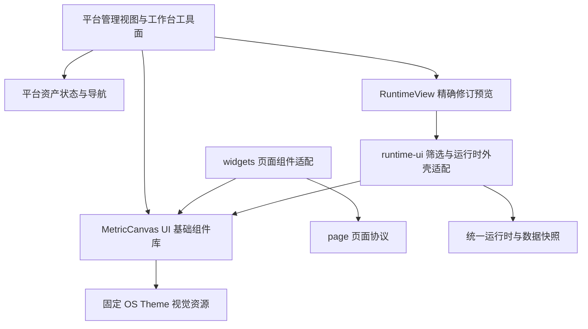

# Platform OS Theme 风格演进与组件复用方案

日期：2026-10-12。状态：用户已确认 Q14 A（保持 Svelte）、Q15 A（平台工具面演进，预览内容保留现行引擎视觉）、Q16 B（新增 MetricCanvas UI 独立包），以及 Q17 UI 独立版本但工程统一、Q18–Q21 A。已确认的[页面管理交互](2026-10-12-platform-page-management-design.md)继续有效。具体工作包、源码冲突与兼容性见[实施计划](2026-10-12-platform-ui-management-implementation.md)，按已确认决策进入规格与视觉基线冻结。

## 目标与解释

采用用户指定的 [TinyVue OS Theme Grid](https://opentiny.design/tiny-vue/zh-CN/os-theme/components/grid) 所属设计体系。页面管理整体使用一致的字体、颜色、控件密度、间距和反馈方式；相同类型的组件对照官方对应组件做 1:1 还原。整体业务布局由已确认的管理旅程决定，官方文档站的导航、示例框及所有 Grid 功能不自动成为产品需求。

“使用这套风格”与“引入 TinyVue 的 Vue 实现”是两项不同选择。当前平台和引擎均为 Svelte 5，推荐继续 Svelte 实现，从官方冻结版本提取样式、图标和必要行为基线。已有日期选择器沿用这一方式。不能只统一几个色值后宣称 1:1，也不能因直接安装库就跳过配置状态与最终页面验收。

## 当前实现事实

| 资产 | 源码依据 | 当前可用程度与调整 |
| --- | --- | --- |
| 页面预览 | `apps/platform/src/lib/RevisionPreview.svelte:64`；`packages/engine/runtime-ui/src/index.ts:1` | 已使用公开 RuntimeView；继续复用统一运行时，阅读模式与编辑入口由平台承载 |
| 页面表格 | `packages/engine/widgets/src/index.ts:16`；`components/table/Table.svelte:47` | 已公开导出 Table，但要求页面数据槽、字段契约、TableProps、TableViewState；没有任意操作单元格 snippet，不能直接装资产列表 |
| 日期选择器 | `packages/engine/runtime-ui/src/filters/DatePicker.svelte:7,254` | 已有 Svelte 实现及官方 OS Theme CSS/图标来源，仍为未导出的内部控件；适合抽取，TimeRangeValue 类型还需与页面协议分离 |
| 分页 | `packages/engine/widgets/src/components/table/Table.svelte:543` | 内嵌于页面表格；可提取受控 Pagination，数据总数和服务端页码由调用者拥有 |
| 页签 | `packages/engine/widgets/src/components/tab-container/TabContainer.svelte:9,50` | 已导出领域容器，内部持有选择状态，并有看板/报告高度规则；应提取中性 Tabs，原容器保留内容区布局 |
| 选择框 | `packages/engine/runtime-ui/src/filters/DimensionFilter.svelte:20` | 内部使用筛选候选值快照；抽基础 Select，查询候选值与写筛选状态继续归领域适配器 |
| 按钮、输入、弹窗、菜单、空态 | `apps/platform/src/lib/views/ManagementList.svelte:26`；`ManagementDetail.svelte:26` | 当前主要为原生元素与局部样式，没有可直接使用的公开基础库；按实际管理需求建立统一实现 |
| 平台框架 | `apps/platform/src/lib/PlatformFrame.svelte:89` | 当前工具面有独立 token，明确不覆盖引擎 `--mc-*`；共享基础控件后仍保留这一所有权 |

上表中的 Table 路径均相对于 `packages/engine/widgets/src/`。DatePicker 的既有验收记录位于 `docs/plan/report-date-picker-tiny-os/`；这是此前有限状态的证据，不能证明本轮新增控件或任意官方新版本已经通过还原验收。

## 官方来源核对

2026-10-12 已在浏览器查看指定 Grid 示例。该页面实际加载的 CSS 地址属于 `tiny-vue-web-doc/3.32.0/assets/`。初步抽样：基础 Grid 文本 14px，正文颜色 `#191919`；表头高 40px、底色 `#f5f5f5`、文字 `#595959`，底边 `1px solid #f0f0f0`；单元格左右 padding 16px，表头文字权重 600。示例内容发生换行时行高随内容变化，不能把截图某一行高度当作所有行的固定契约。这些是勘察事实，尚未冻结全量状态。

官方下载/源码证据：

- [安装说明](https://docs.opentiny.design/tiny-vue/guide/installation.html)与[官方仓库](https://github.com/opentiny/tiny-vue)：现成 UI 支持 Vue 2/3，不提供现成 Svelte 组件入口。
- [仓库结构](https://raw.githubusercontent.com/opentiny/tiny-vue/dev/PACKAGES.md)：模板、renderless、主题和图标分层存在。
- [renderless manifest](https://raw.githubusercontent.com/opentiny/tiny-vue/dev/packages/renderless/package.json)：仍依赖 `@opentiny/vue-hooks`；“renderless”不意味着将该包直接导入 Svelte 就能无适配运行。
- 官方分支和文档会变化。正式基线须记录实际部署资产摘要或可对应的源码 commit；OS Theme URL 不等同于对某个 npm 主题包名称的证明，不混用 SaaS/Aurora/其他主题的 token。

## 已确认的模块安排

新增独立基础组件库 **MetricCanvas UI**，包名 `@metriccanvas/ui`，源码目录 `packages/ui/`。平台与引擎分别依赖它。此前的 Controls 仅是“基础界面控件”的临时技术名称，统一改用 MetricCanvas UI，不再增设 engine/controls 入口。

MetricCanvas UI 提供可直接使用的按钮、输入、选择、日期、表格、页签、分页和弹窗等共享表现能力，不承载页面资产、查询、创作保存或发布规则。按已确认 Q17，UI 可以独立安装、使用独立版本和发布，同时保留本 monorepo 的 workspace、锁文件、工具链与 CI；平台和引擎以经过集成验收的版本组合交付。

基础层只消费受控值、选项、行列、展示属性以及事件回调。它不导入 runtime、page-assets、页面协议或数据网关，也不初始化会话。使用平台基础控件无需构造页面文档或启动 DQE。结构约束以源码可达性与构建产物共同验证，不能仅依赖目录名。

建议按真实需求开放 Button、Input、Textarea、Select、Tabs、Pagination、Dialog、Dropdown、Tag、Grid 和已有 DatePicker；加载/错误/空态先在实际共享需求处统一。管理产品不需要日期筛选就不加日期字段，抽取 DatePicker 是统一既有实现的技术工作。基础能力不追求覆盖 TinyVue 全组件集。

## 表格应拆哪一层

不直接把管理列表包装成页面文档，也不为编辑/预览/更多操作扩充页面 TableProps。管理列表由平台资产服务提供，页面表格由统一运行时供数，两者不同的行为继续留在各自调用者。

推荐共享 Grid 的表头、单元格、行布局、滚动、固定列和受控交互显示；单元格允许调用者提供类型明确的 Svelte snippet，以支持名称链接、状态 Tag 和操作按钮。核心接口是稳定 rowKey、行列描述、显示内容、受控排序与选择状态以及事件，不能暴露页面字段解析细节。键盘、焦点、排序状态和空/加载状态呈现由 Grid 统一负责。

| 归属 | 独占行为 |
| --- | --- |
| 基础 Grid / Pagination | 中性行列呈现、布局、焦点与交互显示；不自行排序远端数据、不自行切片远端页、不发请求 |
| 平台资产列表 | 搜索/状态/排序请求、resourceId 行身份、目录位置恢复、进入编辑与预览、复制/删除确认 |
| 现有页面 Table | 多数据槽行对齐、字段解析与格式化、语义 HTML、合并/汇总行、页面链接、筛选候选值、导出上下文 |
| reportCompact 呈现 | 报告专用无滚动内容布局、静态导出、跨页阅读；不强行改成管理 Grid |

现有 Table 还包含多列排序、表头筛选、固定列、合并行和查询分页。只有确认基础 Grid 能完整承接某条既有路径后才迁移该路径；不能通过删掉能力来得到“复用”。按已确认 Q15 A，本轮管理列表使用 OS Theme Grid，现有页面 Table 不强制迁入新 Grid；引擎侧仅抽取或复用可保持视觉与行为等价的部分。常规页面表格整体迁移另列后续范围，报告分支保留。

## 日期、Tabs 与 Select 的适配

- DatePicker 保留已实现的月/日单值和范围、输入草稿、完整值提交、required/disabled、清除、跨年、弹层定位和原根挂载；基础值使用中性日期类型，TimePointFilter / TimeRangeFilter 保留与页面筛选的映射。datetime 既有路径不因抽取而隐式变更。
- Tabs 基础控件由 active/onchange 控制；管理当前草稿/发布/历史选择由平台持有；TabContainer 的内容区、报告高度和静态导出留在领域适配器。不得新增第二份导航状态。
- Select 的 options/value/disabled/change 是基础能力；DimensionFilter 保留候选值快照、刷新与筛选状态，管理的状态筛选不依赖这条数据通路。
- Dialog 统一焦点进入/退出、Escape 和视觉；发布精确修订、恢复新草稿、删除名称确认与未知操作处理仍属于平台资产逻辑。

## 样式与交付约束

现行 ADR-0066 将引擎视觉呈现归引擎拥有，ADR-0071 规定四交付物锁步发布，结论见[架构主题页](../adr/topics/domain-modeling-and-package-boundaries.md)。用户已选择新增第五个交付物 MetricCanvas UI，Q17 明确其版本独立、工程统一；原四产品包继续锁步，产品精确引用已验收 UI。实施时修订对应 ADR、依赖图、构建发布与消费门禁，共用工程流水线。

不提供平台任意传 theme 的入口，不允许平台广域 CSS 覆盖 RuntimeView。共享控件内部拥有 OS Theme 的固定视觉；平台框架拥有页面工具布局；报告/看板内容拥有自身领域样式。共享内部资源并不代表所有语义颜色、字号或报告密度必须同一套数值。

`@metriccanvas/embed` 在 ShadowRoot 中挂载并以 `emitCss:false` 注入组件样式。新增 CSS/图标随控件发包，在正常 Svelte、HTML embed 和平台微前端三条路径可用；不得依赖 document 中的全局 TinyVue 样式。弹层保留原挂载根并验证边缘碰撞、门户裁剪及卸载监听清理。平台自身没有建立引擎 embed 的 ShadowRoot，微前端路径仍要独立检查门户 CSS 干扰。

保留必要的 MIT 来源与资源归属。共享 token 有唯一实现来源，但正式样式值只来自已冻结的官方状态；不在各页面重复粘贴 TinyVue CSS。单独安装、导入 MetricCanvas UI 的依赖与构建可达模块应不含 engine、页面协议、RuntimeView、DQE 或 ECharts；引擎向下依赖 UI，UI 不反向依赖引擎。

## 方案比较

| 方案 | 好处 | 代价与限制 | 建议 |
| --- | --- | --- | --- |
| 引擎内提供基础组件入口 | 沿用现有四交付物；平台和引擎共享真实实现 | 纯 UI 消费仍需安装 engine | 未采用 |
| 平台内挂 Vue/TinyVue UI | 对应官方实现和高级 Grid 功能可直接配置使用 | 新增 Vue 生命周期、事件桥、CSS/浮层隔离与产物成本；引擎复用仍需桥接 | 未采用，Q14 A 已确认 |
| MetricCanvas UI 独立 Svelte 包 | 平台、引擎及其他 Svelte 应用可独立消费同一套基础 UI，无需安装引擎的图表/数据依赖 | 增加第五个交付物及构建发布门禁；承担官方基线还原维护 | 已采用，Q16 B 已确认 |
| 各管理页面局部仿样式 | 初期改动小 | 控件不一致、与引擎重复维护、后续 1:1 漂移难控制 | 不推荐 |

## 范围与执行次序调整

交互落盘已完成，视觉方案不会重开已批准的预览、编辑、返回、重命名或资产决策。用户已确认 Q15 A：首期覆盖页面管理、详情、阅读模式工具栏及同一工作台的关联工具面/全局导航；预览中的真实页面内容保留现行渲染。引擎已有控件的公共化与适配须保持现有内容视觉和行为；本轮不把普通表格等内容区整体切换到 OS Theme。

1. 按已确认框架、视觉范围与独立 UI 包安排形成 ADR 修订，明确新增交付物、依赖方向与版本/发布策略；保留引擎对内容视觉的所有权。
2. 按官方对应组件冻结版本、状态、DOM/计算样式、图标与截图。管理交互原型只提供旅程基线，视觉使用官方 reference_page；整体产品布局另形成明确规格。按仓库 SDD 分开 MetricCanvas UI 组件库与 platform 应用 Story，联动验收，不用一个跨范围清单混包。
3. 在组件展示入口实现实际可用于产品的基础组件，先提取 DatePicker/Pagination，验证行为等价；逐步实现管理所需基础能力与 Grid。原型使用这些真实组件后才冻结新视觉稿，避免原型和正式代码两套控件。
4. 迁移管理、详情、阅读模式工具栏与工作台相关工具面，接入既有交互状态。外部服务缺口依原设计明确呈现；样式工作不新增 Java/Relay 接口能力。
5. 领域适配器按选择的范围使用共享控件；分别验证正常 Svelte、HTML ShadowRoot、报告导出和平台微前端，再执行产品旅程及真实资产服务验收。

## 预期文件落点

| 文件范围 | 责任与调整 |
| --- | --- |
| 新增 `packages/ui/package.json`、`packages/ui/src/` | MetricCanvas UI 独立包、固定风格基础组件及中性类型；公开入口按真实需求收窄 |
| `packages/engine/runtime-ui/src/filters/DatePicker.svelte` 及日期 helper/图标 | 迁移中性实现；原领域筛选器改用共享控件 |
| `packages/engine/widgets/src/components/table/` | 保留领域转换；抽分页与已具备完整能力的 Grid 路径，报告呈现保持独立 |
| `runtime-ui/src/filters/DimensionFilter.svelte`；`widgets/src/components/tab-container/` | 使用共享 Select/Tabs，保留领域状态与布局 |
| `packages/engine/package.json`、`apps/platform/package.json`；`tools/package-build/build.mjs`、`surface.ts`、`compatibility.mjs`；公开面快照 | 注册独立 UI 包的构建/导出、向下依赖、最低 Svelte 版本与独立消费检查；开发期可导入不等于发包后可用 |
| `apps/platform/src/lib/PlatformFrame.svelte`、`views/ManagementList.svelte`、`views/ManagementDetail.svelte` | 工具面视觉、目录状态和管理入口 |
| `apps/platform/src/lib/PageAuthoringWorkbench.svelte`、`RevisionPreview.svelte` 与管理导航状态 | 与已确认的工作台/阅读模式接线；统一返回路径与修改保留 |
| `docs/adr/` 对应主题页、前端 Story 规格与验收工件 | 固化裁决、视觉状态基线和逐项证据；当前提案不直接覆盖生效 ADR |

上表为架构落点，不是授权的最终执行 allowlist；确认范围后再拆正式 Story 和精确文件清单。

## 验收与回退

同类组件在同版本、同状态、相同字体环境和尺寸下对照官方。覆盖默认、hover、focus、disabled、选中、展开、加载、错误和空态中实际使用的状态；排版尺寸、色值与图标结构做机器检查，截图差异保留真实结果，不能仅称“风格类似”。未勘察的高级 Grid 功能不进入完成声明。

交互按原设计验证：预览直接进入正确草稿；未保存修改不丢失；保存停留工作台；一步返回保留目录条件；发布/恢复/删除仅作用于正确资源和精确修订。基础控件不拥有这些资产动作。

领域回归覆盖已迁移 Table 的字段格式、排序/查询分页/固定与合并、受控语义 HTML、报告布局及 PDF 无交互控件；日期保持原筛选语义。包验收覆盖实际打包消费与监听卸载，不用工作区源码直引证明 npm 消费成功。实际 Java/Relay/门户尚未运行时保持分别未验证。

回退按控件或页面适配批次进行，恢复原工具面或原领域 Adapter，保留新增页面修订、草稿/发布状态与用户工作副本。基础控件迁移本身不要求页面 Schema 或资产数据迁移。提供方能力调整继续按原交互方案单独处理。

## 已确认决策

- Q14 A 已确认：保持 Svelte，按 OS Theme 还原基础组件。
- Q15 A 已确认：演进平台工具面，预览内容保留现行引擎视觉；共享化不隐式改变内容区外观。
- Q16 B 已确认：新增 MetricCanvas UI，采用 `@metriccanvas/ui` 独立基础组件库；不采用此前的引擎内基础组件入口。
- Q17 已确认：UI 可以独立版本和发布，工程保持统一；同仓、workspace、工具链、CI与产品集成验收。
- Q18–Q21 A 已确认：人工明确保存、本地保护与同浏览器恢复、先增量交付真实支持旅程、首期当前稳定 Chrome/Edge。

本轮关键架构决策已收口；后续按实施计划细化视觉基线与迁移清单，服务与视觉勘察出现新冲突时定向 grill。
