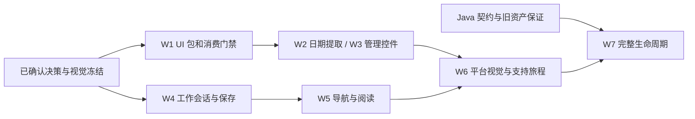

# MetricCanvas UI 与页面管理实施计划

日期：2026-10-12。状态：Q14–Q21 的关键架构与范围决策已确认，工程计划已收敛。Q17 为“UI 独立版本，工程保持统一”；Q18–Q21 均选择 A。后续按工作包建立视觉冻结基线并实施；验收条件不代表已经通过产品验证。

阅读顺序：[已确认交互](2026-10-12-platform-page-management-design.md) → [组件架构与视觉范围](2026-10-12-platform-os-theme-component-architecture.md) → 本文。仓库保存的[原型](../evidence/platform-page-management-interaction-2026-10-12/page-management-interaction-prototype.html)是交互来源；视觉真源是指定 TinyVue OS Theme 的对应组件。

新会话接续时先读 [Handoff](2026-10-12-platform-ui-management-handoff.md)，其中记录当前起点、并行修改、阅读顺序和第一迭代推进步骤。

## 目标与已确定范围

新增独立 Svelte 基础组件库 `@metriccanvas/ui`，供平台和引擎共同使用。管理、详情、阅读模式工具栏和工作台相关工具面按 OS Theme 演进；相同组件按冻结的官方状态做 1:1 还原。平台原有三个关键页面与明确的新建、继续创作、预览进入编辑、一步返回管理规则保持。

已确认：Q14 A 保持 Svelte；Q15 A 保留预览内容的现行引擎视觉；Q16 B 新增 MetricCanvas UI 独立包。DatePicker 提取保持现有视觉与行为；现有页面 Table 不在本轮整体迁入管理 Grid。UI 不消费页面文档、数据快照、页面资产或 DQE；页面组件属性类型仍由 `page` 拥有。

外部 Java 页面资产服务由提供方维护。本仓仅制定消费需求、实现 Adapter 与验证；不修改 Java、私有部署 Adapter 或 Relay 内部实现。完整管理生命周期必须具有真实服务保证。本地恢复记录与远端页面修订是两种对象。

## 已发现的冲突与修正

| 编号 | 冲突或风险 | 当前证据 | 本计划处理 |
| --- | --- | --- | --- |
| C01 | 新 UI 包与四交付物规则冲突 | ADR-0071；`tests/public-api.test.ts:24-32` 强制所有 artifacts 与 page 同版 | 部分修订 ADR-0071；增加第五交付物，采用已确认的 UI 独立版本与统一工程；公开面检查与发布版本分组分开 |
| C02 | 新包不在构建/仓外消费者中 | `tools/package-build/build.mjs:10-16`；根 `package.json` 的 build:packages；`compatibility.mjs:25,80-84,128` 的名单 | 注册 UI 构建、tarball、公开入口、UI-only 消费者与浏览器夹具 |
| C03 | 现有日期并非无领域依赖 | `runtime-ui/src/filters/DatePicker.svelte:3,13`；`date-picker.ts:1,14` | UI 自有日期值/日历合法性；页面适配器保留协议校验，共享用例验证一致性，不能复制 page Schema 到 UI |
| C04 | 平台主题外覆引擎会破坏视觉所有权 | ADR-0066；`PlatformFrame.svelte:89` 的壳层 token；embed 原根样式 | UI 局部样式与默认资源随组件；平台工具面不重设引擎 `--mc-*`，保持 Q15 A |
| C05 | 切路由即销毁工作台 | `PlatformRoot.svelte:18,49-58` 的 pathname+search key；`PageAuthoringWorkbench.svelte:193` 的 dispose | 工作副本与当前任务指针由平台实例拥有；视图切换不等于终止工作；真实卸载/身份失效仍销毁实例 |
| C06 | 现有人工编辑自动远端同步，与原型手动保存冲突 | `workbench/authoring-coordinator.ts:216-228,373-375`；`authoring-sync.ts:187-198` | 按已确认 Q18 A，本地持续保护、人工明确保存才发送；AI 已有内容工具单次保存保持一个发送者 |
| C07 | 内部返回被全局离开确认拦截 | `PageAuthoringWorkbench.svelte:94-108`；`integration/navigation.ts:21-40,51-66` | 区分暂停查看管理、切换目标、离开门户和真实卸载；保护成功后内部切换可恢复，pending/unknown/lease 不失效 |
| C08 | 目录条件/位置及恢复指针不在稳定所有者 | `ManagementList.svelte:9-10`；详情裸 `/manage`；侧栏裸 `/` | 目录条件进 URL/导航状态，滚动与焦点进实例 UI 状态；创作链接解析当前任务；返回明确目标，不使用 history.back |
| C09 | 目录缺全局搜索/排序与标题摘要 | `page-assets/contract.ts:65-72`；`java-adapter.ts:225-236` | Java 消费能力扩展；不能只过滤当前 20 行冒充搜索全部资产，也不逐行读取全部正文补标题 |
| C10 | 草稿/发布隔离与当前生命周期冲突 | ADR-0080；Adapter 同 resourceId PUT is_draft；工作台现有发布提醒 | 新服务保证及旧资产映射后接入；不以浏览器缓存生成假发布副本 |
| C11 | 历史精确读取、追加恢复和整体删除没有现有保证 | `contract.ts:55-57,70-72`；`java-adapter.ts:263-284`；`management.ts:38-44` 允许恢复后版本号重置 | 独立列入提供方需求及验收；旧 rollback 不更名冒充“恢复为新草稿”，DELETE 204 不证明所有引用失效 |
| C12 | 恢复记录作用域缺服务目标 | `authoring-storage.ts:2,11` 仅 actor/workspace/page/resource/channel；`integration/session.ts:14-16` 另绑定两类服务端点 | 新恢复记录绑定身份、workspace、服务目标和资源；版本化解析；旧未决记录保留，不猜服务来源或自动重放 |
| C13 | 输入组件替换可能漏掉最后一次输入 | `PageAuthoringWorkbench.svelte:144-148` 在创作前派发 change/blur | 保留原生输入事件与显式 commit/flush 能力；验证未 blur 即保存或发创作指令 |
| C14 | 兼容性 CI 文档与实际不一致 | `tools/package-build/README.md:22,30` 宣称两个矩阵 job；当前 `.github/workflows/ci.yml` 无 compatibility job | 实施新增矩阵并修正文档；源码、实际消费、浏览器和 CI 证据分别记录 |
| C15 | 标题不是所有旧页都具有的普通字符串 | `packages/page/src/page-list-entry.ts:13` 的标题派生；`schema/page.ts:11` 的可选 TextValue | 名称展示沿用规范派生；无标题时不自动回写 fallback；参数/筛选引用不被 UI 的解析显示值覆盖，只有明确标题编辑才修改页面级声明 |

上述平台路径前缀为 `apps/platform/src/lib/`，日期路径前缀为 `packages/engine/`。这些是当前源码事实；Java 的真实内部存储与服务版本仍不在本仓证明范围。

## 兼容性承诺与边界

### 页面协议与既有外部入口

新增 UI 包不要求改变 Page Metadata 的字段、组件属性、schemaVersion 或 Java/Python 的页面校验协议。保持 engine 的主入口、widgets/ui/composition 子路径、MetricCanvas 导出以及 embed mount/update/destroy；迁移内部实现不能顺手删除外部已使用的导出。

普通引擎 Table 的报告布局、字段格式、分页/排序、合并与受控语义 HTML保持；只对真实迁移路径做回归，不借共享组件改视觉。新的管理 Grid 支持资产操作单元格，但这些 slots 不进入页面协议。

旧页缺少 meta.title 仍可读取，列表名称沿用 `page-list-entry` 的规范派生。标题可能是 TextValue 引用而非字面量；名称显示不能把已解析文本回写成字符串、破坏参数/筛选绑定。工作台标题编辑仅修改页面级声明，保留其他组件标题与数据引用；更改前的原声明进入现有撤销与工作副本保护。

继续兼容 `/manage/pages/:pageId`、`/manage/pages/:pageId/edit` 和 `/?page=...&resource=...`。旧 edit 路径保留 replace 跳转和 query；不按 pageId 猜 resourceId。深链能力不足时给明确受限状态；同名多个资源保持现有歧义拒绝。浏览器前进/后退必须与视图一致，不以多走两层实现明确返回。

### 版本与消费

已确认 Q17：UI 使用独立 SemVer，同时保持工程统一。现有 page/engine/metric-canvas/embed 保持自己的锁步组。产品包依赖已验收的 UI 精确版本，禁止仅因 UI 兼容范围较宽就静默升级引擎外观。更新引擎实现仍正常发产品组新版；UI 版本不加入 Page Schema 或跨语言 Bundle 的产品契约定义。

工程统一具体落实为：

- `packages/ui` 保留在本 monorepo，与平台、引擎共用 pnpm workspace 和锁文件；本地直接使用同一份源码，不建立第二个 UI 仓库或手工同步副本。
- UI 复用现有 Svelte 打包工具、根构建/类型检查/测试入口和 CI 编排；独立组件库有自己的规格与验收，是职责划分，不另建一套工程体系。
- 仓内采用 workspace 依赖；pnpm pack 后写入已验收 UI 的精确版本。公开面检查覆盖全部五包，版本一致检查只覆盖现有四包锁步组。
- 集成验收固定同一源码树、UI 版本与产品版本组合，并记录产物摘要。UI 可单独消费和发布，但平台/引擎产品交付统一验证明确的组合；不默认重新验收任意历史版本组合。
- 同一 CI 可以按变更范围执行 UI 独立消费与产品集成矩阵；UI 改动影响的集成门禁不能因它独立版本而被跳过。

UI 采用现有标准 Svelte 打包方式，声明 peer `>=5.29.0 <6`。这项声明必须通过真实最低版本消费，不默认已经兼容。单独安装 UI + Svelte，类型、构建和行为均可用；依赖图不含 engine、page、ECharts、DQE或页面资产。engine/page-only 两条独立消费回归继续成立。

### 浏览器、样式与嵌入

正常 Svelte、HTML embed ESM/IIFE、平台独立与微前端分别验证。embed 继续自包含，UI CSS/图标进入原挂载根，不要求集成应用额外引入样式文件；浮层不默认移动到 document.body。正常平台没有 embed 的 ShadowRoot，需单独验证门户字体/reset/overflow 的影响与双实例互不干扰。

已有日期直接调用 showPopover，没有旧浏览器 fallback。该能力在 [MDN 官方说明](https://developer.mozilla.org/en-US/docs/Web/API/HTMLElement/showPopover)中标为 Baseline 2024，并提示旧设备/浏览器可能不可用。按已确认 Q21 A，首期支持 Chrome/Edge 当前稳定版本并记录实测版本；固定内网旧版不进入本轮支持承诺，真实门户环境仍单独验收。

官方 1:1 比较使用同一冻结版本、字体环境、viewport、内容长度和状态。控件样式契约与页面组合规格分别拥有来源；桌面、窄屏、短屏和键盘状态按确认后的视觉基线冻结，不从旧原型的 CSS 反推。现有 320/390 日期布局是迁移回归基线；管理窄屏行为是产品布局规格，不冒充官方桌面示例的全页面 1:1。

### 本地恢复与未决写入

工作副本分三种事实：本地已保护、远端已确认、远端结果未知。不得合并为“已保存”。实例内部切换要求本地保护或可证明仍持有工作副本；存储失败时阻止会丢失工作的动作，用户显式丢弃除外。

按已确认 Q20 A，同一浏览器、同身份/workspace/服务目标刷新或重进可恢复当前指针及各页未保存工作副本；不提供跨设备同步。新建尚无 resourceId 的任务需要本地临时身份，不能为恢复任务而自动新建服务资产。

旧 format 1/2 的 frozen command 和 sending/unknown 结果原样保留。新格式区分本地未提交草稿与已发送操作，不能把旧队列转成自动重发任务，也不能被旧客户端错误解析；回退客户端看不懂的新记录仍保留。服务来源无法验证的旧记录隔离为恢复候选，不自动发送。当前 storage CAS 不等于 Java 的并发 CAS，远端并发保证只由真实契约验收。

## 目标状态与职责

| 所有者 | 拥有的状态/行为 | 接口约束 |
| --- | --- | --- |
| MetricCanvas UI | 受控显示、输入草稿、焦点、键盘、浮层及组件资源 | value/options/rows/columns/active 与 callback；不持有页面资产或业务请求 |
| 平台实例工作会话 | 当前任务指针、按资源区分的工作副本、目录返回条件、可恢复状态 | 由 services 创建、实例销毁；身份/目标失效时停止使用，不使用模块全局单例 |
| 既有创作 coordinator | 当前文档、基线、撤销、人工/语言租约、保存状态 | 一份逻辑创作草稿；视图订阅它，不复制 AI 流程；暂停视图不等于重放轮次 |
| 本地保护层 | 工作副本与原操作记录的持久保护及 CAS | 保护与远端发送分离；scope 不含凭据，绑定服务目标；迁移不修改 frozen command |
| 资产 Adapter | 提供方真实读写、响应核验与单次发送 | 当前确认能力和目标能力分开；能力未知默认不开放；不用 UI 层 fetch 绕过保护 |
| RuntimeView | 指定页面文档的统一渲染 | 精确预览文档固定；工作台预览消费当前编辑文档，退出恢复工作，不新增路由层级 |

按已确认 Q18 A，人工编辑状态链：编辑→本地保护→未提交草稿；明确保存→冻结本次文档与基线→单次发送→确认/拒绝/未知。内部查看管理或预览不会创建远端修订。AI 创作指令继续使用现有可信轮次与工具保存回执；前端不得再保存同一 AI 产物。人工脏稿进入 AI 前需要明确保存或取消；不把旧 preparation.flush 的隐式远端同步留作绕过保存按钮的路径。

## 实施工作包与退出条件

本会话已按用户连续实施授权完成 W0–W6 的前端代码；下表区分实现与验收。W7 受提供方能力保证约束，未用模拟能力替代。前置任务的 43 个过程文件保存在带说明的完整 Git stash；交接副本位于 `/tmp/metriccanvas-platform-ui-handoff.jvtgGY/`，未恢复整份 stash。截至该实施记录时尚未提交、推送或部署。2026-10-13 用户已要求提交本批改动并合入 main；提交、远端同步和 CI 结果以本次交付回执为准。生产部署尚未执行。

| 工作包 | 实施状态 | 验收范围及遗留 |
| --- | --- | --- |
| W0 | 已落 ADR-0102、两份 SDD Story、官方 3.32.0 资产指纹 | 完整状态像素比较仍未全部收口，不能宣称所有控件 1:1 已验收 |
| W1 | 独立 UI 0.1.0、统一构建/公开面/五包 tarball 与 CI 矩阵 | 当前与最低 Svelte 源码及仓外 Chrome 消费；Edge 环境故障、CI 未运行另列 |
| W2 | 中性 DatePicker 提取，引擎仍负责页面日期协议 | 四形态、历法共用向量、原根/ShadowRoot、现有 Table/渲染回归 |
| W3 | 管理基础控件与局部官方主题实现 | 七条冻结数值/溢出规则；普通根/ShadowRoot、键盘、禁用、长文案、窄/短屏；全量状态像素证据未收口 |
| W4 | 人工编辑只本地保护；明确保存单次发送；format 3 | 旧未决命令不重放，未知停发；AI 脏稿前置保护与既有单发送者保持 |
| W5 | 实例任务指针、逐任务工作副本、导航与阅读恢复 | 明确新建才创建临时任务；目录条件、异步滚动/焦点恢复；同范围刷新恢复；清洁任务重入刷新基线 |
| W6 | 平台工具面采用 UI；管理 Grid 与受限详情 | 390px 操作完整可点击、目录/详情/工作台链路及 UMD 门户夹具通过；真实 Java/Relay/身份/门户未运行 |
| W7 | 提供方需求与禁用能力说明已交付 | 全局搜索/排序/标题摘要、独立发布读、历史正文/追加恢复、复制、整页删除等待真实保证，未实现猜测 DTO |

详细证据与逐声明状态见 `platform-ui-management/ui-components/`、`platform-ui-management/platform-management/` 及 `docs/evidence/platform-ui-management-2026-10-12/`。

最终本地证据：当前 Svelte 5.56.6 与最低 5.29.0 的隔离源码各为 201 个文件、1772 个测试通过、4 个跳过；每版仓外产品 Chrome 用例 96 个、UI-only 用例 20 个通过。真实五包 tarball 摘要和日志见 [兼容记录](../evidence/platform-ui-management-2026-10-12/compatibility/manifest.json)。包及构建输入与验收树 `b6c855feb90adb47816c384817ea36faeebb91f9` 一致。其后新增的工作台 unknown 状态文案/禁用保存由两版平台 check、当前 Chrome HTTP fixture 和生产微前端 fixture 单独验证；另补人工脏稿 AI 零发送与已保存回执无第二次前端保存两项测试，当前/最低 Svelte 的语言套件均 55/55、测试类型检查通过。这些增量没有被记成最终树全量单测重跑、远端 CI 或真实接缝通过。

当前 Chrome 155 的工作台旅程已记录：无变化保存禁用；第二次保存已应用但丢失回执时，显示“保存结果未确认”、停止重复发送，导航和刷新后仍无额外 PUT。UI 7 项和平台 8 项冻结还原规则通过；它们是明确数值/状态声明，不能代替全状态 1:1 像素对照。完整视觉、Edge、CI 和 live 验收缺口保留在各 Story 的 alpha-tests.md 与 acceptance.md。

### W0：裁决与视觉来源冻结

决策前置 Q17–Q21 已满足。产物：UI 与平台两类 Story 的规格、官方组件库存和必要状态，以及外部能力配合清单。

- `docs/adr/` 新增对 ADR-0071 的部分修订，定义 MetricCanvas UI 的职责、版本与依赖方向；更新现行主题页和索引。不覆写历史 ADR。ADR-0080 的目标生命周期修订只在消费保证明确后落为已生效规则。
- 按仓库 SDD 分开 `packages/ui` 组件库与 `apps/platform` 应用的视觉 Story；工程状态逻辑单列，纯重构不伪装视觉还原。对应官方 URL、实际资产摘要、状态与图标归属进入证据，不把三个 app 混成一个 Story。
- 将日期此前冻结证据作为迁移回归，新增管理组件以当前选定官方版本冻结。浅色 OS Theme 为来源候选；未勘察的模式不列已完成。

退出：每个本轮使用的组件都有可追溯官方视觉来源与使用状态；管理页面布局有明确规格；所有待决选择已记录，服务缺口与前端范围区分。

### W1：独立 UI 包、公开面与消费门禁

版本与统一工程决策已确认；视觉还原依赖 W0 对应基线，可与平台状态建模分别推进。

| 文件 | 实现职责 |
| --- | --- |
| 新 `packages/ui/package.json`、`tsconfig.json`、`tsconfig.build.json`、`tsconfig.test.json`、`svelte.config.js` | 独立包、标准 Svelte 打包、源码/发布 exports、peer、类型与测试入口 |
| 新 `packages/ui/src/index.ts`、`README.md`、`LICENSE` 及上游归属资源 | 最小公开面、安装和受控组件用法、风格与支持范围 |
| 根 `package.json`、`pnpm-lock.yaml` | UI 构建进入默认产品链；UI 浏览器验证入口；workspace 依赖锁定 |
| `tools/package-build/build.mjs`、`surface.ts`、`check.ts` | 新包 staging、入口/声明/运行导出、tarball 结构及 UI 无领域依赖断言 |
| `tests/public-api.test.ts`、新 `tests/public-api/ui.txt` | 第五公开面与独立版本分组；原四包同版规则保留 |
| `tools/package-build/compatibility.mjs` 与 `fixtures/` | UI tarball、UI-only 消费者、同一 Svelte 解析、最低/当前工具链和实际浏览器夹具 |
| `.github/workflows/ci.yml`、`tools/package-build/README.md` | 接入真实兼容矩阵；修复 README 与流水线不一致的描述 |

退出：UI tarball 在仓外只安装 UI+Svelte 即可消费，不需要源码 alias 或专用预处理；page-only 不新增 Svelte/UI/ECharts；UI 依赖图无反向依赖；所有公开 exports 均被快照与打包检查覆盖。此时可证明包形态，尚不证明全部控件已完成。

### W2：日期组件无视觉变化提取

依赖：W1。

- 新 `packages/ui/src/components/date-picker/DatePicker.svelte`、`DatePickerIcon.svelte`、`calendar.ts` 与中性值类型：迁移现有实现和资源，保留单值/范围、月/日、跨年、required、disabled、输入草稿、键盘、清除与原根浮层；不新增时间戳/UTC语义。
- `packages/engine/runtime-ui/src/filters/TimePointFilter.svelte`、`TimeRangeFilter.svelte`、`FilterBar.svelte`：改用 UI，保留页面值适配与协议校验。原内部 DatePicker/helper 去掉重复实现，所有内部引用一次更新；不删除现有公共 engine 符号。
- `packages/engine/package.json` 声明直接 UI 依赖。`packages/ui/tests/calendar.test.ts` 与原 `runtime-ui/tests/date-picker.test.ts` 使用同一日期 conformance 向量核对一般日期合法性与页面校验；不让 UI 依赖 page。
- 更新原浏览器 DatePickerHarness 的引用、`apps/playground/tests/runtime-ui-seams.test.ts` 的样式所有权检查和日期证据入口。

退出：四形态与 datetime 既有路径不退化；日期输入和查询筛选语义不变；普通根/ShadowRoot/多实例/窄屏/导出通过迁移回归；当前与最低 Svelte 实际消费通过。此前证据不能直接标为本次提取通过。

### W3：管理所需真实基础组件

依赖：W0 视觉冻结、W1 包骨架；DatePicker 提取可独立验收。

新建 `packages/ui/src/components/` 下 `button/Button.svelte`、`input/Input.svelte`、`textarea/Textarea.svelte`、`select/Select.svelte`、`tabs/Tabs.svelte`、`tag/Tag.svelte`、`pagination/Pagination.svelte`、`grid/Grid.svelte`、`dropdown/Dropdown.svelte`、`dialog/Dialog.svelte`、`empty/Empty.svelte`。加载/错误反馈仅实现管理实际使用的模式；样式/图标共享来源有唯一所有者。

| 能力 | 首期必须成立 |
| --- | --- |
| Button/Input/Textarea | 原生语义、disabled、focus、输入/commit/blur 行为；能立即获取最后输入，不因包装丢原生事件 |
| Select/Tabs | 外部持有 value/active，显示与 URL/管理版本状态一致；所需空态/禁用/键盘可用 |
| Grid/Pagination | 稳定 rowKey，列定义、类型明确的 cell snippet、受控排序/分页；名称、状态与行操作可呈现；不自行请求或对远端页重复切片 |
| Dropdown/Dialog | 菜单与低频危险动作按需显示；焦点归还、Escape、确认禁用、原挂载根、多实例及卸载清理 |
| Tag/Empty/反馈 | 状态文字与语义、初始空态/筛选无结果/加载/错误分别呈现；不把业务未知状态绘制为成功 |

本轮 Grid 不实现虚拟化、树表、行编辑、导入导出或常驻批量复选框；这些不是已确认管理需求。现有引擎 Table 的高级能力不因基础 Grid 首期范围较小而被删减。

验收落点：新 `packages/ui/tests/browser/UiHarness.svelte`、`main.ts`、`index.html`、`components.spec.ts` 与浏览器配置。根 Vitest 当前没有 Svelte 渲染插件，纯 TS逻辑用现有 Vitest，真实交互用浏览器夹具，不用源码字符串断言冒充组件行为。

退出：实际组件可用于原型和产品；冻结状态的样式/图标事实及浏览器行为均有证据；真实组件组成的新视觉稿与已确认交互对应，避免正式实现再次手写一套控件。

### W4：保存与实例工作会话

保存与恢复决策 Q18/Q20 已确认；可先使用现有界面做状态验证，不依赖 W3 的视觉完成。

| 文件 | 实现职责 |
| --- | --- |
| 新 `apps/platform/src/lib/workbench/work-session.ts` | 平台实例的当前任务指针与按完整资产身份索引的工作副本；管理视图切换保留，不复制创作算法 |
| `integration/services.ts`、`mount.ts`、`session.ts` | 创建与销毁工作会话；身份/目标失效停用；凭据每请求现读；真实卸载不隐式保存 |
| `workbench/authoring-coordinator.ts`、`authoring-sync.ts` | 拆本地保护与人工提交；保持原操作身份、租约、冲突/未知回执；按 Q18 接线 AI 前的人工草稿处理 |
| `workbench/authoring-storage.ts`、`authoring-recovery.ts` | 新记录作用域与版本化恢复；保留旧未决记录，服务来源歧义不重放；Q20 决定指针持久化范围 |
| `PageAuthoringWorkbench.svelte` | 订阅当前工作会话、明确保存/状态提示；视图销毁与会话结束分开，仍使用同一文档和可信创作链 |
| 原 `tests/workbench/authoring-sync.test.ts`、`authoring-coordinator.test.ts`、`authoring-recovery.test.ts`；新 `work-session.test.ts` | 保存发送次数、本地草稿/未知分离、多页恢复、旧记录隔离、身份失效与语言租约 |

暂停到管理时，本地工作副本保留，渲染实例及页面读取按需卸载/取消；发送中的可信操作仍绑定原任务，迟到结果不能更新另一页面。选择另一任务前遵守未决操作和语言租约约束；保存的具体文档/基线在用户提交时冻结，不随后续 UI 变化替换。

退出：人工修改与内部返回不意外新增修订；同页与跨页工作副本保留；单次保存/AI 保存没有重复发送；unknown 不重发；身份与服务变化不能继续使用旧工作；存储失败真实可见。进入 AI 与刷新恢复按确认策略通过。

### W5：导航与阅读模式接线

依赖：W4；视觉可与 W3 并行，最终集成依赖 W3。

- `PlatformRoot.svelte`：保留旧深链兼容，去掉工作会话随 pathname/query 重建的耦合；使用显式 view+reading 状态，阅读不是新历史页面。
- `PlatformFrame.svelte`：侧栏创作恢复当前任务，没有任务展示空工作台；新建仍是独立动作。全局导航和工具面采用 UI 组件与已冻结视觉。
- `integration/navigation.ts`：对内部暂停/切换、真实离开和浏览器 popstate 区分意图，保留 routeBase/门户跨前缀保护、beforeunload；明确返回不依赖 history.back。
- 新 `management/navigation-state.ts`：目录条件与实例位置/焦点恢复；不把业务状态塞入仅做审计格式化的旧 `management-state.ts`。
- `RevisionPreview.svelte` 与工作台：读取预览固定文档；编辑预览消费当前工作副本；入口打开目标当前草稿/恢复原编辑缓冲，不自动恢复历史、不自动保存。
- 新 `apps/platform/tests/management-navigation.test.ts`、`tests/workbench/work-session-browser.mjs`：名单→预览→编辑→一步返回、保存留在编辑、侧栏恢复、浏览器前进/后退、旧 URL 与多实例/门户挂载。

退出：逻辑上仅管理、详情、工作台三类关键页面；阅读模式不增加返回层级；返回恢复目录条件；编辑对象始终明确。内部切换不丢工作，也不撤销真实写入保护。

### W6：平台视觉与现有服务可支持的管理能力

依赖：W3/W5；按已确认 Q19 A 增量交付 UI、视觉与真实支持的旅程，服务能力未到位的功能明确未开放。

- `apps/platform/package.json` 直接依赖 UI；`views/ManagementList.svelte` 使用 Grid、现有服务分页/状态和明确操作入口；不以当前页本地过滤模拟全目录检索。
- `views/PageReading.svelte` 使用 UI、版本状态与当前读取内容预览；旧资产能力与目标双引用模型明确区分。未提供历史正文时不显示假的历史预览。
- `PageAuthoringWorkbench.svelte`、`PlatformFrame.svelte`、`RevisionPreview.svelte` 迁移关联工具面；不覆盖引擎内容 CSS，不重做创作编排或页面布局。
- 新 `management/copy-page.ts`：从明确已读取并校验的文档创建独立 pageId，新建 draft 单次提交；不复制历史、发布引用、本地队列和操作ID。身份、pageId/resourceId、未知操作保护沿用已有层。
- `page-assets/contract.ts`、`java-adapter.ts`、`management.ts` 与 `page-assets.ts`：仅扩充已获得提供方事实的消费面；新增 capability 描述记录是否确认及原因，不以示例成功推导真实支持，也不要求私有 Adapter 平白增加必填配置。

阶段可支持：UI 库独立交付、现有目录分页/状态、当前已读内容预览、草稿编辑/标题、工作副本保留、正确导航、已确认来源的新草稿复制。依赖服务保证的动作保持未开放。尤其已发布资源的编辑不能通过旧单资源 PUT伪装“发布内容保持不变”；该目标未获保证时阻止新旅程中的危险写入并解释能力缺口。

退出：实装页面使用同一 UI 库，已开放旅程与真实消费保证一致；界面简洁且不把 provider 能力、资源 ID 或技术流程暴露成多余用户步骤。此阶段若选择增量交付，验收状态明确为部分功能完成，不宣称整体管理目标已完成。

### W7：提供方能力与完整生命周期接入

依赖：提供方经验证的契约、旧资产映射及 W6；不实施 Java 服务。

| 能力 | 提供方必须保证 | MC 侧实现/验收 |
| --- | --- | --- |
| 全目录检索 | title 摘要、范围一致的搜索/状态/排序/分页和总数 | List 消费与跨页检索/排序；不能分页后再本地过滤 |
| 草稿/发布分离 | 两个明确内容引用，保存草稿不修改发布读取结果 | 双版本状态、预览对象与编辑目标；保存前后发布定义与访问行为不变 |
| 精确确认发布 | 绑定已审阅修订的服务端原子约束 | 确认 A 后出现 B不能发布 B；人工确认与单次提交保护 |
| 历史读取与恢复 | 精确历史定义、追加草稿、保留历史/发布、并发基线约束 | 历史预览固定正文，恢复为新草稿；不可用历史不伪造 |
| 整体永久删除 | 范围涵盖草稿/发布/历史，后续发布读取与执行入口失效 | 名称确认、并发行为、删除后新读取与访问验证；无法追回已下载内容 |
| 写入核实 | 已发生/未发生/无法确定有明确查询或人工核实方案 | 原操作核实；没有可用核实能力时 unknown 继续停发，不另造操作重试 |
| 旧资产映射 | 当前单资源如何进入双引用模型和回退读取 | 有实际样例、版本与发布引用验收；不覆盖旧发布内容或猜历史快照 |

正式路径/DTO、CAS字段及错误闭集以提供方协议冻结，不在此猜测 URL。MC 更新消费契约、Adapter、管理状态和相关夹具；Java 的存储、索引、发布引用和历史保留策略归提供方。新版双引用数据不能被旧单资源保存路径破坏，完整版本启用前需给出旧客户端/回退阻止写入策略。

退出：真实 Java和发布读取/执行链路分别通过；新契约与旧资产映射已验收；ADR-0080 对应现行结论更新。Relay/身份/门户不因 Java 单项通过而被记为通过。

## 验收追溯与证据层次

| 验收编号 | 必须证明的结果 | 工作包/主要证据 |
| --- | --- | --- |
| AT01 | UI 可独立安装且不依赖引擎/协议/图表 | W1；真实 tarball UI-only 消费者和依赖可达性 |
| AT02 | 当前与最低 Svelte、Chrome/Edge 目标版本实际消费 | W1/W2/W3；仓外类型/构建/浏览器；CI实际矩阵 |
| AT03 | OS Theme 所需同态组件 1:1 还原 | W0/W3/W6；冻结样式契约、图标及截图结果；逐状态声明 |
| AT04 | DatePicker 提取无视觉和筛选语义变化 | W2；共用用例、四形态、普通根/ShadowRoot及导出 |
| AT05 | 切换管理/编辑/阅读不丢工作，保存留在工作台 | W4/W5；coordinator与浏览器旅程；提交次数 |
| AT06 | 本地保护、远端确认、未知分开；AI 结果不再前端重复保存 | W4；单次端口与可信语言流程用例 |
| AT07 | 老URL、多资源身份、目录条件/位置正确 | W5；深链、前进后退、搜索/页码状态与实际门户前缀 |
| AT08 | 新记录隔离和旧未决记录保留 | W4；scope/CAS/旧format/服务目标变化/存储失败 |
| AT09 | 整体平台视觉与原有报告/嵌入呈现相容 | W6；实际页面、微前端、双实例、报告/PDF迁移路径 |
| AT10 | 全目录搜索排序与复制独立身份正确 | W6/W7；契约夹具、浏览器及真实服务分别记录 |
| AT11 | 保存不改发布、发布绑定精确修订、恢复追加草稿 | W7；真实服务并发与发布定义/访问证据 |
| AT12 | 删除范围及之后读取/执行失效，unknown 不重发 | W7；服务范围、真实URL访问与失败/未知结果 |

组件纯逻辑使用现有 Vitest；控件交互/布局用真实浏览器；资产生命周期用契约夹具及真实服务。现有 `pnpm test`、`pnpm check`、`pnpm build`、`pnpm packages:check`继续执行；发布兼容使用修订后的 `pnpm compatibility:check`，最低版本与当前版本分别留痕。是否跑完整 Bundle 导出检查取决于产品包版本/契约的实际变更，generated lock 不手改。

compatibility 默认检查 HEAD 的 Git 树。执行未提交实现的消费验证要明确 source-tree，不能跑 HEAD 后声称当前工作区通过；只对本批允许文件建立验收树，保留其他任务修改。Svelte最低工具链使用既有矩阵兼容组合，不用忽略 peer 声称成功。规划时验证尚未运行；本次实际执行范围与结果见上方实施状态及证据，未运行项保持单独登记。

## 批次、依赖与回退

工程工作包归并为五个验收迭代，前四轮完成增量版本，第五轮在外部能力就绪后完成全部生命周期。以下为初步工程排期，按一名主要开发持续投入、包含针对性测试与集中浏览器验收估算；不是已测执行耗时，也不计 Java 提供方建设/等待、设计大幅变更或上线审批时间。

| 迭代 | 对应工作包 | 可验收交付 | 估算工作日 |
| --- | --- | --- | --- |
| I1 工程与基线 | W0/W1 | 官方视觉状态基线、UI 包骨架、统一构建/CI与独立消费门禁 | 2–3 |
| I2 公共 UI | W2/W3 | 日期无变化提取、管理所需真实组件与还原验证、基于真实组件的新视觉稿 | 4–6 |
| I3 工作台与导航 | W4/W5 | 明确保存、本地恢复、多页工作副本、统一工作台和阅读模式/返回旅程 | 4–6 |
| I4 管理增量版本 | W6 | 管理/详情/工作台工具面视觉与已支持资产旅程集成，兼容性集中回归 | 3–4 |
| I5 完整生命周期 | W7 | 提供方能力接入、旧资产映射、真实发布/历史恢复/删除验证 | 2–4，在契约与服务均就绪后 |

前四轮合计 13–19 个工作日，约三到四周；包括第五轮的 MC 侧工作合计 15–23 个工作日，约三到五周。完整功能的日历完成时间为“前四轮完成与提供方就绪两者中较晚的时点 + I5 的 2–4 个工作日”，不能只将 MC 工作量相加当作提供方交付承诺。

Java 配合清单在 I1 就输出，提供方工作可与 I2–I4 并行，不到 I5 才启动协调。I3 最主要的不确定性是现有自动同步改为明确保存，以及旧恢复记录/未决操作兼容；I2 的不确定性是官方状态基线与控件交互细节。I1 验收后以实际工程/基线结果校准后续区间，不缩减已确认的 1:1 或写入保护要求来满足时间估算。

### 各迭代代码包变更

下表区分产品源码、新包建设、验证文件与同版发布联动。工程工具与根目录不是新增 npm 交付物。

| 迭代 | 新增/修改的主要代码包 | 具体变更 | 验证及仓库级配套 |
| --- | --- | --- | --- |
| I1 工程与基线 | 新增 `packages/ui`（`@metriccanvas/ui`） | manifest、源码/发布入口、Svelte/TS配置、最小公开面、许可证与README；此时不算控件全部完成 | 修改 `tools/package-build`、根 package.json/锁文件、`tests/public-api`、CI；新增 UI 独立消费夹具；规格/视觉来源及 ADR 修订 |
| I2 公共 UI | 修改 `packages/ui`、`packages/engine` | UI 实现管理所需基础组件并接收 DatePicker；engine 的 runtime-ui 日期筛选适配器改用 UI，中性日期类型与页面协议校验分开；engine manifest新增 UI 依赖 | UI/engine 日期与控件验收；修改 `apps/playground/tests/runtime-ui-seams.test.ts` 和日期 Harness；embed、搭建画布及最低 Svelte 仓外消费回归 |
| I3 工作台与导航 | 修改 `apps/platform`（platform） | 工作会话、人工明确保存、本地存储/恢复版本、服务作用域、当前任务指针；路由、返回目录状态、阅读模式与预览编辑入口 | platform 保存/恢复/导航/微前端测试及新增工作会话浏览器夹具；不改 Python 创作算法或 Relay协议 |
| I4 管理增量版本 | 修改 `apps/platform`；`packages/ui` 仅在集成发现必要适配时修正 | platform 直接声明 UI 依赖，管理/详情/工作台工具面使用 UI；新草稿复制与真实能力展示。UI适配修正不改变已冻结还原目标 | platform 页面/微前端/兼容验收；UI修正时重验依赖状态；引擎内容/日期/报告导出做对应回归 |
| I5 完整生命周期 | 修改 `apps/platform`；外部 Java 页面资产服务由提供方修改 | platform 更新消费契约和 Java Adapter，接入检索、双内容引用、精确发布、历史读取/追加恢复、删除与核实；不把 Java 服务建进本仓 | 消费契约资料/夹具、生命周期 ADR；真实 Java、发布访问/执行、身份与门户分别验收 |

`packages/page`、`packages/metric-canvas`、`packages/embed` 本轮没有计划中的业务源码重构。engine 改动正式发布时，按现有四包同版规则联动这三个包的 manifest 版本、产物和对应契约版本/摘要生成；这不等于修改页面 Schema 或新增 UI 领域依赖。embed 重建后仍自包含，并检验 UI 的组件样式进入 ShadowRoot。

`packages/application-runtime` 与 `metriccanvas-authoring` 未列本轮业务改动：配置/身份通路和 AI工具单次保存继续沿用。产品组版本发生变化时，authoring 中的生成契约快照/锁可按既有导出链联动，不能误报为创作算法或输入协议变更。若实施证据显示必须改变现有公开 Interface、私有 Adapter 或这些包的业务代码，先登记扩散原因并做针对性架构审查，不默认扩大范围。

包骨架、日期提取、平台状态/导航、平台视觉、完整生命周期为可分别审阅的批次。默认不提交/推送/部署；用户要求交付时按允许路径和实际验证树执行，分别报告远端 SHA、CI 与真实部署，不混淆。

前三类回退只恢复源码导入、依赖和视图，不迁移页面数据。新恢复记录和未知操作始终保留；回退旧客户端不可读取时不删除、不重放。完整生命周期回退需提供方数据兼容保证；无保证时停止旧写入并保留只读/核实路径，不能将草稿覆盖回发布资源。

当前有其他未提交任务涉及 RuntimeSurface/ExportView/ReportHeaderView、图表格式、页面计算与 ADR。W2/W6 不顺手改这些语义；确需修改同文件时先以当前内容为基线做局部合并，相关回归与既有证据单独对账，不撤销他人工作。

## 已确认关键决策

| 决策 | 用户确认 | 实施含义 |
| --- | --- | --- |
| Q17 UI 版本策略 | 可以独立，工程保持统一 | UI 独立 SemVer；同仓、workspace、锁文件、工具链与 CI；四产品包仍锁步，产品精确引用并统一验证 UI 版本组合 |
| Q18 人工保存边界 | A | 人工修改本地保护，明确保存才写远端；AI 保留工具单次提交，人工脏稿进入 AI 前先保存或取消 |
| Q19 交付节奏 | A | 先交 UI、视觉与真实支持旅程；未获服务保证的功能明确未开放，后续补齐 |
| Q20 工作恢复范围 | A | 同浏览器同作用域刷新/重进恢复任务和未保存副本；不做跨设备同步，不等同远端保存 |
| Q21 浏览器范围 | A | 首期当前稳定 Chrome/Edge，记录实测版本；真实门户兼容单独验收 |

本轮关键架构与范围决策已收口，后续从 W0 的规格与视觉冻结开始。服务契约与视觉勘察产生新的实质冲突时定向 grill，不重复询问已确认选项，也不将外部能力缺口写成已通过。
