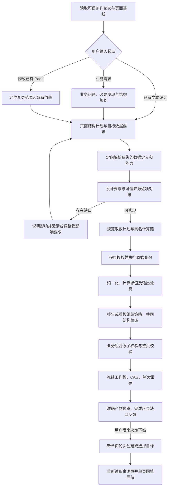

# Report 与 Dashboard 生成主计划

更新：2026-10-12。状态：**整体方案已认可，生产实现未开始，接口与部署选型待冻结**。本计划合并本次两页目标、实施方案、编码任务、整体流程、computed 专项及 Relay/Java 依赖六份文件，是本批唯一执行入口。已确认原则见 [ADR-0098](../adr/0098-profiled-page-composition-and-incremental-navigation.md)；历史分稿只作追溯，不继续维护。

目标：通过文本业务要求或文本设计，生成并保存 IOC 概览与机会点列表，后续按用户意图增量下钻。内部 Agent 不支持多模态，正式流程不依赖图片、OCR 或图像模型。普通问数不进入本批。

## 阅读导航

- [完成状态](#1-完成状态)
- [两页目标与验收基线](#2-两页目标与验收基线)
- [统一创作流程](#3-统一创作流程)
- [架构调整与代码职责](#4-架构调整与代码职责)
- [计算规划与输出验真](#5-计算规划与输出验真)
- [编码任务与实施顺序](#6-编码任务与实施顺序)
- [协议迁移](#7-协议迁移)
- [Relay Java 与数据依赖](#8-relay-java-与数据依赖)
- [验收与完成门槛](#9-验收与完成门槛)
- [待冻结的具体选型](#10-待冻结的具体选型)
- [迁移回退与源码入口](#11-迁移回退与源码入口)

## 1 完成状态

| 工作 | 状态 | 已完成内容或尚缺什么 |
|---|---|---|
| 业务范围与流程方案 | 已完成 | 两页目标、文本设计/需求/已有页三种起点、自由生成顺序；用户已认可整体方案 |
| D1–D7 架构原则 | 已完成 | 统一入口、内部策略、受控树、业务组合原子性、输入整体切换、可信规则来源、增量下钻；已记入ADR-0098 |
| 源码与提供方契约盘点 | 已完成 | 创作入口、预算、字段/筛选/计算缺口及Java/DQE消费要求已定位；不等同于生产实证 |
| 状态逻辑原型 | 已完成模拟 | 只说明流程和状态；不作为最终管理页面或业务页面原型，不作为真实生成验收 |
| C00–C11及C01a/C03a/C05a | 未开始 | 可读目标已盘点，机器清单、正式契约与实现仍待编码；逐项见第6节 |
| 事实消费、跨页驱动、设计恢复、求值部署选型 | 待冻结 | 具体取舍见第10节；方案认可不等于已选择所有接线方式 |
| 新目标真实模型、保存产物与浏览器 | 未执行 | 必须使用同一机器清单逐层验收 |
| 真实Relay/Java/DQE/门户接线 | 未验证 | 第8节依赖需提供方实证，未取得接入结论 |

状态按证据层级更新：方案完成、代码完成、本地验收完成、真实集成完成分别记录。已有报告稳定性和简单dashboard用例通过，不计为本批两页或完整复杂计算通过。

## 2 两页目标与验收基线

### 目标页面与基线

| 目标 | 当前文件 | 必须保留的能力 |
|---|---|---|
| 全球与区域作战地图概览 | [ioc-project-overview.json](../../pages/ioc-project-overview.json) | 7 个查询数据源、6 个筛选器、铺底地图、3 张组合卡、4 个受控比率、3 个 Tab 与表格、权重列轨、地图层级切换及导航 |
| 机会点列表 | [ioc-opportunity-list.json](../../pages/ioc-opportunity-list.json) | 1 个查询数据源、10 个筛选器、40 列表格、固定列、查询分页、排序、5 列表头筛选、行导航 |

2026-10-12 当前工作区基线，两页均通过 Python 页面校验：

| 文件 | Schema | SHA256 |
|---|---|---|
| ioc-project-overview.json | 6.11 | dc683d7331ed695edb77eb270e860adfbe57324d9b27fd410371e99a4b711e29 |
| ioc-opportunity-list.json | 6.11 | 7f1e91132aa2388e7e9877a82d9ccab6612e4279aa3b3cc8a1a3cb8e7aeab1b6 |

原页包含合成演示行及尚待真实对接的区域编码，不能作为生产业务证据。概览页说明仍称主数据源为 inline，实际 7 个源已全部为 query；冻结验收夹具时须纠正该说明。后续基线改变应更新哈希和差分，不能自动覆盖已经冻结的用例。

生成页面采用当前作者版本，不要求与原页字节相同。来源身份、字段映射、筛选绑定、计算口径、业务内容、组件关系与交互必须等价。不得以删模块、减列、取消分页、取消地图层级或复制目标页面降低验收标准。

用户生成过程保持自由：可以先创建概览，再决定下钻问题并生成目标；也可以先建列表或选择已有目标。没有提出下钻的当前轮次，不因缺少未来导航而判为未完成。本批不新增长期下钻待办或占位入口；后续根据当前已保存页面和用户意图继续创作。最终两页基线验收包含实际可用的导航；工程实施顺序与用户生成顺序分别处理。

### 两页的生成目标

#### 概览生成

自然语言需求明确统计月份、截止日、业务范围与阅读目的；程序供给可信的新建创作基线及计划授权。生成页面应具备以下内容：

- 机会点概况、项目分层分级管理、复盘总结三张组合卡。包含总量、金额、对比值、分类环图与明细、管道支撑率、立项率、分析会召开率、赢单率、复盘率及奖惩计数。
- 区域地图作为铺底层，与指标卡及 Tab 表格共同形成概览；保留全球、地区部、代表处层级，图例、提示信息及区域编码映射有可信依据。
- 概览、TOP 预签项目、丢单项目三个 Tab；同一数据源可支持多个子组件，Tab 之间不复制或改变取数口径。
- 六个筛选状态覆盖月份、重点国代、截止日、区域层级、项目等级与产业。原页月份为隐藏筛选器，由页面参数初始化；保留这一语义，不能要求六项都显示为顶部控件。
- 七个数据源均按声明消费对应筛选；层级区域按每级 queryField 绑定，不能让三个层级共用错误字段。
- 四个 ratio 算子保留当前分子、分母、0–100 刻度和零分母行为。可信指标若提供等价已计算值，采用前应另行确认与基线的口径等价性。
- 从地图或概览行进入机会点列表，携带月份、重点国代、产业、区域值及区域层级；原页其他导航入口的目的与参数也须保留。

参考用户指令：

> 为运营负责人新建全球与区域作战地图概览，统计月份为 2026 年 4 月，截止日为 3 月 26 日。以区域地图呈现管道支撑情况，展示机会点概况、项目分层分级管理与复盘总结；下方提供概览、TOP 预签项目、丢单项目三个 Tab。支持重点国代、日期、区域层级、项目等级和产业筛选。可以从区域地图及代表处概览进入同范围的机会点列表，项目条目可以进入已存在的项目详情。先核对取数计划，再创建草稿并交付预览。

此指令还需配套业务需求清单，明确每个指标、分类和 Tab 所需内容；清单使用业务语言，不携带 Page JSON、样式坐标或 DQE 查询体。

#### 列表生成

生成机会点明细列表，保留原页全部 40 个显示列和导航所需隐藏字段。覆盖机会点与客户身份、产业、金额、赢率、阶段、区域、行业、日期、责任人、立项、进展风险、伙伴以及十二个月客观预测。

十个筛选器包括月份、重点国代、产业、层级区域、NA 类型、云行业、云子行业、超期状态、机会点阶段和预签金额范围。行业与子行业保持级联；筛选初值与页面参数分工保持不变。原页没有通用关键词搜索，本批不增加只过滤当前页的搜索框。

查询分页、排序和表头筛选由生效查询下推执行。初始页大小沿用基线 5，验收数据至少覆盖两页；改变范围、排序或表头筛选后页码重置，金额和日期条件使用正确目标。机会点编码与名称为左侧固定列，名称可点击，横向滚动由表格承载。

机会点名称进入已存在的项目详情，并携带原页声明的行字段，包括行月份。不能把行月份替换为概览页面的月份。详情与机会点分析是既有导航目标，不在本批新建范围中。

参考用户指令：

> 新建 2026 年 4 月的机会点列表，用完整明细表展示机会点、客户、产业、金额、赢率、阶段、区域、行业、日期、责任人、立项和项目进展，以及 1 至 12 月客观预测。提供月份、重点国代、产业、区域层级、NA 类型、云行业及子行业、超期状态、阶段、预签金额范围筛选。使用查询分页，支持金额和预测列排序、指定日期与状态列的表头筛选；固定编码和名称两列，名称可进入项目详情并带上行参数。先核对取数计划，再创建草稿并交付预览。

具体列清单、顺序、排序与表头筛选要求应在验收用例中冻结；模型可读的是业务要求，验收器独立保存预期字段与协议关系。

### 必须完成的调整目标

| 编号 | 调整目标 | 当前事实与阻力 | 完成判据 |
|---|---|---|---|
| G1 | 支持两页规模的受控取数与装配 | 整页 sources 上限 6，概览需 7；每取数单元 metrics 上限 6，概览汇总返回 20 个度量、列表返回 15 个；装配 fields 和 record-list columns 上限 30，列表显示 40 列、查询有 45 个结果字段 | 无静默删源、拆错口径或漏列；单批并发、整页规模和模型证据预算分别表达，适配两页规模并有明确拒绝条件 |
| G2 | 形成完整的概览结构表达 | 平台 compose 接收平铺数据块；地图、组合卡与 Tab 虽有编辑原语，尚不足以表达目标的全部属性。原页采用 plain、backdrop 与 columnTracks=[29,29,22]，现有 add_map_chart 拒绝 plain/card，set_section 不接收 columnTracks | 能通过受控创作表达铺底地图、权重列轨、三张组合卡、三个 Tab 和子组件 variant；自动报告页头不造成重复标题或破坏概览结构；保存后宽窄屏正确渲染 |
| G3 | 统一生成筛选声明与跨查询绑定 | 新建只直接支持 dateFilters；维度编辑只支持扁平绑定，缺层级及级联完整输入；缺 boolean/numberRange 创建与绑定原语；总量查询筛选字段不在结果中，会被维度编辑拒绝 | 两页所有筛选及其绑定来自可信查询能力；区域逐级字段、金额 metric、boolean 真值和日期 valueFormat 正确；不为总量卡增加错误分组 |
| G4 | 保留可信派生计算并支持组合呈现 | 原页四个 ratio 已由产品协议与运行时支持；当前创作没有相应 compute 装配能力，容器构造读取源时拒绝 compute，要求物化证据 | 从可信口径形成具名算子及输出字段，使用执行与计算证据验真；组合卡消费正确结果，筛选重查后比率重算；禁止模型从有界样本拼凑业务比率 |
| G5 | 完整生成宽表的查询交互 | 当前取数单元不接收分页与排序声明；平铺表格表达不能完整声明目标的固定列、分页、表头筛选与导航，编辑列属性也不足以补齐全部配置 | 40 列全部可用，查询分页与总条数一致，排序和表头条件下推正确；隐藏导航字段保留；表格内部滚动且固定列正确 |
| G6 | 增量生成并验收两页导航 | 表格链接已有部分受控能力，地图及指标卡的目标属性不能经现有原语完整表达；目标图已有筛选携带与行携带的区别 | 支持先概览后决定下钻、先目标页、选择已有目标；没有下钻需求时概览可独立完成；不新增持久待办或占位；目标可用后从来源页当前修订回填链接；概览到列表的筛选与层级一致，列表到详情使用行字段 |
| G7 | 用两页替换简单 dashboard 的主要验收面 | 现有 create-dashboard 只覆盖区域对比图与表格，无法证明两页的创建和交互 | 同一用例清单贯通确定性、真实 DS、页面产物与浏览器；模型不读取目标 JSON，各层分别记录状态与证据 |

上述缺口主要位于公共创作契约、确定性装配和 Skill 编排。现有页面协议已能合法表达两页，优先复用当前协议与统一运行时。具体 Interface 采用何种结构、多少次工具调用以及预算数值，进入设计阶段后确定；不通过放开任意 Page JSON 作为输入规避受控能力。

## 3 统一创作流程

### 输入：设计可以是一段业务文字

| 输入来源 | Agent 实际消费 | 信任范围 |
|---|---|---|
| 自然语言、Markdown、表格形式规格 | 阅读目的、模块顺序、组件关系、显示字段、交互及用户钉住项 | 用户表达设计要求；不自动证明指标口径、物理字段、编码或权限 |
| 上游提供的结构化文本 | 经闭集 Schema 校验的设计要求；具体结构字段在 C01 冻结 | 创作输入，不是可直接执行的 Page JSON、查询体或脚本 |
| 用户指定且有权限读取的参考 Page | 程序读取准确修订，投影有界结构摘要及可引用能力 | 引用须绑定来源与修订；复制设计不意味着可复用原数据授权 |
| 只有图片的外部材料 | 由用户或上游先提供可读文本规格，正式 Agent 再处理文本 | 自动转换是可选外部能力；无法取得文本时明确输入缺口，不臆测图片内容 |

例如，用户可以直接提供以下规格，不必了解字段 ID 或算子名称：

```text
页面：区域经营概览，供区域负责人看本月执行情况。
顶部：月份、区域、行业筛选。
主体：地图作为背景，覆盖三个指标模块：机会金额、项目金额、达成率。
底部：三个标签页，分别看重点项目、流失订单、机会分层。
达成率按实际金额除以目标金额；没有目标时显示缺失，不显示零。
指定：保留地图和三个标签页，不能自动换成一张汇总表。
先生成概览；下钻页面稍后再决定。
```

程序保留文本来源和版本；模型将其转换为有界页面结构计划与业务数据要求。达成率描述只构成待核验规则，程序还须识别真实字段、单位和粒度，必要时记录明确的规则确认。设计示意数字不进入真实取数证据。

参考 Page 的结构摘要与用于评分的完整目标 JSON 分开：两个验收目标的 JSON 和评分器仍不进入模型消息。已有页面编辑必须读取 Java 当前准确基线，不能用设计文本重建旧文档。

### 三种起点，汇入一条受控生成链



这是职责顺序，不要求每格对应一个 MCP 工具或一次模型调用。纯外观编辑沿现有 edit 路径跳过发现、取数和计算；已具备本轮有效事实与结果的任务复用证据，不强制重复发现。报告也能从文本设计开始，看板也能从业务需求开始；layout 只参与表达组织。

| 阶段 | 需要形成什么 | 门禁及反馈 |
|---|---|---|
| 可信准备 | 单页 binding、权限、模式、当前基线与 workVersion | 未准备不得执行创作工具；existing 使用准确当前文档 |
| 设计归一化 | 页面结构计划、稳定逻辑标识、目标数据要求、钉住项和允许调整项 | 未解析数据要求是创作期内容，不生成占位查询或提前保存不完整 Page |
| 定向发现与对账 | 每个要求对应可信指标/字段、规则、执行能力或明确缺口 | discover_data_context 解析缺失语义；不能凭模型知识补公司事实 |
| 取数与计算规划 | 规范取数单元、依赖、闭集算子顺序、预期输出、范围及单位 | 设计确认、业务规则确认与查询授权分别记录；计划授权精确匹配规范请求 |
| 执行与验真 | 获授权原始结果、归一化字段、计算后输出证据 | 窗口不得冒充完整聚合；键、粒度、可加性、0/null、错误传播逐项核验 |
| 结构编译 | 按 report/dashboard 策略组织，绑定真实字段与算后字段 | 复用共同计算/筛选/组件构造；钉住项不静默降级；业务组合及依赖闭包原子处理 |
| 保存与交付 | 合法 Page、准确保存回执、artifactRef、完成度 | 合法 partial 可保存，但明确未实现的要求；unknown 不重发，预览失败不重新保存 |
| 后续下钻 | 实际目标身份/参数证据、来源页新基线、独立编辑回执 | 不开跨页事务，不持久化未来下钻待办；目标创建成功不代表来源回填成功 |

缺口反馈至少区分：文本需求歧义、缺可信口径、缺字段或执行能力、缺现有算子表达能力、缺组件/布局能力。反馈定位到具体设计要求并说明受影响模块。现有合法内容是否形成 partial 与用户要求是否全部满足分别报告；不能删模块后宣称完成。

### 原计划缺少的核心：要求、证据和产物之间的对应关系

页面结构计划与数据要求之间需要稳定逻辑标识，避免按显示标题或数组位置猜对应关系。创作期至少维护以下映射；它是编译与验真信息，不新增页面资产种类：

| 设计要求 | 数据或计算解析 | 产物及验收 |
|---|---|---|
| 某个指标卡显示本月区域达成率 | 分子、分母的可信来源，区域/月粒度，单位、ratio 与缺失规则 | 源/字段/组件 ID、当前结果或计算证据、筛选后的显示值 |
| 地图显示分层区域结果 | 地域键与层级编码、取数粒度、聚合或关联要求 | 地图 variant、绑定字段、层级切换实际请求与结果 |
| 明细列表 40 列、固定前两列、按月份下钻 | 实体键、45 结果字段、隐藏导航字段、分页与排序事实 | 列配置、过滤后总数、翻页行稳定性、行月份导航参数 |

该映射还承担变更影响分析：只改标题或列宽，不重新查数；改变时间、口径、分组或关联键，重建受影响取数与计算依赖，重新取得适用的精确授权。变更后旧计划派生的结果不能仅因字段名相同而继续使用。不得让计算后结果进入 raw initial 或绕过现有查询结果绑定规则。

版本不能混用：设计来源版本、计划修订、数据上下文版本、工作稿版本、Java 页面修订和产物引用分别标识不同事实。设计来源与模型归一化结果也需区分，避免将模型推断升级为用户原文。上下文丢失后靠聊天总结重建“已确认计划”不合格。

## 4 架构调整与代码职责

| 编号 | 当前 → 调整后 | 改动与所有权 | 决策状态与风险 |
|---|---|---|---|
| A1 | 平台取数从报告结构计划复制 Schema，且包装为 Page Build Spec → 独立取数需求契约与共同执行内核 | `data/` 拥有规范化、授权输入、查询派生和执行；页面结构不再约束数据规模 | 既有方向已确认。要同时解决上下层 metrics=6；不得顺便改普通问数编排 |
| A2 | `referenced.compose` 平铺装配 → 报告/看板组织策略 + 共同结构编译 | 分派位于可信结果解析之后、冻结工作稿之前；编译器不执行 HTTP、不保存、不生成授权 | D1/D2 已确认。不能复制两套字段、过滤与保存逻辑 |
| A3 | 顶层块逐项失败隔离 → 按业务组合及其依赖闭包提交 | 共同编译器拥有子树、计算、绑定、必要字段和受影响引用的原子校验 | D3 已确认。不是每个叶子失败后插文本就算完整；共享筛选失效可能影响多个组合 |
| A4 | 已有结果/维度摘要不足以证明全部能力 → 显式可信事实消费及版本化证据 | 区分结果字段、筛选专用目标、业务规则、层级/级联、分页排序及导航目标事实 | D5 已确认来源原则；消费端口接线仍需定向审查。旧 MetricRelationsPort 不是 ratio 或导航通用接口 |
| A5 | 单页面/单轮次 → 同一业务意图下串行准备多个单页轮次 | MC 负责单页回填；Relay/工作台提供目标新建及来源当前修订的编辑轮次与精确回执 | D6/D7 已确认行为；父请求与单页轮次关联、切换驱动位置需与 Relay 明确。不开跨页事务、不建持久任务引擎 |
| A6 | 平台工具协议 2.0 → 新主版本，整体迁移输入 | 注册 Schema、协议文档、bundle-info、Skill、生成器和安装包同步 | D4 已确认。工具同名不代表兼容；页面 Schema 与产物信封独立判断 |
| A7 | 查询字段直接装配、计算侧重四ratio → 目标数据要求、受控计算规划、计算后验真与组件绑定 | 共同数据推导能力服务报告和看板，复用当前具名算子与统一运行时；不新建计算资产 | 本次方案已补充，具体求值接线待冻结。Python保存前求值与TS计算内核接线尚未确定，新增部署依赖或双Implementation需定向grill |
| A8 | 设计优先只有流程描述 → 文本设计归一化、稳定逻辑标识和要求到来源/产物的映射 | MC 负责受控计划与诊断；Relay 提供原始文本和可信引用；不需多模态能力 | 本次方案新增。设计事实与数据事实分开；不把目标 JSON 或物理字段从文本直接注入查询 |
| A9 | work/results 与 discovery task 被视为足够 → 明确数据绑定前的设计状态及跨轮恢复 | MC/Relay 对账来源快照、计划修订、当前轮次与恢复/失效；不默认归 Java 或新长期任务引擎 | 本次方案新增。authoring-turn/1.0 未包含相关字段；保留其版本需独立可信上下文接线，否则明确升级；待 grill |
| A10 | 原子组合校验 → 设计、查询、计算和呈现联合依赖及变更影响分析 | 共同规划/编译拥有要求映射、悬空/循环校验与受影响证据失效 | 本轮扩大范围。布局调整不重新查数，口径/键变化重新解析并授权；不扩展运行时查询/计算语义 |

这些调整主要在公共创作层。最终 Page 已能表达目标，本批不因更换创作输入而升级页面 Schema，也不默认重写统一运行时。真实生成产物暴露的运行时缺陷作为独立修复批次记录。

### A4 的具体接口审查

先做逐事实的来源清单：现有 `DataContextPort`、`SourceDescriptionPort` 或可信元数据已提供的事实直接投影，不强制新建端口。缺失事实保持 unknown。

确实无法从现有事实面获取时，建议在消费者所属 Module 声明有界的可选依赖：数据侧接收规则/筛选/执行能力，页面侧接收导航目标证据；不要扩充一个可存任意 JSON 的“万能本体”。最终端口名称、返回闭集、身份/版本绑定、可信用户确认回执和工厂接线在 C01 审查后冻结。是否在 `AuthoringAdapters` 加默认 None 的可选项，及其接口版本兼容性，必须与内部维护方对账，不能静默新增必填能力。

缺提供方的旧部署仍应明确报告对应能力不可用；不能让模型提交 `origin=user`、`confirmed=true`、物理字段名或生产地址补齐。

### A5 的具体接口审查

当前 `LanguagePort.run` 和结果接收只验证一个 `LanguageContext.binding`；`createAuthoringLanguage.start` 在 active 时不启动第二轮，且 `validateDelivery` 拒绝不同 binding 的回执。Python 同样以完整单页 binding 寻址 work/result。因此，提示词中的“创建并关联”不等于已有程序能串起这两步。

建议保留单页工具，在可信程序侧驱动串行轮次：目标新建 → 核验目标回执/地址 → 重新读取来源 → 来源编辑 → 精确预览。Relay 提供各轮次 authority，工作台只接收与当前轮次一致的页面，目标创建回执不能被当成来源页回执。C08 需明确切换驱动在 Relay 还是 MC 工作台，并冻结父请求、单页轮次、取消及最终反馈的接线；不引入新的长期工作流存储。尚未接通时，分别创建、选择和回填的能力可验收，一条指令跨页自动串行标为未完成。

### 拟定代码结构与 Interface

下列新增文件名是编码定位，不是已经存在的正式契约。目录名称可在同一职责内调整，不为本批批量搬迁旧文件。

```text
metriccanvas-authoring/contracts/authored/
  data-request.schema.json                 # 新：数据需求的独立真源
  page-composition.schema.json             # 新：有界结构、引用与预算
  composition-evidence.schema.json         # 新：程序事实及模型投影闭集
  design-requirements.schema.json           # 新提议：文本归一化后的要求、钉住项、稳定逻辑标识
  computation-plan.schema.json             # 新提议：目标数据要求、闭集算子链与可信引用
  page-edit-request.schema.json            # 现有：新增原子子树/导航操作分支
metriccanvas-authoring/tool/metriccanvas_authoring/
  data/query.py + executable_units.py       # 共同执行内核；旧调用者委托
  data/results.py                          # 精确授权、结果记录及有界证据
  data/computation_planning.py             # 新提议：目标形状到取数/计算要求；无独立资产
  data/computation_evidence.py             # 新提议：原始与计算后证据分离；求值接线待裁决
  pages/composition/design_requirements.py # 新提议：要求校验、对应关系及诊断；状态接线待裁决
  pages/composition/compiler.py            # 新：共同引用、子树和依赖闭包校验
  pages/composition/report_strategy.py     # 新：报告章节/页头组织
  pages/composition/dashboard_strategy.py  # 新：模块、铺底、列轨与工具栏组织
  pages/components/                        # 复用或深化闭集构造
  pages/referenced.py                      # 薄入口与既有结果编辑接入
  pages/platform_authoring.py              # 保留轮次、CAS、冻结、保存和回执
  entrypoints/mcp/platform_mcp.py           # 现有工具名，更新注册输入/版本
```

公共编译 Interface 目标为 `compose(prepared, request, trusted_records, trusted_facts) -> document/operations/issues/scopeAnnotations/completion`。该形状是职责示意；trusted_facts 从程序依赖解析，不是模型参数。最终合法 Page 在共同校验出口产生，再由现有 PlatformAuthoring 冻结保存。

模型输入：受控结构、当前 resultRef、已发布的能力/规则引用、字段选择、筛选与计算声明、布局钉住项及导航意图。输出给模型：逐业务组合状态、缺口路径、完成度、保存状态、workVersion 及精确 artifactRef。完整 document、查询体、真实响应、权限和确认原文留在程序通道。

复杂编辑仅增加目标所需的子树与导航组合操作，委托相同编译能力；保留现有简单属性编辑。创建路径与编辑路径不能维护两份地图、容器、计算或筛选构造算法。

**A9 的实际现状**：[authoring-turn Schema](../../metriccanvas-authoring/contracts/authored/authoring-turn.schema.json) 为闭集单页绑定，未包含设计来源/计划修订字段；[discovery_tasks](../../metriccanvas-authoring/tool/metriccanvas_authoring/work/discovery_tasks.py) 是定向数据发现记录，不能直接解释为通用设计或多页流程存储；[PlatformAuthoring](../../metriccanvas-authoring/tool/metriccanvas_authoring/pages/platform_authoring.py) 的工作稿与保存链不能替代尚未形成 Page 的设计计划。原计划“authoring-turn/1.0 保留”的判断因此需要增加条件：若设计身份必须进入 binding，就明确升级；若走独立可信上下文，则需严格绑定当前身份/请求/轮次，不能让模型自报 designRef。

## 5 计算规划与输出验真

### 1. 已核对的现状与真正缺口

工作区产品类型和运行时已有闭集：`ratio`、`delta`、`sumFields`、`cagr`、`groupSubtotal`、`grandTotal`、`pivot`、`joinAggregate`、`timeFill`、`selectField`。它们不表示通用公式或任意脚本。权威实现为 [runtime/compute](../../packages/engine/runtime/src/compute/index.ts)，来源与字段规则在 [Page compute](../../packages/page/src/compute.ts) 和 Schema 中。

[computedSnapshots](../../packages/engine/runtime/src/compute/snapshots.ts) 在原始快照图上递归处理跨源依赖，传播 loading/error，避免将依赖失败当无匹配。运行时 [orchestrator](../../packages/engine/runtime/src/orchestrator.ts) 收集依赖闭包、维护原始快照、处理筛选失效并重算。创作侧 Python 有结构/字段/依赖校验，但没有与该 TypeScript 计算内核接通的计算执行链；部分组件构造还显式拒绝 computed source。

因此，缺口不是只有“再加几个算子创建参数”：

| 缺口 | 上一版不足 | 本次调整 |
|---|---|---|
| 目标与输入分离 | 主要按查询字段直接装配组件 | 先定义组件需要的粒度、字段、行形状、单位和缺失语义，再规划取数与计算 |
| 计算规划 | 四个ratio被当成主要计算验收 | 声明可组合的计算链、跨源依赖和原始取数要求，复用现有算子闭集 |
| 计算后验真 | 查询有ready/fields/rows，未证明最终形状 | 验证输出契约，并实际求值后检查最终行与组件适配；静态合法不等于计算正确 |
| 运行时一致性 | 未明确Python创作验真与TS执行如何一致 | 计算规则以产品实现为权威；求值接入或跨语言一致性作为独立技术决策 |
| 输入完整性 | 扩大字段数量不足以保证可计算 | 每个算子声明需要的范围、粒度、键与可加性；窗口不得冒充全量 |
| 能力边界 | 两页四ratio通过容易被概括为复杂计算通过 | 两页业务验收保持；另加闭集计算链的共享能力验收；协议外运算精确报告缺口 |

计算专项审查时的工作区快照为 **6.14**，当时有未提交的算子/透视改动；这不是实施时的固定版本，也不证明分发或生产采用。并发能力迭代继续推进，编码前须重新冻结TS源、Python校验、契约快照和Bundle的一致作者版本，不沿用6.13或6.14作为自动结论。

### 2. 弥合方式：先明确输出，再规划推导


#### 第一步：目标数据要求

对每个业务组合记录：需要哪一组业务对象、每行代表什么、哪些字段用于键/维度/度量、需要长表还是宽表、是否有小计/总计、单位与百分刻度、空值和零的含义、交互改变什么。该要求是创作期输入，不是新增页面资产或持久中间表。

例如“按客户展示各月份实际金额、目标与达成率”需要客户行和月份列。实际金额接口返回客户×月份长表，不等于接口必须直接返回最终宽表，也不意味着模型能在几行样本上拼出整页数字。

#### 第二步：从目标反推输入和算子

示例：实际金额查询和目标金额查询都以客户×月份为业务键；以稳定组合键左关联目标，按明确口径计算达成率，再按客户透视月份及相应度量，最后绑定表格。

```text
实际金额 query：客户 × 月份，原始金额、明确单位
目标金额 query：客户 × 月份，目标金额、唯一性或可折叠证明
        ↓ joinAggregate（组合键、unique/sum、缺行=null）
实际金额 + 目标金额，同一已对齐行
        ↓ ratio（分子/分母、scale=100、零分母语义）
实际金额 + 目标金额 + 达成率
        ↓ pivot（客户键、明确月份类别、度量与输出字段）
客户行 × 月份列
        ↓ 字段/行形状验证，再绑定目标表格
```

上述示例用于说明规划，不新增本批业务页面目标。具体指标、日期、键、月份列表和单位来自用户需求与可信事实，不由模型猜测。同比、环比等不同时间范围是有意的业务关系，需要明确对齐规则；不能要求所有源时间范围一律相同，也不能未经规则把不同范围直接相除。

模型提出受控计算意图与可信字段/规则引用，工具将其编译成已有 Page 的 `dataSources[*].compute` 及字段契约。不会单独存储一个计算图资产。字段级处理遵守声明顺序，跨源处理沿显式 source 依赖；“计算图”在此仅指创作规划及现有页面依赖关系。

#### 第三步：语义与范围校验

在取数前能够确定的约束进入计划和授权：辅助源、时间窗口、键、粒度、必要字段、resultScope、窗口及执行预算。取数后验证真实返回：完整性、唯一键/缺键、单位/币种、字段类型、空值、可折叠声明和数据依赖。若需要补查，更新取数计划并取得精确授权；编译器不隐式扩大范围或自动拉全量。

- 跨源关联明确区分“没有匹配行”“依赖返回空”“依赖失败/未加载”，不统一变成0。
- 求和与总计必须有可加性/可折叠依据；非可加率值不能因为显示为number就相加。总达成率按正确的分子总量/分母总量计算，不平均逐行达成率。
- 算子顺序会改变结果：透视、汇总、关联和逐行计算不能随意交换；工具验证每一步可用字段和输出，不靠模型声明顺序合法即信任。
- 分页窗口只证明该窗口；跨源、补齐、全局汇总等按具体算子的范围要求校验。当前6.14有受约束的有限主结果左关联：该例外不放宽辅助源完整性，不允许将窗口叫全量。
- 当前查询结果绑定只接受原始维度字段集合。需要“计算后的结果再驱动另一次查询”时，不能冒用已有 resultBindings；超出现行语义另提协议与执行设计。

#### 第四步：计算输出与组件适配验真

区分程序中的 **原始执行证据** 与 **计算后执行证据**。后者记录实际输入引用与版本、原始请求/筛选作用域、算子/规则摘要、依赖、输出字段、行数/行类别及求值状态。只对模型投影有界、获授权的输出证据，不泄露完整原始数据。

字段数量或compute声明合法不是充分条件。需要验证：最终绑定字段真实存在，结果粒度符合目标，透视后类别对应正确，没有因隐式合并改变对象含义，百分刻度/零空值与展示一致，必要业务组合完整。某个算子执行失败，依赖它的组件组合不能被当成完整成功。

`initial` 保存的仍是原始查询结果行；不得把计算后字段写回query initial再让运行时计算一遍。计算后结果作为临时程序证据，不替代查询定义，也不作为第二份长期资产。重新打开和筛选变化继续由统一运行时执行同一声明并重算。

### 3. Python 与 TypeScript 的求值接线是新决策

此前“纯编译不执行HTTP”的原则保留；新增计算求值也可以纯内存完成。问题是计算权威在TS，Authoring工具及离线Bundle是Python交付，不能写下“复用同一内核”就假定接通。

| 候选 | 获得什么 | 架构与部署代价 |
|---|---|---|
| A 复用TS权威内核（优先考察） | 创作验真与运行时使用同一算子语义，不复制规则 | 需稳定纯JSON求值入口、可独立分发的计算产物及可用JS运行时/桥接；Python-only部署依赖改变须grill。不能假设Relay已提供Node |
| B Python受控求值实现 + TS/Python同向量一致性门禁 | 保持Python-only工具部署，保存前可验真 | 两份Implementation需长期维护严格一致性；生成契约和共同正反例不自动保证求值相同 |
| C 只做静态编译，保存后才由运行时求值 | 不增加创作求值依赖 | 计算失败可能在保存/预览时才暴露，模型缺少计算后证据；不满足本提议的保存前计算验真目标，须明确降低验收承诺 |

以上尚未选定，不新增公共必需端口、不修改私有Adapter、不直接给Python部署加Node。先盘点真实部署可提供的执行环境与分发条件，再定向grill A/B 的取舍。两份Implementation或新增运行时依赖都不能无声地进入编码。

## 6 编码任务与实施顺序

| 任务 | 状态 | 改动位置和具体工作 | 依赖 | 退出条件 |
|---|---|---|---|---|
| C00 冻结目标与回归 | 未开始 | `test-harness/model-evals/platform-authoring.cases.json`、评分器及消费者旁 fixtures；冻结全部源/字段/列/筛选/导航；每页三种等价业务问法；增加纯文本设计、歧义澄清、固定项、跨轮恢复、缺口与无设计稿用例；保留报告回归 | 无 | 可读目标与机器清单对应；内部Agent无需图片；目标Page JSON/评分器不进模型；原页不改；恢复后仍保留已确认约束 |
| C01 输入与对外消费契约 | 未开始 | 新独立 data/composition/design/evidence Schema、现有 edit Schema、`adapter-interface.md`；冻结文本输入、来源/版本、未解析要求、规范请求、受控树及计划修订/失效规则 | C00；R1/R2/R3/R6 设计对账；A9状态裁决 | 正反例、预算及版本迁移可审查；未解析要求不伪装查询；A4/A5/A7/A9接线和待定项明确，不能据此切生产 |
| C01a 文本设计与要求映射 | 未开始 | 新 design_requirements 校验/归一化；模型提议结构计划，程序校验稳定逻辑标识、钉住项、来源及变更；建立要求→目标数据→编译产物的映射和有界缺口诊断 | C01；R6；A9恢复接线 | 自然语言/Markdown/结构文本均可用；不执行输入脚本，不把模型推断当用户确认；数据绑定前不保存占位Page；新轮次恢复来源并重新验证作用域 |
| C02 共同取数内核 | 未开始 | `data/query.py`、`executable_units.py`、`page_build_spec.py`、`results.py`；平台直接消费独立 data request，旧数据调用者委托共同执行；支持关键单元 20/15 度量、明细投影和实体粒度、分页/排序需求 | C01；D1/D3；R2 | 不再被旧 Page Build Spec metrics=6 拦截；派生 DSL 有执行证据；先验证实体键和行含义，不把所有明细属性擅当聚合维度 |
| C03 可信结果与能力证据 | 未开始 | `results.py`、`semantic_catalog.py`、`source_mapping.py` 及 C01 落定的消费依赖；结果契约与 filter-only 目标分离；冻结规范请求、字段、规则来源、快照版本和 coverage | C02；R3；D1/D2 | 错页面/身份/轮次/版本/查询绑定被拒绝；45 结果字段可表达；结果窗口与完整聚合证据分开；旧持久记录缺能力时明确不可用 |
| C03a 目标数据与计算规划 | 未开始 | 接收C01a目标要求，按可信元数据解析规范取数单元及computation-plan；确定跨源键、算子顺序、单位、空值、范围及输出形状；跟踪要求变更后的证据失效 | C01a；生产接入依赖C02/C03、R2/R3、D1/D2 | 规划先于执行，实际结果反馈后修订并重新授权；联合查询/计算依赖无悬空/循环；不把算后字段放进queryField，不隐式拉全量；能力缺口明确 |
| C04 共同结构编译 | 未开始 | 新 compiler、`page_structure.py`、`container_building.py`、`text_map_building.py`、`section_editing.py`、`input_tolerance.py`；有界树、稳定 ID、字段选择、variant、子树引用与权重列轨；输出要求到产物对应关系 | C01a/C03/C03a | 一源多组件、合法容器子树、计算源证据可构造；钉住项失败定位到要求；不静默降成 table、删列或改宽度 |
| C05 筛选与原子组合 | 未开始 | 新共享构造及 `interaction_editing.py` / `operation_batch.py` 接入；完整 dimension/timePoint/boolean/numberRange、逐级 region、级联；消费C03a的计算链与完整依赖 | C03a/C04；D2/D3 | 不为总量查询增加错误 groupBy；失败组合回滚所有新字段/计算/绑定/子树；共享依赖失败影响范围明确，剩余页面仍合法 |
| C05a 计算求值与输出证据 | 未开始 | 新公共计算验真；对选定求值接线执行实际获授权原始结果，验证输出字段、粒度、形状及组件适配；与TS权威算子同源或同向量严格对照 | C03a/C04/C05；A7求值部署裁决 | 算子链真实输出符合目标；跨源/单源、多步骤顺序、窗口限制、0/null、单位和错误传播通过；initial仍是原始结果，计算证据不长期落库或重复计算 |
| C06 两种组织策略及入口 | 未开始 | 新 report/dashboard strategy；`referenced.py`、`platform_authoring.py`、`platform_mcp.py`；保留保存链，更新共同 normalization；报告标题/章节和看板标题/铺底规则独立 | C04/C05/C05a | 显式阅读目的选择策略；layout 不决定数据或保存语义；report 既有行为通过；保存次数、CAS、unknown 和预览不退化 |
| C07 列表纵切 | 未开始 | C02–C06 的闭集表格表达、列表 Skill 工作流、确定性/DS 用例、浏览器用例 | C06；D1/D2/D3；J1/J2 的本地合同替身 | 40 列、隐藏导航字段、固定两列、10 筛选、query 分页初始 5 行、排序、5 表头筛选和行月份导航完整 |
| C08 单页回填与跨页接线 | 未开始 | 公共 navigation 构造/编辑；`authoring-language.ts`、`authoring-coordinator.ts` 及程序端口集成；以实际 ref 和当前源基线写入入口、href、query | C01/C06；R4/R5；J2/J4 | 先概览后下钻、先目标和已有目标可行；回填保留无关编辑；新建失败/回填失败/取消/迟到分别处理；一条指令自动串行需真实接线证明 |
| C09 概览纵切 | 未开始 | 多源/ratio/容器/地图构造、概览 Skill 工作流、确定性/DS/浏览器用例 | C06；D1/D2/D3；导航完整验收另依赖 C08 | 7 query 源、6 筛选、3 组合卡、4 ratio、3 Tab、plain + backdrop 地图和 `[29,29,22]` 列轨；重查后计算和层级正确 |
| C10 统一流程、迁移与分发 | 未开始 | `skill/metriccanvas-platform-authoring/`、平台协议、Bundle及生成锁；实现文本设计优先/需求优先/增量编辑汇流，描述要求对账、计算验真与恢复；退役旧生产输入 | C07/C09；R1/R5/R6 的部署采用门槛 | 现有九工具锁步更新；主版本提升；流程不依赖多模态；设计约束不静默覆盖；历史向量留迁移测试，无旧生产fallback |
| C11 两页关系与真实交付 | 未执行 | 共用 runner、评分器、保存后浏览器；内部环境执行 Relay/Java/DQE/权限/门户验收并回传矩阵 | C07–C10；所有关键外部项 | 全部必需用例有各层结论；同一次全量通过优先；模型/产物/浏览器/生产逐层验收，未联调项不记 pass |

预算在 C01 正式冻结：整页 sources 至少容纳 7、单元度量至少 20、结果字段至少 45、表格显示列至少 40；单批执行 6 与整页预算分开。树深度、节点数、证据行/字节与执行资源预算都有闭集上限。原型里的“8 源”不是正式预算，不能照搬。页大小和业务实体粒度按目标冻结，不靠更换查询口径规避规模限制。

### 提交与推进顺序

1. **批次 B0：C00 + C01。** 先审文本输入、设计来源/恢复与计算求值部署，再冻结用例、输入正反例、协议对账及缺失能力契约；外部依赖纳入R6。
2. **批次 B1：C01a + C02–C06，包括C03a/C05a。** 文本要求归一化与映射、公共取数、计算规划/验真及报告保护，使用可信替身推进。C03a先解析要求再调用执行，不按任务编号把运行流程反排；每个提交覆盖一个职责，不批量重排目录。
3. **批次 B2：C07 + C09；C08 同期接线。** 工程先列表再概览，前者验收筛选/分页/宽表，后者验收计算/地图/子树。完整概览创建不等待未来导航目标；跨页接线不能阻止无下钻需求的概览验收。
4. **批次 B3：C10 + C11。** 两页联动、真实模型和保存后浏览器验证，再锁步升级生产消费者并退役旧输入。外部未就绪时可以完成公共代码与本地证据，但发布矩阵保持对应 blocked/not-run。

这是代码依赖顺序，不是用户操作顺序。估期应在 B0 确认字段和对外能力供给后给出；本计划不把未知接入工作伪装成固定工期。

## 7 协议迁移

| 协议或状态 | 本批处理 | 必须同时核对的地方 |
|---|---|---|
| 平台工具协议 | 计划由 2.0 升为 3.0，C01 冻结，C10 才发布；九工具名称不变 | `platform_mcp.py` 的资源返回硬编码、`bundle.json` 与导出器 2.0 门禁、实际 introspection、Relay 工具缓存/路由、Skill 与分发 |
| 页面结构计划与 data request | 独立版本及真源；新树扩展结构计划，data 不再 import 报告章节 Schema | Python 校验、实际 MCP 注册、产品 authoring 投影、离线 Bundle 及迁移夹具 |
| 文本设计要求与计划状态 | 新创作期闭集；来源文本、模型提议、可信确认及计划修订分开；先对账恢复方案 | R6可信上下文、身份/请求/轮次关联、作用域/预算、澄清及变更失效；不新增Java页面资产类型 |
| Page Schema | 采用实施时一致作者版本；初次核对6.13，补充计算核对时工作区已到6.14并有未提交改动，需重新冻结；维持旧页面兼容读取 | TS/Python校验一致性、Java透传或服务端校验区间、浏览器读取；不手改生成快照、不视为生产已采用 |
| authoring-turn/1.0 | 单页语义保留；设计身份若走独立可信上下文可维持版本，若进入闭集binding需明确升级；A9待裁决 | 前端PrepareLanguageRequest、Python门禁、Relay取消/关闭、设计来源/计划修订绑定、精确字节hash；不能静默加字段 |
| artifactEnvelope 2.0 | 若只增加 modelSummary 组合/完成度字段，保留既有完整产物信封 | 当前真源在 `platform_mcp.py`；不能误改旧 page-build 的 1.0 信封。Relay若严格解码摘要仍需升级消费 |
| authoring-adapters/1.0 | 现有必需项不变；可选事实依赖的形式与版本须 C01 对账 | 工厂类型、装配检查、公共模板及内部采用报告；方法兼容不代表行为已接通 |
| StateStore 查询记录 | 给新增能力/coverage记录定义格式及读取门禁，命名空间仍分隔 | 跨进程可读、CAS、旧记录缺能力拒绝使用；不要清除原 frozen submission 或 unknown 操作 |
| Java HTTP / DQE HTTP | 复用提供方现行接口，不因工具版本改外部路径 | 提供方 YAML与真实响应、条件更新、行粒度、分页/排序/计数；发生真实能力缺口时再单列提供方改动 |

当前 `authoring-turn-protocol.md` 的工具举例仍含早期 create_content_page/旧 compose 形状，与实际九工具不一致。C10 要改正文描述，不以该旧示例倒推生产注册，也不恢复退役工具。

## 8 Relay Java 与数据依赖

### 1. Relay：必要接入及行为变化

| ID | MC 的当前消费事实 | 外部需要提供或同步什么 | 对编码的影响 | 必须回传的验收证据 |
|---|---|---|---|---|
| R1 工具与 Skill 切换 | 同一服务九工具；`platform_mcp.py` / bundle-info / bundle.json 当前工具协议 2.0 | 采用新主版本输入、Skill 与 Bundle；更新实际工具缓存及路由；旧请求不再生产消费 | C01对账，C10/C11生产切换；不新增服务名或 report/dashboard 工具 | 实际工具列表/Schema摘要、Skill/公共/内部提交号、版本一致性；旧输入拒绝，新报告与两页可运行 |
| R2 精确数据计划授权 | `AnalysisAuthorizationPort.authorize(binding, request, version)`；QueryResults 规范化后逐单元授权，执行前先核对整批有效单元 | 计划审核包含明细字段/实体粒度、分页/排序及范围；规范请求与 `requestSha256` 同源；更新内部白名单和确认映射 | C02/C03及真实查询；方法同名不等于兼容 | 一项变更字段/请求/版本/身份后授权拒绝且 DQE调用0；正确请求有真实确认事件关联及执行记录 |
| R3 业务规则确认与事实 | 现有 MetricRelationsPort 只支持 primary/change/time，不能传通用ratio；数据提供方和用户确认是不同来源 | 若需要人工确定ratio或业务映射，由可信程序记录具体内容/来源/身份/轮次或修订/版本回执；外部物理能力由元数据或提供方事实供给 | C01新事实消费契约、C03/C05；不是把confirmed布尔加入工具输入 | 确认前unknown，明确确认后只使被确认规则有效；错范围/旧回执拒绝；模型自报origin=user不能授权 |
| R4 单意图串行单页轮次 | CurrentAuthoringTurnPort 和 work/result绑定单页；前端 LanguageResult只接当前binding | 同一业务请求分别准备目标new轮次和来源existing轮次；明确切换驱动与父请求关联；来源回填前精确读取，取消/身份变化拒绝迟到回执 | C08；单页创建可先做，一条指令自动跨页不能仅靠Skill | 一条“创建并关联”意图贯通两个目标作用域；每次保存对应正确页/轮次；不串预览、不丢来源修改、不发双页事务 |
| R5 双通道与工作台显示 | MCP模型摘要与完整artifact分离；`relay_preview.prepare`回执精确artifactRef/ref；保留两个占位符 | 消费新组合/完成度摘要；完整产物不回模型；更新预览缓存/占位符替换和前端回执映射；跨页只展示当前授权产物 | C06/C08/C10/C11；preview ready仅表示程序接收 | 真实工作台渲染正确修订；交错/取消/旧artifact不替换当前页；预览失败只重交付，保存调用数不增加 |
| R6 文本设计与跨轮恢复 | authoring-turn/1.0为闭集单页绑定，无设计来源/计划修订；既有discovery task不是通用设计状态 | 传递自然语言/Markdown/结构文本及程序可核验来源、版本；澄清后在新轮恢复相关约束；冻结作用域、预算、确认及失效规则。优先复用可信请求上下文，实际能力需对账 | C01/C01a/C03a/C10/C11；独立可信上下文或binding升级需A9裁决；不默认新必填Adapter/新MCP工具 | 全程无图片依赖；澄清后固定项仍有效；错身份/旧版本拒绝；设计推断不被视为用户确认；口径变更使旧证据失效 |

保留 `{{RESPONSE_START}}` 和 `{{PAGE_METADATA_PREVIEW_JSON}}`。不把计划确认、业务规则确认、目标创建授权和发布混为同一个“确认”。已有 Java 发布仍按人工明确动作执行。

R4 不是要求创建长期工作流服务。本批无持久下钻待办；单个 MCP 调用只使用一个合法单页轮次。是否由 Relay 驱动全部子轮次，或由 MC 工作台通过现有程序端口依次准备并启动，需要 C01/C08 冻结具体接线。当前 `createAuthoringLanguage` 在 active 时拒绝再 start，`validateDelivery` 校验单个 binding，直接广播目标页通知给来源页工作台会被拒绝。不能删掉这些门禁来“打通流程”。

R6与R4分开：设计澄清恢复解决当前创作要求的连续性，不等于持久下钻待办或多页事务。若原始文本和计划身份走独立可信上下文，必须绑定当前身份/请求/轮次；若需要在authoring-turn内表达，显式升级契约及消费端。不能向闭集1.0静默加designRef，也不能用模型聊天总结冒充程序恢复结果。未取得接线证据前，跨轮恢复标为未完成。

### 2. Java 页面资产：既有依赖与条件性改动

提供方真源为 [platform-java.yaml](../../service/platform-java.yaml)，公共消费参考为 [KnownLifecycleHttp](../../metriccanvas-authoring/examples/adapter_template/firstparty/lifecycle_http.py)。对照资料：

- 集合 `POST /rest/cdi/cdinl2databuilderservice/v1/user-page-metadata`：新建，传 `page_id`、对象形式 `page_metadata_definition`、`is_draft:true`。
- 资源 `GET/PUT .../user-page-metadata/{page_metadata_id}`：按资源 ID 读取/更新；PUT 传 `base_revision_id` 和 `is_draft:true`。
- 响应 `page_metadata_definition` 为 JSON 字符串；成功还需 `page_metadata_id/page_id/revision_id/revision_number/is_draft`，定义与提交相符。

这里的 URL 和字段来自仓内 YAML，不证明生产端点、认证、限制或并发语义已通过。引用的 YAML 中 OpenAPI `operationId` 是接口名称，不是保存幂等键或远端操作查询能力。

| ID | 本批依赖 | 是否默认需要 Java 改接口 | 若不满足怎么处理 | 必须回传的验收证据 |
|---|---|---|---|---|
| J1 完整 Page 保存与读取 | 透传当前作者版本的 query/filterBindings/compute/组合卡/Tab/地图/布局；隐藏字段及Page参数完整保留 | 不默认。若服务端校验版本滞后、字段裁剪或大小限制，则提供方兼容调整 | 不能删字段过检、降低Schema版本或转静态；真实保存阻塞 | 两页实际定义POST/GET/PUT无损，确认大小限制和校验区间；原页71,625/36,754字节仅作测试下界，不是请求上限 |
| J2 服务端原子修订检查 | current_match读当前资源，PUT服务端原子检查base_revision_id；冲突不覆盖 | YAML已有字段，仍须真实语义核验；若无原子性需后端修正 | MC本地CAS或GET后PUT不能替代；安全回填及并发编辑阻塞 | 两请求同基线竞争只一个成功，另一个明确冲突；资源/页不混用；修订前进且相同权限范围读取 |
| J3 单次保存回执与unknown | 明确成功/拒绝/未知；请求发出后超时不再发送 | 不要求新增幂等键、operation lookup或历史精确读取 | 持久保留unknown及原操作；公共recover只核对本地已留回执，不恢复为成功 | 断开保存响应后写调用仅1；重启和再次调用不重发。无明确原操作证据时状态仍unknown |
| J4 目标资源与消费方式 | 按权限查找/读取目标、取得page/resource/current revision；参数与实际页面一致 | 优先复用现有列表/GET；若不能授权定位目标，列提供方缺口；不默认新增URL解析接口 | 模型不能猜ID/路由；目标不可读或当前消费模式不可用时不关联 | 可读和拒绝目标分别验证；Page参数与源绑定相容；草稿/发布消费规则及真实地址可访问 |

真实 URL、门户前缀、草稿/发布消费模式由平台/集成应用提供，不归 Java 自动生成。保存草稿不代表地址已对外发布；不通过自动发布来满足导航。

`supported_fields` 是 Java 从定义抽取的指标/维度摘要（YAML有此字段）。对 compute派生字段、隐藏导航字段、多源字段的抽取应核验；若该摘要只是辅助显示，可以由定义消费避免假设，若真实执行或权限依赖其正确性则属于提供方必须修复项。不能把布局策略或模型业务编排塞进 Java。

Java参考实现只声明 current_read/single_save，lookup/read/history 返回 CAPABILITY_UNAVAILABLE。`assets/drafts.py:recover` 读取冻结 submission及已留回执，不调用远端 operation lookup。因此本批正常新建/编辑不以自动解除unknown为前置。逻辑原型中“核对后成功”仅模拟外部已有明确回执，不能作为 Java 已有能力。

文本设计、未解析数据要求与计划修订不塞进page_metadata_definition；Java只保存最终合法Page。设计计划持久化若成为单独产品需求，再审存储/服务所有权，本批不默认给Java增加设计资产或计算求值接口。

### 3. Java 元数据与 DQE：与页面资产分开对账

Java 数据集元数据真源为 [dataset-detail-java.yaml](../../service/dataset-detail-java.yaml)。DQE执行经已有 `dsl/execute` 及内部认证接线；它与 Java页面资产不是同一项能力，也不由 Relay伪造数据事实。

| ID | 必要事实或执行能力 | MC 可以独立完成什么 | 提供方/治理方配合及门槛 |
|---|---|---|---|
| D1 全量字段与实体粒度 | 概览关键查询20度量；列表30维度+15度量；字段类型、单位、映射、身份、权限及机会点实体键 | 独立data request、共同派生和字段验证；用可信夹具覆盖规模 | 实际能取得所有字段并保持预期行粒度；output_dims 是否分组合并及度量聚合按真实DQE确认，不能仅加projection字段宣称支持记录查询 |
| D2 筛选/层级/计算事实 | 筛选专用目标、region编码/行业级联、boolean真值、日期/金额字段；计算链需要的跨源键、粒度、可加性、单位与完整性，含四ratio定义 | 对已有事实投影；建立能力引用与负向验证；按目标形状规划现有算子链 | 缺事实需治理或明确规则确认；物理字段/编码/完整性不能通过设计描述或确认制造；元数据缺事实需另由真实提供方接入，不假定当前Java端点已有 |
| D3 查询分页排序/筛选 | 初始limit5、offset变化、上游排序编码、表头条件、过滤后的匹配totalCount、稳定翻页粒度 | 派生并保存当前Page支持的查询定义；运行期复用正式网关和统一运行时 | 真正执行分页/排序/表头筛选，至少两页验证；仅返回首屏行或静态totalCount不算通过；真实编码缺口单列，不修改协议伪装支持 |

现有语义投影的维度卡能给出规范名、来源身份、filterDimension/timeGranularities，但 values与metricCompatibility可能unknown；单个静态查询成功也不能证明任意层级、级联或所有筛选值可用。

## 9 验收与完成门槛

### 公共数据与编译验收

在消费者 Interface 上验证真实行为：规范化后每个取数单元获精确授权；一个未授权单元不能让其所在批次的有效单元提前执行；同轮两批取得 7 源后装配；错误 resultRef/快照/来源身份拒绝；45 字段不被旧包装校验截断；隐藏字段不等于显示列；筛选专用字段不进入聚合 groupBy；排序与分页需要稳定实体粒度及正确 totalCount。

编译验收包括共享源、容器子树、字段格式、ratio 分母为零、计算依赖循环、重复/悬空 ID、布局钉住、失败组合无部分提交、共享筛选依赖回滚、局部编辑保持未涉及内容。页面整体校验是保存的最终门禁。无变化、全部失败、不合法页面保存次数为 0。

文本设计验收还包括：不依赖图片的等价表达、用户原文与模型推断分离、未知口径精确反馈、要求到数据/计算/组件映射、跨轮恢复后保留约束、旧版本/错身份设计拒绝、只改布局不查数、改变口径/时间/键后受影响证据失效。不得靠聊天总结恢复可信规则或把未绑定模块持久化为Page。

另设计算能力矩阵，覆盖关联→ratio→pivot等多步骤链、总率按分子/分母汇总而非平均率、透视后多度量字段、时间补齐、模式选字段、缺键/重复键、依赖失败与无匹配、完整辅助源和受限主源、筛选后的依赖失效与重算。采用当前算子闭集；两页四ratio验收不替代该矩阵。跨语言求值若选两份Implementation，边界数值、空值/零、顺序与错误结果均有TS/Python一致性门禁。

### 平台生命周期和跨页验收

复用并扩展 `test_platform_main_flow.py`、`test_platform_v2.py`、`test_platform_layout_policy.py`、结果与生命周期测试；新测试进入 `test-layers.json` 恰好一次。前端扩展 `authoring-language.test.ts`、`authoring-coordinator.test.ts`、Java资产测试与保存后浏览器，不绕过原来的 binding/ref 校验。

必须覆盖：同轮重复操作只保存一次；并发工作稿竞争；服务端修订冲突；请求发出后超时 unknown；跨进程恢复只查看原记录、不重发；保存成功但预览失败；旧轮次迟到、取消和身份变化；目标创建成功但来源回填失败；来源修改后重新读取并核对意图；已有目标不可读或消费模式不可用；导航使用筛选月份，列表到详情使用行月份。

### 两页、报告与外部证据

确定性传输和真实 DS 使用同一机器清单及正式 MCP/HTTP 链路。预期 JSON 和调用脚本不交模型。各必需用例保留首次失败与复测，报告 requested/executed/not-run、调用数、模型配置和 token。生成产物逐项校验 Page、字段/查询/口径、业务内容、结构与导航。

浏览器重新打开已保存产物，经正式网关重新取数，记录筛选、层级、分页、排序、表头条件及计算重算；宽屏、窄屏、短屏截图均查看。若对照外部参考还原视觉，进入仓库 `sdd-dev-frontend`。真实 Relay/Java/DQE/门户另有证据，不由 HTTP 夹具或逻辑 HTML 代替。

报告保护包含：新建、日期工具带、参数初值与可变筛选分离、局部编辑、单位格式、partial、冲突、unknown、预览失败和直接打开旧保存页面。共享模块对报告行为的影响在 B1 验收，不能到 B3 才发现。

实施检查沿 [DS 验收流程](../agents/skill-ds-model-acceptance.md)，依次无模型预检、确定性、真实模型、产物、保存后浏览器、回归与分发。修改契约源后 `pnpm authoring:contracts`，再跑 check、Bundle、登记后的 authoring 全量测试和相关 TS 检查；有公共Python变动时运行复杂度与页面校验一致性门禁。

### 外部阻塞的处理与完成定义

- R1/R2 未对账：可写公共新契约和测试替身，但不能声明新生产输入已兼容 Relay。
- R3 或 D2 缺少 ratio/层级/编码事实：可完成编译和负向验收；生产概览保持对应缺口，不拿原页配置当公司事实。
- R4/R5 未接通：单页新建和回填可分别验证，一条指令自动跨页与真实预览显示保持未完成。
- R6或A9未接通：当前轮文本归一化和编译可独立验证；跨轮澄清恢复保持未完成，不能以模型记忆作为替代。
- J1/J2 无法支持当前 Page 或服务端条件更新：本地生成仍可验证；真实保存和安全来源回填受阻，不能用前端先读后写代替。
- J3 没有操作查询：允许正常创建/编辑联调，不把“自动解除 unknown”作为本批前置或完成项；unknown 始终保留并停止重发。
- D3 无稳定行粒度、排序编码或匹配总条数：列表交互不合格，不能改成当前页过滤或静态分页。

本批完成需 C00–C11及C01a/C03a/C05a 和目标矩阵中所有必需能力落实；公共代码完成、真实模型本地通过、真实环境接线通过分别报告。发布只在新工具/Skill/Bundle/部署注册及内部采用版本匹配后进行；回退恢复同一组旧软件，不回滚业务页面，不重发未知提交。

## 10 待冻结的具体选型

整体方案已认可，下列具体Interface与部署选型尚未冻结。先核对提供方现状与部署约束，再针对取舍grill，不重复审D1–D7。

| 问题 | 推荐方向 | 取舍与状态 |
|---|---|---|
| Q8 缺失可信事实如何接入 | 已有事实先投影；确需新增时声明数据/规则与导航目标两个可选消费接口，现有必需项不变 | 职责明确，但内部工厂要显式采用；替代方案是扩展现有发现/结果端口，需扩大其事实职责。待用户选择，不视为已批准新接口 |
| Q9 一条意图跨页的串行驱动归谁 | Relay可信程序主驱动，MC工作台配合逐轮基线/锁/回执更新；Python只执行单页工具 | 与Agent流程归属一致，但Relay需要新增程序协调接线；替代方案是MC工作台主驱动，Relay逐轮提供单页prepare/run。待用户选择，不默认任一方已有能力 |
| 新增：设计来源及跨轮恢复 | 优先复用Relay可信请求上下文保留不可变文本来源，MC按本轮事实归一化/校验受控计划；需要存储时另审有界记录 | 必须核实可用上下文能力、引用寿命及绑定；独立上下文或authoring-turn升级待grill，不默认新增长期任务引擎 |
| 新增：计算验真的执行方式 | 优先评估复用TS权威内核；无可交付执行环境时比较Python实现与严格一致性门禁 | 共享内核增加运行/分发依赖，两份实现增加维护成本；部署盘点后定向grill，不假定Relay已有计算服务 |

## 11 迁移回退与源码入口

先冻结现有实际注册 Schema、Skill 来源、真实消费者以及 report 创建和编辑回执。为新输入编写确定性协议/生成验收，在新发布中整体更新公共实现、Skill、导出契约与安装包。依 D4，测试兼容映射仅存在于迁移夹具；验收后删除旧生产输入解析与被替代装配，不长期维护双入口。

新路径验收通过后移除被替代的公共实现，不保留旧路径作为新 dashboard 失败重试入口。既有保存页面不原地迁移，仍由页面协议兼容读取。正式决策及其主题结论见 ADR-0098；实施出现新架构冲击时再进行定向 grill。

回退恢复上一批公共实现、Skill、Bundle 和部署注册的匹配版本；内部 Adapter 与已有页面资产保留。任何 pending/unknown 写入先按原 operation 核对，不能通过回退重发保存。预览失败只修复交付，不重新执行查询和保存。

- [PlatformAuthoring](../../metriccanvas-authoring/tool/metriccanvas_authoring/pages/platform_authoring.py)：可信结果解析、统一工作稿及保存。
- [referenced composition](../../metriccanvas-authoring/tool/metriccanvas_authoring/pages/referenced.py)：当前平铺输入、源规模和纯内存装配。
- [QueryResults](../../metriccanvas-authoring/tool/metriccanvas_authoring/data/results.py)：批次、受限引用、精确授权摘要与模型证据。
- [维度语义投影](../../metriccanvas-authoring/tool/metriccanvas_authoring/data/semantic_catalog.py)：filterDimension、来源身份和 unknown 能力。
- [筛选编辑](../../metriccanvas-authoring/tool/metriccanvas_authoring/pages/editing/interaction_editing.py)：结果维度绑定限制和日期处理。
- [容器构造](../../metriccanvas-authoring/tool/metriccanvas_authoring/pages/components/container_building.py)、[地图及源证据](../../metriccanvas-authoring/tool/metriccanvas_authoring/pages/components/text_map_building.py)：子树、计算源和铺底地图限制。
- [MetricRelationsPort](../../metriccanvas-authoring/tool/metriccanvas_authoring/data/metric_relations.py)：当前主值/变化关系证据。
- [定义与预览](../../metriccanvas-authoring/tool/metriccanvas_authoring/delivery/preview.py)：保存移除 query initial 及精确交接。
- [契约来源](../../metriccanvas-authoring/SOURCES.md)、[平台协议](../../metriccanvas-authoring/contracts/authored/platform-v2-protocol.md)、[DS 验收规则](../agents/skill-ds-model-acceptance.md)。

不默认扩范围：独立设计管理资产、长期工作流引擎、未绑定数据的可持久Page、专用设计预览协议、图像转换服务、任意脚本与新的运行时查询/计算语义另行决策。
