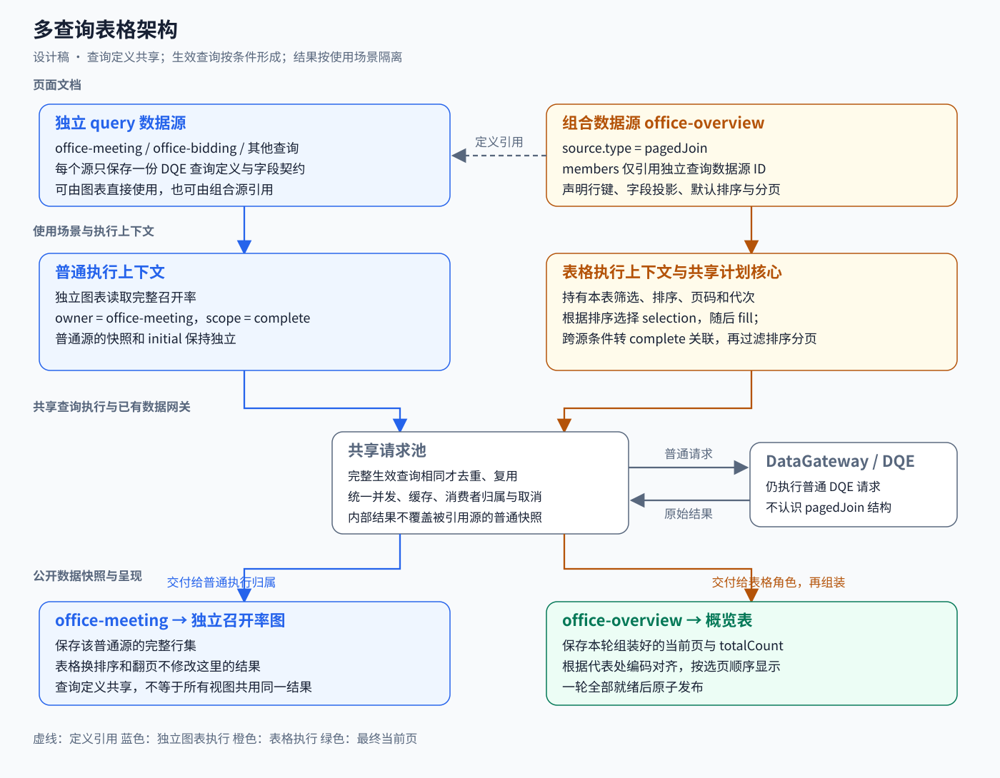
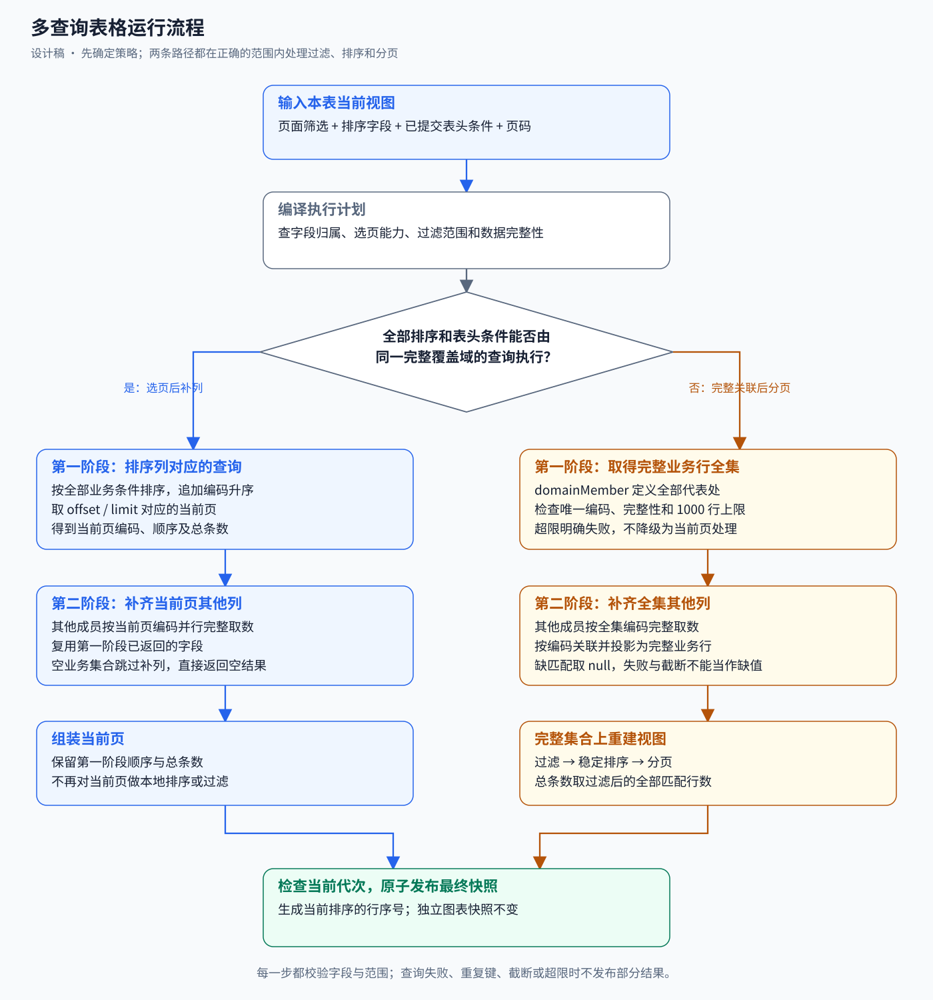
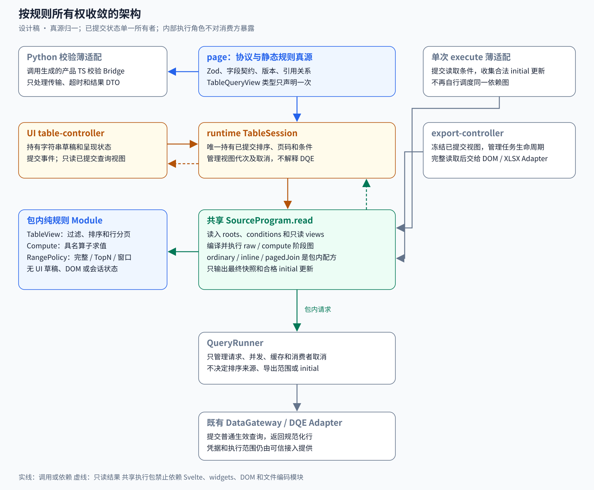

# 多查询表格分页和共享查询设计

状态：按用户后续授权完成 P0–P5 实施。此前“不要开始实现”只属于设计阶段。P6 已执行环境预检，缺真实 DQE/Relay 端点与已验真业务上下文，未执行真实业务验收。实际结果见[实施证据](../evidence/multi-query-table/result.md)。

补充范围：本轮进一步核对当前源码，将第 12 节收敛为架构调整、拟新增模块、现有文件改动和实施批次。当前工作区版本真源已为 6.21，固定级联已允许声明过的分页窗口输入；本方案复用这项现有能力，不重复建设。新组合查询源和内部计划已实现为 6.22 增量。

技术债收敛：第 15 节记录已确认的职责过载、重复规则与设计风险。第 12 节已按该审计修正：共享 SourceProgram 统一执行规则，TableSession 唯一持有已提交视图，内部 Invocation 不对消费方暴露，Python 不新增第二套组合语义校验。

一张表的各列可以来自不同 DQE 查询，任何可排序列都要在全部符合条件的代表处中排序后分页；同一份查询定义还能被独立图表消费。采用新增的 `pagedJoin` 页面数据源表达表格组合规则，引用现有 `query` 页面数据源。查询定义共享，生效查询按使用条件形成，执行结果按使用场景隔离。

## 1 阅读入口

- [完整示例 JSON](multi-query-table/office-overview.proposed.json)：六个独立查询数据源、一个组合数据源、一张概览表和一个独立召开率图。
- [组合结构摘录](multi-query-table/paged-join-source.proposed.json)：从完整示例原样提取，集中检查拟议结构。
- [执行计划与预期结果示例](multi-query-table/execution-examples.proposed.json)：金额排序、召开率排序、第二页和跨源筛选五种场景；这是设计预期，不是运行证据。
- [架构图](multi-query-table/architecture.svg)与[运行流程图](multi-query-table/runtime-flow.svg)：SVG 可放大；同目录提供 PNG 和 Mermaid 源文件。
- [切换排序时序图](multi-query-table/sort-switch.mmd)：同时包含独立图表和表格，说明共享请求与独立结果。
- [收敛后的 Module 和规则所有权图](multi-query-table/cohesive-modules.svg)：展示协议、执行、状态、呈现和校验的依赖方向；同目录有 PNG 和 Mermaid 源。

示例 `schemaVersion: "6.next"` 是评审占位，不是有效发布版本；`pagedJoin` 及数值列筛选 `numberRange` 尚未进入当前协议。所有 DQE 字段和来源能力是结构示例，不代表真实执行验真。这些 proposed 文件保留设计历史；正式 6.22 仿真/契约夹具位于 `packages/page/fixtures/contract-valid/paged-join-page.json`，并补齐表格 rowKey。它不是已验真的业务页面。

## 2 当前实现和本次变化

| 当前事实 | 本次拟议变化 |
|---|---|
| `DataSource` 只有 `inline`、`query` | 增加封闭的 `pagedJoin` 分支，描述页内组合；不新增计算资产或任意表达式 |
| `resultBindings.source` 决定固定查询依赖 | 保持原语义；表格内部用执行计划产生当前页编码输入 |
| 普通快照、查询状态主要按页面数据源 ID 管理 | 保持公开快照按数据源 ID 管理；增加内部查询执行记录，不把补列结果写回被引用源 |
| 查询分页表格要求独占数据源 | 组合源由一张交互表独占；它引用的查询定义可与其他组合源和普通图表共享 |
| `createPageDataExecutor` 与浏览器复用查询核心 | 新组合执行核心同时供单次执行、浏览器和导出调用 |
| 多槽表格只在显示时按 `rowKey` 对齐 | 新组合源在数据层产出完整当前页行，表格继续使用单个 `data.main` |

依据：[当前数据源类型](../../packages/page/src/data-source.ts)、[固定依赖校验](../../packages/page/src/validate-query-results.ts)、[运行时编排](../../packages/engine/runtime/src/orchestrator.ts)、[共享取数决策](../adr/0105-shared-page-data-execution-and-initial-consumption.md)。

本设计替代本轮讨论中“把独立查询内嵌在组合源中”的方向。最终结构只有查询 ID 引用，没有第二份召开率查询体。

## 3 三种身份

### 3.1 查询定义身份

`office-meeting` 是页面数据源 ID。其 `source.query` 保存召开率 DQE 原始请求体、筛选绑定，其 `fields` 保存结果字段契约。独立图表通过 `data.main: "office-meeting"` 消费普通数据快照。

`office-overview` 是另一个页面数据源 ID。它的 `source.type` 为 `pagedJoin`，只保存成员引用和组合规则，没有自己的 DQE 查询体。表格通过 `data.main: "office-overview"` 消费最终当前页数据快照。

这些 ID 都由创作期装配并明确写在 JSON 中，不由运行时根据列顺序猜测。

### 3.2 查询执行归属

同一份召开率查询定义可以产生三种生效查询：

| 执行归属 | 执行范围 | 结果归属 |
|---|---|---|
| 普通源 `office-meeting` | 全部符合该源条件的代表处 | 公开快照 `office-meeting` |
| `office-overview` 的选页角色 | 全范围排序后的当前窗口 | 该组合源内部的选页结果 |
| `office-overview` 的补列角色 | 当前页代表处编码集合内的完整匹配行 | 该组合源内部的补列结果 |

内部记录以 `ownerSourceId + memberId + role + viewKey + generation` 标识使用者，执行范围是 `complete`、`page` 或 `completeWithinKeys`。角色不决定请求内容，只决定结果交付给谁。

被引用源的 `source.resultScope: "complete"` 继续约束它自己的普通执行。表格选页执行的范围由执行计划声明为 `page`，不修改原定义，也不把分页响应应用于原源的完整性判断。补列的完整性则针对加入当前页编码条件后的查询结果检查。

### 3.3 请求与缓存身份

请求键由完整规范化生效查询和可信执行范围构成：DQE 请求体版本、字段映射、页面参数物化结果、业务筛选、编码条件、排序、分页、执行适配器配置及授权范围。每次页面实例默认拥有独立请求池；不在用户或租户之间共享缓存。还需区分新鲜取数作用域：正常浏览可复用会话缓存，完整导出和明确刷新使用新批次，不读取页面旧缓存；同一批次中的相同请求仍可复用，调度并发总额共同管理。

`ownerSourceId` 和 `role` 不加入请求键。同一新鲜取数作用域内，不同使用者的生效查询完全相同时可以共享在途请求和原始缓存，结果分别交付。相同查询定义但筛选或分页不同，必须形成不同请求。

不默认做“已有完整缓存自动覆盖某个编码子集”的推导。首版只复用完全相同的生效查询；子集复用需要另行证明筛选、计算、完整性和采集时点一致。

## 4 页面协议结构

### 4.1 组合源字段

| 路径 | 形状与规则 |
|---|---|
| `fields` | 最终结果字段契约；不声明 `queryField` |
| `source.type` | 固定 `pagedJoin` |
| `source.rowKey` | 最终结果中的单个非空 string/number 维度字段 |
| `source.domainMember` | 成员 ID；其完整结果定义表格业务行全集 |
| `source.members` | 成员 ID 到查询数据源引用、键映射和选页能力的映射 |
| `source.projection` | 最终字段到 `{member, field}` 的显式映射 |
| `source.ordering.default` | 默认排序数组；数组顺序为排序优先级 |
| `source.ordering.sortableFields` | 可由表格请求全局排序的最终字段列表 |
| `source.ordering.nulls` | 首版固定 `last`，升序与降序都把缺值排末尾 |
| `source.pagination.pageSize` | 正整数，首版不超过 1000；示例为 3 |
| `source.fallback.maxRows` | 完整关联路径的行数上限，示例为 1000 |
| `source.onMissing` | 固定 `null`；成功无匹配与查询失败分开处理 |
| `source.ordinalField` | 可选，产出当前排序下的行序号；示例为 `rank` |
| `source.initial` | 可选，格式见第 10 节；完整示例刻意省略，以呈现执行关系 |

`members` 的字段如下：

| 字段 | 含义 |
|---|---|
| `source` | 一个已声明的 `query` 页面数据源 ID，复用其查询定义与字段契约 |
| `key.field` | 该源归一化结果中的业务键字段 |
| `key.queryField` | 当前页编码条件在该 DQE 查询中的输入维度字段；显式声明，不从字段同名推断 |
| `canSelectPage` | 是否声明该查询具备全范围排序、计数并覆盖同一业务行全集的能力 |

`canSelectPage: true` 是需真实数据验真的能力契约，不是从 `initial` 几行样本推断出的事实。它必须满足：在相同基础条件下，结果键集合等于 `domainMember` 的键集合；一键一行；返回的是代表处数量；可排序字段为该源原始字段；缺值排序规则已确认。任一条件不满足，应写为 false，使用完整关联路径。

`source.projection` 覆盖所有最终字段，只有 `ordinalField` 由运行时生成。一个字段只能有一个归属，不做隐式字段覆盖。行键投影来自 `domainMember`，所有成员的键类型和业务含义必须与它一致。

首版成员必须是无 `compute`、无 `resultBindings`、无业务 TopN/limit/offset 的普通查询源，并声明普通执行完整范围。这样内部查询角色可明确重用原始查询体，且不会错误继承另一条固定级联或受限集合。现有复杂级联页面继续走原路径；本次不把它们偷偷转为动态表格计划。

首版支持一个真实稳定的标量业务键。多个分组维度不自动拼成字符串，也不把多个 `IN` 条件冒充组合键集合。若一行是“客户加月份”，需要已有可验证的单行标识，或在后续协议中单独设计精确组合键输入。

### 4.2 普通源与组合源的共用

完整示例包含 `office-meeting`。概览组合源的 `members.meeting.source` 引用它；独立图表的 `data.main` 也引用它。

普通源自己的 `source.initial` 只能保存它自己的完整普通结果。组合源自己的 `source.initial` 保存最终组装页。内部选页、补列结果不写入成员源的 `initial`。

两张表要独立分页时，分别声明两个 `pagedJoin` 数据源，引用同一组普通查询源。首版继续要求每个可变组合源由一个交互表独占，避免本次扩展全局快照身份。

### 4.3 列排序和筛选

表格列保留 `sortable: true`，且字段必须在组合源 `ordering.sortableFields` 中。列字段归属由 `projection` 查出，运行时不再复制一份排序来源配置。

原有 `select`、`dateRange` 表头筛选继续保留。本设计同时提出 `filterable.mode: "numberRange"`，用于金额和召开率范围；UI 草稿保留输入字符串，已提交查询视图转为可缺省的数值 `from`、`to`，两端均为包含。这项需要同步扩展表头草稿、事件、字段类型校验和 UI，不是现有属性。

共享执行核心将已提交表头筛选编译为最终字段上的封闭谓词。空选项按既有“取消该条件”语义处理；范围对 null 不匹配；金额和比率比较使用原始值，不能拿显示的“2.60亿”或“91.2%”参与排序过滤。

该谓词同本表的排序、页码一起属于会话态，不写回成员源的筛选状态，也不影响独立图表。

## 5 执行计划选择

### 5.1 选页后补列

编译器仅在下面全部成立时选择此路径：

1. 所有排序字段在 `projection` 中归属同一成员，且该成员 `canSelectPage` 为 true。
2. 当前表头筛选涉及的字段均能通过同一成员的显式原始字段映射下推；不存在另一个来源才知道的筛选结果。
3. 各成员和业务行全集对当前页面筛选、参数有兼容且完整的绑定；来源口径和行粒度一致。
4. 排序、同值键排序、总条数和 null 位置可由实际 DQE 能力兑现。对于可空排序字段，在 null 编码未确认时转完整关联；不得猜测新 DQE 请求字段。

默认预签降序选择 `bidding`；改为召开率降序选择 `meeting`。数组为空时恢复 `ordering.default`。排序末尾自动追加该成员业务键升序，防止同值跨页漂移。

选页响应必须包含唯一非空编码、当前页排序字段和有效 `totalCount`；行数不能超过页大小。普通第一页返回空且 totalCount 为 0 时直接发布空结果，不发补列请求。非首屏页码越界时用新 totalCount 修正页码，再重新执行本轮选页。

其他成员加入当前页编码维度条件，执行 `completeWithinKeys`。本轮选择成员已经返回的原始字段直接用于投影，不重复查询。补列成员按同一请求池的全局并发上限执行，沿用当前上限 5，不在每张表各开一个无约束池。

编码集合限于 1000 个，保留 string/number 类型。编码条件由执行计划添加到生效查询副本，成员原始定义不变。若同一维度已有页面筛选条件，做显式交集；不得添加两条相互竞争的绑定，也不得覆盖用户筛选。首版存在该冲突时可以确定性转完整路径。

### 5.2 完整关联后分页

以下情况自动选择完整路径：跨源多列排序、跨源表头筛选、选页成员没有完整覆盖行全集、可空值上游排序未确认、排序字段没有可用上游映射。

1. 查询 `domainMember` 的完整业务行全集，校验唯一键和 `maxRows`。
2. 用该全集编码查询其他成员的完整匹配结果，保留基础业务条件。
3. 按键左关联并投影所有最终字段；有些字段缺行输出 null。
4. 在完整组装行上执行本表全部已提交筛选、稳定排序。
5. totalCount 取筛选后的行数，再按页码切片，最后写入序号字段。

`maxRows` 同时约束业务行全集和成员实际返回行；同一代表处多条明细不自动求和。每个成员须已在 DQE 中按目标行粒度汇总，重复键作为契约错误处理。窗口截断或 totalCount 与返回行数不符时失败，不把截断数据算成全表。

超过上限明确返回 `DQE_QUERY_REJECTED` 并给出脱值原因。大规模跨源全局过滤、跨源计算排序需要真实服务端关联能力，是本设计不通过前端无限取数解决的能力边界。

完整路径的结果可按数据条件和筛选状态复用以支持翻页；缓存必须区分原始完整组装集合与后续视图状态，不因一次局部筛选覆盖完整集合。排序、页码改变时如输入缓存仍有效，可仅重建视图，不重新执行 DQE。

## 6 示例运行结果

按用户截图的八个代表处，金额和比率仅用于演示顺序。

| 场景 | 第一阶段 | 第一页顺序 | 表格总条数 |
|---|---|---|---|
| 首次打开，每页 3 行 | `bidding` 金额降序，offset 0、limit 3 | 上海、北京、广州 | 8 |
| 改为召开率降序 | `meeting` 召开率降序，offset 0、limit 3 | 上海、深圳、北京 | 8 |
| 召开率排序下翻第二页 | `meeting`，offset 3、limit 3 | 杭州、成都、广州 | 8 |
| 召开率降序并要求金额至少 1.5 亿 | 完整关联；不能在召开率第一页补金额后再过滤 | 上海、北京、广州 | 3 |
| 同时要求金额至少 1.5 亿、召开率至少 85% | 完整关联，两个条件 AND | 上海 | 1 |

第一个排序下深圳原来在第二页；切换排序后应进入第一页。这是全局排序验收，不能用当前页三行排序的截图替代。

`ordinalField: "rank"` 表示当前排序和筛选后的行序号，值为 `pageIndex * pageSize + rowIndex + 1`，第二页从 4 开始。它不保存预签金额的固定业务排名，也不作为行键。

## 7 请求共享和图表隔离

独立图表执行 `office-meeting` 的完整生效查询，表格执行同一查询定义的 page 或 completeWithinKeys 变体。筛选／排序／分页不同，通常是两条请求；这是两个不同的数据需求，不是定义重复。

完整路径有可能执行与独立图表完全相同的查询，此时请求池只发一次请求，为两个归属分别交付结果。共享请求只有所有当前消费者都失效时才取消；表格换排序不能取消独立图表仍需要的请求。

公开快照映射仍然是：

```text
office-meeting  → 独立图表的完整召开率结果
office-overview → 概览表本轮组装后的当前页
```

表格内部的 `selection`、`fill`、`complete` 结果保存在组合执行上下文中。结果可以引用请求池里的同一份不可变原始行；最终表格行只复制需要的投影字段，不复制一份普通源全量快照。

## 8 Module Interface 和职责

对浏览器、单次执行和导出的锁步消费 Interface 是第 12 节的 SourceProgram.read。下面两个函数是组合源配方的包内 seam，不对外部消费方导出；它们也不接收 UI 草稿：

```ts
type PagedJoinView = {
  pageIndex: number;
  pageSize: number;
  sort: Array<{ field: string; direction: 'asc' | 'desc' }>;
  predicates: TablePredicate[];
};

compilePagedJoin(page, sourceId, inputs, view): PagedJoinPlan;
executePagedJoin(plan, { runQuery, signal }): Promise<DataSnapshot>;
```

`inputs` 提供已物化参数、当前页面筛选与可信执行上下文；`runQuery` 由调用者注入，统一负责网关、规范化、并发、请求去重与缓存。`PagedJoinPlan` 显式保存本轮策略、成员查询、执行范围、行键映射、投影、排序、谓词及分页，不持有 DOM、图表实例或 AI。

| 所属 | 职责 |
|---|---|
| `@metriccanvas/page` | 文档态／领域态类型、Schema、版本门禁、引用和字段校验、封闭谓词定义 |
| `@metriccanvas/data-execution` | 计划编译、角色生效查询、编码输入、完整性核验、组装和视图求值；三种入口共用 |
| `engine/runtime` | 页面实例生命周期、视图状态、代次、取消和最终快照发布；适配共享执行核心 |
| `engine/runtime-ui` | 把用户排序、翻页和已提交表头筛选传给运行时；展示加载／错误／页码 |
| 纯渲染表格组件 | 消费最终行，展示当前状态并上抛事件；不认识哪个 DQE 先执行 |
| 数据网关与 DQE Adapter | 继续接收普通生效查询；不认识 `pagedJoin` 页面结构 |
| Relay 单次入口 | 用默认视图执行组合源，返回完整页面文档；不编写第二套级联规则 |
| 导出入口 | 冻结本表输入与视图，用相同计划取得全部匹配行，再交给现有编码职责 |



## 9 运行流程和代次



排序、业务筛选或已提交表头筛选改变时，表格页码归零并启动新代次。翻页、页大小变化也启动新代次，页大小变化页码归零。每个 await 返回后检查代次；旧代次不得发布行、总数、错误或页码纠偏。

一个新视图整体进入加载态，不显示旧行作为新排序结果。选页成功后不提前发布半张表；所有必需成员成功并通过字段、键和范围检查后，原子发布最终快照。

同条件刷新失败可保留上一份完整快照及原 initial，但显示刷新失败状态，不能标为本轮成功。视图条件已经变化时，旧 initial 不驱动本轮补列，也不显示成新视图结果。

## 10 首屏单次执行和导出

### 10.1 新组合源的初始行

组合源的 `initial` 保存最终稳定页面字段行，不使用 DQE 原始字段名，格式拟定为：

```json
{
  "capturedAt": "2026-10-14T00:00:00Z",
  "rows": [],
  "totalCount": 0,
  "view": {
    "pageIndex": 0,
    "pageSize": 3,
    "sort": [{ "field": "bidding-amount", "direction": "desc" }],
    "predicates": []
  }
}
```

该片段表示一个成功的空默认视图，不是未查询占位。`view` 是采集结果的查询视角描述，不是执行证明封套；用户后续操作仍为会话态。普通 query 源原有 initial 格式不变。

已有匹配默认视图的组合 initial 直接使用；缺失才执行，参数或默认筛选变化按现有失效原则清除受影响的组合 initial。组合 initial 缺失时成员 initial 不证明选页／补列角色的结果，应执行本轮计划，不把独立图表的普通 initial 随意裁成当前页。

### 10.2 单次页面取数

`createPageDataExecutor().execute(metadata)` 继续返回完整页面文档。独立图表的普通查询结果写回它自己的 initial；组合源结果写回组合 initial；内部角色不写回成员定义。

执行根区分两类引用：组件／普通固定依赖的结果引用，和组合源对查询定义的引用。仅作为组合成员使用的查询源不因定义引用而另发一遍完整普通查询；如果同时被独立图表或普通固定级联消费，就保留普通执行根。其他未参与组合的既有普通查询源沿用 ADR-0105 的单次入口范围。

这要求局部修订 ADR-0105 的“所有可执行普通源”收集规则，避免成员定义被无条件执行两遍。定义引用不能被加入现有 `queryResultDependencies`，否则又会变成“必须等待普通源的完整快照”才能选页。

### 10.3 全量导出

捕获已提交的页面筛选、本表谓词、排序和查询定义版本。选页路径依次取得所有页并补列；完整路径在完整筛选排序后输出全部匹配行。导出仍保留既有业务范围，不去除授权或静态条件。

沿用当前导出上限 10000 行和 60 秒、相同总数核验及失败不交付部分文件原则。排序补业务键保证确定性，但没有 DQE 快照令牌时不宣称跨多次请求具有事务快照一致性；总数变化和重复键可以检测并失败，同总数内容变化仍需真实上游能力保障。

本设计仅定义数据准备协作，不开始实现 Excel 编码或新的搜索入口。后者与[表格搜索和 Excel 导出计划](2026-10-14-table-search-excel-export.md)统一实施。

## 11 静态校验和运行错误

### 11.1 静态校验

- `pagedJoin` 的成员只能引用上述允许的普通查询源；不能引用自己或另一个组合源。
- 行键存在、非空、角色为 dimension，类型在所有成员中一致；业务含义在创作验真中确认。
- `key.queryField` 的输入目标显式合法，不与静态条件或筛选绑定争抢控制；冲突必须有交集规则或选择完整路径。
- projection 的源字段存在；最终字段类型、角色、单位、币种相容。可能缺匹配的字段允许 null。
- ordinal 字段为 number／measure，没有 projection 或 queryField，不能同时作为排序字段或行键。
- 默认排序和 sortableFields 指向已投影的原始可比较字段；boolean、recordList、semanticHtml 不在首版排序范围。
- 所有相关参数和页面筛选被 domainMember 及成员按明确映射消费；字段名相似不等于同一口径。
- 每个组合源只被一张可交互查询分页表使用；成员源可被多个消费方引用。
- 组合源不声明普通 `resultScope: complete` 或 compute，不作为固定 resultBindings 输入或全量聚合输入。
- 新能力登记次版本；旧版本携带新结构必须拒绝，旧页不会被自动迁移。

### 11.2 运行错误

| 情况 | 行为与现有错误分类 |
|---|---|
| 空业务集合 | 发布 empty、totalCount 0，不发无条件补列请求 |
| 某成员成功但缺匹配行 | nullable 投影取 null；domainMember 缺选页编码则报范围契约错误 |
| 键缺失、重复、额外未请求键、类型不符 | `DQE_ROW_CONTRACT_ERROR`，整轮失败 |
| 补列 totalCount 与原始返回行数不一致 | `DQE_ROW_CONTRACT_ERROR`，不展示截断结果 |
| 选页缺 totalCount 或返回窗口异常 | `DQE_ROW_CONTRACT_ERROR` |
| 完整路径超限 | `DQE_QUERY_REJECTED`，脱值说明范围无法完整处理 |
| 网关失败、超时、认证、权限 | 保留既有分类；同表整轮失败，独立图表不受连带覆盖 |
| 旧请求迟到 | 丢弃，不发布旧错误或行 |
| 新视图触发取消 | 对无有效消费者的请求传递 AbortSignal |

不新增平行错误体系。日志可以记录 owner、member、role、请求标识和耗时，不输出筛选值、编码集合、业务行或凭据。

## 12 架构调整和文件级实施清单

本节为原文件级实施清单；本批已落地，实际路径与兼容委托见实施证据。未触及的旧分类/校验按第15节登记延期，不扩大为平台整体重构。

### 12.1 冻结的架构调整

1. **页面协议新增组合源分支。** 独立 query 源继续拥有自己的查询定义与普通结果；pagedJoin 只引用定义并产出本表快照。`DataSourceMode` 仍是 inline／query／mixed，pagedJoin 归动态取数。
2. **共享请求调度从浏览器编排器中提取。** 目前 `orchestrator.ts` 持有并发、缓存与在途请求，单次执行和导出又有各自调度。提取 QueryRunner，普通查询和组合内部查询共用同一个页面实例请求池，避免新增一个并行查询通道。
3. **表格计划在共享执行包内。** 策略选择、成员生效查询、键输入、组装、完整性和视图求值由 `@metriccanvas/data-execution` 承担；浏览器、单次执行、导出复用，不移入 Svelte。
4. **执行归属与公开快照分开。** 原有 `Map<dataSourceId, DataSnapshot>` 保留。组合内部调用通过 Invocation 标识，不能写入被引用源的 rawSnapshots 或 initial；只有最终组合结果写入组合源 ID。
5. **依赖分为定义引用、结果依赖、条件传播。** `resultBindings` 的结果依赖保持固定；组合成员引用用于解析定义和传播条件失效，不被当作“先执行该普通源”的依赖边。
6. **收敛执行规则而不仅是 HTTP 请求池。** 新 SourceProgram 同时执行普通固定级联与组合源，拥有 raw／compute 阶段图、范围与 initial 写入资格；浏览器、单次执行、导出都使用同一个 read Interface，不各保留一套 pending 循环。
7. **已提交状态有唯一所有者。** TableSession 持有规范化后的排序、页码、已提交筛选和搜索；UI controller 只持草稿与呈现状态。TableView 只求值，不保存状态；QueryRunner 不知道表格列、页码重置或导出业务。

这是一次页面协议、共享执行和运行时的跨层调整。主要复杂性集中在共享执行 Module，协议解析、参数失效、首屏、导出和创作校验必须同批闭合。

### 12.2 拟新增模块和文件

```text
packages/page/src/
  table-query-view.ts              新增：规范化已提交视图及谓词类型唯一声明
  paged-join.ts                    新增：组合源及初始视图类型
  data-source-references.ts        新增：定义引用与条件传播闭包
  validate-paged-join.ts           新增：组合声明和消费约束校验
  schema/paged-join.ts             新增：组合源 JSON Schema 真源

packages/data-execution/src/
  query-runner.ts                  新增：普通与内部查询的共同请求池
  source-program/
    compiler.ts                   新增：raw / compute 阶段图与源配方编译
    session.ts                    新增：统一 read 入口、依赖执行和结果交付
    range-policy.ts               新增：完整、窗口、有限集合与导出范围规则
  compute/                        迁入：现有纯具名算子实现，不保留第二份
  table-view.ts                    新增：已提交视图的过滤、稳定排序和分页
  paged-join/
    plan.ts                       新增：选择策略并编译不可变执行计划
    member-query.ts               新增：按执行角色形成生效查询
    rows.ts                       新增：范围核验、按键关联及字段投影
    execute.ts                    新增：执行选页补列或完整关联路径
    export.ts                     新增：冻结视图后的完整数据准备

packages/engine/runtime/src/
  table-session.ts                 新增：已提交表格视图、代次和源更新

packages/engine/runtime-ui/src/
  table-controller.ts              新增：表头和搜索草稿、事件到 session 的适配
  export-controller.ts             新增：捕获、取消和导出任务生命周期
```

这些文件属于协议、SourceProgram、QueryRunner、TableView 和实例适配五个 Module。文件是内部组织，不能把所有内部函数都导出给调用方。表格组件只扩展数字范围控件；UI 不解释查询计划。

### 12.3 页面协议和引用解析

| 文件 | 类型 | 具体调整 |
|---|---|---|
| `packages/page/src/table-query-view.ts` | 新增 | 定义 TableQueryView／排序／已提交谓词的唯一类型，组合 initial.view 复用；UI draft 不进入这个 DTO。文档态类型从 Schema 推导，真正的归一化差异保持显式 |
| `packages/page/src/paged-join.ts` | 新增 | 定义 PagedJoinDataSource／Source／Member／Projection／InitialView。组合源不允许 compute 和 queryField；使用 `compute?: never` 等类型手段维持联合类型属性检查 |
| `packages/page/src/schema/paged-join.ts` | 新增 | 对第 4 节结构建立严格 Zod 分支，限定键、投影、排序、上限和 initial.view；引用既有字段契约原语 |
| [data-source.ts](../../packages/page/src/data-source.ts) | 修改 | 扩展 DataSource 联合；增加 isPagedJoinDataSource 和明确的动态取数分类；resolveDataSourceFields 对组合字段原样返回，不尝试移除不存在的 queryField |
| [page-document.ts](../../packages/page/src/page-document.ts) | 修改 | 扩展文档态联合。普通 query initial 仍是 DQE 原始字段；组合 initial 是最终页面字段，不能用同一个归一化分支 |
| [schema/data-source.ts](../../packages/page/src/schema/data-source.ts) | 修改 | 将新严格分支纳入 dataSourceDocumentZ；不扩大普通 query 分支的开放键 |
| [materialize.ts](../../packages/page/src/materialize.ts) | 修改 | 普通查询继续 normalizeQueryRows；组合 initial 直接按最终字段契约检查，并校验采集视图，不做 DQE 字段名转换 |
| `packages/page/src/validate-paged-join.ts` | 新增 | 检查成员、键、投影、选页声明、上限、初始页、单表独占、成员原始性及字段／筛选类型；提供精确 JSON Pointer 错误 |
| [validate.ts](../../packages/page/src/validate.ts) | 修改 | 数据源循环接入新校验；queryPaginationErrors 允许组合源并读取 source.pagination；tableErrors 仅对 numberRange 接受数值度量；initial 校验分三支；详情和全量消费明确拒绝未支持的组合范围 |
| [validate-compute-dependencies.ts](../../packages/page/src/validate-compute-dependencies.ts) | 修改 | 遇到组合源明确报告它是窗口结果，不能访问 `.source.query` 或把它当完整辅助源；保留普通源完整性规则 |
| [validate-query-results.ts](../../packages/page/src/validate-query-results.ts) | 核验／局部修改 | 固定 resultBindings 继续引用普通查询原始结果，保留当前分页窗口和 where 支持；明确拒绝组合结果作为原始结果输入，不反转依赖 |
| `packages/page/src/data-source-references.ts` | 新增 | 提供 `definitionSourceIds(source)` 和 `conditionSourceIds(page, sourceId)`；前者只列组合成员定义，后者递归收集参数／筛选失效来源；不替代 queryResultDependencies |
| [resolve-page-params.ts](../../packages/page/src/resolve-page-params.ts) | 修改 | changedParamSourceIds 沿定义引用传播到组合源；原成员查询继续原位参数物化；同步删除受影响组合 initial，展示参数不误触发查询 |
| [extract-page-params.ts](../../packages/page/src/extract-page-params.ts) | 修改 | 参数候选仍来自独立成员的实际 DQE；选定参数后，沿新条件闭包清除组合 initial，不能只删除普通源 initial |
| [query-param-references.ts](../../packages/page/src/query-param-references.ts)、[param-bindings.ts](../../packages/page/src/param-bindings.ts)、[migrate-param-bindings.ts](../../packages/page/src/migrate-param-bindings.ts) | 核验／局部修改 | 普通成员中的参数路径保持原形；组合源没有 query，不误读或重复扫描。迁移改变成员查询条件时也使对应组合 initial 失效 |
| [page.ts](../../packages/page/src/page.ts) | 修改 | derivePageCapabilities、deriveComponentCapabilities 把组合源识别为动态且可查询分页；不能因为 source.type 不是 query 就推导成 inline |
| [version.ts](../../packages/page/src/version.ts)、[internal.ts](../../packages/page/src/internal.ts) | 修改 | 登记新能力及次版本；内部导出类型、校验／引用辅助。page 根入口的外部 Interface 不额外扩张 |

`schema.ts` 目前消费 Zod 生成结果，不另写第二份 Schema。新能力版本从实施时的实际真源分配；本轮核对 CURRENT_MINOR 为 21，不预占 6.22。

### 12.4 共享查询执行核心

| 文件 | 类型 | 具体调整 |
|---|---|---|
| `packages/data-execution/src/query-runner.ts` | 新增 | 从现有浏览器／单次调度提取请求队列、最大并发 5、缓存、在途去重、消费者取消和 dispose；查询结果按归属交付，原始缓存不包含组合产物 |
| `packages/data-execution/src/source-program/compiler.ts` | 新增 | 从同一源引用图编译 raw／compute 阶段；普通 query、inline、pagedJoin 是封闭源配方。策略分派集中在这里，外部入口不再重复 source.type 分支 |
| `packages/data-execution/src/source-program/session.ts` | 新增 | 提供唯一 read Interface，执行依赖和源配方、交付 SourceUpdate；raw 与最终结果区分，内部角色不成为公开源结果 |
| `packages/data-execution/src/source-program/range-policy.ts` | 新增 | 管理声明完整、业务有限集合、当前窗口、编码范围完整和导出扩展的规则；统一检查和错误分类，保持这些范围之间的区别 |
| [compute/index.ts](../../packages/engine/runtime/src/compute/index.ts)、[join-aggregate.ts](../../packages/engine/runtime/src/compute/join-aggregate.ts)、[time-fill.ts](../../packages/engine/runtime/src/compute/time-fill.ts)、[snapshots.ts](../../packages/engine/runtime/src/compute/snapshots.ts) | 迁移 | 已有纯计算迁入 data-execution 的内部 compute 目录，由 SourceProgram 执行；旧 engine 路径仅兼容再导出。Node 与浏览器不各写一份 ratio／pivot／join 或最终快照推导 |
| `packages/data-execution/src/table-view.ts` | 新增／迁入 | 从 table-state、table-search 迁入已提交视图的过滤、稳定排序和分页纯逻辑；运行与导出共享。它不接收 UI 字符串草稿，不拥有会话状态 |
| `packages/data-execution/src/paged-join/plan.ts` | 新增 | 将 projection 反查到排序归属；检验活动条件是否能同源下推；选择 selectPageThenFill 或 completeJoin；补键排序，保存策略选择原因供脱值诊断 |
| `packages/data-execution/src/paged-join/member-query.ts` | 新增 | 复用 composeEffectiveQuery，针对 selection／fill／complete 创建查询副本；显式映射键输入；覆盖本轮排序／分页但保留业务条件；不改成员定义或 resultBindings |
| `packages/data-execution/src/paged-join/rows.ts` | 新增 | 检查唯一非空键、窗口／完整范围、请求编码子集、字段对应和空值；按键左关联、投影。它支持维度和度量的一对一读取，不复制仅支持数值聚合的 joinAggregate 实现 |
| `packages/data-execution/src/paged-join/execute.ts` | 新增 | 执行两阶段查询，复用选页字段；完整路径先取域再取成员，最后过滤排序分页；在每个异步阶段尊重 signal，只返回一份完整终态快照 |
| `packages/data-execution/src/paged-join/export.ts` | 新增 | 接受被冻结的计划与视图，按相同规则遍历页或输出完整匹配集；处理总数变化、重复键、10000 行和 60 秒上限；只准备数据，不编码文件 |
| [effective-query.ts](../../packages/data-execution/src/effective-query.ts) | 修改 | QueryHeaderFilters 增加已经归一化的数值范围；映射到既有 metricRange。组合字段需先经 projection 转成成员字段，不能把根字段当 queryField。兼容现有 search 参数 |
| [source-scope.ts](../../packages/data-execution/src/source-scope.ts) | 修改 | 区分普通执行根、组合执行根与仅供组合引用的定义；普通图表使用的成员保留普通执行，只作为成员的定义不额外触发完整普通查询 |
| [execute.ts](../../packages/data-execution/src/execute.ts) | 修改 | createPageDataExecutor 成为薄适配：物化页面、调用 SourceProgram.read、收集该 Module 产出的合法 initial 更新；删除自有依赖调度和范围检查。根 Interface 仍为 execute(metadata) → PageDocument |
| [runtime.ts](../../packages/data-execution/src/runtime.ts) | 修改 | 只向锁步消费方导出 createSourceProgram、规范化视图类型和纯 TableView；runner、Invocation、compilePagedJoin 和 executePagedJoin 留在包内。index.ts 的外部单次入口不增加“表格取数 API” |
| [query-result-inputs.ts](../../packages/data-execution/src/query-result-inputs.ts) | 保持语义 | 继续负责固定绑定、where 和当前窗口上限；组合填列不借这个函数动态改 source，也不改变其原始输入保护 |

QueryRunner 与组合配方的内部 seam 形状如下；这是包内组织，不是提供给 UI、单次入口或导出的外部 Interface：

```ts
type QueryInvocation = {
  definitionId: string;
  owner: { sourceId: string; memberId?: string; role: 'ordinary' | 'selection' | 'fill' | 'complete' };
  generation: number;
  viewKey: string;
  cacheScope: string; // 会话缓存或一轮新鲜取数；由执行器提供，不来自页面 JSON
  query: EffectiveQuery;
  scope: QueryExecutionScope;
};

createQueryRunner({ gateway, maxConcurrent: 5 })
  -> { run(invocation, signal): Promise<DataSnapshot>; dispose(): void };

compilePagedJoin(page, sourceId, inputs, view): PagedJoinPlan;
executePagedJoin(plan, { runQuery, signal }): Promise<DataSnapshot>;
```

请求池在页面会话或单次执行开始时创建，不由每个 member 创建。完整组装结果首版可以由缓存的原始成员结果重新推导，避免再引入一种全局可变缓存。节点所有者和代次用于结果交付，完整生效查询用于请求去重，二者不混用。

完整导出使用新的 cacheScope，与普通浏览共享同一个调度限额，复用本轮相同请求，不读取浏览阶段的旧缓存。cacheScope 属于执行器的内部新鲜度管理，不能由页面作者用来跨越授权范围。

SourceProgram 对消费方的 Interface 收敛为：

```ts
const program = createSourceProgram(page, { gateway });
program.read({ roots, conditions, views, purpose, freshness, signal })
  -> AsyncIterable<SourceUpdate>;
program.dispose();
```

`conditions` 只包含已经解析的业务参数和筛选；`views` 是只读的规范化已提交表格视图；`purpose` 区分屏幕读取和完整匹配结果读取；`freshness` 表达复用或本轮重查。消费方不构造 role、generation、cacheScope、成员键输入或 DQE。

SourceUpdate 对公开源交付最终 DataSnapshot，并在符合政策时携带可写回的 initial 更新。普通 query 的 initial 来自原始查询阶段，不能写 compute 产物；组合 initial 只来自完整成功的组装结果。普通源查询成功但计算失败时，两阶段事实保持分开，不能把计算失败误记为原始查询失败。

查询窗口越界时，SourceUpdate 还要返回本轮实际应用的 viewCorrection。范围政策计算纠偏，TableSession 在确认仍为当前代次后作为唯一写入者应用它；不能只换数据而保留旧页码。可变查询 views 按独占的最终源 ID 映射；共用完整源的多个本地表只在自己的 TableSession 中用纯 TableView 投影，不反向修改源视图。

DataGateway.fetchData、DQE 凭据注入、端点配置和 QUERY_LANGUAGES 不改变。现有 DQE Adapter 在实际支持的编码上继续工作；null 位置或跨源条件不能兑现时走完整路径，而不是发明新 DQE 请求字段。

### 12.5 浏览器运行时和实例状态

| 文件 | 类型 | 具体调整 |
|---|---|---|
| `packages/engine/runtime/src/table-session.ts` | 新增 | 作为已提交表格视图的唯一所有者，管理 view、代次及取消；只调用 SourceProgram.read，并映射只读状态给 UI。initial 资格和范围政策由 SourceProgram 决定，不在这里复制 |
| [orchestrator.ts](../../packages/engine/runtime/src/orchestrator.ts) | 修改 | 保留页面会话、最终快照发布和订阅职责；执行根与依赖编译交给 SourceProgram，startSession 创建一个 program；普通源与组合源都调用 SourceProgram；查询视图事件交给 TableSession，orchestrator 不再解释选页或完整关联 |
| 同上 initialSnapshots／publish／dispose | 修改 | 新增组合初始视图匹配；公开 rawSnapshots 只接收普通结果或完整组合结果；条件变化先失效组合并推进代次；dispose 释放所有使用者，再关闭 runner |
| [table-pagination.ts](../../packages/engine/runtime/src/table-pagination.ts) | 修改 | 普通自动分页规则保持；组合源从自己的 pagination.pageSize 取值，不依赖某个成员 initial 或 order.limit；成员共享不触发普通独占拒绝 |
| [compute/snapshots.ts](../../packages/engine/runtime/src/compute/snapshots.ts) | 兼容再导出 | 推导真源迁入共享执行包，engine 不再复制计算和范围规则；已组装组合结果由 SourceProgram 直接形成最终快照 |
| [execution.ts](../../packages/engine/runtime/src/execution.ts) | 核验／局部修改 | 旧 ExecutionBootstrap 的普通查询回执继续兼容；不能把成员 ordinary 回执当内部 role 结果。组合首次取数以默认 initial 或新共享计划执行，不新增旧回执封套字段 |
| [index.ts](../../packages/engine/runtime/src/index.ts) | 修改 | 只在必要的内部导出处更新；保持嵌入和框架调用入口兼容 |

公开快照仍按 sourceId 管理。已提交查询视图只在 TableSession 中保存，原 sourceId 的分页／排序方法作为兼容委托，不再另存第二份 sortRules／headerFilters／searches。UI 渲染 TableSession 返回的只读状态，不能先改一份本地已提交 sort 再请求运行时执行。

普通本地表也采用一个 TableSession 视图所有者，读取共享源快照后调用纯 TableView，生成本表呈现，不修改共享源。独立查询分页表分别绑定独占可变源或组合 ID。UI 草稿不是查询真源；提交成功后重投影 session 状态，避免拒绝查询时箭头与数据不一致。

### 12.6 表格呈现和 UI 接线

| 文件 | 类型 | 具体调整 |
|---|---|---|
| [schema/components/table.ts](../../packages/page/src/schema/components/table.ts) | 修改 | filterable 增加 numberRange；只对 number／money 度量合法；保留既有 toolbar、select、dateRange 和排序声明 |
| [widgets/table/view-state.ts](../../packages/engine/widgets/src/components/table/view-state.ts) | 修改 | 增加 numberRange 草稿分支；草稿保存输入字符串，只有合法端点才提交；一端允许缺省，反向／非有限范围不触发查询 |
| [widgets/table/Table.svelte](../../packages/engine/widgets/src/components/table/Table.svelte) | 修改 | 原 dateRange 的兜底 else 改为明确分支，新增数字上下限输入、单位和清除；金额端点使用原始单位“元”，百分比使用本字段原始刻度；只发事件 |
| `packages/engine/runtime-ui/src/table-controller.ts` | 新增 | 持有 search／range 等草稿、候选状态和控件反馈；把事件转换成 TableSession 命令，生成 TableRenderBinding。已提交 view 从 session 只读投影，不再自己写一份 |
| `packages/engine/runtime-ui/src/export-controller.ts` | 新增 | 管理表格和页面导出任务、捕获已提交状态、取消／busy／错误；调用共享完整读取，再交给现有 DOM 导出或工作簿 Adapter |
| [RuntimeSurface.svelte](../../packages/engine/runtime-ui/src/RuntimeSurface.svelte) | 修改 | 当前批次迁出表格草稿、事件与 binding 组装，以及导出控制器；保留组件组合和页面生命周期接线。新增功能通过 controller／session 接入，不继续堆 handleTable 分支 |
| 同上 tableSnapshot／queryPageSize／tablePaginationState | 修改 | 组合快照已是最终当前页，不二次本地过滤排序；页大小取组合会话或声明；总条数使用最终快照 |
| 同上 tableFilterOptions／候选加载 | 修改 | 枚举列按 projection 解析到原源候选维度端口；查询分页不能从当前页采样出“全表候选”；无能力或加载失败按现有状态呈现 |
| [runtime-ui/table-state.ts](../../packages/engine/runtime-ui/src/table-state.ts) | 修改 | 作为兼容薄适配调用统一条件图与 TableView；删除此处独立的排序／筛选实现。页码重置命令由 TableSession 处理，不再由 UI 与运行时分别推导受影响闭包 |
| [runtime-ui/table-pagination.ts](../../packages/engine/runtime-ui/src/table-pagination.ts) | 修改 | 对组合源接收运行时给出的 query 页大小，不从当前行数推导 local 模式；显式配置优先规则保留 |
| [component-render.ts](../../packages/engine/runtime-ui/src/component-render.ts) | 核验／局部修改 | 仅更新筛选事件类型和渲染输入；不向 Table 传递查询计划、成员网关或内部执行结果 |

表头数值输入的“草稿”和“已提交谓词”必须分开：用户尚在输入 `-` 或小数时不发 DQE；提交后传数值，不用字符串范围比较。该规则同时适用于普通本地表和组合表。

### 12.7 导出和现有工具区的合并位置

| 文件 | 类型 | 具体调整 |
|---|---|---|
| [export-snapshots.ts](../../packages/engine/runtime/src/export-snapshots.ts) | 修改 | 成为完整读取薄适配，普通源和组合根都委托 SourceProgram.read；删除独立的固定级联 pending 循环与 fetchComplete 规则副本，保留 ExportViewError 向外部导出错误的映射 |
| [export-view.ts](../../packages/engine/runtime-ui/src/export-view.ts) | 修改 | 冻结组合声明、成员定义和本表已提交状态；一轮导出统一取消和截止时间，调用数据准备核心 |
| [export-types.ts](../../packages/engine/runtime-ui/src/export-types.ts) | 修改 | 内部导出捕获信息加入组合视图描述，不扩展页面 JSON 的外部下载字段 |
| [export-render-state.ts](../../packages/engine/runtime-ui/src/export-render-state.ts) | 修改 | 导出消费已完整排序过滤的组合结果，避免再次排序筛选或分页；普通本地表的数字范围也复用共享求值 |

当前工作区已有 toolbar、search 和 Excel 相关代码。这些不是本方案新建的入口：实施时复用已有已提交搜索状态、source scoped 搜索控制和单表导出入口。本轮不删除或重写它们。

对配置搜索的组合表，搜索必须加入本表计划的行集合条件：能由选页成员兑现且真实编码已核验时下推；否则用有上限的完整路径搜索最终投影。超限明确失败，不能只搜索当前页。搜索字段跨来源时和跨源表头过滤采取同一策略判定。当前示例没有打开工具区，JSON 无需因这项兼容规则变化。

既有 PDF／Excel 编码、文件名和下载职责继续归相应集成模块；本次组合执行只提供正确的完整数据。

### 12.8 Python 创作和契约分发

| 文件或目录 | 类型 | 具体调整 |
|---|---|---|
| `metriccanvas-authoring/tool/metriccanvas_authoring/pages/validation/node_validator.py` | 新增 | 调用从产品 TS 校验器打包的单文件 Node Bridge，返回既有 PageContractIssue；不再为组合源手写第二套语义校验 |
| `tools/scripts/page-validation-bridge.ts` | 新增 | 只调用产品 parsePage／validate，通过 stdin/stdout 接收 JSON 和结构化结果；从同一产品版本打包，供 Python 校验适配，不发 DQE 或保存页面 |
| [page_validation.py](../../metriccanvas-authoring/tool/metriccanvas_authoring/pages/validation/page_validation.py) | 修改 | 新能力使用产品校验 Bridge；逐步迁出对应的手写语义分支。Python 只承担传输、错误 DTO 和创作侧输入问题，不成为第二个页面规则所有者 |
| [validation/query_results.py](../../metriccanvas-authoring/tool/metriccanvas_authoring/pages/validation/query_results.py) | 核验／局部修改 | 固定依赖、where、分页窗口现行规则保留；组合定义引用不进入固定结果依赖图 |
| `metriccanvas-authoring/tool/metriccanvas_authoring/pages/composition/paged_join.py` | 新增 | 从已有已验真结果对应的普通源 ID 和明确的行／列需求，装配组合源、字段投影和默认排序；不生成另一份 DQE 定义 |
| [composition/page_building.py](../../metriccanvas-authoring/tool/metriccanvas_authoring/pages/composition/page_building.py)、[composition/table_pagination.py](../../metriccanvas-authoring/tool/metriccanvas_authoring/pages/composition/table_pagination.py) | 修改 | 保留成员源；为组合表声明 query 分页，页大小取组合声明；不向某个成员查询体硬写 table order.limit |
| [referenced.py](../../metriccanvas-authoring/tool/metriccanvas_authoring/pages/referenced.py) | 修改 | 结果引用装配能够引用同一个普通源给独立组件和组合成员；不重复复制查询定义、重新编号或写死实际编码集合 |
| [data-sources.md](../page-metadata/data-sources.md)、[table.md](../page-metadata/components/table.md)、[cascading-queries.md](../cascading-queries.md) | 修改 | 正式协议解释组合结构；固定级联与组合计划的区别；数字范围、完整集合和窗口范围 |
| [page-reference.ts](../../tools/scripts/page-reference.ts)、[page-conformance-vectors.ts](../../tools/scripts/page-conformance-vectors.ts)、[export-authoring-contracts.ts](../../tools/scripts/export-authoring-contracts.ts) | 修改／生成入口 | 登记新协议正文路由、合法／非法向量与能力版本；从 TS／协议真源生成中立契约 |
| [local-authoring-projection.ts](../../tools/scripts/local-authoring-projection.ts)、[local-authoring-validator.ts](../../tools/scripts/local-authoring-validator.ts) | 核验／局部修改 | 把新协议与独立校验器闭合投影进分发 Skill；不把草案或别的任务产物混进安装目录 |
| `contracts/metriccanvas/`、`metriccanvas-authoring/contract-snapshot/`、Skill 的生成知识／校验器、bundle.json | 生成产物 | 授权实施后按真源生成并校验一致性；不在本轮修改，也不直接编辑软链 Skill 或复制手工 JSON 冒充正式样例 |

创作扩展以已经验真的独立普通查询为输入。是否同一业务行、是否完整覆盖域不能靠模型看几行样本猜测；数据侧能力验真仍按第 13 节 A15 单列。

### 12.9 可复用代码和明确保持的部分

- `query-result-inputs.ts` 继续处理固定级联；新计划复用键类型保护、空集不无条件查询和既有错误分类，不反向修改固定 source 引用。
- `normalizeQueryRows` 与字段契约校验继续作为每次普通 DQE 响应的真源，新组合层只做显式字段投影和一对一关联。
- `compute/join-aggregate.ts` 的数值聚合语义保持；组合层不把维度拷贝和分页补列塞进该算子。
- DataGateway 及凭据配置、Java 保存发布、qiankun 导航和门户加载没有新的业务流程；采用新协议产物的接入验收另列。
- `packages/page/src/snapshot.ts` 的公开 DataSnapshot 结构保持；不往每行加入查询角色或内部执行 ID。
- page 和 data-execution 的根外部调用入口保持；新增低层能力只通过现有 internal／runtime 接缝暴露，并核对相应公开面白名单。

### 12.10 实施批次和每批产物

| 批次 | 必须完成的改动 | 完成判据和测试位置 |
|---|---|---|
| P0 协议闭合 | page 类型／Schema／解析、规范化 TableQueryView、版本、字段校验、条件引用闭包 | 拟议 JSON 替换实际版本后通过；新旧版本、非法引用和参数失效覆盖。拟新增 `packages/page/tests/paged-join.test.ts`；扩展 page-document、version、resolve-page-params 等现有测试 |
| P1 共享执行收敛 | QueryRunner、SourceProgram、范围政策和纯 compute／TableView 迁移；普通浏览器、单次执行和导出先接入同一 read | 原普通查询／固定级联／参数／取消行为保持；新增 `packages/data-execution/tests/query-runner.test.ts`，覆盖共享请求、独立消费者取消、排队取消和全局并发 |
| P2 组合源配方 | 在同一 SourceProgram 内接入 plan、member-query、rows、execute；不新建独立依赖调度；默认视图单次执行 | 五种示例顺序／总数与现有设计一致，查错范围失败关闭；新增 `packages/data-execution/tests/paged-join.test.ts`；扩展 execute.test.ts |
| P3 视图所有权与接线 | TableSession、table-controller、export-controller；orchestrator 只委托；默认 sort、分页、数值草稿和候选 | 新增 `packages/engine/runtime/tests/table-session.test.ts`；扩展 table-state、table-pagination、table-view-state；浏览器证明深圳从原第二页进入新第一页且独立图表仍为 8 行 |
| P4 完整取数和现有工具协作 | paged-join/export、导出捕获／渲染、搜索状态合并 | 扩展 report-export；新增组合导出测试。捕获状态不被后续交互修改，超限／截断／总数变化不给部分文件 |
| P5 校验真源与分发 | Python 校验 Bridge／装配、产品校验包、协议正文、契约向量、Bundle 与独立 Skill | TS／Python 合法非法向量一致；contracts、Bundle、独立安装校验通过；实际版本替换评审 JSON 后成为正式夹具 |
| P6 真实接入 | DQE 请求／响应、真实行域、分页总数、排序／null、编码补列、Relay 单次入口 | 单列证据，不能由 Sim、静态校验或浏览器假数据替代；未通过前不宣称真实业务已支持 |

浏览器正式夹具拟放 `packages/embed/tests/browser/paged-join.spec.ts`；共享逻辑的查询夹具和 Sim 场景放对应消费者的 fixture 目录，正式示例不留在 docs/plan 作为测试输入。Sim 只认识普通查询，新增场景与测试可放 `tools/dqe-sim/tests/multi-query-table.test.ts`，由当前 `tools/dqe-sim/src/server.ts` 的既有场景机制接入，不让 Sim 执行 pagedJoin 协议。

P0–P5 是完整功能和分发的一个实施批次；其中任何中间状态都不作为完整交付。P1 是风险较高的兼容重构：消除三套调度并归一政策，先证明普通、固定级联、TopN 和完整导出路径保持，再接组合逻辑。第 13 节 A01–A15 是该批的最终验收，不因各批局部测试通过降低要求。

P0–P5 产品实现、现有 where/窗口及搜索/导出协作已完成；测试、生成产物、独立安装和浏览器证据见第16节。本批未提交、推送、部署或发布。

## 13 验收计划

| 编号 | 必须证明的行为 |
|---|---|
| A01 | 完整示例在新版本合法，旧版本拒绝；成员、字段、键、范围错误有对应非法夹具 |
| A02 | 默认金额排序第一页上海／北京／广州，总数 8，其他列对应同一编码 |
| A03 | 换召开率排序第一页上海／深圳／北京，证明原第二页对象进入第一页 |
| A04 | 第二页杭州／成都／广州，序号 4／5／6，短末页与越界纠偏正确 |
| A05 | 成员返回乱序仍正确关联；同值依键稳定，升降序缺值均排尾 |
| A06 | 召开率排序加金额门槛自动完整路径；跨源条件 AND，totalCount 来自过滤后的全集 |
| A07 | 两表共用查询定义独立排序／分页；独立召开率图始终保持完整结果 |
| A08 | 完全相同的请求只发一次；表格取消不终止独立图表仍在使用的请求 |
| A09 | A 排序慢、B 排序快、随后翻页，所有迟到行／错误／页码纠偏不覆盖当前代次 |
| A10 | 空集不扇出，缺行取空，重复键／截断／网关失败不伪装成成功 |
| A11 | 缺成员 ordinary initial 不使表格复用无关初始行；匹配组合 initial 首屏免查询 |
| A12 | 单次入口与浏览器得到相同默认结果；生成页面中的普通 initial 和组合 initial 相互独立 |
| A13 | 导出覆盖全部匹配页，顺序正确；并发视图变化不改已捕获范围，失败无部分文件 |
| A14 | 契约、Python、Skill Bundle 和独立安装校验均来自同一版本真源 |
| A15 | 真实 DQE 分别证明行全集一致、业务键、粒度、排序／总数／null、编码输入和完整补列；Sim 通过不能替代 |

上一轮设计样例检查已完成：三份 JSON 解析、成员／字段引用和投影类型对应、五种场景顺序及总数、文档本地链接、两张图渲染及目视检查。把拟议组合源和表格移除后，六个普通查询源与独立图表通过该轮工作区的 6.19 校验；完整拟议页面被该轮校验器拒绝，符合新协议尚未实施的状态。本轮已按 6.21 工作区源码核对文件级方案，产品验收仍未执行。

## 14 方案取舍

| 方向 | 结论 |
|---|---|
| 反转或动态改写现有 resultBindings.source | 不采用；改变固定依赖语义，可能循环并覆盖源快照 |
| 把查询体复制进组合源 | 不采用；破坏独立复用，修改查询要同步两份定义 |
| 只给表格增加多个数据槽并本地排序当前页 | 不采用；辅助列没有进入全局排序和筛选，分页结果错误 |
| 根据用户操作临时生成 DQE 或调用模型规划 | 不采用；渲染期只执行页面已定义的查询 |
| 新建通用跨源 SQL／服务端计算资产 | 不在本次建设；需求由受控页内组合和明确上限承载 |
| 查询定义引用加内部执行归属 | 采用；公开数据快照模型保持，小范围扩展共享执行核心 |

用户已经授权实施；本节保留设计取舍。P6 的进入条件是可信真实端点、身份、已验真字段/行域及实际 Relay 部署，而不是再次确认既定技术选择。

## 15 技术债务识别和收敛要求

### 15.1 证据范围和判断标准

本次为当前工作区源码静态审计，范围覆盖页面协议、表格 UI、运行时、单次执行、导出和 Python 校验。没有宣称生产故障已经发生，也没有执行真实 DQE 或浏览器复现。

“上帝类”在这里主要表现为职责过载的 Module，而非 Java 类。判定依据是它是否同时拥有多种业务规则、状态和外部副作用，调用方是否必须理解其内部细节，变更是否迫使多个入口同步手改。行数只辅助定位，不是唯一指标。

本次读取的 RuntimeSurface 约 1745 行、orchestrator 约 582 行、validate.ts 约 2258 行，Python page_validation.py 约 2828 行。Table.svelte 约 1455 行，但大量内容是样式和变体；其本身不查询、不访问全页状态，不能只凭文件长就认定为同等问题。

P1 表示本功能必须先收敛的基础债务，P2 表示本批次接线时处理的耦合，P3 表示登记后独立实施的专项。它们是实施优先级，不是宣称发生过对应严重级别的故障。

### 15.2 已确认的债务和拟议风险

| ID | 优先级与性质 | 证据和影响 | 收敛动作 |
|---|---|---|---|
| TD01 | P2，现有职责过载 | [RuntimeSurface](../../packages/engine/runtime-ui/src/RuntimeSurface.svelte) 同时拥有页面初始化、筛选／URL、表格草稿与页码、详情查询、导航、候选加载、单表导出、整页导出及渲染投影。一次表格需求必须进入整个页面组件 | 本批迁出 table-controller、export-controller；组件只组合与接线。详情／导航／候选的进一步拆分登记 P3，不把整份 script 原样搬进 PageManager |
| TD02 | P1，现有职责过载 | [orchestrator](../../packages/engine/runtime/src/orchestrator.ts) 同时处理依赖收集、initial 政策、生效查询、query view、缓存、并发、取消、计算和公开快照。其 startSession 的状态及闭包串联多种职责 | 图编译和源执行交给 SourceProgram；请求调度交给 QueryRunner；已提交 view 交给 TableSession；原文件只做页面会话与订阅适配 |
| TD03 | P1，现有重复流程 | [单次 execute](../../packages/data-execution/src/execute.ts)、[运行时 refetch](../../packages/engine/runtime/src/orchestrator.ts)、[导出 prepareExportSnapshots](../../packages/engine/runtime/src/export-snapshots.ts) 各自解释依赖、构造请求和检查结果；单次与导出各有 pending 循环，浏览器有 waitingQueries | 提取共同 SourceProgram，三种消费方调用同一个 read。只共享 executeQuery 或请求池不足以消除这项债务 |
| TD04 | P1，现有状态所有权不清 | UI 的 tableViews／appliedTableHeaderFilters 与运行时的 pageIndexes／sortRules／headerFilters／searches 保存重复已提交状态；handleTableSort 先写 UI 再调用 stream，运行时可能拒绝或纠偏 | 已提交 TableQueryView 只由 TableSession 修改；UI 只保存草稿，控件排序箭头和页码来自只读 session 投影。草稿与已提交状态的区别是必要设计，不应被合并掉 |
| TD05 | P1，现有条件图散落 | [参数失效](../../packages/page/src/resolve-page-params.ts)、[页码重置](../../packages/engine/runtime-ui/src/table-state.ts)、[单次根收集](../../packages/data-execution/src/source-scope.ts)、[导出闭包](../../packages/engine/runtime/src/export-snapshots.ts) 各自遍历依赖；有的看 compute，有的看 queryResult。不同闭包并不能证明当前必然错页，但新增定义引用会放大漂移风险 | 在 page 真源明确 definition／rawResult／computeResult 三类引用，统一构建条件图；各用途选择明确的边，不把所有引用当执行前置，也不各写递归 |
| TD06 | P1，现有范围规则散落 | totalCount、完整声明、limit 和窗口检查分别存在于 execute.ts、query-result-inputs.ts、compute/snapshots.ts、export-snapshots.ts、table-export.ts。完整行集、TopN 和当前页并非同一语义 | range-policy 统一类型和求值政策，按显式范围检查；各入口只映射自己的错误呈现。禁止抽出一个“rows.length 必须等于 totalCount”的通用 if 应用于所有模式 |
| TD07 | P1，原方案的潜在耦合 | 原拟议 QueryRunner Invocation 暴露 owner、role、generation、cacheScope、scope，且编译／执行辅助拟经 runtime 导出。消费方会认识内部阶段，runner 容易继续吸收业务规则 | Invocation 留在包内；外部调用 SourceProgram.read。QueryRunner 只调度规范化请求与取消消费者，不决定排序来源、行全集、导出范围和 initial 政策 |
| TD08 | P1，现有规则位置和拟议风险 | 排序与表头过滤在 [table-state](../../packages/engine/runtime-ui/src/table-state.ts)，文本搜索在 [table-search](../../packages/engine/runtime-ui/src/table-search.ts)，Node 无法依赖 Svelte/UI 层。原计划若在 data-execution 再加同名算法，就保留两份真源 | 迁移到纯 TableView，旧 UI 函数仅调用共享求值；live、完整关联、完整导出用同一类型化规则。UI 字符串草稿由 controller 转换，不进入执行 Module |
| TD09 | P1 新规则，P3 旧规则，现有双语义实现 | [TS validate](../../packages/page/src/validate.ts) 与 [Python page_validation](../../metriccanvas-authoring/tool/metriccanvas_authoring/pages/validation/page_validation.py) 均手写字段、参数、行、导航和查询规则。生成 JSON Schema 已有共同真源，但这没有消除语义判断的两份 Implementation；原计划再加 paged_join.py 会继续扩散 | 新组合规则只在产品 TS 实现，Python 通过生成 Node Bridge 调用；逐步迁出对应旧语义副本。Node 22+ 依赖、分发闭合和运行超时必须明确验收，不能无 Bridge 时回退为较弱的 Python 校验 |
| TD10 | P2，现有校验聚合过重 | validate.ts 同时包含结构导引、筛选、查询、计算、表格、地图、动作和行契约。中央 parsePage 入口有价值，但所有规则都内联会提高修改成本 | 中央入口保留；规则按 query／rows／tables／actions 等高内聚领域私有分组，新组合验证直接独立。旧地图／布局等无关拆分登记 P3，不为凑文件大小整体重写 |
| TD11 | P2，范围、快照和展示耦合 | [export-render-state](../../packages/engine/runtime-ui/src/export-render-state.ts) 与 [table-export](../../packages/engine/runtime-ui/src/table-export.ts) 接收 widgets 中定义的业务视图类型，完整取数又依赖 captureQueries 单条生效查询映射 | 规范化 TableQueryView 移到 page/internal；完整读取接收 root 和已提交视图，不要求导出认识 DQE 或成员角色；NamedDataSlots、颜色和样式仍留在呈现层 |
| TD12 | P3，规则探测与分类散落 | 新 source.type 需要修改多个 query／inline 二选一分支；页面能力、initial、参数、导出、Python 各自推断动态性和范围。判别联合本身正常，重复推断同一政策才是债务 | parsing 与 SourceProgram compiler 中保留必要判别；其他调用方消费描述或结果，减少 UI 中的 source.type 分支。先覆盖本次触及路径，不引入可任意注册的插件框架 |

### 15.3 规则所有者与允许的依赖方向



| 事实或规则 | 唯一所有者 | 消费方不得自己维护的副本 |
|---|---|---|
| 页面结构、字段、版本和静态引用合法性 | page 的 Zod／产品语义校验 | 手改生成 Schema、Python 新语义副本、安装目录副本 |
| 已提交查询视图的类型 | page/internal 的 TableQueryView | widgets／runtime／export 各自重定义排序和过滤 DTO |
| 已提交排序、分页、搜索与表头条件的当前值 | runtime TableSession | UI 可写的第二份 sort/pageIndex、另存的 engine view maps |
| 输入中的字符串草稿、错误提示、候选展示 | runtime-ui 的 table-controller | SourceProgram 或 QueryRunner 解释输入框中间值 |
| 定义引用、结果依赖和条件传播的分类 | page 的 source references | 多个入口自己拼闭包或者把定义引用误作执行前置 |
| raw／compute 阶段执行、initial 资格和读取范围 | data-execution SourceProgram | 浏览器、单次 execute 和导出各自执行同一依赖图 |
| 请求去重、在途消费者、并发和原始缓存 | data-execution QueryRunner | 每个表／导出额外创建独立限流池和不兼容缓存键 |
| 行过滤、排序、分页和具名算子求值 | data-execution 的 TableView／纯 compute | UI 与导出私有的算法分支；注意数据行分页与查询窗口策略不同 |
| 最终公开源快照及页面订阅 | runtime 的页面会话 | 将内部补列结果写回普通源公开快照 |
| 文档／表格导出的 DOM、图片冻结与文件编码 | 既有浏览器导出 Adapter／集成应用 | SourceProgram 挂 DOM、写 Excel 或下载文件 |

TypeScript 的 types 和 Zod 必须有可追溯的关系。新文档 DTO 优先从其 Schema 推导；文档态与已归一化领域态确有区别时，通过显式转换体现，不为消除所有类型声明而掩盖 queryField／原始行与最终行的差别。

依赖方向为：`UI Controller → TableSession → SourceProgram → QueryRunner → DataGateway`，协议和纯规则由下层提供。Node 单次执行和完整导出直接消费 SourceProgram。共享执行包不得 import runtime-ui、widgets、Svelte、DOM、Excel 或平台；UI 不直接构造成员 DQE 查询。

QueryRunner 和 SourceProgram 是两个真实职责：前者处理请求资源，后者处理页面声明的确定性执行。TableView 只计算，TableSession 只管理已提交视图。拆出文件后仍由一个 Manager 接收整份可变页面状态、再调一串 util，不算完成收敛。

### 15.4 校验真源的具体落法

现有 [local-authoring-validator.ts](../../tools/scripts/local-authoring-validator.ts) 已经把产品 parsePage 打包为只依赖 Node 的校验器；[SOURCES.md](../../metriccanvas-authoring/SOURCES.md) 和维护文档明确其生成链。新 Python 校验适配沿用这条产品真源，而不复制 pagedJoin 规则。

`page-validation-bridge.ts` 用 stdin 接收页面 JSON，调用产品 parsePage／validate，输出结构化的 type／path／message；文件名检查只在明确的文件模式调用。Python `node_validator.py` 只负责进程、超时、协议结果和 PageContractIssue 转换。Bundle 锁定校验器字节与页面协议版本，安装目录不 import 作者仓库。

旧 Python 规则迁移按能力分批，不一次删除所有历史兼容。新组合能力必须先走共同产品语义校验，避免一开始就制造第二份规则。Node 运行时可用性是需要交付的真实部署条件；没有该能力时明确报告校验不可用，不能退化为“结构通过就合法”。

### 15.5 本批次和延期范围

本批必须收敛 TD02–TD09 所涉及的新执行路径、状态所有权与新规则真源；P1 完成普通路径兼容后再接组合配方。TD01、TD10、TD11 只拆出本次表格／导出／新校验职责，不扩张到整个平台重构。TD12 未触及的旧分类与 Python 旧语义迁移作为 P3 专项登记。

明确保留的合理差异：不同查询条件得到不同结果；同一视觉规则的 CSS 变体；UI 草稿与已提交值；文档态与领域态；生成产物与产品真源；请求范围不同的完整／窗口检查。真源归一不能用“一个通用对象或函数”抹平这些语义。

### 15.6 验收规则

- 普通图表、固定级联、组合表、单次执行和完整导出在对应输入／范围下调用同一规则所有者；允许读取范围不同，不允许解释规则不同。
- 修改一个字段投影、范围规则或排序比较规则，不要求在 live、Node、export 三处同步手改业务算法。
- TableSession 是已提交视图唯一写入者；渲染箭头／页码来自同一快照，非法草稿不改变查询结果。
- 共享执行包依赖检查禁止 UI、widgets、DOM、Svelte 和文件编码模块；内部 Invocation 和配方函数不新增稳定公开承诺。
- 源参数变化同时失效普通结果和引用它的组合结果，定义引用不触发多余完整普通查询，也不被当成固定级联边。
- 产品校验与 Python Bridge 对同一组合法／非法契约向量得到相同结果；缺运行依赖必须显式失败。
- 测试以 SourceProgram.read、TableSession 与既有 DataGateway seam 的可观察行为为主。迁移时先保留旧行为回归，再合并确实重复的实现细节测试，不因拆文件堆一层镜像测试。

这些条目是架构验收，不以“文件已经变短”代替。本批已按这些规则收敛触及的执行、状态、表格求值和新校验路径。延期项与实际验收见第16节。

## 16 实际实施状态

| 阶段 | 状态 | 落地结果 |
|---|---|---|
| P0 | 完成 | 6.22 严格组合分支、规范化视图、独占/键/投影/范围校验、定义/结果/条件引用及参数 initial 失效 |
| P1 | 完成 | QueryRunner 共享请求与独立取消；SourceProgram.read 统一普通/固定级联/compute/导出；旧 compute 与分页入口兼容委托；静态业务 TopN 保留 |
| P2 | 完成 | 全局选页补列/有界完整关联、键交集、范围/键/投影校验、策略原因、默认单次执行与独立 ordinary 结果 |
| P3 | 完成 | TableSession 唯一写提交状态；table-controller 保存草稿并组装 binding；默认排序恢复、数值范围、候选能力状态、代次及越界纠偏 |
| P4 | 完成 | 新鲜完整导出共用程序/并发池，冻结视图；10000 行/60 秒、失败无部分文件；搜索和既有 Excel/PDF 入口协作 |
| P5 | 完成 | TS Node Bridge、Python 传输/装配、MCP Schema 引用投影、协议/向量/Bundle/Skill 真源生成、公开面和实际 sdist/wheel 闭合 |
| P6 | 环境阻碍，未执行真实业务 | 预检缺可信 DQE/Relay 配置；已交付脱值验收程序与[可执行步骤](../evidence/multi-query-table/real-acceptance.md) |

A01–A14 的本地/静态、行为、浏览器与分发证据集中在[验收报告](../evidence/multi-query-table/result.md)；A15 仍为 NOT_RUN。正式示例与 Sim 请求/响应是仿真，设计结果本身不再作为运行证据。

延期范围：TD01 的详情、导航和全局候选编排进一步拆分；TD10 的无关地图/布局/动作校验拆分；TD09/TD12 的旧 Python 语义及未触及源分类迁移。本批新的组合规则只有 TS 实现，未新增 Python 语义副本。没有上游事务快照令牌时仍存在多次读取同总数内容变化的限制。
