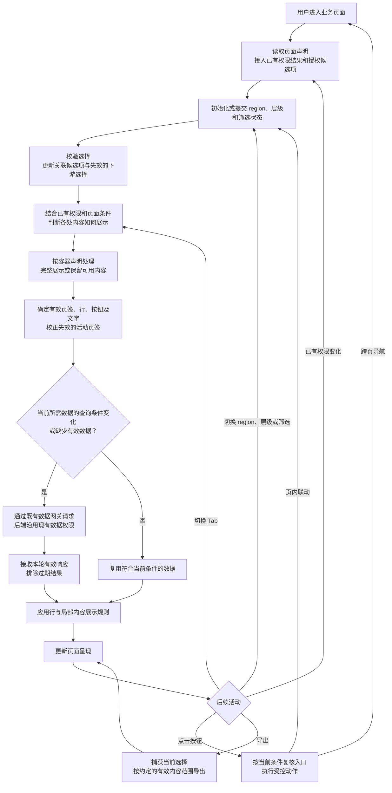
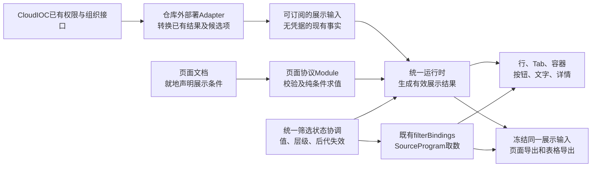

# 已有权限下的页面显隐与区域联动

日期：2026-10-15。状态：完整构建方案待用户审核，产品代码未实施。本文是本轮需求、现状证据、架构取舍、兼容策略、技术债务与实施验收的唯一主入口。以下推荐方案均为审核提案，尚未成为现行 ADR 或协议。

目标是在 CloudIOC 已有后端数据权限之上，统一处理授权候选项、页面内容显隐与区域切换后的数据刷新。CloudIOC 是内部集成门户，本机没有可访问的目标环境；下述实现盘点来自当前工作区，不能据此判断线上已部署能力。

## 1. 用户已确认的需求

| 编号 | 已确认内容 |
|---|---|
| R01 | 目标系统是内部 CloudIOC。后端已经完成数据权限控制，本轮以此为既有前提。 |
| R02 | 下拉筛选器需要通过接口取得与当前用户权限一致的候选项。例如仅有部分代表处权限时，仅展示这些代表处。 |
| R03 | 权限统一消费已有结果；不单列第二套“内容能力”，也不使用“作用域授权”命名。切换 region 改变页面选择和查询条件，不产生新授权。 |
| R04 | 有代表处权限、没有地区部权限时，父级名称、地区部相关内容如何展示，由各业务页面分别决定。 |
| R05 | 页面展示既需要预先声明的业务规则，也需要使用接口返回的信息。接口返回的权限信息沿用同一权限体系，其他业务信息仍按业务条件解释。 |
| R06 | 首批覆盖筛选器、表格行、单个 Tab 页签及内容、完整容器、按钮、局部文字；完整容器可能包含多组数据。 |
| R07 | 表格行主要需要前端隐藏，或通过条件变化重新请求数据；本轮不重新建设后端行级权限。 |
| R08 | 每个容器分别声明“完整展示”或“保留可用内容”。必要子内容的指定方式、加载及异常状态细节仍待实现讨论。 |
| R09 | 当前交付为完整构建方案，由用户审核架构、兼容性和技术债务；产品实现尚未开始。 |

“当前用户的已有权限”“当前页面选择”“页面展示条件”分别表示授权事实、交互状态和业务呈现规则。页面可以依据已有权限收窄展示，数据请求仍由现有后端按既有权限处理。

## 2. 目标行为

| 对象 | 本轮需要的可观察行为 | 尚待确定的实现细节 |
|---|---|---|
| 筛选器 | 显示授权候选项；上游选择变化后更新下游候选和失效选择 | CloudIOC 候选值接线、默认值、空选及多层级清理方式 |
| 表格行 | 根据当前权限、region、层级等条件隐藏，或以查询条件变化更新结果 | 行标识、条件引用字段、隐藏与查询分页及统计的关系 |
| Tab | 同时控制页签与内容；当前页签失效时转到可用内容 | 活动页签回退顺序、全部不可用状态、是否扩展内容类型 |
| 完整容器 | 父容器隐藏时整体隐藏；各容器选择完整展示或保留可用子内容 | 必要子内容集合、空容器处理、局部加载与异常呈现 |
| 按钮 | 根据条件显示、隐藏或禁用；执行相应受控动作 | 独立按钮、表格行内入口或现有工具栏的具体覆盖位置；动作类型 |
| 局部文字 | 整段文字或句内片段随条件改变 | 片段形状、标点和连接词归属、既有正文兼容 |

展示变化与数据更新分开描述：某次选择可以只改变展示，也可以修改查询条件，还可以同时触发两者。查询刷新继续使用显式筛选绑定，不按组件名称或字段同名推断。

## 3. 目标活动流程

下图表达需求活动，不冻结权限接线、条件字段名称和查询启停策略。接口既有数据权限保持；隐藏内容是否停止取数的具体边界见第 6 节。



例如：用户只有代表处 A、B 的权限，下拉框只展示 A、B。选择 A 后，页面依据本页规则调整地区部汇总行、代表处 Tab、相关容器、按钮和说明文字，绑定到该选择的数据源按需重查。切到 B 后，A 的迟到结果不能覆盖本轮状态。地区部名称是否保留由当前业务页面声明。

## 4. 当前实现盘点

盘点基线：2026-10-15 当前工作区，Git HEAD 为 `ea6e453e`，工作区存在其他未提交改动。以下描述当前源码，不代表该 HEAD 单独包含全部能力，也不代表 CloudIOC 已采用。

### 4.1 可复用能力

| 能力 | 当前事实 | 主要位置 |
|---|---|---|
| 接口候选值 | 有独立候选值端口，支持稳定值、显示名称、上游约束和取消信号 | [ports.ts](../../packages/data-execution/src/ports.ts)、[dimension-values.ts](../../packages/engine/runtime/src/dimension-values.ts) |
| 候选值加载状态 | 区分未请求、加载、就绪、空结果、能力不可用与错误 | [dimension-values.ts](../../packages/engine/runtime/src/dimension-values.ts) |
| 身份接线 | DQE 主查询和候选值请求通过每请求读取配置发送现有身份头 | [runtime-config.ts](../../packages/application-runtime/src/runtime-config.ts) |
| 级联与层级 | 有 dependsOn、hierarchy 和逐层查询字段绑定 | [filter.ts](../../packages/page/src/schema/filter.ts)、[cascade.ts](../../packages/engine/runtime-ui/src/filters/cascade.ts)、[effective-query.ts](../../packages/data-execution/src/effective-query.ts) |
| 筛选刷新 | 筛选状态与 filterBindings 驱动相关查询及下游更新 | [orchestrator.ts](../../packages/engine/runtime/src/orchestrator.ts) |
| 页面级多数据容器 | 内容分区可包含多种组件，子组件分别绑定页面数据源 | [page.ts](../../packages/page/src/schema/page.ts) |

已有候选端口可承接 CloudIOC 的授权候选项。是否使用现有 DQE 枚举或组织接口 Adapter，需要核对真实接口；仅为候选项接线不必先增加通用 REST 页面数据源。

### 4.2 当前缺少或受限的能力

| 对象 | 当前限制 | 实施影响 |
|---|---|---|
| 通用条件显隐 | 筛选器 visible 为静态布尔值；组件、内容分区、Tab 没有统一条件入口 | 需讨论页面协议与求值归属 |
| 完整容器 | section 已可复用；compositeCard 仅允许闭集子组件，不能承接任意结构 | 明确页面级和卡内级需求后选择复用或扩展 |
| Tab | 当前只容纳单表或多表 | 若样本需要指标、图表和文字共同进入 Tab，需扩展拓扑、遍历、布局及导出 |
| 按钮 | 当前组件目录无通用独立按钮；现有动作入口属于具体组件 | 明确入口位置后决定新增组件或扩展动作项 |
| 局部文字 | text 有整段正文和链接，没有带独立身份的句内条件片段 | 句内片段需要协议增量，整段可复用组件级条件 |
| 表格行 | 既有视图筛选可复用，尚无通用行展示条件 | 区分固定指标行、记录行和查询范围变化 |
| 查询启停 | 当前源集合不随活动 Tab 和条件显隐统一裁剪 | 展示隐藏不等于已实现停止取数，执行规则待裁决 |
| 导出 | 当前导出展开全部 Tab | 要确定导出中的业务条件与已有权限如何统一消费 |

结构依据：[组件目录](../../packages/page/src/schema/component.ts)、[组合卡](../../packages/page/src/schema/components/composite-card.ts)、[Tab](../../packages/page/src/schema/components/tab-container.ts)、[文本](../../packages/page/src/schema/components/text.ts)、[表格](../../packages/page/src/schema/components/table.ts)、[源集合](../../packages/data-execution/src/source-program/compiler.ts)、[导出分发](../../packages/engine/runtime-ui/src/ComponentRenderer.svelte)。

### 4.3 需纳入实现验证的已有问题

- **候选值请求竞态**：讨论期用内存 deferred gateway 复现了旧请求覆盖新候选的情况。当前 settle 仅检查 loading 状态，没有关联请求代次；取消后迟到的结果可能先落入 ready。实施时需固化可重复的回归用例，当前没有独立验收证据包。
- **候选快照身份过窄**：快照按维度名保存，同维度不同约束的筛选器可能共享状态。候选请求身份与缓存规则需统一确定。
- **筛选写入口不一致**：下拉控件执行直接下游清理和候选刷新，普通 action 与 customBlock 的写入绕过该入口；多层 dependsOn 也未统一递归清理。
- **切层空选可能丢失层级**：层级控件切层提交空 values，当前写入路径把它转换为 null。此项为静态调用链发现，尚未浏览器验收。
- **已选值缺少统一校正**：候选刷新目前不会自动处理不再存在的已选值；需明确清空、默认值与阻断规则。
- **候选业务错误分类过粗**：候选值 DQE 单项非 SUCCESS 统一成为 unavailable；HTTP 403 另有分类。是否需要按真实接口进一步区分无权限、不可用和失败，待接入核对。

主要位置：[候选加载器](../../packages/engine/runtime/src/dimension-values.ts)、[状态入口](../../packages/engine/runtime-ui/src/RuntimeSurface.svelte)、[级联清理](../../packages/engine/runtime-ui/src/filters/cascade.ts)、[层级控件](../../packages/engine/runtime-ui/src/filters/HierarchyFilter.svelte)、[候选响应处理](../../packages/data-execution/src/dqe/dqe.ts)。

## 5. 推荐构建方案

### 5.1 总体取舍

推荐采用“页面就地声明条件、集成应用供给已有事实、统一运行时生成有效展示结果”。本轮完成全部已确认对象的显隐与重查联动；后端数据权限沿用既有实现。

首批保留现行查询执行范围：隐藏内容不自动停止其查询，region 等查询条件变化仍通过既有 filterBindings 和依赖图触发更新。这样将展示需求与取数优化分开，避免同时改写共享 execute、查询结果绑定和计算行为。代价是部分隐藏内容仍可能取数，见技术债务 T07。

| 方案 | 优点 | 主要代价 | 审核建议 |
|---|---|---|---|
| 页面声明条件，运行时统一求值 | 规则随页面保存，预览、动作、导出可共用，独立渲染可消费 | 增加有限条件协议、公共求值和创作配置 | 采用 |
| CloudIOC直接返回页面节点显隐 | 前端节点判断较少 | 内部接入依赖页面节点身份，页面难以独立迁移，预览与导出需复制接线 | 不作主路径，可把现有返回值映射为事实输入 |
| 各组件接受业务回调或自行请求 | 短期单页改动快 | 规则分散、序列化困难、异步和导出语义不一致，违反纯渲染分工 | 不采用 |



### 5.2 Module与职责

| Module | Interface与职责 | 位置及依赖约束 |
|---|---|---|
| 条件协议 | 定义封闭条件、引用和版本能力；验证来源存在性、类型、上下文；返回确定性判定 | `packages/page/src/`；纯TS，无Svelte、HTTP、权限SDK |
| 展示输入接缝 | 集成应用提供现有权限结果、业务值、就绪状态及修订通知 | 引擎定义中立Interface，CloudIOC Adapter在仓库外；凭据仍归已有网关 |
| 筛选状态协调 | 所有交互入口共用一次状态提交；维护层级、递归后代失效、候选请求代次 | engine/runtime；FilterState保存唯一已提交筛选状态，不在各组件复制状态机 |
| 有效展示结果 | 根据当前输入求值父子内容、容器策略、活动Tab、动作和片段；保留判定原因 | engine/runtime；runtime-ui消费结果，widgets只接收受控属性和事件 |
| 表格视图投影 | 对已授权快照应用展示行条件，接入现有排序、筛选和本地分页顺序 | 复用data-execution/TableView与engine/TableSession；不修改共享raw快照 |
| 导出投影 | 捕获同一版本的筛选、事实、有效内容和表格投影；取消过期导出 | 复用现有导出流程；不另写一套条件解释器 |
| 创作与分发 | 创建、编辑、校验上述声明，生成同版契约与Skill | 平台工作台、Python受控工具、产品Node Bridge与生成链 |

条件逻辑不进入中立UI包；纯渲染组件不调用CloudIOC接口。页内显示过滤不改写compute或resultBindings的输入，也不自动生成新查询。

## 6. 提议的协议与运行语义

本节字段均为审核用草案，当前校验器尚不接受；实施时按实际下一可用次版本登记，不预占版本号。

### 6.1 就地声明有限条件

各内容节点增加可选的 `visibleWhen`。筛选器现有静态 `visible` 保持：静态false永远隐藏，静态允许时再判断条件。按钮另可有 `enabledWhen`，条件隐藏与可见但不可操作分开表达。

首批来源为：已有权限键、接入提供的有限业务值、已声明筛选器的值或层级、允许行上下文中的显式字段。首批操作为all/any/not、严格等值与集合匹配，以及显式空值判断；不开放脚本、动态属性路径、算术、正则或查询请求。深度与条件数采用有界校验，建议上限参照现有resultBindings.where的4层/64叶子，正式限制随协议测试固定。

以下表示“当前选择在地区部层级，并且已有权限结果允许查看相应数据”：

```json
{
  "visibleWhen": {
    "all": [
      { "permission": "region-department.read" },
      { "filter": "organization", "part": "level", "op": "eq", "value": "department" }
    ]
  }
}
```

权限键只是既有结果的稳定映射示例，不代表新建权限码或内容权限服务；实际键由CloudIOC接线确认。已有权限结果未提供某个必需键时，不能凭候选项或角色名推断其值。

条件不引用任意查询快照、加载完成事件或组件DOM，避免形成“显隐改变查询、查询结果再改变显隐”的循环。行字段只在表格行、行内动作及有显式数据上下文的位置合法；分区或独立按钮引用row字段应在校验时拒绝。已有权限只读，不能被URL、writeFilter或页面参数覆盖。

求值区分满足、不满足、等待输入和输入错误。等待与错误都不展示依赖该输入的受保护内容，并给出可定位的状态；不把它们写成业务空结果。输入错误在求值前检查，not不会把未知值翻成允许。合法旧节点未声明条件时保持原行为。

### 6.2 展示输入与生命周期

推荐为RuntimeView和JS挂载入口增加可选的中立 `displayInputs` 输入源，其Interface为“读取当前不可变快照＋订阅变化＋取消订阅”。它只提供现有事实，不查询权限中心、不登录，也不承担最终数据鉴权。

快照包含已有权限结果及其修订、有限业务值和各自的就绪状态。依赖region的异步业务值必须携带其请求所对应的筛选版本；提议在现有filter-change事件增加可选filterRevision，集成应用复制该版本到响应快照，只有与当前选择一致时才生效。初次挂载使用初始筛选版本。与选择无关的权限结果可以复用。修订标识可由Adapter在已有通知上生成本地代次，不要求后端新增授权令牌。

订阅源对象保持稳定，普通业务值变化只重算展示；不把该变化回灌为一次完整mount.update，从而避免切换region后又重置选择。JS `update` 继续采用现行完整替换语义。新增输入必须同时经过RuntimeView、embed类型、输入白名单及EmbedRoot，不能只改一个类型声明。

生命周期按三类处理：

| 变化 | 处理方式 |
|---|---|
| 筛选值或层级变化 | 保留实例，提交新筛选版本，失效关联候选与查询；等待相关业务事实的新版本 |
| 同一权限修订内的业务值变化 | 只重算展示及动作判定，必要时校正Tab和局部选择，不重建整个运行时 |
| 用户、工作空间或已有权限修订变化 | 立即停用旧展示、详情、自定义组件和导出；终止旧会话并清缓存，集成应用按当前身份重新提供页面和执行初始化 |

第三类更新由集成应用显式销毁并重挂实例，Svelte采用实例key，JS采用destroy/mount，不依赖相同document引用的update触发重建；旧实例先停用，当前合法初始化就绪后再挂新实例。不承诺保留排序、分页或局部自定义状态。旧ExecutionBootstrap、query/pagedJoin initial与缓存不能作为新权限的数据来源；合法页面可保留声明，携带数据须由集成应用按当前权限重新准备。inline业务数据需重新获取当前可用文档；前端显隐无法撤回已经下载的数据。

这需要明确补充ADR-0105的适用前提：失败保留旧initial仅适用于同一可信身份和权限修订。输入身份或权限已经变化时，先失效再执行，失败也不恢复旧权限数据。既有后端数据权限实现继续沿用。

### 6.3 候选值与统一筛选状态

候选值继续走现有DimensionValuesGateway。CloudIOC组织接口若与DQE不同，由集成应用组合网关实现该方法，组件不增加业务HTTP地址。端点、身份与响应封套都留在Adapter。

统一状态提交顺序为：验证写入目标及值类型→保留显式层级→清理递归后代→提交一次新状态→按完整请求身份更新候选→依既有绑定刷新受影响查询。下拉、表格选择、普通action、地图、customBlock动作、URL初始化和历史恢复共同走此链。

候选身份至少区分筛选器、当前维度、规范化上游约束和当前会话代次；相同请求可合并，不同请求分别保存。每次reload记录新代次，成功、取消和失败回调都核对代次；取消信号本身不能替代过期判断。

空选层级约定提议为：缺少筛选状态表示默认层级且无附加筛选；显式 `{level, values: []}` 保留该层级并表示该层级内无附加条件。同步修复defaultLevel、URL的仅层级恢复、切层和effective-query。空值不生成业务谓词，最终数据范围仍由后端现有权限限制。此约定影响公开FilterState和URL行为，需纳入兼容验收。

授权候选为空、能力不可用、无权限和加载失败分别呈现；新候选到达后校正已选值。默认不静默跳到其他地区或扩大选择；无有效选择时按页面声明保留待选或不可用状态。

### 6.4 表格行与数据重查

行隐藏采用组件私有展示投影，不删除raw行，不更改共享数据源、compute或resultBindings。若下游查询范围也应改变，使用已有filterBindings；针对上游结果集合的独立筛行继续使用已有resultBindings.where，两个用途不得互相冒充。

| 表格模式 | 推荐行为 | 条数与计算语义 |
|---|---|---|
| 完整本地数据或固定指标行 | 在共享表格投影中先应用行条件，再沿用搜索、排序和本地分页 | 本地页数按可见行数；源级统计与compute保持原口径，合计行按其自身规则展示 |
| query分页或pagedJoin，需要改变全局结果范围 | 用既有查询绑定重查，等待返回窗口与totalCount | 总条数和全局范围由上游结果决定；不自动把任意显示条件编译成DQE |
| query分页或pagedJoin，只想隐藏本页部分行 | 默认不隐式启用；如用户接受，必须显式声明currentWindow模式 | 可能出现短页或整页无展示行，页数仍按源结果计算；这是审核项U3 |

原始快照仍供其他消费者和结果绑定使用。行投影复用同一纯求值及TableView顺序，TableSession继续作为表格已提交状态唯一写者，widgets不自行再filter一次。被隐藏行的selectedCell、详情和动作入口同步失效，位置采用稳定rowKey而非可变行号。

### 6.5 容器与Tab

容器增加两种策略：`retainAvailable` 保留满足条件的直接子内容；`requireAll` 要求声明的必要子内容全部满足条件。必要集合用稳定子节点id声明并就地校验；可选按钮和装饰文字不会因默认被视为必要项而让整块消失。完整模式必须明确必要集合；保留模式没有可见子内容时收起空容器。

父级不满足条件时约束所有后代；子项只可进一步收窄。必要集合只依据展示条件判定，加载、空数据或请求失败仍是数据呈现状态，不自动改变容器授权结论。

优先在section和现有compositeCard上实现策略；不新增通用递归容器。现有组合卡成员白名单保持，Tab先支持现有单表/多表的条件页签。若实际样本需要图表＋文字＋表格一起进入Tab，须单列闭集拓扑扩展及对应工作量，不能把它写成已经可用。

Tab列表变化后，优先保留仍可用的当前Tab，否则选择仍可用的defaultTab，再取声明顺序中的第一个；全部不可用则隐藏空Tab容器。没有条件的既有Tab行为保持。纯Tab切换不触发整页重新execute。

### 6.6 按钮与文字

首批明确建设受控独立按钮，并为现有表格行内动作、链接和相关工具栏入口提供相同条件。独立按钮至少支持普通导航与固定值筛选联动；行内入口继续支持已有详情。独立按钮没有当前行时，引用行字段的动作非法。

已有writeFilter使用field取当前行值。固定值联动应以互斥的字面值分支增量扩展同一动作，不新建重复的筛选动作体系；最终仍调用统一状态协调。服务端保存、审批等写操作需要另外明确集成动作契约，本提案的默认首批不增加任意HTTP动作。

按钮不绑定数据源，会触及当前“writeFilter只允许query组件”的校验。建议只在新协议中、目标筛选有明确query绑定或显隐消费方时允许写入；无任何可观察效果仍拒绝。该规则需要局部修订ADR-0022，并同步能力推导、校验和回归。

文本组件新增与body互斥的 `parts` 正文分支；每个片段有稳定id、有限文本取值和可选条件。首批片段为纯文本，可使用现有整值参数/筛选引用；标点和连接词归属相应片段。独立小段文字、fieldText整体也支持组件级条件。

不把全局textValue联合改为任意片段，不改变全部标题与列名的物化结果，也不在semanticHtml字符串里裁切标签。任意标题、单元格富文本内部的片段化属于额外扩展，需要样本和明确协议，见U5。

### 6.7 动作、详情、自定义组件与导出

动作入口即使先前可见，触发时也重新读取当前判定，校验当前行仍在有效投影内。详情来源隐藏后关闭或失效，不能沿用旧行继续操作。普通导航保留现有anchor和集成应用接管方式。

customBlock只在有效展示条件允许时挂载；不向Worker传递完整权限对象、凭据、网关或访问权限中心的函数。它的私有HTML内部按钮与片段不自动成为页面规则节点；需要内部局部变化时优先拆成可独立声明的受控节点，或另行评审有限投影。本轮不扩大Worker权限。AI总结和详情也应在共享呈现入口处理，不能只修普通组件DOM。

导出开始前冻结筛选、展示输入修订、有效内容、文字和表格状态；展开所有满足当前条件的Tab，不输出不满足条件的Tab。页面PDF、表格XLSX和详情导出共用条件结果与行投影。普通筛选变化保留已捕获的导出视图，权限修订变化立即取消导出。沿用现行完整取数、行数和时间上限，不新增多请求事务一致性承诺。

旧页面无新条件时保持现有“导出展开Tab”的行为。共享单次execute仍回填既定源范围，导出呈现过滤不会反向改变源级执行与计算口径。

## 7. 架构冲突与处理提案

| 编号与等级 | 现行约束及冲突触发点 | 本次推荐处理 | 需要修改的决策 |
|---|---|---|---|
| A01 高 | ADR-0003禁止开放表达式；把visible写成JS字符串或任意回调会突破声明式协议 | 只增加封闭条件和纯求值，限制输入及复杂度；就地规则，不增全局规则库 | 新ADR澄清与0003、0018的关系，延续严格声明式原则 |
| A02 高 | ADR-0066不增加身份端口，0094规定CloudIOC映射在仓外；引擎直连权限中心会违背接缝 | 新增无凭据事实输入源，业务HTTP与身份继续归Adapter | 增量明确展示输入契约；不迁移权限裁决 |
| A03 高 | ADR-0105规定共享单次执行范围，0108进一步区分组合成员；hidden即停查会改变跨入口执行语义 | 首批显隐不自动裁剪执行根；保留SourceProgram和已有绑定刷新 | 当前执行范围保持；按需取数优化另行裁决 |
| A04 高 | ADR-0105同条件失败可保留旧initial；权限变化后继续用旧值会跨可信上下文复用 | 将身份/权限修订变化定义为硬失效，集成应用重取当前合法文档与初始化 | 局部修订0105：失败保留仅在相同可信上下文适用 |
| A05 高 | ADR-0108指定TableView算法与TableSession唯一状态；组件末端删行会分叉PDF/XLSX/分页 | 统一展示行投影，源级raw、compute、resultBindings不变；查询范围变化走已有绑定 | 明确展示投影语义，不修改0107/0108结果窗口规则 |
| A06 中 | ADR-0053限制组合卡成员与递归；把完整容器直接做任意group会重开布局语言 | 复用section及现有有界容器；混合Tab另列拓扑增量 | 首批保持0053；扩大白名单或嵌套时再修订 |
| A07 中 | ADR-0100与0018采用文本整值替换；全局fragments或字符串模板会扩大所有文本面 | text正文独立parts分支，原body和所有旧文本取值保持 | 新ADR记录局部文字增量，保留禁止模板插值 |
| A08 高 | ADR-0022及validate当前把writeFilter限定query组件；无data的按钮无法复用现行字面语义 | 新增互斥字面值分支，并以query或显示条件的可观察消费方判定合法性 | 局部修订0022，旧无效交互仍拒绝 |

上述架构提案需用户审核后再写成accepted ADR。本轮不直接修改现行ADR正文，也不把候选方案视为已获批准。

## 8. 兼容性矩阵与发布约束

当前源码实际为6.22，支持读取5.0–5.4、6.5及6.11–6.22；这是非连续集合。以[version.ts](../../packages/page/src/version.ts)为真源，不照搬主题文档中遗留的6.9说明。

| 消费组合或变更 | 推荐行为 | 验证重点 |
|---|---|---|
| 旧页面＋新引擎 | 未声明新字段时保持显隐、Tab、文本与导出行为；不要求displayInputs | 全部合法旧夹具及5.x导航读取回归 |
| 新页面＋旧引擎 | 明确版本不兼容，不能忽略新字段后把内容全部展示 | raw文档能力探测、strict schema与错误提示 |
| 新页面＋新引擎，未使用已有权限/外部值条件 | 可只依赖filter/row运行 | 不强制接入无关事实输入 |
| 新页面引用已有权限/外部值，但集成缺输入 | 相关节点为等待或配置错误，不静默允许；其余独立内容可呈现 | 缺键、类型错误、订阅失败与输入修订 |
| 静态visible＋新visibleWhen | 旧false保持隐藏；条件只进一步限制 | 二者组合与默认值 |
| RuntimeView／JS mount／平台工作台 | 同一可选输入及生命周期，完整update语义不变 | embed白名单、EmbedRoot、平台服务、直接npm消费全部接线 |
| 公共FilterState与URL | 仅增加显式空选层级表达，原普通维度空选仍表示无附加条件 | 默认层、仅level链接、旧URL回放、地图与筛选控件一致 |
| 文本body与新parts | 互斥；旧body及semanticHtml保持；parts使用独立版本能力 | 文本物化、参数/筛选引用收集、导出与编辑保存不丢字段 |
| Python与本地Skill | 新语义由产品TS校验，Python通过Node Bridge消费；独立校验器同版生成 | 新能力触发Bridge、跨语言共用向量、仓外复制闭合 |
| 集成门户配置 | 旧接入无需增加可选展示输入；新页面功能依赖新Adapter接线 | 新可选契约不混入token配置；实际序列化与白名单需同步 |

filter-change增加可选版本字段，保留原事件名和search。推荐首批不新增强制消费的事件分支或mount方法；若实现确需扩大公共事件联合，必须另外检查依赖穷尽switch的消费者源码兼容，不能仅称“字段可选所以完全兼容”。

### 8.1 已复现的5.x能力门禁债务

本轮只读运行parsePage：同一table-toolbar页面声明6.21通过，声明6.20因能力下限失败，但改成5.4仍通过，requiredMinor为21。[capabilityFloorErrors](../../packages/page/src/version.ts)对非当前主版本跳过能力下限，5.x读取路径因此可能接受后续能力。

本批最低要求：在统一能力表及raw版本检查中明确新显隐、parts、按钮等能力不得借5.x入口使用；覆盖sections、detailViews、Tab、动作、行和文字片段。既有旧能力是否被历史5.x文档使用需要先扫描，不能未经盘点收紧所有旧文档。保留的既有漏判记T01，逐项补兼容归属，而非在各组件分散加判断。

### 8.2 版本、构建与回退

新字段、联合分支和闭集成员按ADR-0051采用实际下一个次版本。条件、片段及按钮分别登记能力使用点；只改CURRENT_MINOR不能证明门禁闭合。新产物保持既有锁步版本及包依赖规则，实际交付包含page、engine、embed、metric-canvas、data-execution涉及部分和完整创作Bundle/Skill，不增加无必要的新包。

新引擎先验证旧页面，再启用新页面；需要外部输入的页面在Adapter就绪后才启用。回退前停止发布新协议页面；旧引擎读取不了新页面时，恢复其上一合法页面修订或保留新引擎读取，不能通过剥掉条件字段回退。完整Skill和Bundle按版本回退，不能只换其中的规则文档。

## 9. 技术债务登记

| 编号与性质 | 风险及影响 | 首批处理或接受代价 | 退出条件与责任 |
|---|---|---|---|
| T01 既有，高 | 5.x能力下限漏判 | 本批封住新能力绕行；既有能力不未经扫描收紧 | page维护者盘点存量版本使用并形成逐能力读取矩阵 |
| T02 既有，高 | 候选竞态、按维度单键缓存、取消回调覆盖新状态 | 本批修复，形成代次及完整请求身份回归 | 候选Module和统一状态测试覆盖，不继续保留 |
| T03 既有，高 | 各交互入口和空选层级语义分叉 | 本批收口入口；初值、URL、地图和查询一起修 | 无组件绕过声明感知的状态提交，回放行为一致 |
| T04 新增风险，高 | 规则逐步演化成通用编程语言 | 限定来源/操作/深度；不读任意查询快照 | 新来源或操作必须有场景、协议向量和ADR影响审查 |
| T05 既有及新增风险，高 | RuntimeSurface继续堆积条件、状态和导出分支 | 提取纯求值与状态协调Module，UI只组合结果 | 同一规则修复无需改多种组件或多条导出路径 |
| T06 既有，高 | TS/Python双份语义及派生知识漂移 | 新语义纳入产品Node Bridge，真源单向生成 | 不新增Python条件解释器；产品、Bundle和独立Skill向量一致 |
| T07 推荐接受，中 | 业务隐藏内容仍可能查询 | 首批保持现行查询范围，避免顺带重构调度 | 有测量到的真实成本后，再审核统一按需根集合与依赖策略 |
| T08 可选接受，中 | query分页仅本页隐藏会导致短页及全局条数差异 | 默认禁隐式使用；仅在U3明确接受后开放currentWindow | 若业务需要全局语义，改用受支持的查询条件并复验 |
| T09 集成依赖，高 | CloudIOC事实修订或撤权通知不完整，旧initial/inline可能留存 | 本仓提供接缝和模拟向量；真实闭环由内部Adapter联调 | 验证现有权限变化能触发硬失效和合法文档重取；未完成不宣称生产闭环 |
| T10 范围控制，中 | 任意嵌套、全部文本位置和任意HTTP动作会放大本批 | 保留现有树约束，正文片段和受控按钮先闭合 | 新样本确有需要时独立评审，不用customBlock长期绕过公共能力 |
| T11 创作风险，中 | 隐藏节点从画布消失后无法修改，运行时与编辑器各有一套结构 | 作者结构视图保留隐藏节点及原因；真实预览消费条件 | 嵌套目标用稳定身份定位，创建/修改/保存重开不丢规则 |

T07是推荐的明确性能取舍；T08只有用户选择后才接受。T02、T03、T05、T06属于本批应偿还或避免的债务，不以记录替代修复。

## 10. 代码影响与实施批次

| 批次 | 文件或目录范围 | 交付与完成条件 |
|---|---|---|
| B0 设计与样本 | 本计划、ADR草案、典型页面需求与接口映射表 | 用户审核U1–U5；冻结必要子项、行模式、动作及片段范围；内部接口事实有来源 |
| B1 协议与纯求值 | page的schema、page类型、actions、validate、version、component-walk；新增条件与语义校验Module | 新旧合法/非法向量、类型/上下文/复杂度、5.x绕行门禁；不引入Svelte依赖 |
| B2 统一状态与候选 | runtime/filter-state、dimension-values；runtime-ui/filters/cascade；data-execution/filter-values及相关effective-query | 递归后代失效、全部写入口、空选层级和取消代次闭合；原查询绑定语义保持 |
| B3 事实输入与生命周期 | runtime-ui/types、RuntimeView、独立订阅适配；embed/types、index、EmbedRoot；platform/integration及消费点 | 可选输入完整转发；普通业务值不重置筛选；权限修订清旧会话；公开API清单同步 |
| B4 有效展示与组件 | RuntimeSection、ComponentRenderer、section-navigation、Tab、表格controller/session、按钮和文本 | 六类首批对象及容器两模式完成；行投影复用TableView，动作触发时复核 |
| B5 导出与详情 | export-render-state、ExportView、export-view、table-export、export-snapshots及详情 | PDF/XLSX/详情共用投影；捕获状态一致，权限变化取消导出，旧页行为保持 |
| B6 创作闭合 | workbench/Inspector、property-edit和稳定目标定位；Python editing、page_validation及Node Bridge | 创建与修改均能表达首批规则；隐藏目标可编辑；不靠任意JSON路径写入绕过受控编辑 |
| B7 分发与验收 | pages、Playground目录、协议文档、契约导出器、Bundle与独立Skill、public-api与包构建 | 完整页面直接用于验收；生成差异可解释；仓外安装、入口、版本与哈希闭合 |
| B8 CloudIOC联调 | 仓库外Adapter、真实账号/组织接口与本仓验收记录 | 候选、权限事实、region异步响应、权限变化及导出真实验证，单列外部未完成项 |

B1与B2可在已冻结的状态和条件Interface下并行；B3依赖B1的输入类型；B4依赖B1–B3；B5与B6在目标定位及展示投影稳定后可并行，B7持续生成并最终收口。B8的接口调查可先行，生产验收在本地完成后执行。不在混合工作区全仓重新生成他批次派生物；实施前确定隔离基线和本批显式文件范围。

### 10.1 创作能力必须具体实现

现有人工搭建属性编辑为白名单，定位主要是sectionId/componentId；嵌套Tab、动作和文字片段不能靠当前顶层定位完成。需要稳定目标形状，按section/component/tab/action/part等身份路径定位；不使用数组序号作为保存身份。受控编辑原子必须校验目标、规则引用和结构限制，保存继续沿用已有单次提交及未知结果保护。

人工端提供条件与容器策略控件；AI内容工具提供同等受控操作并走产品校验。完整图形化条件拖拽编辑器不作为隐含承诺，首批可采用有限条件表单。作者结构视图说明隐藏原因，运行预览仍显示真实结果，保持单套渲染。

## 11. 验收与构建门禁

| 编号 | 正式页面或行为场景 | 必须观察到的结果 |
|---|---|---|
| C01 | 相同页面，已有权限结果不同 | 候选与目标内容正确变化，用户权限事实不可被URL或筛选写入覆盖 |
| C02 | 同一权限结果，不同业务页面规则 | 可分别保留父级名称或隐藏地区部相关内容，不增加第二权限体系 |
| C03 | region/层级切换 | 行、Tab、容器、按钮和文字同轮更新，受影响绑定重查，未绑定内容保留 |
| C04 | requireAll与retainAvailable | 必要子项决定完整容器；可选按钮不意外隐藏整块；全隐藏后无空壳 |
| C05 | 当前Tab失效、默认Tab失效、全部失效 | 回退顺序确定，隐藏内容无遗留入口，纯Tab切换不整页execute |
| C06 | 本地行投影及查询重查 | 分页、条数、源统计与下游结果绑定符合各自声明，不篡改raw |
| C07 | 多级级联、URL仅level、动作与地图写入 | 全部入口具有相同已提交状态；空选层级可恢复 |
| C08 | 候选A→B，旧取消先回调、旧成功迟到 | 新loading/ready不被旧回调覆盖；同维度不同约束不串状态 |
| C09 | 异步业务事实与当前筛选版本不一致 | 过期事实被丢弃或保持等待，不将A规则应用到B |
| C10 | 权限修订、旧initial/inline、旧详情及custom状态 | 先停用旧会话，当前合法初始化前不回退旧数据；旧导出取消 |
| C11 | 按钮、文字parts、行内动作 | 字面与行来源上下文正确，隐藏后旧handler失效，正文标点和引用正确 |
| C12 | 屏幕、详情、页面PDF、表格XLSX | 共用同一有效内容及行投影；导出展开符合条件的Tab，异步捕获不混版 |
| C13 | 全部支持旧版本与旧集成 | 未使用新能力行为不变；新页面在低版本及5.x伪装下失败 |
| C14 | 人工/AI创建、编辑、保存并重开 | 各首批对象可配置，隐藏节点仍可修改，规则不丢失且通过产品校验 |
| C15 | 独立消费与Skill仓外复制 | npm、JS挂载和平台输入一致；无隐藏依赖，生成版本与哈希一致 |

拟新增`pages/page-visibility-region-linkage.json`作为集成样例、另以必要最小页面覆盖兼容与行模式。页面注册、入口、数据性质和预期结果按[新功能验收要求](../agents/feature-acceptance.md)维护；行为测试直接消费样例声明，迟到响应和取消使用确定性边界测试。仿真权限事实必须标明为Sim输入。

检查顺序为：新增纯规则及状态测试→现有相关回归→公共类型和契约→页面/Skill分发→构建和独立消费者→浏览器/Sim→真实CloudIOC。构建前确认实施基线，不将混合工作区的无关失败归因本批。

```sh
pnpm exec vitest run packages/page/tests packages/engine/runtime/tests packages/engine/runtime-ui/tests packages/data-execution/tests tests/public-api.test.ts
pnpm check
pnpm authoring:contracts
pnpm authoring:contracts:check
python3 metriccanvas-authoring/scripts/check_bundle.py
pnpm exec vitest run tests/local-authoring-skill.test.ts tests/page-reference.test.ts tests/authoring-export-isolation.test.ts
pnpm authoring:test
pnpm build
pnpm packages:check
```

最终交付从明确提交的隔离源码树执行`pnpm compatibility:check`，核对其source-tree确为本批交付；它默认读取HEAD，不会自动验证未提交工作区。实际浏览器路径和定向测试文件在B0/B1确定后登记命令。Skill工作流实质变化需要真实模型复验时，另按[模型验收要求](../agents/skill-ds-model-acceptance.md)执行；确定性测试不替代真实模型。

## 12. 外部依赖与生产条件

| 事实或接入项 | 责任 | 对本批的影响 |
|---|---|---|
| 组织候选接口及编码/名称/父路径 | CloudIOC接入方 | 决定复用DQE还是组合候选Adapter；本地可用明确仿真完成开发 |
| 已有权限键、结果类型和通知 | CloudIOC接入方 | 确定中立映射及权限修订失效；不要求重建权限中心 |
| 按region变化的接口信息 | CloudIOC接入方与平台Adapter | 必须携带或关联筛选版本，验证快速切换与迟到响应 |
| 合法文档与initial/inline重取 | 当前页面供给方与集成应用 | 权限变化后不能复用旧执行初始化；真实撤权闭环依赖此项 |
| Relay单次执行 | 现行Relay接入方 | 首批入口及执行范围保持；是否缩小隐藏内容取数范围不在本提案默认变更中 |
| Java保存与读取 | 现行页面资产提供方 | 沿用原有资产职责；确认新协议可保存、读取且不被旧校验器剥离，无新增存储体系 |

## 13. 用户审核清单

需求R01–R08已确认。以下五组是本次完整方案的实现取舍，均待用户审核：

| 审核项 | 推荐结论 | 接受后的主要代价 |
|---|---|---|
| U1 规则与接入 | 页面就地有限条件；引擎共用纯求值；可订阅输入只供已有权限和业务事实 | 增加可选公开输入，嵌入、平台、创作和导出需同批接线 |
| U2 查询范围与失效 | 首批保留现行全源执行；查询条件变化走已有绑定；权限修订先硬失效重建 | 隐藏内容可能仍取数；权限变化不承诺保留局部交互状态，需内部重取文档 |
| U3 行展示与分页 | 本地完整数据可筛行；query/pagedJoin改变范围优先重查；当前窗口隐藏仅显式接受后启用 | 选择currentWindow会出现短页及源总数不变；不启用则需可用查询绑定 |
| U4 容器与拓扑 | 每容器支持两模式，完整模式显式指定必要子项；首批保持现有有界树及表格Tab | 混合内容Tab或任意嵌套需另增拓扑工作，不以通用容器顺带承诺 |
| U5 按钮、文字与创作 | 独立按钮及既有入口条件、固定值联动、text正文parts、稳定创作定位；现有动作闭集为主 | 业务写操作、所有文本位置富片段化须明确追加；首批需同步创作而非只做运行时 |

建议按U1–U5逐项给出同意或修改意见；可先修改最关键的一项。审核结束后，将选定结论写入ADR及正式协议，再实施B1以后的代码。不会因本计划已落盘而推定用户批准全部推荐。

## 14. 当前证据与交付状态

本轮交付为完整构建审核稿及计划索引，未修改产品代码、现行ADR或内部接入。源码盘点、候选竞态和空选层级内存复现来自本地调查；5.x门禁行为已通过只读tsx复核。没有运行本提案的实现测试、构建、真实CloudIOC/DQE/Relay或真实模型验收。

文档应保持已确认需求、待审核取舍、本仓实现、本地验收与真实集成分层。后续更新本计划并就地登记U项裁决、B项进度和C项证据，不再创建平行主方案。
