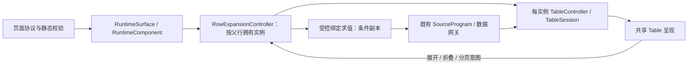

# 行内子表格：参考、原型与协议草案

日期：2026-10-21。状态：Q1–Q4、Q6–Q7 已确认，默认干净呈现已确认；仅Q5导出范围由用户明确挂起，待后续确认。已获用户授权实施；工作区为独立table-row-expansion检出，实施与验收见[实施记录](implementation.md)，Git交付见实施记录。已确认规则与未决建议分开记录。

## 已确认决策（2026-10-21）

- Q1=A：单层、独立列子表；用户补充展开后背景必须白色。展开承载区与子表内容区使用白色，沿用普通表格表头样式，不用浅灰底区分展开。
- Q2=B：首期必须支持大明细的查询分页，替换最初“只取完整结果后本地分页”的限制。父行自带 recordList 分支仍使用本地分页，查询分支由上游分页。
- Q3=A：允许 multiple/single，默认 multiple。
- Q4=A：首期只读，搜索、排序、分页及独立导出能力获认可；不开放导航、详情动作或写全页筛选。独立导出的具体范围与策略仍属于Q5，按用户后续要求挂起，暂不冻结或实现导出部分。
- Q5=待确认（用户挂起）：父表/子表 XLSX、页面 PNG/PDF 的范围与策略均不采用默认方案；不阻止继续设计查询分页，导出相关设计和验收暂不闭合。
- Q6=A：折叠或父表翻页销毁实例，重新展开从第一页重新查询；不保留上次子页、搜索、排序或成功结果缓存。
- Q7=A：接受实时offset分页，追加稳定唯一行键排序；不要求一次展开期间固定数据快照，数据变化仍可能带来跨页位置变化。
- 用户补充：子表默认干净，只显示表头、数据内容和分页。标题、搜索、列排序等附加呈现按需显式声明；不自动继承父表工具栏或主动补齐这些配置。

## 1. 结论与参考

TinyVue Grid 有子表格，官方名称是“展开行 → 嵌套表格”。在 `tiny-grid-column type="expand"` 的默认插槽内放置独立 `tiny-grid`；父、子表列结构可以不同。

- [官方 OS 示例定位](https://opentiny.design/tiny-vue/zh-CN/os-theme/components/grid-expand#expand-nested-grid)
- [嵌套表格源码，固定提交](https://github.com/opentiny/tiny-vue/blob/3167eab1c08a922f7d63b666e019189e0f9f494f/examples/sites/demos/pc/app/grid/expand/nested-grid.vue)
- [展开配置源码](https://github.com/opentiny/tiny-vue/blob/3167eab1c08a922f7d63b666e019189e0f9f494f/examples/sites/demos/pc/app/grid/expand/expand-config.vue)
- [官方示例目录与说明](https://github.com/opentiny/tiny-vue/blob/3167eab1c08a922f7d63b666e019189e0f9f494f/examples/sites/demos/pc/app/grid/webdoc/grid-expand.js)
- [官方交互测试源码](https://github.com/opentiny/tiny-vue/blob/3167eab1c08a922f7d63b666e019189e0f9f494f/examples/sites/demos/pc/app/grid/expand/nested-grid.spec.js)

`expand-config` 示例提供默认展开、按行键展开、手风琴、触发区域及可展开判断。其函数式 `activeMethod`、Vue 插槽不进入我们的页面协议。官方嵌套示例给不同父行使用相同静态 `expandTableData`，不能据此声称它已提供按父行查询、权限控制或请求隔离。

本轮浏览器访问官方 OS 页面，定位“嵌套表格”，点击首行展开并观察独立子表；本地同时只读克隆官方仓库核对源码。官网部署与上述 dev 提交不是同一版本的证明，记录为两个来源。

术语区分：这里讨论“行内子表格”（待新增能力），独立表头和列；树形表格是在同一列结构下缩进父子行；既有“详情视图”展示在弹窗/抽屉。三者不能隐式互换。

## 2. 可查看的原型

[原型 HTML](../../../packages/engine/widgets/prototypes/row-expansion/index.html)，可直接双击。服务运行时：[本地预览](http://127.0.0.1:5198/)；重启命令见同目录 [README](../../../packages/engine/widgets/prototypes/row-expansion/README.md)。

原型的设计问题是：展开后能否保持父行阅读上下文，多个子表状态能否独立，取消和条件变化能否阻止旧数据回流。因此采用单 HTML 状态交互原型，无持久化、无真实网络；视觉只参考 TinyVue OS，不签署像素还原。

可操作：两种来源、多行/单行展开、父表翻页、子表独立查询分页、父表排序、期间变化、加载、空结果、失败重试、折叠后重新展开和迟到响应。查询由“模拟返回”按钮控制，便于观察加载期间。演示状态直接可见，属于原型观察面，不进入业务页面。

已完成的操作与证据见 [原型浏览器观察](prototype-check.md)。

原型不是 `pages/` 正式页面，不能用它代替后续页面试验场验收。未批准的新字段暂不进入页面目录、正式协议文档或本地创作 Skill。按当前仓库约定直接复用现有Table及分页，以已确认原型约束检查实际页面；不走SDD，不把原型脚本搬入产品。

## 3. 现状与缺口（已按当前工作区源码复核）

| 当前事实 | 落点 | 设计影响 |
|---|---|---|
| Table 没有展开行声明 | `packages/page/src/schema/components/table.ts:129` | 新增受控协议分支，不是现有配置开关 |
| Table 接收数据、发出事件，是纯渲染组件 | `packages/engine/widgets/src/components/table/Table.svelte:43,468` | 不在组件中请求 DQE；展开使用稳定业务行键，不使用行序号 |
| 嵌套明细字段 `recordList/detail` 已存在，一层、每行最多100项，项属性只允许标量 | `packages/page/src/schema/primitives.ts:228`、`result-field-contract.ts:147` | 直接复用字段契约及 queryField 归一化，不支持任意 JSON 或再嵌套 |
| 详情视图支持 row/filter/param 显式输入绑定 | `packages/page/src/schema/actions.ts:46`、`schema/navigation.ts:4` | 复用绑定语法与求值规则，不增加函数、表达式或字符串插值 |
| 查询详情已有独立条件、打开取数、关闭取消与代次保护 | `packages/engine/runtime/src/detail-view.ts:7`、`runtime-ui/src/RuntimeSurface.svelte:736,768` | 提取共享输入求值与作用域执行内核，保留浮层生命周期 |
| TableController 的本地会话按 table.id，查询视图按 sourceId 识别 | `runtime-ui/src/table-controller.ts:22`、`runtime/src/orchestrator.ts:32` | 同模板同时展开多个父行必须使用独立实例，否则数据与分页串行 |
| 首屏默认取全部非 inline 源，仅特殊排除 query 详情专属源等 | `packages/data-execution/src/source-scope.ts:25` | 懒加载必须改引用分析、延迟源及依赖闭包，不能仅“展开时渲染” |
| 详情表要求 complete，禁止 query 窗口、pagedJoin；既有纯表格可本地分页 | `packages/page/src/validate.ts:345` | 完整结果首期复用较多；查询分页需另扩执行作用域和视图控制 |
| 完整导出另有总数一致性和10000行限制 | `runtime-ui/src/table-export.ts:28` | 展示成功不等于允许完整导出，不能静默导出当前页或截断 |

上表部分路径按 `packages/engine/` 省略前缀，行号仅为本轮定位参考。仓库存在并行修改，本轮保留所有已有改动。

## 4. 建议的交互契约

1. 父表首列固定展开按钮；键盘 Enter/Space 可操作，带 `aria-expanded`/`aria-controls`。整行点击不触发展开，避免干扰选择、导航和详情动作。
2. 单层、每个父行一张子表。独立列、格式、多级表头、排序、分页；recordList 使用本地分页，query 使用查询分页，搜索与排序作用于该父行约束下的全部匹配结果。表头与普通表格共享实现。展开承载区和内容区白底。原型分页每页2条仅为方便观察。
3. 默认全部收起；`mode: multiple | single`，已确认默认 `multiple`。不提供查询源“展开全部”，避免批量发起逐行查询。
4. 查询在展开、子表翻页、搜索提交或排序变化时执行；仅请求对应窗口。失败只影响当前子表并可重试；空结果显示“暂无明细”。绑定缺失/非法则不发查询，显示参数不可用，不能退化为无父行限制的全量查询。
5. 折叠销毁该实例；再次展开重新取数，首期不加跨折叠缓存。同页纯排序保留仍可见的行；父行消失、父表翻页、搜索/列筛选/页面筛选变化、页面更新或销毁时取消相关实例并丢弃迟到响应。已加载的 inline 内容随父快照更新。
6. 父行键必须非空、稳定且在父数据范围唯一；缺失/重复不能退回行号。静态可检错误在创作期拒绝；渲染期发现数据不合规则隔离展开能力并给出诊断。小计、合计默认不展开。首期建议带展开的父表不与跨父行 `mergeBy` 同时使用，避免单元格跨越子表插入行；如业务需要须补合并几何规格和用例。
7. 子表沿直接容器宽度收缩，宽列在子表内横向滚动，不能撑宽父表。展开区通过独立 `<tr><td colspan>` 占据父表列，固定列、可见列数、多级表头、窄容器和导出须回归。

Q6/Q7已确认上述销毁重查和实时分页契约。查询分页不受原完整读取10000行上界约束，总数可以大于10000；单次窗口仍服从既有查询限制，真实 DQE 性能尚未实测。并发建议内部上限4，条件变更清队列，不放进页面元数据。完整导出的限制与范围保持Q5待确认。

## 5. 元数据草案

候选新增 `table.props.rowExpansion`，同一位置就地声明来源、展开策略和子表列。父表显式声明既有 `props.rowKey`。不新增组件类型，不新增 `openDetail` action，不改变 `detailViews` 的浮层含义。

默认机器可读片段：[父行明细](record-list.proposal.json)、[展开查询](query.proposal.json)；[按需附加呈现](optional-controls.proposal.json) 单独示例标题、搜索和列排序。它们是带说明的方案信封，**不是合法 Page**，不可交给现行 `parsePage`/独立校验器当成可用页面；仅 JSON 语法已检查。正式 Schema 版本在开工时基于最新主线分配，不提前占用6.33等版本。

```json
{
  "rowKey": "customer-id",
  "rowExpansion": {
    "mode": "multiple",
    "data": { "type": "recordList", "field": "orders" },
    "table": {
      "rowKey": "order-id",
      "columns": [
        { "field": "order-id", "title": "订单号" },
        { "field": "product", "title": "产品 / 服务" },
        { "field": { "field": "amount", "format": "number-grouped" }, "title": "金额（元）" }
      ],
      "pagination": { "mode": "local", "pageSize": 10 }
    }
  }
}
```

### 两个 data 分支

| 分支 | 声明 | 行为与校验 |
|---|---|---|
| `recordList` | `field` 指向父行嵌套明细字段 | 要求父表单一数据槽；字段必须 `recordList/detail`；子表字段在 `items.fields` 中解析；不复制字段契约，不自动按同名字段关联；不请求数据网关 |
| `query` | `source` 引用页面数据源；`filters` 声明实例输入；`bindings` 完整映射这些输入 | source 必须可分页普通 query，不声明 `resultScope: complete`；DQE order.offset 初始为0、order.limit 为正整数；响应提供该父行与全部当前条件下的 totalCount。父行/筛选/参数值只写入本实例条件副本；query 的既有 `filterBindings` 负责对 DQE 目标字段的映射 |

query 分支示意：

```json
{
  "type": "query",
  "source": "customer-orders",
  "filters": ["detail-customer"],
  "bindings": {
    "detail-customer": { "source": "row", "field": "customer-id" }
  }
}
```

`detail-customer` 复用页面 `filters` 的类型声明，但属于展开实例的输入，不渲染为全页控件、不写全页 FilterState；必须标记为子表专属输入并禁止正文或另一独立作用域消费它。一般页面筛选（如期间）仍由查询显式 `filterBindings` 继承，值来自展开当时的已应用状态。绑定值缺失拒绝执行，而不是忽略绑定。

这是复用现有详情输入模型的建议；替代方案是新建独立 `inputs` 类型系统。后者可避免顶层 filters 命名复用，但会新增参数类型、绑定、校验与求值的第二套协议；当前推荐先复用已有模型并把作用域校验补齐。

子表 `table` 是受限 Table 呈现配置，不是可以递归装载的完整 Page Component；字段语法、格式与列分组复用现有 Table，`data` 由 rowExpansion 唯一声明。默认只显示表头、数据和分页，展开承载区与内容区白色，无额外卡片边框、标题、期间标签、搜索框、工具栏或排序控件。`title` 省略即不渲染标题区域，`toolbar.search` 省略即不渲染搜索，列 `sortable` 省略即不显示排序入口；不从父表继承，也不由AI默认补上。首期支持按需声明 `title`、`rowKey`、`columns`、`fit`、搜索与排序；recordList 允许 `pagination:none/local`，query 要求 `pagination: {mode:"query"}`，每页条数沿用查询定义 order.limit，不在 rowExpansion 增加第二处 pageSize。内部稳定唯一行键兜底排序与用户可见排序入口独立，关闭列排序不取消分页的稳定排序。禁止再次 rowExpansion、pagedJoin、任意组件插槽；Q4已确认禁止写筛选、导航和 openDetail。导出入口及行为跟随Q5待确认，不从Q4推断启用。recordList 的 nullable 缺失值不能伪装成空数组，区分“明细不可用”与“确实无明细”。

查询模板建议专属本次 rowExpansion，不和正文共用同一个 sourceId。共享无父行参数的依赖可以按既有取数内核复用，但缓存键必须含条件指纹。查询分页已纳入首期确认范围；多槽联接与跨源计算仍不包含在首期建议内，不能把当前查询窗口冒充完整明细。

## 6. 架构调整



| 模块 | 保持的职责与具体调整 |
|---|---|
| `packages/page` | 新增非递归 rowExpansion Schema、版本能力门禁、父/子字段解析、绑定完整性、输入私有性、源引用校验及遍历。列呈现 Schema 提取共享子集，不把普通 table 递归进自身 |
| `packages/data-execution` | 首屏源分析识别延迟子表专属源及依赖；不得未展开就查询。查询分页能力检测、source引用计数与执行根投影必须认识实例内子表，只扫描原page正文会漏判子表查询分页。源同时被正文消费要拒绝有作用域冲突的声明；依赖不能绕回父表形成循环。沿用 SourceProgram，不新增 DQE 协议或网关类型 |
| `packages/engine/runtime` | 从 detailViewInput 提取中立受控输入求值；拟新增 RowExpansionController 深模块，以展开/折叠/清理为小接口，内部拥有条件、快照、请求队列、取消和代次。每个query展开实例拥有隔离 PageSnapshotStream/SourceProgram 作用域；窗口修改只作用于该实例的 sourceId，复用既有 TableSession 与 setQueryPage/Sort/Search，不能让父表与其他父行使用同一stream。key 至少是页面实例 + 父组件id + 带类型父行键；请求归属另含父快照/条件指纹与代次 |
| `packages/engine/runtime-ui` | 组装子表实例和现有 TableController。TableSession 按展开实例隔离，页码/每页条数/搜索/排序变化只修改对应实例的查询窗口；搜索和排序重置该实例到第一页。共享 DetailContent 的通用表格呈现能力，但不把单浮层的全局 open/close 状态用于行内展开；增加受控展开行承载位置 |
| `packages/engine/widgets` | Table 仅渲染展开按钮、状态和子内容承载行；通过事件请求上层切换。复用原 Table 表头、格式、单元格、分页和空态，不复制成第二套子表皮肤 |
| 页面搭建、导出与分发 | 增加受控配置入口、遍历与文本物化支持；静态投影明确子表范围；协议文档、样例和 local-authoring 由产品真源生成 |

不推荐两个捷径：把 `openDetail.surface` 加 `inline` 会把单浮层与多个行实例混在一起；在父 Table 内直接实例化网关会破坏纯渲染组件和统一运行时的取数职责。仅单行展开也不能取消作用域隔离，旧请求和未来复用依然需要实例身份。


### 查询分页的额外架构证据

- 页大小与输入契约：`packages/page/src/validate.ts:1830` 校验 offset=0 / limit正整数；`packages/data-execution/src/effective-query.ts:115,127` 形成窗口并要求totalCount。省略 `resultScope`，不发明现行协议不存在的 `window` 枚举。
- 现有普通query排序覆盖body.order.by，不会自动追加rowKey（`packages/data-execution/src/dqe/dqe.ts:629`）；首期子表需在内部最终排序追加显式queryField映射的稳定唯一子行键。默认排序亦须包含唯一键。静态校验保证映射，数据方保证跨页唯一，当前窗口重复键可检测，但浏览当前一页不能证明全结果唯一。
- 全匹配搜索经EffectiveQuery.search下推，网关要求已配置encodeSearch（`packages/data-execution/src/dqe/dqe.ts:646`）。未配置会报DQE_CONFIG_ERROR；不回退为当前窗口本地搜索。真实搜索编码属于接入前置和真实DQE验收，不声称本仓现网搜索已经可用。
- 现有 `DetailContent` 的TableController注入空stream，不能驱动查询分页；拟新增中立的 `ScopedTableContent`，承载普通TableComponent + 实例stream，而不是放宽原详情浮层的complete限制。
- 空窗口且totalCount证明越界时复用既有页码纠正与重查；非空窗口与较小totalCount不一致时沿用现有告警保留行策略（`source-program/range-policy.ts:23,47`），不宣称严格服务端快照。

## 7. 导出：待确认（用户明确挂起）

Q5由用户明确挂起，晚点提供答案。本轮不采纳任何默认导出范围，不启用原型导出按钮，保留Q4已认可的独立导出目标，等待范围与策略确认后再实施该部分。不把当前查询窗口、已展开子表或全部子表隐式混入导出。后续继续讨论三个选项：父子分别导出；页面捕获已展开快照并标注范围；全部父行全部子表的有界批量取数。

已有完整导出校验和10000行限制只是现状事实，不是新能力的已确认策略。此分支保留待确认状态，独立于查询分页设计继续推进。

## 8. 确认收口与剩余范围

Q1=A白底、Q2=B查询分页、Q3=A多行配置、Q4=A只读、Q6=A销毁重查、Q7=A实时offset分页均已确认，不重新询问。默认干净呈现亦已确认：只有表头、数据和分页；其他按需显式声明。

查询分页的确定性技术约束：每个展开实例独立请求窗口；offset=pageIndex×pageSize；初始pageSize来自DQE order.limit；父行条件与页面当前筛选共同约束每个请求；搜索/排序仅在声明启用时显示，执行于上游全匹配范围，改变后重置到第一页；totalCount对应同一条件与窗口代次。稳定排序最终以可映射的唯一子行键消除同值并列；页码不写入Page Metadata。

翻页失败保留目标页码，显示失败/重试，不把旧页数据放在新页码下；折叠、离开父页或全页条件改变即销毁相关实例，重新展开回到第一页与默认条件。实时offset分页不提供后端快照token/cursor保证；稳定唯一键不能抵消两次请求间数据变化。

只有Q5导出范围仍待用户后续提供，保持挂起，当前不催问，不以默认方案替用户裁决。正常加载、空结果、错误与重试属于内容状态，不为默认子表新增常驻辅助区域；原型的模拟响应按钮和会话观察面属于演示控制，不进入产品。

## 9. 确认后的实施与验收顺序

1. 根据 grill 答案更新唯一方案；将已确定的领域规则写 ADR 并并入主题页。遵循当前仓库的组件API复用和实际页面验收约定，不执行已停用的SDD流程。非导出设计决策已确认；后续实施需按原型维护要求保存可追溯参考，本轮仍不执行git交付。
2. Schema/校验/版本与实例控制器先行；补确定性边界行为测试；随后接共享 Table 呈现，检查编译产物及生产构建。
3. 正式 `pages/capabilities/table/table-row-expansion-inline.json` + query 场景，注册页面试验场目录及使用说明；浏览器覆盖多实例独立分页、缺键/重复键、非法绑定、空/失败/重试、取消迟到响应、父页变更、窄容器、固定列和导出范围。真实 DQE 与 Relay 另列环境证据。
4. 更新 PAGE-METADATA.md、table/fields/data-source/actions 实际归属文档；生成 local-authoring 知识/示例/独立校验器，复制仓外安装验收。
5. 按 docs/agents/feature-acceptance.md 对账；交付若获授权再使用 scoped-main-delivery，显式文件范围，保留并行改动。

上述为设计阶段的验收顺序。已完成授权的非导出实施与本地验收，实际命令和结果见[实施记录](implementation.md)；CI、真实DQE/Relay/模型未执行。Q1–Q4与Q6/Q7及默认呈现已获用户确认；只有Q5导出范围明确挂起。
