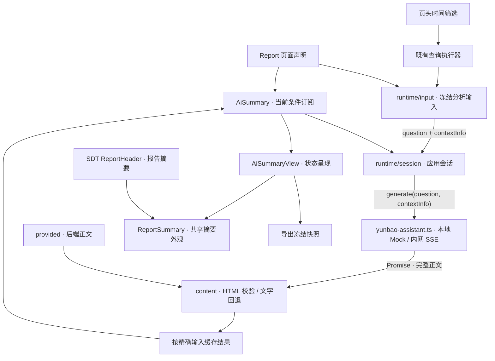

# Report AI 总结实现与验收

2026-10-22。用户已确认：Report 独占、已有正文与动态生成统一、显式数据源或 section 可见范围、业务提示词与结构化查询上下文、完整结果展示、结构不合规降级文字、后台任务跨时间/报表继续完成并缓存、每区域节流与全局并发。

最终接入 Interface 为 `async generate(question, contextInfo): Promise<string>`。唯一云宝助手实现文件是 `packages/engine/runtime-ui/src/ai-summary/adapters/yunbao-assistant.ts`，本地写 mock；用户在内网替换该文件内 generate 函数体，自行构建和消费 SSE。没有 signal 或流事件进入页面协议。

## 职责

page 拥有两种模式与关联范围契约、版本能力下限 6.51。runtime-ui/ai-summary 拥有范围投影、冻结输入、任务会话、缓存、完整正文与纯文字回退。ai-summary/adapters 的云宝文件拥有具体调用；数据网关与普通 widgets 不新增网络能力。复用现有 Report 页头时间选择、filterBindings、组件树遍历、集中显隐和 SemanticHtml。

组件卸载只取消订阅。任务按完整输入去重，完成后缓存；迟到回执只写自己的输入键，不修改其他时间正文。队列只保留同一摘要最新待启动输入，已启动请求不取消。离开报表后返回使用相同注入对象，从而复用应用会话；刷新丢弃。

## 验收清单

- [x] 协议：两模式、Report 限制、未知 section、缺少范围、版本下限；同序错误列表与现有契约向量。
- [x] 任务：切换并返回、迟到隔离、去重、每区域节流、全局并发、失败与重试、缓存清理。
- [x] 范围：显式字段优先、section 去重与可见嵌套、时间条件与实际查询、空/失败透传。
- [x] 浏览器：实际 Playground 双区域、页头时间切换、后端正文与降级文字、导出冻结。
- [x] 文档及 local-authoring：产品真源生成，仓外独立安装验证。
- [x] 复杂度：同一 AST 工具测量修改函数及全部新增函数，Svelte 脚本单独提取。

真实云宝助手、内网身份、真实 DQE/Relay 不属于本地 mock 验收。结果及命令记录写入 `docs/evidence/report-ai-summary/`。

本仓实现与本地验收已完成，详见 [验收结果](../evidence/report-ai-summary/result.md)。真实云宝助手由用户在内网替换单文件实现后另验；本批未提交或 push。

## 模块架构图

- 页面声明分析提示词与数据范围；显式 relatedData 优先，否则由 relatedSections 推导可见数据源。每区域独立。
- 输入组装只读取既有查询结果与实际条件，不执行专门分析；contextInfo 保留字段信息、结果范围及空/失败状态。
- 任务会话负责节流、并发、去重和缓存。切换条件或卸载只取消订阅，运行中的请求继续完成；结果写回自己的输入键。
- 云宝助手单文件隔离 SSE；引擎只认识两参数 Promise<string>，不会消费云宝事件。
- 默认完整摘要与 SDT 报告摘要共用同一 ReportSummary 组件；HTML、文字和状态使用同一外框。显式 reportInline 复用 TextBlock 紧凑呈现，重试复用 UI Button。

可视外观在 ReportSummary 一处维护，生成与缓存不进入 widgets；SDT 页面的元数据无需改动。

## 按功能维护的目录

实现集中在 `packages/engine/runtime-ui/src/ai-summary/`。从 README 与 index.ts 进入，AiSummary.svelte 负责当前页面的订阅；runtime 拥有输入与后台会话，view 拥有呈现与正文适配，adapters 独占云宝 SSE 实现。runtime-context 合并入 runtime/input，生成任务内部类型也归该文件，不再单独维护上下文胶水文件。

云宝按 `@metriccanvas/engine/ui/ai-summary/yunbao-assistant` 独立入口导入并注入；主入口不自动引用 Adapter。应用持有同一个配置对象，后台任务与缓存仍跨卸载复用。
