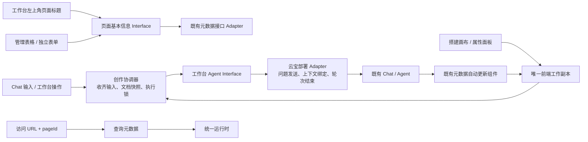

# 页面创作流程：架构调整与交互原型

日期：2026-10-24。状态：已按确认需求实施 MC 侧代码与本地验收；内网云宝/实际服务接入待验收。

本轮唯一实施设计入口。本文承接 [平台管理计划](2026-10-12-platform-ui-management-implementation.md) 与 [创作接入待办](authoring-current-status.md)，只调整本轮已确认的创作入口、前端上下文和管理编辑路径。旧计划中“人工脏稿先保存才能进入 AI”的约束由本轮新决策替代，正式代码切换时同步相关 ADR、接入说明与测试。

## 1. 已确认的需求

| 场景 | 本轮规则 |
| --- | --- |
| 新建 | 新建页面进入页面搭建工作台，Chat 交互生成初版元数据，可信程序提供页面 ID |
| 人工页面搭建 | 组件、布局等手动操作即时修改前端工作副本 |
| 工作台页面标题 | 左上角页面标题直接调用元数据接口修改，并同步当前工作副本；不经过 Agent |
| 自然语言调整 | 问题必须携带前端最新工作副本，包含未保存修改以及输入框刚输入的内容 |
| Agent 执行 | 暂停手动编辑、下一次发送和切换编辑目标；结束后解锁 |
| 工作台元数据操作 | 发布、确认保存等操作转成问题，通过云宝 Chat 交给 Agent |
| 回显 | 使用已有组件的元数据自动更新能力，不增加结果评审、二次应用或另一套保存流程 |
| 发布访问 | 发布后的实际访问地址由外部系统承接，本轮不建设该地址的访问与消费链路 |
| 创作地址 | pageId 定位页面，sessionId 定位云宝会话；缺少 sessionId 时自动新建会话并补回地址 |
| 页面恢复 | 有 pageId 时查询元数据恢复画布；不要求从云宝会话反查 pageId 或恢复历史画布 |
| 云宝执行 | 云宝负责完整 Agent 编排，MC 负责前端工作副本、执行锁与能力接入 |
| 独立 dialogue | 保留现有可独立交付内网维护的 dialogue，通过 MC 定义的公开 Interface 和接入项目 Adapter 装配 |
| 管理页面 | 没有 Chat，基本信息和访问路径直接调用接口修改 |
| 管理编辑 | 管理目录仅提供基本信息与可视化编辑；标题、描述、可访问路径在独立表单修改；页面内容直接进入工作台修改 |

本轮不建立独立发布副本、短链、历史精确读取或新的修订治理。本轮不指定云宝私有 SDK 方法名，也不把原型的模拟结果当作真实接口事实。

## 2. 当前代码事实与调整点

| 位置 | 当前事实 | 本轮变化 |
| --- | --- | --- |
| `apps/platform/src/lib/dialogue/port.ts` | DialogueAdapter 只有 mount；draft-saved 已有回显通道 | 保留挂载及已有组件回显，新增工作台发问能力 |
| `dialogue/runtime.ts` | 默认盘古 Adapter 只调用 renderChat/destroy | 真正云宝调用由部署 Adapter 实现，平台不直接依赖私有 SDK |
| `dialogue/authoring-integration.ts` | 已有 language/ connect 注入接缝 | 在同一部署装配中提供发问与轮次结束能力，避免重复装配 SDK |
| `workbench/authoring-language.ts` | start 会 synchronize、读取服务端 latest、adoptLatest；documentJson 取自 latest.document | 改为收齐输入并截取前端文档，Agent 上下文以这个文档为准 |
| `workbench/authoring-coordinator.ts` | 人工 dirty 会阻止进入 AI；本轮锁、作用域、晚到结果隔离已有 | 允许受本轮锁保护的未保存工作副本进入 AI；保留任务归属及身份检查 |
| `workbench/authoring-sync.ts` | 本地保护与显式远端提交已分离 | 发问前只等待本地保护，不隐式新增一次远端保存 |
| `PageAuthoringWorkbench.svelte` | 发布当前资源可直接走 coordinator.publish | 发布与确认保存转发给 Agent；顶栏页面标题单独走基本信息接口 |
| `views/ManagementList.svelte` | 已有 Grid、预览、编辑入口，缺少就地编辑/路径编辑 | 添加行编辑及独立基本信息表单入口 |
| `page-assets/contract.ts`、`java-adapter.ts` | 有页面读写；列表没有正式 title/path 编辑 DTO | 增加基本信息消费面，实际字段由提供方映射；不得猜测 `meta.url` |

文件路径除首行外均相对于 `apps/platform/src/lib/`。完整上下文、现有 draft-saved 的精确草稿语义与新输入文档不是同一对象，不用当前详情查询伪装精确历史读取。

## 3. 目标架构与所有权



| Module | 拥有什么 | 调用者无需知道什么 |
| --- | --- | --- |
| 既有创作协调器 | 唯一工作副本、输入 flush、本地保护、本轮快照与执行锁 | 视图不用分别维护一份 AI 文档和人工文档 |
| 工作台 Agent Module | 操作意图到问题的组织、当前任务关联、调用状态 | 每个按钮不用理解云宝会话、SDK 和结束通知 |
| 云宝部署 Adapter | 私有 SDK 方法、上下文注入、Chat 实例关联、轮次完成 | 平台组件不直接访问 window 上的私有 SDK |
| 既有元数据组件 | 元数据结果接收与自动更新 | 新 Adapter 不返回第二份待应用文档、不解析 Chat 文本生成页面 |
| 页面基本信息 Module | 表格与表单共用字段、校验、调用结果 | 两种编辑入口不用复制接口映射或保存规则 |
| 元数据接口 Adapter | 标题、描述、访问路径的真实字段/请求映射 | 业务 UI 不猜 URL 所在字段，不直接 fetch 绕过资产端口 |

UI 复用 `@metriccanvas/ui` 的 Input、Textarea、Grid、Button、Tag，页面内容复用 MetricCanvas 和 RuntimeView。没有已确认的组件样式冲突，本轮不替换控件视觉。新增表单布局为原型审核对象。

### 3.1 MC 与云宝的聚合规则

MC 工作台内嵌既有 dialogue，云宝拥有 Chat 会话、Agent 编排、模型和工具执行。MC 的创作协调器拥有工作副本、快照和锁，不再启动另一套模型/Agent 编排。页面协议与创作工具仍可由 MC 项目提供给云宝 Agent 消费。

接入项目是私有 SDK 的装配方：将 dialogue 的挂载能力、会话能力、程序发问及结束通知绑定到同一云宝会话，再通过公开 Interface 注入 MC。现有 dialogue 保持独立交付，不因聚合而依赖 MC 工作台内部模块；公开声明与接入说明同步交付内网，实现代码仍由内网维护。

一个创作任务绑定一个云宝会话；本地 taskId、DOM/SDK instanceId、真实 sessionId 分别保留各自含义。不同 sessionId 的同一页面不能折叠为同一个本地工作任务。

## 4. 前端最新文档如何成为本轮输入

### 4.1 原子启动顺序

1. 获取当前任务的准备锁，暂停新的人工编辑和重复发送。
2. 同步收齐输入框、属性面板及元数据编辑器尚未提交到工作副本的输入。
3. 等待浏览器本地保护完成；从协调器读取当前完整 pageDocument。
4. 复制并规范序列化文档，计算 hash，绑定任务 ID、页面 ID、本地变化序号和本轮请求 ID。
5. 交给可信程序注册本轮上下文，明确内容来源是 working-copy。
6. 使用该上下文调用云宝发送问题；Agent 编辑工具必须读取这份完整文档。
7. 由现有元数据组件处理结果更新；Adapter 接收到本轮完成通知后释放锁。

新建时 document 为 null，页面 ID 由可信程序提供。已有页面保留服务端引用用于既有提交协议；该引用不授权读取旧页面替换前端内容。

仅把“请使用最新页面”写在自然语言问题里不满足要求。prepare、工具上下文注册、Agent 编辑工具和文档 hash 校验必须共同绑定输入文档。Agent 执行中再次读取页面内容也返回同一份本轮快照；本轮快照不随后续 UI 引用改变。

### 4.2 当前协议需要配套调整

当前 `PrepareLanguageRequest` 虽然有 documentJson，但实际来源是服务端 latest；现行 AuthoringTurnBinding 也把文档 hash 与已保存基线绑定。实施不能只改 UI 的一个参数。

拟在创作程序契约中区分：

- **工作副本输入**：本轮完整文档、hash、本地序号，Agent 的页面内容来源。
- **既有服务端引用**：页面资源和修订定位，继续交给既有写入协议处理。

相应更新 TS/Python 的 prepare、binding 关系校验和本轮工具读取约束；通过契约能力显式协商，旧提供方不能接受 working-copy 时显示能力不可用。页面 Schema 不因此升级，创作程序协议能力需独立演进。旧协议只接受服务端基线的行为不得静默当作新能力成功。

## 5. 云宝 Adapter 的最小 Interface

以下是本轮平台逻辑 Interface 草案，不是已存在的云宝 SDK 签名。

```ts
type WorkingCopyInput = {
  taskId: string;
  pageId: string | null;
  localSequence: number;
  documentJson: string | null;
  documentSha256: string | null;
  persistedRef: DraftRef | null;
};

type AgentPageRequest = {
  requestId: string;
  intent: 'create' | 'adjust' | 'publish' | 'confirm-save';
  question: string;
  input: WorkingCopyInput;
};

interface WorkbenchAgentPort {
  send(request: AgentPageRequest, signal: AbortSignal): Promise<{
    requestId: string;
    status: 'completed' | 'failed' | 'unknown';
    message?: string;
  }>;
}

interface DialogueSessionPort {
  open(input: { sessionId?: string }, signal: AbortSignal): Promise<{
    sessionId: string;
  }>;
}
```

DialogueSessionPort 也是逻辑 Interface 草案：传入 sessionId 时恢复该云宝会话，缺少时创建新会话；返回真实提供方会话 ID。它是独立 dialogue 接入能力的补充，不替换既有 mount 的销毁契约。管理页面没有 Chat，因此不调用会话创建。

`send` 的完成表示本轮已经结束，且本轮必要的现有组件更新已处理；仅仅把问题塞进 Chat 输入框或 SDK 接收成功不能解锁。纯文本回答/无文档变化也可以正常结束，不要求一定有页面更新。不能以固定倒计时或读取聊天文本判断成功。若提供方只支持接收通知，部署 Adapter 通过本轮结束订阅完成这个 Promise。

问题文本在工作台操作 Module 里集中组织，身份与授权通过可信部署配置取得，完整元数据通过程序上下文注入，不让模型从普通消息文本反向提取可信身份。真实 Chat 不支持隐藏上下文时，由部署 Adapter 注册可读取的文档引用；引用必须绑定本轮前端快照。

### 与现有入口组合

- DialogueAdapter.mount 的接口保持兼容，新发问能力作为同一部署集成对象的附加能力；已有只挂载 Chat 的消费者不被要求实现元数据写入。
- 程序按钮发问与用户在 Chat 内输入问题进入同一个本轮启动入口，都执行 flush 和快照注册。部署 Adapter 需要支持 SDK 发问前拦截/上下文回调，或让现有组件显式调用这个入口。
- 每轮只有一个真正的发送者。若云宝 SDK 已负责向 Agent 发问，就不能再调用 LanguagePort.run 发送第二次；现有 language.prepare/read 等能力按真实部署复用和映射。
- 所有元数据更新沿用已有组件。既有消费者需要调整 dirty 门禁以接受本轮结果；这不是新增结果预览、确认或另一条回填管道。
- 旧任务、身份变化或组件卸载后的迟到结果不能更新另一页面。unknown 保留工作并说明结果待核实，不自动重发；不新建查询远端操作状态的服务能力。

## 6. 创作 URL、会话与页面恢复

工作台点击发布 → Adapter 发送约定问题 → Agent 执行 → 现有组件展示结果及自动生成地址 → 用户确认保存，仍通过同一对话操作入口处理。若既有组件已提供确认动作，就直接接入，不增加第二层发布评审弹窗。

发布后的实际消费在外部系统完成，本轮不设计该页面的访问入口、分享地址是否携带会话或发布读取策略。管理页面仍按已确认范围维护可访问路径。

下表是 MC 创作入口的行为。参数名 pageId/sessionId 为设计表达，正式实施兼容现有 page/resource/task 深链，统一解析为明确身份，不能只让未知 query 原样透传。

| pageId | sessionId | 创作入口行为 |
| --- | --- | --- |
| 有 | 有 | 按 pageId 查询并渲染元数据，按 sessionId 恢复对话 |
| 有 | 无 | 按 pageId 查询并渲染元数据，自动创建新云宝会话，回填 sessionId |
| 无 | 有 | 恢复指定对话，画布没有页面加载目标；不要求会话提供 pageId |
| 无 | 无 | 自动创建云宝会话，进入空工作台，等待用户描述页面需求 |

新建会话的请求由 Adapter 内部关联一次打开操作，组件重复挂载不重复创建会话。云宝返回真实 sessionId 后，MC 以 replaceState 更新当前地址，保留 pageId 及其他已有参数。生成初版页面并由可信程序提供 pageId 后，同样补入当前地址，保留原 sessionId。

用户删除 sessionId 相当于要求为当前页面开始新会话：已有 pageId 保留并照常加载，随后自动创建新会话；不从本地旧任务记录补回被删除的旧 sessionId。只有缺少会话 ID 才自动创建；指定会话恢复失败时展示失败，保留页面加载结果，不冒充恢复成功。

页面读取与会话恢复分别运行。会话不可用不应阻止已有 pageId 的元数据渲染。没有 pageId 时，不根据聊天文本、历史消息或未确认私有 SDK 能力推断页面身份；后续明确取得 pageId 再加载。恢复对话本身不自动应用历史消息中的旧页面产物。

发起自然语言调整时仍以 MC 前端最新工作副本为准；新建会话或恢复会话都不改变这一规则。查询元数据返回什么就消费什么，不在客户端构造独立发布缓存。

管理页可修改元数据的可访问路径，页面 ID 保持定位作用。正式路径字段位置、唯一性、真实可达路由及现有服务允许的修改方式由提供方契约给出。管理 UI 可做合法路径与 pageId 检查，不能通过单纯保存一个字符串就声称新路径已可达。

## 7. 管理表格与独立表单

共用 `PageInfo = {title, description, accessPath}` 与 `updateInfo(target, changes)` 逻辑消费面；字段名为平台逻辑名称，具体 Java DTO 由 Adapter 映射。

工作台左上角页面标题复用同一个基本信息 Module，失焦或确认输入后直接提交标题差异；提交前同步更新本地显示，成功后仅确认标题字段，组件和布局的未保存修改继续保留。自然语言发问启动时收齐标题输入；标题请求尚未结束时，先核对该次提交结果再发送本轮问题，避免刚改的标题被随后回执覆盖。Agent 执行期间标题仍遵循已确认的编辑锁。

- **独立表单页**：新增建议路由 `/manage/pages/:pageId/settings?resource=...`；旧 `/edit` 继续指向画布，避免改变已有深链含义。
- **表单字段**：标题、描述、可访问路径；不承载组件和数据源编辑。保存成功恢复目录条件、页码和原位置。
- **调用行为**：直接进入元数据接口 Adapter；不挂载 Chat、不发送自然语言问题。
- **局部提交**：优先调用提供方基本信息更新接口。只有整文档写接口时，由 Adapter 读取当前内容、应用明确字段差异，再依照既有基线协议提交；不把行编辑开始时的旧整页文档覆盖回去。
- **标题兼容**：当前 meta.title 可能为参数/筛选引用。绑定型标题必须显式选择改为固定标题后才覆写，不以渲染后文本静默替换原声明。
- **与工作台并存**：管理保存不清空工作台未保存内容；同任务执行中禁止管理写入。本批在同页工作副本脏或执行中时拒绝管理写入并保留表单输入，先在工作台处理后再保存，避免跨入口覆盖。

目前列表未提供完整 title/accessPath 编辑契约，真实消费面需要补齐。接口联调前可以演示表单，不开放猜测 DTO 的生产写入。

## 8. 文件级实施工作包

| 工作包 | 预计调整位置 | 退出条件 |
| --- | --- | --- |
| A 工作副本上下文 | coordinator、authoring-language、创作程序 turn 契约及提供方上下文注册 | 脏稿发问不用先保存；Agent 输入完整包含本地最新变化 |
| B 云宝接缝 | dialogue/authoring-integration、services、部署 Adapter；新增操作组织模块 | 手输问题与按钮问题共用上下文入口；单次发送；真实结束通知可解锁 |
| C 工作台接线 | PageAuthoringWorkbench、输入 flush、锁定状态、既有自动更新组件接入点 | 发布/确认保存走 Chat，现有组件更新；执行中所有编辑入口均暂停 |
| D 管理编辑 | ManagementList、共享 PageInfo 表单、独立信息编辑页、routes、资产 Adapter | 独立表单能直接保存三字段，目录仅保留基本信息与可视化编辑，失败/取消保留输入 |
| E 会话与创作地址 | routes、work-session、独立 dialogue 会话 Interface、部署 Adapter | 四种 URL 组合成立，删 sessionId 新建会话且页面仍恢复；真实会话 ID 可回填 |
| F 文档与验收 | 当前主计划、ADR 相关现行结论、接入说明、Playground 可观察场景、local-authoring 影响核对 | 完整验收映射，不以原型/Mock 代替真实服务证据 |

依赖：A/B 可分别实施，C 依赖 A/B；D 可独立推进；E 依赖真实接口与宿主事实；F 随各工作包同步。离线原型本身不改变生产流程；后续正式代码的实施状态见文末。

## 9. 原型与验收

原型源码：[目录](../../apps/platform/prototypes/agent-authoring-flow/README.md)。可分享单文件：[prototype.html](../../apps/platform/prototypes/agent-authoring-flow/prototype.html)。

| 场景 | 操作与观察 |
| --- | --- |
| 前端最新输入 | 修改组件标题或布局后直接发送；Agent 输入包含未保存变化，服务端对应页面内容仍可为旧值 |
| 顶栏标题直调 | 修改左上角标题直接进入基本信息接口，Agent 发送计数不增长，其他工作副本变化保留 |
| 输入末尾字符 | 输入框不失焦也可发送，完整输入进入本轮快照 |
| 执行锁 | 发送后的模拟处理期中，标题、画布、发送、发布与切换编辑目标均暂停 |
| 回显复用 | 模拟既有组件自动更新；没有新增“应用结果”或结果评审步骤 |
| 发布链路 | 新建、Chat 生成、修改、发布、生成地址、确认保存依次可操作 |
| 管理直调 | 独立表单修改标题描述路径；演示记录中接口计数增长，Agent 发送计数不增长 |
| 失败保留 | 模拟本轮失败，编辑恢复，本轮前未保存工作保留；旧轮次延迟完成无效 |
| 创作地址 | 四种 ID 组合、自动新建会话和 sessionId 回填；首版离线原型未覆盖；实际 MC 验收入口已覆盖 |

原型只验证交互状态，生成数据和服务调用均为本地替身。原型未定义真实 SDK 的发送接口、真实自动更新时序或元数据路径 DTO，未执行真实云宝/Java/Relay/DQE/门户验收。正式实施需补这些接线与服务证据。

早期评审只新增方案和隔离原型。当前实施不改页面 Schema，已同步产品文档及其派生知识。正式能力实施按 [功能验收要求](../agents/feature-acceptance.md) 提供 Playground 场景、对应页面元数据文档和 local-authoring 同步；非 Page Schema 信息不得为满足同步要求而塞入页面声明。

## 10. 原型检查与交付状态

本轮的实际构建、浏览器交互、复杂度口径和限制见 [原型 README](../../apps/platform/prototypes/agent-authoring-flow/README.md)。离线原型保留为评审过程材料；已确认决策已进入正式代码，实际 MC 验收与外部未验项见文末和验收记录。


## 实施状态（2026-10-24）

已在独立工作树实施真实 MC 入口、可注入云宝端口、URL 双身份、工作副本发送锁、标题直改、管理目录与独立表单。生产公开接缝采用新增 DialogueAgentPort，不修改旧 Relay v1 协议；旧接入继续兼容，仅新端口具有本方案语义。已确认决策以 ADR-0118 和 docs/pangu-agent-authoring.md 为准，早期讨论中关于强制升级 Relay 输入的设想不作为本批必要条件。

离线原型保留为状态讨论材料；实际代码的可运行验收入口为 `pnpm --filter platform dev:agent-flow`，使用真实 MC 界面及明确标注的合成服务。验证结果与未接通项见 docs/evidence/agent-authoring-flow/acceptance.md；真实云宝和服务接线仍待内网实施，不能将本地夹具作为生产接入完成依据。

后续入口收敛：按用户截图反馈，移除管理行内编辑和预览入口；每行仅保留“基本信息”和“可视化编辑”，后者直接进入搭建工作台。保存接口与页面协议不变。
