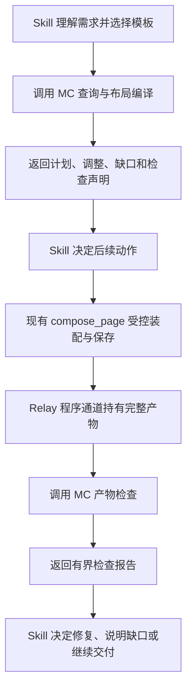

# MC 内容包与布局能力：架构结果

日期：2026-10-24。状态：MC 内容补全及本仓验收完成；Skill / Relay 真实接线另验。

完整性复核已实施：知识、发现/查询字段、场景、完整工具参数、检索与覆盖门禁现已补齐；本仓验收见[实施记录](../../evidence/mc-content-layout/implementation-results.md)。逐项范围仍以[完整性主计划](mc-content-completeness-plan.md)为准；真实 Relay/DQE/保存/预览部署未验，不能用本地结果替代。

本文件是本批次的架构主入口。两份附件原文保留：[布局冻结提案](layout-standards-frozen-design.md)、[MC 侧需求提案](mc-engine-requirements.md)。与本轮确认冲突的表述以本文件为准；原文的“设计冻结”不代表其中所有外部环境断言已经通过 MC 仓或部署验收。

## 1. 已确认的责任

MC 是能力提供方：提供事实、确定性计算、检查与评测结论。Skill 负责理解用户需求、组织流程并决定如何使用结果。集成应用沿现有机制执行页面资产保存和产物交付。

| 事项 | MC | Skill / Relay / 集成应用 |
|---|---|---|
| 产品事实 | 维护协议、工具契约、错误与修复建议、组件能力、布局标准、运行时契约 | 按需消费，核心工作流不复制事实 |
| 确定性逻辑 | 提供查询、编译、产物检查和评测 Implementation | 提供执行 Adapter，调用并处理结果 |
| 用户意图 | 校验调用方明确声明的要求是否满足 | 理解原话、形成要求、选择模板和调整方案 |
| 评测 | 对约定范围给出结论、证据及未验项 | 定义需要的能力与采用规则，决定是否接受或豁免 |
| 保存与交付 | 如实描述现有工具行为，不新增基于内容包的流程准入机制 | 根据检查结果和真实工具回执决定下一步 |
| 分发 | 提供完整、可整体替换的内容包 | 整体安装与替换，保证资源和执行环境可达 |

MC 工具仍校验自身输入、能力和页面契约；无法编译时返回失败及原因。这是能力契约，不代表 MC 替 Skill 决定是否调用其他能力、保存或交付。

## 2. Module 与交付形态

将与 MC 产品事实和契约紧耦合的行为收敛为一个 MC 内容与布局能力 Module，通过小规模 Interface 消费。编译规则、模板、闭集导出和对应回归由 MC 一处维护，Skill 无须重新实现。

```text
MC 产品真源与活动工具契约
          │ 构建期导出 + 作者维护的说明/模板
          ▼
MC 内容包（完整替换单位）
  ├─ mc-content.version.json
  ├─ mc-closed-sets/snapshot.json
  ├─ protocols/
  ├─ tool-contracts/          # 工具、错误、修复建议、操作契约
  ├─ runtime/
  ├─ layouts/catalog.json
  ├─ layouts/standards/
  ├─ scripts/                # MC 提供的确定性 Implementation
  └─ eval/fixtures/
          │
          ▼
Skill / Relay 调用 Adapter
  ├─ 按需查询 / 编译 / 程序通道检查 / 运行评测
  └─ 工作流、采用规则、保存和交付编排
```

mc-content 与 Bundle 都由 MC 提供。第一批不要求两个独立部署系统：内容包可以随匹配 Bundle 交付，Skill 可整体替换。无需建设动态更新、激活、回退管理器或内容注册中心。

内容包是静态资源与代码，不拥有会话状态。依赖应显式声明并可在仓外安装；不得隐式依赖开发目录。Skill 核心保留方法论、工作流骨架、能力要求和薄 Adapter，MC 脚本随内容包升级。

## 3. 对外 Interface

下列名称是架构约定，尚非现有工具。以可在程序中调用的脚本函数为基础；本批次不要求新增 MCP 工具、Hook 或 PluginManager 扩展。

| 操作 | 输入 | 返回 | 副作用 |
|---|---|---|---|
| `query_content` | topic、key、受控 options | 内容、来源、版本、截断标记 | 只读资源 |
| `compile_layout` | templateRef、完整 plan、调用方声明的 userRequirements | status、可生成的 plan、adjustments、gaps、inspectionSpec、内容指纹 | 不查询、不保存、不发布 |
| `inspect_assembly` | 完整 document、对应 inspectionSpec | 实际保留能力、绑定检查、缺口、检查覆盖范围 | 只检查输入 |
| `evaluate` | 内容包、双方约定的能力矩阵、可用的测试输入或回执 | 评测报告 | 仅输出报告，不改变内容包或采用状态 |

`inspectionSpec` 是编译时产生的检查声明：包含模板指纹、已声明的必须内容和可检查绑定关系。它不是新页面字段，不进入 COMPOSE_SCHEMA；由调用方在程序通道关联到对应装配产物，检查函数不猜测“最近一次编译”。

统一诊断包含稳定 code、定位 path、原因及可选 expected/actual。区分非法输入、能力缺口、建议和未验证项，不将所有问题混成失败。`compile_layout` 对非法输入或无法形成合法计划的缺口返回空 plan；可用计划携带未满足声明或建议时必须显式列出，不冒充完整满足。Skill 决定是否继续。

`query_content` 使用固定 topic 和受控参数，禁止任意代码或任意文件路径。返回片段应保持语义完整；截断时提供继续定位信息，不能截断后当成完整工具契约使用。返回预算可配置。同轮去重如有需要由调用 Adapter 管理，不在 MC 内容 Module 中引入进程会话缓存。

## 4. 调用链与产物检查



现有 compose_page 在返回前完成保存尝试，不能承诺“外置检查失败便没有保存”。检查报告必须与真实保存回执分别呈现，也不能通过外置检查暗示已撤销保存。

完整 document 留在程序通道。调用 Adapter 负责将相应 document 与 inspectionSpec 交给 `inspect_assembly`，模型只消费有界检查结论。不得为了运行检查把完整页面、查询体或原始响应塞入模型。

现有 MCP 模型摘要没有完整 document，所以“Skill 可直接检查 compose 返回 document”不能作为现成能力。真实 Relay 接线需单独验证：能否执行 MC 脚本、能否关联编译检查声明与精确产物、能否在程序通道完成检查。MC 可交付函数和输入输出样例，但不将外部 Adapter 尚未接通标成已完成。

当前保存及产物通道事实见 [PlatformAuthoring](../../../metriccanvas-authoring/tool/metriccanvas_authoring/pages/platform_authoring.py)、[MCP Adapter](../../../metriccanvas-authoring/tool/metriccanvas_authoring/entrypoints/mcp/platform_mcp.py)、[产物定义](../../../metriccanvas-authoring/tool/metriccanvas_authoring/delivery/preview.py)。

## 5. 编译与布局语义

沿用已确认的完整计划模式与可执行场景范围：

- 模型提交完整计划；缺失节点视为本页不包含该节点。仅对已存在节点补缺省字段，显式选择优先，不自动补回被删除的模板章节。
- 节点按稳定 id 匹配，不能按标题或位置猜测。系统自动生成的页头须按其真实产物身份单独检查，不要求其冒充模板内用户节点。
- 模板区分 MC 约束、调用方声明的用户要求及作者建议。检查报告明确来源；作者建议不自动升级为必须内容。
- 用户要求来自 Skill 声明；程序证明声明与产物的一致性，不证明模型是否完整理解用户原话。
- 必须内容发生降级或替换时返回明确缺口，不把占位文本或替代表格当成已满足。
- 模板声明数据角色，不内嵌业务示例值、业务字段名、查询结果或固定 source ID。真实数据绑定继续由既有受控查询与装配能力处理。
- 场景显著不匹配时给出建议性诊断。视觉质量通过实际预览检查，不以结构合法代替布局验收。
- 第一批覆盖 business-report 与 usage-report 可执行变体；IOC 保留 planned/executable:false 与原因，不扩展其创作入口和装配能力。

闭集从当前活动契约自动导出，不手写副本。快照应覆盖输入形状、按块类型区分的枚举、必填项、容量和装配能力；不能只有统一组件或 purpose 列表。COMPOSE_SCHEMA 继承 authored SECTION，并有自身修订，应以其有效投影为准。

## 6. 版本与评测结论

内容清单提供内容版本、Interface 格式版本、完整资源摘要及对应产品/工具版本。完整摘要覆盖模板、文档、快照和脚本，不仅覆盖 snapshot。清单自身的摘要规则须避免自引用；评测报告放在内容包之外，避免评测结果改变被测内容身份。

只针对当前一个 Skill 和双方约定的能力要求，不建设通用多 Skill 兼容矩阵。工具版本不匹配时返回检查结论及影响；无法可靠编译时明确返回失败。是否采用整包和如何处理不匹配由 Skill 决定。

评测报告最少包含：

| 字段 | 含义 |
|---|---|
| testedContent | 内容版本与完整摘要 |
| scope | 本次约定和实际检查的能力范围 |
| environment | 本地预筛、仿真或真实部署等实际环境 |
| checks | 每项 passed / failed / not_run，附原因和证据 |
| conclusion | MC 对本次范围的结论，以及明确未验项 |

本地确定性检查与真实部署回执分开报告。静态知识对齐或模拟闭环不能证明模型会正确使用，也不能证明真实 Relay、DQE 和保存交接完成。

MC 不写入具有流程准入意义的 evalStatus，不替 Skill 出具豁免，不安装新包或回退旧包。Skill 自行定义采用标准、豁免、继续与停止规则。

## 7. 第一批验收与实施顺序

| 阶段 | 工作 | 完成证据 |
|---|---|---|
| P1 契约和内容导出 | 复用现有导出链，生成活动契约快照、版本清单与原子内容 | 与真源对账、内容完整性与引用闭合报告 |
| P2 MC 确定性能力 | 实现查询、编译、检查及评测报告 Interface | 通过同一 Interface 执行的正常/异常回归，按代码规则测复杂度 |
| P3 完整交付 | 打包内容、脚本、依赖和样例 | 仓外整体安装可运行，整体替换后版本及内容一致 |
| P4 可观察场景 | 覆盖正常编译、裁剪、缺口、降级及实际布局 | Playground 页面、实际浏览器交互和相应诊断证据 |
| P5 协议与分发同步 | 按实际改动同步页面文档、生成知识和 local-authoring | 仓库功能验收要求对应证据；不改变 local-authoring 独立安装能力 |
| P6 Skill / Relay 对接 | 调用 Adapter 与完整产物检查接线 | 实际执行、程序通道检查和部署回执；未接通明确标记未验 |

MC 交付完成与外部集成完成分别报告。可执行脚本无法运行时，只读文档只能算知识交付，不算脚本能力通过；是否采用该降级仍由 Skill 决定。

实施遵守现有[功能验收要求](../../agents/feature-acceptance.md)。新建验证页面默认 Dashboard；专门验收 Report 布局的页面可使用 Report。协议变更、页面与 local-authoring 同步按实际改动执行。本批实现与证据见[验收记录](../../evidence/mc-content-layout/result.md)。

## 8. 原文需修正的事实与表述

1. 当前 MC 仓存在 metriccanvas-page-builder，不能依据外部裁剪副本直接删除本仓声明。
2. authored v3 schema 的 SECTION 仍被活动 COMPOSE_SCHEMA 直接消费，“完全旁路”表述不准确。
3. 当前仓存在 test-harness；“无测试骨架”不能作为本仓实施依据。
4. layout_compiler 及产物检查 Implementation 归 MC，Skill 负责调用 Adapter；不再同时表述为双方各自实现。
5. 统一使用 mc-content 目录与版本清单；原文 closed-sets/layouts.version 等前后版本路径需要在实施时收敛。
6. tools.py 注册、权限隔离和部署可达性属于 Relay 外部事实，本仓声明及附件描述不等同于本次部署验收。
7. “零生产代码改动”限定为不调整既有保存、交付、MCP 签名和渲染链；新增 MC 脚本、构建导出与测试仍是需要正式验证的代码工作。

## 9. 实施准备与文件范围

2026-10-24 已建立本任务干净 worktree：`/Users/moon/.codex/worktrees/mc-content-layout/DataDashboard`，实际基线 `b740d397829ab85f180ed427afd39912ab115bc0`（本地已知 origin/main；未在本轮 fetch，不宣称已核对远端实时状态）。该基线比主工作区本地 main 更新，不含主工作区并行未提交内容。仅复制本批三份架构资料和实施本批明确范围。

首批文件职责范围如下，实际清单随本批 diff 记录：

- `tools/scripts/export-authoring-contracts.ts` 及本批内容导出辅助脚本：复用产品真源与既有生成流程，不增加手工契约副本。
- `metriccanvas-authoring/mc-content/`：整体可替换的生成内容、MC 脚本与必要依赖说明。作者维护源与生成输出明确分离，避免生成覆盖作者文件。
- `metriccanvas-authoring/bundle.json`、Bundle 检查器与生成锁：声明本批内容与核对分发完整性；保留现有合法 Skill 声明。
- 本批行为与仓外安装回归、复杂度证据、Playground 场景及对应页面元数据说明。
- local-authoring 仅按实际新增的产品语义同步生成知识与独立校验；不改为依赖外部内容包。

Skill / Relay 的执行注册、完整产物输入接线、采用规则和流程编排由调用方承接。本仓提供 Interface、样例及对接说明，不在本批替外部部署实现或宣称真实接入完成。主工作区的表格、Playground 信息架构及其他并行改动不纳入本批。

## 10. Schema 兼容与后续升级流程

页面 schemaVersion、结构计划契约、模板 templateVersion、内容包 contentVersion 和脚本 Interface 格式分别管理。当前页面写出版本与可读版本直接从产品 versionPolicy / supportedVersions() 导出；内容包不维护另一张手写版本表。

本轮新增 `inspect_schema` 与显式文件升级 `upgrade_page`。前者只输出读取合法性、能力下限、可迁移性与语义缺口；后者复用产品升级实现，默认只检查，明确指定新输出目录后保存原始字节、SHA256、目标页面和报告。它不扩大运行时可读范围、不支持降级、不改历史修订。是否采用迁移产物仍归 Skill。

后续 Schema 升级时：修改产品真源及明确迁移规则 → 重生成契约和 MC 整包 → 对旧页执行原版本读取、迁移与目标校验回归 → 在真实目标运行时预览 → 交付新内容与未验项。继续可读、只做旧版本能力内局部修改的页面不强制整页迁移。未知/未来版本、能力下限冲突或没有规则的旧语义明确返回缺口，不能只改版本号通过。

内容清单的完整摘要覆盖包内契约对齐信息；单独改 manifest 的版本声明不能冒充新兼容能力。调用方可向编译传入真实 targetVersions：不匹配时报告无法可靠编译，未提供时明确标为 deploymentAlignment=not_run，不推测实际部署版本。

整包替换后由调用方新建进程或完整重载脚本，确保内存函数与磁盘资源一致；同轮固定内容摘要，调用缓存和 inspectionSpec 按内容摘要隔离。MC 不建设热更新管理器，真实 Relay 中脚本重载与产物关联仍属于对接验收。

第一批还加入隔离升级演练：仅在临时检出把产品当前 minor 增加一版，重生成整包，验证旧当前页面仍按产品策略读取、可另目录升级到新版本，原件字节不变。该演练不修改本仓产品版本，也不代表未来新增语义迁移已自动获得支持。
