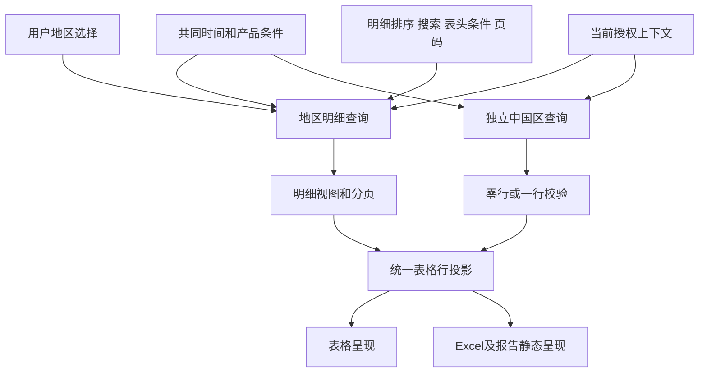

# 表格展示容错和独立置顶行协议设计

状态：Schema 6.60 已实施，本地验收完成；代码按范围向 main 交付，真实服务待联调。日期：2026-10-26。

实施结果、检查命令、复杂度与浏览器证据见[验收记录](../evidence/table-enhancements/2026-10-26-acceptance.md)。

本批增强表格的三个行为：类型或格式失配的标量保留原文展示并告警；本地排序将空白和横杠排在末尾；表格独立查询一行汇总并在每页首行展示。汇总使用指标表已有的区域取数逻辑，前端不根据地区明细求和。

页面协议增加置顶行声明及逐列字段绑定。展示容错和横杠尾排采用统一默认行为，不增加页面开关。查询结果的有效类型值与降级展示证据分别保存，避免展示容错改变计算、查询输入或行身份。

## 已确认的行为

| 项目 | 规则 |
|---|---|
| 标量失配 | 时间组合字符串、字符串字段返回数字、数值字段返回非数字文本等，按原始标量的 String 结果展示并告警；不截断、不 trim 展示原文 |
| 缺失 | 真正 null、undefined 和非有限数字保持既有缺失展示；不补零 |
| 结构化字段 | recordList 与 semanticHtml 保留各自结构及安全规则，不以 String 绕过校验 |
| 诊断 | 仅控制台输出，按数据源、字段和原因聚合，包含数量及定位信息，不记录业务原值 |
| 本地排序 | 空值、空串、纯空格及纯横杠文本，升降序均尾排；0、false 有效；远程查询排序遵从上游 |
| 汇总数据 | 独立页面数据源，独立查询，约定完整返回零行或一行；不使用当前页明细补算 |
| 条件 | 地区选择、表内搜索、列表头条件不影响汇总；共同时间、产品等条件通过显式绑定同时影响两源 |
| 权限 | 两源均遵守当前用户权限；汇总查询不移除权限约束，不由前端推断或扩大可访问范围 |
| 位置 | 每页首行展示，首版不纵向吸顶，不参加明细排序、搜索、筛选或分页 |
| 序号和计数 | 置顶行序号格留空，不占明细分页条数，不计入明细 totalCount；地区序号跨页连续 |
| 异常 | 汇总无记录时不生成置顶行；失败或多条记录时该行不可用，记录诊断，明细继续呈现 |
| Excel | 表头之后先写汇总一次，再写全部匹配明细；汇总无序号；汇总取数或行数契约失败则整个表格导出失败 |

“不影响汇总”的地区筛选指用户主动选择的地区条件。用户权限约束始终生效。独立汇总查询返回的中国区汇总是否包含特定区域，由真实查询与服务端授权决定。

## 实施前基线与本批变化

| 接缝 | 当前实现 | 本批改变 |
|---|---|---|
| 查询结果归一化 | [query-rows.ts](../../packages/page/src/query-rows.ts) 将异常数值度量转 null；其他标量失配可能使整份查询失败 | 有效值继续类型化，新增可传递的原始标量展示证据；可降级的标量失配改为 warning |
| 结果字段契约 | [result-field-contract.ts](../../packages/page/src/result-field-contract.ts) 同时服务 inline 和查询结果 | inline、文档字面量与结构规则保持严格；查询结果的失配处理独立拥有容错分类 |
| 本地视图 | [table-view.ts](../../packages/data-execution/src/table-view.ts) 已实现 null 和非有限数双向尾排 | 扩展空白及纯横杠分类，带展示证据的行投影与值一起移动 |
| 多数据槽 | [tableDataErrors](../../packages/page/src/validate.ts) 要求所有槽使用同一个 rowKey；[rows.ts](../../packages/engine/widgets/src/components/table/rows.ts) 按主槽行对齐 | 显式区分明细对齐槽和置顶槽，置顶槽独立读一行，不参加关联 |
| 组件宿主态 | [widget-host-state.ts](../../packages/engine/runtime-ui/src/widget-host-state.ts) 中任一槽 loading/error 可影响整表 | 置顶槽不阻塞明细；明细既有槽保留现有状态规则 |
| 导出 | [table-workbook.ts](../../packages/engine/runtime-ui/src/table-workbook.ts) 对对齐行编号，日期另经 JS Date 解析 | 复用统一表格行投影；置顶行不编号，原文降级单元格以文本写入 |

已有 grandTotal 将计算产生的总计追加到末尾，rowKindField 要求由折叠算子写入。本批不修改这条契约：独立查询汇总使用置顶声明表达，不伪造计算行标记，也不创建新的聚合算子。

现有地图也有名为 pinnedSummary 的能力，语义是地图地域摘要，不作为表格能力复用。早期 [IOC 设计草案](ioc-m0-m1-2026-09-30/design-review.md) 中的独立 summary 槽尚未形成产品协议；本批以本文件的范围和命名收敛，不顺带实施该草案的详情及计算扩展。

## 页面协议草案

### 独立槽和逐列绑定

保留现有 table.data 命名数据槽，新增加两处可选声明：

- props.pinnedTop：声明一个用于置顶行的数据槽，首版只允许一行、固定在顶部。
- 叶子列 pinnedTop：声明该列在置顶行中的主字段、可选次字段和徽标字段，复用现有 FieldBinding。

以下是组件局部草案。region-data 和 china-summary 在页面 dataSources 中分别声明普通查询定义及完整结果字段契约；该片段不是现行 Schema 的可运行页面。

```json
{
  "id": "regional-table",
  "type": "table",
  "layout": { "span": 12 },
  "data": {
    "main": "region-data",
    "china": "china-summary"
  },
  "props": {
    "rowKey": "region-id",
    "rowNumber": {},
    "pagination": { "mode": "query" },
    "pinnedTop": { "data": "china" },
    "columns": [
      {
        "field": "region-name",
        "title": "地区",
        "pinnedTop": {
          "field": { "data": "china", "field": "scope-name" }
        }
      },
      {
        "field": { "data": "main", "field": "actual", "format": "cny-adaptive" },
        "title": "完成金额",
        "sortable": true,
        "pinnedTop": {
          "field": { "data": "china", "field": "summary-actual" }
        }
      },
      {
        "field": { "data": "main", "field": "completion-rate", "format": "percent-1" },
        "title": "完成率",
        "pinnedTop": {
          "field": { "data": "china", "field": "summary-rate" }
        }
      }
    ]
  }
}
```

组件级 pinnedTop.data 引用槽名 china，而非页面数据源 id。列级 pinnedTop.field 使用显式 FieldBinding，不按列下标映射、不要求两源同名字段，也不需要给既有叶子列补 id。同一明细字段重复展示时，各列可独立绑定汇总字段和格式。

候选类型如下；实际实现直接复用现有 fieldBindingZ。

```ts
type TablePinnedTop = { data: string };
type TablePinnedCell = {
  field: FieldBinding;
  secondaryField?: FieldBinding;
  badgeField?: FieldBinding;
};
// Table.props.pinnedTop?: TablePinnedTop
// TableColumn.pinnedTop?: TablePinnedCell
```

置顶字段格式优先级为“置顶绑定显式 format → 同列相应明细绑定的最终 format → 置顶字段 defaultFormat”。missingText 同样允许置顶绑定覆盖同列设置。不声明列级 pinnedTop 时该格留空，不能回读 main 的第一行；未声明次字段或徽标时不继承明细内容。序号格及展开控制格留空。

列宽、对齐、固定列、现有单元格排布和显式颜色规则复用当前列定义。颜色和 rateBar 等数值装饰只使用有效类型值；降级文本按普通文字展示。首版置顶行只读，不继承明细的 selection、navigate、openDetail 或展开动作，不参与 mergeBy 跨行合并。

### 静态校验

1. pinnedTop.data 必须存在于组件 data，不能为 main，且不能与 main 引用同一数据源。
2. 该槽仅服务置顶行，普通列的字段、rowKey 对齐和候选枚举不得消费它。其余多数据槽维持现有 rowKey 校验；只有 main 加置顶槽的表格，不因这个额外槽被强制要求 rowKey。
3. 列级 pinnedTop 必须有组件级声明，所有绑定分支只允许引用指定置顶槽。字段存在性、角色、结构化字段消费者能力仍按既有规则校验。
4. 对应主次字段的类型语义兼容，金额币种相同，单位声明不得冲突。不能靠共用 format 把不同币种、单位或不同比例刻度变成同一口径。
5. 首版置顶槽引用普通 query 页面数据源，声明 source.resultScope 为 complete；可保留既有计算，但最终结果必须仍满足零行或一行。不支持把 pagedJoin 窗口直接作为置顶结果。
6. 汇总源及其依赖不得依赖该表 main 或明细辅助源，避免将翻页结果或明细筛选间接输入汇总。共同业务输入使用各自 filterBindings、paramBindings 等现有机制声明。
7. 所有查询分支都检查完整结果和字段语义。不得用 limit 为 1 掩盖多行；任何查询窗口都必须有完整性依据，无法证明时不接受为完整置顶结果。
8. 首版用于普通表格和其现有变体；行内子表格不新增该字段，现有详情视图限制继续生效。

不增加 inheritFilters、ignoreRegion、excludeFromPagination、showRowNumber 或 sticky 等开关。置顶行的固有行为由协议确定；具体查询消费哪些页面条件仍由各自现有绑定表达。

### 行数及状态

行数规则在表格置顶投影中校验，不把同一个源的其他消费者一起改为错误态。若响应携带 totalCount，必须与完整的零行或一行一致；截断、totalCount 大于 1 或最终结果多行均使置顶行不可用，不能悄悄选择第一行。

| 汇总快照 | 明细已就绪时的表现 | Excel |
|---|---|---|
| loading | 明细可显示，暂不生成汇总行 | 等待到统一准备期限 |
| empty 或完整零行 | 只显示明细 | 正常导出，不生成汇总 |
| 完整一行 | 在当前页明细前显示一次 | 表头之后写一次 |
| error 或行数不合法 | 不显示旧汇总，不补算；诊断定位到组件及数据源 | 整张表导出失败，不下载部分文件 |

明细筛选后零行但汇总成功时，仍显示汇总；分页条数和 totalCount 仍为零。明细加载失败时，沿用明细当前失败处理，不能用一行汇总冒充明细查询成功。

## 展示容错和快照变化

### 归一化与格式化分工

查询结果归一化处理“原始值不符合结果字段契约”，表格单元格呈现处理“有效值不适合当前绑定 format”。二者使用同一失配分类，不在 Table、Excel、初始快照各写一套类型判断。

- 合法数字和现有允许的数字字符串继续归一化为有效数字。
- 其他可降级的非空有限标量在有效值通道中置为 null，同时保留原始标量展示证据。字符串字段返回数字时显示 String(原始数字)，不把它自动变为可用业务键。
- 原始 null、undefined、非有限数字保持原缺失规则，不生成字符串 null、undefined、NaN 或 Infinity。
- 对象和数组不进入通用 String 容错，不生成 object Object 或逗号拼接。既有数值异常对象转 null 的防御行为保留；recordList、semanticHtml 和其他字段的结构规则继续校验。
- 字段缺失、queryField 映射错误、行不是对象、非法明细结构等仍是结构或契约错误，不归入标量展示 warning。
- inline 和页面文档字面量继续严格校验。动态响应与 query.source.initial.rows 通过同一归一化入口，不能首屏报错而刷新后才容错。

类型失配后的 null 是计算用有效值；表格显示优先读取降级证据。格式失配时保留有效值，当前单元格使用原文模式并记录诊断。两者都不改变结果字段契约的 type、role、queryField 或货币语义。

### 可序列化的展示证据

DataGatewayResult、ready DataSnapshot 和归一化结果增加可选 cellFallbacks。候选内部 Interface 如下，进入实施时与现有快照类型一起维护，不写入页面 dataSources.fields。

```ts
type ScalarDisplayFallback = {
  raw: string | number | boolean;
  reason: 'TYPE_MISMATCH' | 'INVALID_NUMERIC_VALUE';
};
type CellFallbacks = Record<number, Record<string, ScalarDisplayFallback>>;
// ready.rows 不改变形状；ready.cellFallbacks?: CellFallbacks
// key 是本快照的零基行下标，内层 key 是稳定页面字段 id。
```

例如金额返回“待确认”，有效 rows 中该格为 null，cellFallbacks 中保留原字符串。存 raw 而非仅存 text，使初始快照反向序列化仍能恢复原始查询标量。String 表示的是已解析原始标量，不承诺恢复 JSON 数字的原始词法书写。

行下标仅在所属不可变快照内有效。内部行变换必须通过携带“有效行加展示证据”的记录进行，再重新打包快照；禁止先改 rows 后沿用旧下标。具体覆盖：

| 操作 | 证据传播 |
|---|---|
| 搜索、过滤、排序、分页、完整导出合页 | 同步选择、移动并重新编号证据 |
| selectField 或显式单元格复制 | 将证据映射到目标字段 |
| 关联、透视 | 按真实输入单元格映射；不能按结果行号猜来源 |
| 明细原值保留 | 保留该原始字段证据 |
| ratio、delta、求和等新计算字段 | 只使用有效类型值；不把输入原文伪装为计算结果 |
| 刷新、权限上下文变更、快照替换 | 行和值及证据一起失效，不缓存独立于快照的文本 |

使用共享行投影 Module 集中维护这条不变量，不在字段字典中加入保留业务字段，不依赖 rowKey 唯一性，不使用 Symbol 或 WeakMap 作为唯一载体。归一化、QueryRunner 缓存、SourceProgram、计算、初始行反向序列化、Node Bridge 和查询初始结果回传均需传递或恢复证据；只修改 formatter 不算完成。

结构化明细项的既有数值容错维持原行为；本批不增加嵌套项原文证据协议。该范围不会影响独立 query 子表格中自身的标量字段容错。

### 计算与交互

计算、结果绑定、行键、动作输入、日期或数值谓词使用有效类型值。降级文本只用于呈现和本地排序的降级文本分组，不作为可信查询输入。无效 rowKey 不能被自动转换为另一种键；关联、展开及动作仍执行自身资格检查。必需查询输入无效时阻止相关执行，不能丢掉条件后发无约束请求。

表格搜索和候选值继续按有效字段语义执行，不因“可以看到原文”就扩展成搜索任意异常值。列候选只来自明细范围，不混入置顶槽。其他图表、指标卡继续消费有效值及既有缺失规则，本批原文展示消费者为表格及其导出。

QueryRowNormalizationWarning 扩展标量失配分类，按 source、field、reason 聚合。告警包含组件、源、queryField、预期类型及数量等定位信息，不输出 raw。缓存复用不重复逐格告警。

## 本地排序规则

在现有 sortTableRows 中集中分类，不改远程查询的 sort 编码或返回行顺序。先判断分组，再比较组内值：

1. 有效且非空白值按现有类型语义排序。
2. 有降级证据的非空白原文位于有效值之后，组内按原文字符串排序。
3. 真正缺失、空串、纯空格、纯横杠文本位于最后；同级相等时继续下一排序键，全部相等保持稳定顺序。

尾排分组不随 asc/desc 反转；方向只影响组内比较。纯横杠明确为首尾空白去除后由一个或多个 ASCII 连字符、en dash 或 em dash 组成的字符串，即字符集合为 -、–、—；含业务文字的 A-01 等保持有效。该去空白只用于分类，不改原文展示。

明细的原始字符串横杠以及数值字段的降级横杠遵循同一分类。0、false、负数均不因视觉近似或真值判定被放入空值组。多键排序采用每个排序键独立的缺失尾排语义，最终稳定性保持既有规则。

## 查询执行与状态所有权

SourceProgram 继续拥有执行规则，QueryRunner 继续拥有去重、缓存、并发与取消；TableSession 继续只拥有明细已提交的排序、条件、搜索和分页。置顶行不创建第二个可变表格会话，不在 Svelte 内发请求。



| 事件 | 地区明细 | 汇总 |
|---|---|---|
| 翻页、排序、表内搜索、列表头条件 | 更新其 TableSession，重读或本地投影 | 保留同业务上下文快照，不附加明细视图 |
| 用户地区选择 | 按既有绑定更新 | 不订阅该输入，生效查询不变 |
| 共同时间或产品改变 | 旧业务范围失效，按既有规则重置页码并重读 | 旧汇总同时失效并重读；不得显示上个时间范围的值 |
| 授权上下文或页面文档改变 | 现有失效和重建流程 | 一起硬失效，禁止跨权限复用 |
| 汇总先返回或晚返回 | 不改变明细页码或序号 | 就绪后出现在该页首行 |
| 过期响应或销毁 | 使用原有取消和代次保护 | 适用同一保护，不复活旧汇总 |

普通 data 槽已会进入查询根集合，但需审计绑定是否被当作对齐成员、自动分页源及主快照状态的一部分。置顶槽不加入自动查询分页集合，也不从 main 的 resultBindings 输入派生。

地区变化时汇总业务查询不变。即使编排层触发了一次共同 read，也应复用原查询回执；核查现有 sourceReadScope 对全局 filterRevision 的使用，避免无关地区变动导致汇总重新取数。缓存身份仍必须包含页面与授权上下文，不能为了少查而删掉权限修订或可信输入检查。

## 渲染与导出

共享表格行投影返回两个分区 pinnedTop 和 body。先完成明细对齐、搜索、排序和分页，再附加单条置顶行。置顶行不写回 main 快照、不修改主源 rows、totalCount、结果绑定或候选范围。屏幕和导出使用同一列绑定及单元格呈现 Module。

投影明确区分 body 行与 pinnedTop 行，并提供只对 body 计算的 ordinal。这样屏幕每页可重复汇总，Excel 完整结果中只出现一次，地区序号仍从 1 开始且连续。mergeBy、选择态和展开实例只处理 body。

组件宿主态排除置顶槽的等待与错误聚合，仍保留其内部状态供诊断和导出检查。不得在投影为空行后丢掉错误事实，否则 Excel 会把查询失败误当成合法空汇总。

Excel 冻结同一份已提交业务条件和授权上下文，地区读取完整匹配结果，汇总只读取自身完整结果。复用现有 60 秒期限和最多 10000 行的单表结果限制，输出总数据行数包含置顶行；主源 totalCount 和分页计算仍只计明细。降级文本直接写文本单元格，先于 Date、数字格式等分支判定，避免原文被重新猜测为日期或数字。合法数字继续保留 Excel 数值类型。

报告 PDF 和 PNG 使用同一行投影，在展开后的单张表中放置一次汇总；沿用报告现有的部分查询失败策略，不把 Excel 的原子失败规则扩展到全页。置顶汇总失败时保留其诊断，不补造或复用旧值。

## 架构影响和实施范围

| Module | 拥有的改变 | 主要文件 |
|---|---|---|
| 页面 Schema 和校验 | 两处 pinnedTop 声明、槽角色、字段语义及依赖检查；运行时证据类型 | packages/page/src/schema/components/table.ts、validate.ts、snapshot.ts、query-rows.ts、result-field-contract.ts |
| 查询结果处理 | 原始标量证据、warnings、缓存与初始行往返 | packages/data-execution/src/ports.ts、dqe/dqe.ts、effective-query.ts、query-rows.ts、query-runner.ts |
| 查询程序和计算 | 两源独立生效查询、按条件失效、快照证据传播、计算投影 | packages/data-execution/src/source-program/、compute/、table-view.ts |
| 表格呈现 | 明细和置顶两分区，统一单元格原文呈现，不继承动作 | packages/engine/widgets/src/components/table/、shared/value-format.ts |
| 运行时 UI | 非阻塞置顶槽、状态及证据传递、共用行投影 | packages/engine/runtime-ui/src/RuntimeSurface.svelte、widget-host-state.ts、table-controller.ts |
| 导出 | 独立结果检查、统一行顺序与编号、原文文本写入 | packages/engine/runtime-ui/src/table-export.ts、table-workbook.ts、export-render-state.ts |
| 页面搭建和创作 | 表格置顶槽及列绑定编辑，生成和校验新字段 | apps/platform/src/lib/workbench/、metriccanvas-local-authoring 的产品投影 |

架构主要成本在展示证据贯穿查询、计算、初始快照和导出；置顶行本身复用已有独立查询路径。数据网关 fetchData 的调用参数与真实 DQE HTTP 协议无需新增；其返回 Interface 增加可选证据。普通集成应用的合法返回值无需变化，使用内置归一化能力的 Adapter 才能保留降级原文。

不改变 pagedJoin 的按键补列语义，不增加 pagedUnion、不把两源强行合成新的查询源，不更改指标表的区域取数逻辑。已有 rowKindField、grandTotal 和普通多槽对齐维持原行为。

## 兼容策略与实施顺序

实施在独立工作树中基于 origin/main 的 7834fbc5bc2534209e9358c2252bc9bd50e1eec8 完成，交付整合最新主干 bf66b1caf6e35cd34b237c15aafe0fb797eb0017 后，保留图表常量 6.59，将本批表格能力顺延到 6.60；ADR 顺延为 0120。原工作区的并行修改保持原样。新增 table-pinned-top 和 query-cell-display-evidence 能力边界，契约、锁文件与 local-authoring 均由产品真源重新生成。

新 pinnedTop 声明按次版本增量，旧表格无需迁移；旧运行时不能宣称支持新声明。展示容错和横杠尾排在新运行时统一适用于其支持读取的页面版本，并记录为行为变化；不为旧页保留相反默认。严格的 inline 数据、结构化字段与权限规则不随此放宽。

CONTEXT.md 已修订查询结果标量语义；ADR-0120 及现行主题页已记录“结果字段契约保持类型语义，展示容错不把异常值提升为计算或交互输入”和“独立置顶槽不属于明细行域”。结构规则仍严格，可展示的标量失配进入有效值和原文两条通道。

已按依赖完成四步实施：

1. 建立查询标量失配分类和快照展示证据，贯通初始行、计算、缓存、Bridge 与原文导出；先保证数据不丢失且不进入计算。
2. 接入统一单元格呈现和本地排序分类，验证正常值行为不变。
3. 增加 pinnedTop 页面声明、槽角色校验、两分区投影和非阻塞宿主态，接入 Excel 与静态报告。
4. 完成页面搭建编辑、文档和 local-authoring 生成及独立安装验收。

编码前已定位修改函数职责并测基线；编码后按 metriccanvas-ts-ast/1（TypeScript 5.9.3）实测修改函数及全部新增辅助函数，含 Svelte script、测试闭包与工具脚本。新增函数 selfCC 最高 13，相关存量超限函数不增长；结果与保留理由见验收记录。

## 可观察场景与验收

新增 Dashboard 示例 table-value-tolerance、table-missing-sort、table-pinned-summary，复用现有表头、分页、单元格和工具区。分别覆盖：

- 合法值、时间组合串、数字返回字符串字段、数值字段非数字文本、空值；同页其他数据继续显示，原文和 Excel 一致，告警不泄露业务值。
- 本地升降序及多键排序，横杠的不同长度和字符、空白、0、false；翻页、完整导出、无效值的非空原文分组。
- 两个独立 query 数据源；汇总字段与明细字段故意不同名；汇总无 rowKey；每页首行、无序号、计数不增加。
- 选择地区不改变汇总请求和结果，共同时间或产品变化重查两源；旧响应不能回写，新业务上下文中不显示旧汇总。
- 汇总慢、失败、零行、多行、伪装 limit 为 1、计数冲突；明细继续展示；Excel 合法空汇总可导出、错误汇总不可下载。
- 无明细但有汇总，多级表头、固定列、次字段及徽标、现有变体；置顶行不触发明细动作、不跨区合并、不进入候选。
- 初始行和动态响应往返、计算后行数或次序变化、关联与透视、Node Bridge 的证据传递；不存在原文错挂到另一行的情况。

页面元数据文档同步 PAGE-METADATA.md、table、data-sources、字段及格式模块；新增字段、warning、行为变化和对应路由从产品真源导出到 local-authoring。仓外复制安装目录并验证知识、独立校验器和依赖闭合。其他 Skill 和真实模型不追加验收。

真实 DQE 验收独立验证指标表的区域汇总请求、权限约束、共同条件绑定及返回行数。合成网关和浏览器场景只证明本仓行为，不证明真实服务授权或中国区口径。
