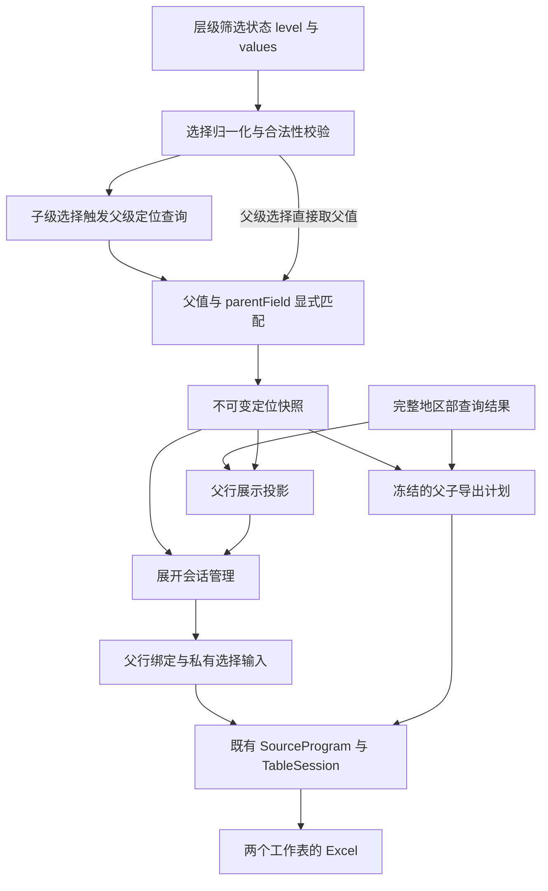

# 层级筛选联动父子表格设计方案

日期：2026-10-27。状态：P0–P5正式实现与必选本地/Sim验收完成（Schema6.70，独立工作树基线219b5db9233d735c2234f83d4ce7c8062ac57605）。业务行为与可交互原型均经用户确认；用户已授权完成正式实现与验收。实施入口见[交接说明](2026-10-27-hierarchical-row-expansion-handoff.md)。

已确认原型保存在本地试验分支 `codex/prototype-hierarchy-selection`（提交 `65fb7ed3cdf3b5056836f1503dfe91bb59f18baa`，路径 `packages/engine/widgets/prototypes/hierarchical-row-expansion/`）。用户确认行为符合需求；正式实现与产品证据见[验收报告](../evidence/hierarchical-row-expansion/result.md)，2026-10-28 批量交付将[原型文件](../../packages/engine/widgets/prototypes/hierarchical-row-expansion/README.md)纳入 main 的独立 prototypes 目录，不接入产品构建。

地区部父表首屏取得完整结果，代表处子表展开时取数。选择代表处时，父行继续展示所属地区部的整体指标，子表只展示所选代表处。本批还包含当前筛选范围内全部父子数据的 Excel 导出。

建议在既有 `rowExpansion` 内增加显式层级选择联动，通过受控的父级定位查询建立“所选代表处 → 地区部”的对应关系，再按显式字段匹配已有父行。不要求代表处明细或候选响应携带 parent。复用原查询执行、表格会话和完整导出机制，保持页面筛选状态及通用展示条件的形状；新增协议只对显式启用的表格生效。本文件是本批唯一设计与后续执行入口；历史基线见[原行内子表格方案](2026-10-21-table-row-expansion/README.md)。

## 已确认业务行为

| region 选择 | 父表行域与指标 | 子表取数与展开 | Excel 范围 |
| --- | --- | --- | --- |
| 未选 | 所有地区部，各自整体指标 | 手动展开，查询对应地区部全部代表处 | 全部匹配地区部及其全部代表处 |
| 地区部 A | 仅 A，仍是 A 整体指标 | 手动展开，查询 A 下全部代表处 | A 汇总及其全部代表处 |
| 代表处 a1 | 仅所属地区部 A，仍是 A 整体指标 | 自动展开，只查询 a1；允许手动收起 | A 汇总及 a1 明细 |

父表与子表继续受时间、产品等共同业务条件及既有授权范围约束。地区部整体值由原地区部查询返回，不能使用代表处查询结果在浏览器求和代替。

| 变化 | 父表会话 | 展开状态 | 子表会话与请求 |
| --- | --- | --- | --- |
| region 的层级或选中值变化 | 搜索、排序、表头条件、页码、每页条数恢复声明默认 | 清理旧状态；新选择为代表处时自动展开一次 | 释放旧请求与会话，新展开从默认状态查询 |
| 时间、产品等共同条件变化 | 保留搜索、排序、表头条件、页码和每页条数 | 保留仍在当前父表视图中的展开/收起；手动收起不自动打开 | 已展开的保留搜索、排序、每页条数，子页回第一页并按新条件取数；收起的不查 |
| 手动收起后重新展开 | 保持 | 重新展开 | 沿用既有语义：新建会话，从声明默认状态取数，不跨折叠缓存 |
| 父行在新结果或当前父页消失 | 保留父会话；页码越界时收敛到有效页 | 清理对应展开状态 | 取消并丢弃迟到响应 |

“保留父页码”不承诺某个地区部在指标排序改变后仍位于同一页，也不保留已经不存在的父行。列因既有显隐规则失效时，继续执行既有的搜索、排序和列条件调和，不能保留无效字段引用。

首期 region 单选；导出为一个 Excel，包含地区部汇总、代表处明细两个工作表。导出冻结条件，补齐未展开和未加载的数据；任一查询失败时整个任务失败，不下载部分文件。页面 PDF/PNG 不属于本批范围。

## 现有能力与实际冲突

| 当前事实 | 代码位置 | 对本方案的影响 |
| --- | --- | --- |
| 行内子表拥有独立查询作用域，首屏排除模板查询源 | `packages/page/src/table/expansion.ts`；`packages/data-execution/src/source-scope.ts` | 可直接复用，不预查所有代表处 |
| rowExpansion 目前只有 mode、data、table | `packages/page/src/schema/components/table.ts:165` | 需要新增显式联动声明 |
| 层级筛选值只保存 dimension、level、values | `packages/data-execution/src/filter-values.ts:20` | 不可直接从已应用状态读取所属地区部 |
| 候选端口允许可选 parent，但默认 DQE 实现只构造 value/label | `packages/data-execution/src/ports.ts:99`；`dqe/dqe.ts:550-591` | 不能把结构上的可选能力当成实际组织归属；本方案不依赖候选 parent |
| 默认候选查询可携带其它维度约束；当前层级控件不保留上一层选择作为约束 | `packages/data-execution/src/dqe/dqe.ts:528-542`；`packages/engine/runtime-ui/src/RuntimeSurface.svelte:800-811` | 查询来源在特定请求中可能建立映射，但当前通用链路没有可供任意代表处选择使用的完整映射 |
| 平台候选 Adapter 只转发宿主端口，不实现组织关系 | `apps/platform/src/lib/integration/filter-candidates.ts:5-15` | 不能从平台包装或 Sim 夹具推断生产具备反向定位能力 |
| levelQueryFields 只换目标字段，保留原选中值 | `packages/page/src/query.ts:109`；`packages/data-execution/src/effective-query.ts:76` | 不能把代表处值绑到地区部字段来实现父级定位 |
| 完整父行展示投影已有；条件叶子只能与字面量比较 | `packages/engine/runtime/src/presentation.ts:91`；`packages/page/src/schema/condition.ts:4` | 不应把本需求误当成已有 rowVisibleWhen 配置 |
| 任意页级条件变化都重建展开控制器 | `packages/engine/runtime-ui/src/table/views/ExpandableTable.svelte:16` | 必须拆开选择身份变化与普通条件刷新 |
| retain 会比较整条父行 JSON，指标改变也关闭子表 | `packages/engine/runtime/src/table/expansion.ts:149` | 需以稳定行键与实际输入绑定识别实例，而非父行全部内容 |
| 本地父表在上游绑定筛选变化时重置页码 | `packages/engine/runtime-ui/src/table/controller.ts:190` | 新联动分支需保留父页码，不能只修改展开控制器 |
| 私有子输入必须全部绑定，空值会失败 | `packages/page/src/table/validate-expansion.ts:65`；`packages/engine/runtime/src/detail-view.ts:22` | 需要明确表达选地区部时“不添加代表处条件”，不能用缺值伪装 |
| Excel 已有冻结、完整分页读取及严格失败，但只写一张工作表 | `packages/engine/runtime-ui/src/table/export/task.ts`、`prepare.ts`、`workbook.ts:34` | 复用读取与单表写入，新增父子收集和工作簿组合 |
| 父表 Excel 和页面 PDF/PNG 均被禁止；静态渲染不包含子表 | `packages/page/src/table/validate-expansion.ts:32,134`；`packages/engine/runtime-ui/src/ComponentRenderer.svelte:229` | 只放开显式配置的完整 Excel 分支；不能直接移除全部禁令 |

## 推荐协议草案

采用一个内聚的层级联动声明，内含父级定位查询与父表匹配字段，再加一个受控私有输入来源、一个导出分支。定位查询是一条作者显式定义并验真的普通 DQE 查询，不新增推理语言，也不把缺失的组织关系藏在前端猜测中。

### 完整表格组件声明

以下是拟新增协议下的完整组件声明。它引用页面已有的两个查询源与筛选声明，属于设计稿，不能交给现行解析器作为已支持配置使用；DQE 字段与指标须在实施时从真实数据契约确定。

```json
{
  "id": "region-office-table",
  "type": "table",
  "layout": { "span": 12 },
  "data": { "main": "region-summary" },
  "props": {
    "title": "地区部与代表处情况",
    "rowKey": "region-id",
    "columns": [
      { "field": "region-name", "title": "地区部" },
      { "field": "amount", "title": "整体金额" }
    ],
    "pagination": { "mode": "local", "pageSize": 10 },
    "toolbar": {
      "export": {
        "format": "xlsx",
        "filename": "地区部与代表处情况",
        "rowExpansion": {
          "scope": "all",
          "parentFields": ["region-name"]
        }
      }
    },
    "rowExpansion": {
      "mode": "multiple",
      "selection": {
        "filter": "region",
        "parentLevel": "region-dept",
        "parentField": "region-id",
        "childLevel": "office",
        "parentLookup": {
          "source": "office-region-lookup",
          "field": "located-region-id",
          "filters": ["lookup-office"],
          "bindings": {
            "lookup-office": { "source": "filter", "id": "region" }
          }
        }
      },
      "data": {
        "type": "query",
        "source": "office-detail",
        "filters": ["detail-region", "detail-office"],
        "bindings": {
          "detail-region": { "source": "row", "field": "region-id" },
          "detail-office": { "source": "selection" }
        }
      },
      "table": {
        "rowKey": "office-id",
        "columns": [
          { "field": "office-name", "title": "代表处" },
          { "field": "amount", "title": "金额" }
        ],
        "pagination": { "mode": "query" }
      }
    }
  }
}
```

输入声明仍在页面的 `filters` 中拥有定义：

```json
[
  {
    "id": "region",
    "type": "dimension",
    "dimension": "region_dept_id",
    "display": "tree",
    "treeSelection": "level",
    "selection": { "mode": "single" },
    "hierarchy": [
      { "id": "region-dept", "dimension": "region_dept_id", "label": "地区部" },
      { "id": "office", "dimension": "office_id", "label": "代表处" }
    ],
    "defaultLevel": "region-dept"
  },
  { "id": "lookup-office", "type": "dimension", "dimension": "office_id", "visible": false },
  { "id": "detail-region", "type": "dimension", "dimension": "region_dept_id", "visible": false },
  { "id": "detail-office", "type": "dimension", "dimension": "office_id", "visible": false }
]
```

| 声明位置 | 基数、引用与默认行为 | 校验与语义 |
| --- | --- | --- |
| `rowExpansion.selection` | 可选单对象；filter 引用层级筛选器；两个 Level 引用其 hierarchy 的 id；parentField 引用父表 main 字段 | 初期仅 query 子表、显式 single、两个声明层级；未声明保持原生命周期，不依赖候选 parent |
| `selection.parentLookup` | 首期 selection 中必需的单对象；source 引用专属普通 query；field 引用该源的原始父级维度；filters/bindings 显式声明私有输入 | 只有选中 childLevel 才执行；至少读取所选代表处值；完整结果提取去重父值后必须恰好一个。无任意查询文本或表达式 |
| `bindings[私有输入].source: selection` | 新增无额外参数的私有输入分支，只读取同一 rowExpansion.selection 的 childLevel 选中值 | 只允许绑定一个隐藏非层级 dimension，且须被子查询消费。无 selection 时拒绝；不扩大全局 NavigationBinding |
| `toolbar.export.rowExpansion` | 可选单对象；首期 scope 仅 all；parentFields 为非空、去重的父表字段 id 数组 | 显式启用才允许父子 Excel；parentFields 必须有合法父列来源，与子列分别拥有命名空间；输出两个工作表 |

parentField 负责匹配父级业务值，rowKey 继续负责表格行身份；二者可相同也可不同，不隐含绑定。首期 parentField 与定位结果 field 均为原始 string 维度，值域为同一父级稳定业务值；不以显示名或数字/字符串隐式转换建立对应关系。父表 rowKey 继续支持已有 string/number 类型；当它与 parentField 不同，运行时通过匹配出的行读取真实 rowKey 管理展开。

例如顶部选中 O101；定位查询的私有输入 lookup-office=O101，结果 located-region-id=R01；再匹配父表 row["region-id"]===R01。找到该行后按其 rowKey 展开，子查询使用该行地区部值与 O101。父行其他内容始终来自独立地区部查询，不从筛选状态生成。

### 三个查询源的约束

`region-summary` 按地区部粒度独立查询整体指标，声明完整结果语义，允许父表本地分页；它消费共同条件，但不绑定 region 或子表私有输入。本地投影只改变该表行域，不修改 raw、compute、resultBindings 或共享源的其他消费者。

`office-region-lookup` 是独立的取数单元：输入代表处稳定值，输出地区部稳定值。使用普通 DQE 查询和现有 filterBindings 把 lookup-office 映射到实际代表处字段，结果字段 located-region-id 通过 queryField 映射实际地区部输出。它不是给代表处明细增加 parent 字段。该源只服务本联动声明，不共享正文的可变结果；初期为声明完整结果的普通 query，不包含 compute、resultBindings 或组合源。

父级定位只消费业务归属所必需的条件和授权上下文，通常不绑定产品或指标统计期间。不能因为某代表处在某产品/期间没有业务记录，就把它误判为没有所属地区部。如果组织归属具有历史期间语义，必须在定位查询中显式绑定相应期间，并承认其依赖。真实数据服务若不能执行这条定位查询，则该页面不能直接启用此能力，需要先提供经过验真的数据查询；页面 Schema 不会自动创造缺失的数据关系。

`office-detail` 保持专属分页 query；`detail-region` 通过既有 filterBindings 绑定真实地区部字段，`detail-office` 绑定真实代表处字段，时间、产品等共同条件按需在该查询显式声明。父行地区部输入始终必需。首期拒绝把全页 region 同时直接绑定到这个子查询，避免重复或错误层级谓词。

父查询缺少完整性证明、只返回 TopN 或远程分页窗口时拒绝此联动声明。否则在当前窗口删行会制造缺失地区部与错误 totalCount。此场景也不放宽子表对 compute、结果绑定和 pagedJoin 的既有限制。

### 私有代表处条件的三种结果

| 选择状态 | source:selection 的结果 | 查询行为 |
| --- | --- | --- |
| 未选，或合法选中 parentLevel | 明确不适用 | 从私有副本删除代表处条件，保留必需地区部条件 |
| 合法选中 childLevel | 明确选中值 | 注入代表处条件，且验证该代表处归属当前父行 |
| 选择不合法，或定位查询等待、失败、空结果、多父级 | 等待或错误 | 不发子查询，不退回无代表处条件 |

“不适用”是新分支的显式语义；既有 row/filter/param 绑定缺值仍失败。不能为实现本需求在共享 scopedFilterValues 中统一放宽空值。

### 与展示条件的组合

层级联动只负责把稳定选择映射为父行集合，不新增布尔条件语言。先在完整父行集上应用层级投影与既有 rowVisibleWhen 的交集，再应用表内搜索、表头条件、排序及本地分页。候选合法性校验和父级定位查询是两个不同的前提，任一 pending/error 不能被当成未选而展示全部。

父级定位成功但父汇总结果零匹配时显示当前共同条件下无父行数据，不生成虚假零值父行。定位查询零父值与多父值分别显示无法定位、归属不唯一，不猜编码前缀或以名称反查；父行 parentField 重复导致匹配多行也拒绝自动展开。当前父行的单元格动作仍必须经过同一投影后的行资格检查，防止旧回调绕过选择范围。

## 架构设计



### 父级定位与关系所有权

候选模块只负责选择合法性，不承担本场景的组织归属推断。新增父级定位 module 接收 selection 声明、已应用筛选、页面参数与授权上下文，复用既有 SourceProgram 执行声明好的定位查询，输出 unrestricted、selected、pending、unresolved、ambiguous 或 error。selected 携带 parentValue、可选 childValue、逻辑选择身份与定位回执；父行投影、展开与导出共用此回执。

未选时不执行定位；选父级时直接以选中值匹配 parentField；选子级时在独立作用域中把 region 的当前 values 绑定到 lookup-office，只有定位成功才能发布父行选择结果。沿用既有 source:filter 即可读取当前子级选值，不需要新全局绑定语法。定位私有输入不写全页 FilterState；URL 仍只保存用户实际选择，不序列化过期归属结果。

定位缓存键由查询定义、所选代表处、实际声明的其他输入、参数与权限修订组成，并服从页面刷新/会话生命周期。每次新的选择先使旧定位回执失效；请求可取消，迟到回执不能移动或展开新选择的父行。没有组织版本信号时不能声称跨刷新缓存永远有效；手动刷新同时刷新定位。其他业务条件若未被定位查询消费，则不重复定位，只刷新父子指标。权限修订硬失效定位及全部相关查询。

首期不把“候选请求来源缓存”或“逐个地区部试查全部子表”作为隐藏后备策略。前者目前没有通用完整覆盖，后者会产生额外请求并受缺业务记录影响。未来若某实际候选链路提供经过验证的完整归属回执，可在相同内部 interface 上实现复用，不提前扩大本次公开协议。

### 父表查询与展示投影

地区部查询仍由现有 SourceProgram 管理，region 不进入它的查询依赖，所以仅 region 变化时复用已经就绪的完整地区部结果。共同条件变化按原依赖图刷新，旧结果不作为新条件的就绪结果使用。

父行投影作为表格私有视图接入现有 presentation/表格行投影位置；页面共享数据快照保持完整。导出、动作资格和屏幕投影消费相同选择快照，不能在 DOM 层单独隐藏父行。边界不放入纯渲染 Table，也不修改 DQE Adapter。

筛选引用与依赖扫描需要识别 selection 是 region 的合法消费者，使该筛选不必为了通过“必须有可观察效果”的校验而伪绑父查询。应分别维护查询依赖和视图/展开依赖：region 变化更新定位、父视图和子作用域，但不会使地区部查询失效。source-scope 必须识别并排除父级定位模板及其私有输入，默认首屏只查地区部；若 URL 初值已选代表处，则增加一次必要的定位，定位成功后才执行目标子表。浏览器与 Relay/共享执行均不能无条件运行全部定位模板。

### 展开身份与查询生命周期

将“用户希望哪些父行展开”与“某次子表查询程序是否存活”分开。展开身份由 table id 与类型稳定的 rowKey 确定。父行指标内容变化不能关闭展开；实际 row 输入绑定改变时更新该子作用域，而非比较整条父行 JSON。

控制器保留小接口：同步最新上下文与可见父行、切换展开、重试、销毁。内部承担选择变化重置、同选择刷新、自动展开一次、会话恢复、取消与迟到回执隔离。界面只转发事件并呈现快照，避免在多个 Svelte effect 分散保存展开集合和手动收起标记。

region 的层级和值构成逻辑选择身份；同选择的候选或定位回执重新返回不等于用户重新选择，不应打开手动收起的子表。父级归属若在重新定位后改变，旧子作用域必须失效，并在保留本轮用户展开/收起意图的前提下重新匹配新父行。权限变更仍先执行既有硬失效；不能通过“保留展开”跨权限修订复用旧数据。

共同条件变化可以替换内部 SourceProgram，但必须保留稳定的展开身份和合法 TableSession 状态。在第一笔新查询前恢复已提交搜索、排序和每页条数，并把子页设为 0，避免先请求默认条件再补发一次。新的上下文代次先隔离旧响应；父表加载中不能对临时空数组执行 retain 而误清全部展开。

父表的 reset 路径仅对启用 selection 的表格使用新策略：region 变化重置全部；其他绑定条件变化保留父表会话；父页越界时调整至有效页，并清理不再可见的实例。父表手动翻页、搜索、列条件或每页条数变化，继续清理离开当前视图的子实例。

### 完整父子 Excel

导出创建独立任务，冻结页面声明、已应用筛选、参数、权限修订、有效列和父表已提交视图；在该冻结上下文中取得有效定位回执，随后整次导出使用同一个父级定位结果。它不展开页面 DOM，不改变屏幕页码，也不读取当前子表窗口作为完整结果。定位无法完成或归属不唯一时不能继续导出。

先通过既有完整读取取得父表结果，应用层级范围、展示条件及父表已提交搜索/表头条件，保留全部匹配父行，不限制在父表当前页。随后按每条父行创建私有输入，用原 SourceProgram 的完整分页读取收集子表。所有子任务共享同一个取消信号、超时和总预算；建议并发上限复用 4，父子数据合计上限 10000 行，整个准备阶段 60 秒，不按父行重复获得预算。

工作簿固定两个工作表：父表汇总写一次；子表明细合并写入，并通过 parentFields 添加父行关联列。父与子字段分别取本地契约及显示标签；同名字段不能覆盖。隐藏列继续视为不存在，不能通过 parentFields 绕过隐藏规则；若没有合法可见父关联列则拒绝导出。多个父实例的子表有效列不能无声合并成会泄露隐藏列的超集。

单表的列树、多级表头、原始数值与格式、异常原文证据等写入逻辑从现有 workbook 编码器按职责复用。只在所有父子读取与校验成功后序列化并下载；空子表合法，失败子表不等于空表，严格校验 totalCount 与读取完整性。此处接受原实时 offset 读取语义，不承诺后端事务快照。

**已确认：** scope:all 使用页面业务条件和声明默认子表顺序，不复用某个已展开实例的局部搜索、排序或页码；是否曾展开不改变导出范围。父表搜索和表头条件继续限定要导出的父行。

## Schema 兼容性与现行决策冲击

| 影响面 | 冲击等级 | 处理 |
| --- | --- | --- |
| rowExpansion.selection | 中 | 新增可选声明，以显式启用方式承载父行投影与新生命周期；旧 rowExpansion 默认不变 |
| selection.parentField / parentLookup | 中 | 显式建立定位结果值与父表字段的对应；定位是独立普通查询模板，必须有输入绑定与单父级结果约束 |
| 私有 source:selection | 中 | 仅扩大 rowExpansion 的私有绑定联合；不放宽全局 NavigationBinding、detailViews 或旧输入缺值规则 |
| toolbar.export.rowExpansion | 中 | 新增显式完整导出分支；保留旧缺声明时的父子导出诊断及页面 PDF/PNG 限制 |
| 筛选状态、URL、DQE 查询体、结果字段契约 | 低 | 形状不变；无新查询语言、脚本或表达式，也不改变已有层级 filterBindings 的含义 |
| 父级定位与依赖执行 | 高 | 新增条件激活的私有查询作用域；纳入模板源排除、输入依赖、取消、缓存、基数与权限失效；候选端口形状不变 |
| 表格会话与展开生命周期 | 高 | 同时影响 UI scopeKey、controller.reset、retain、子会话恢复、取消代次，必须整体实施 |
| Excel 导出编排 | 高 | 从一个数据表扩到父行集合及 N 个私有查询；完整性、预算、失败与列投影必须统一 |
| 公共类型、知识与安装分发 | 中 | Schema 派生类型、语义验证、能力表、契约向量、local-authoring、属性编辑与生成清单需同批闭合 |

设计阶段检查的 `versionPolicy.current` 为6.69；实施时重新核对远端仍为6.69，本批已按增量6.70实现。分别登记含父级定位的层级联动、私有选择输入、完整父子 Excel 的能力使用路径；新声明不能借旧版本或 5.x 读取通道进入。

不声明 selection 的旧表格保持“页面筛选变化销毁实例”的现行行为。新表格按新版本显式启用“region 重置、其他条件保留展开”规则，不能全局替换为新默认。没有新 export 分支的旧声明继续按旧规则校验，不把历史禁用配置静默解释成完整父子导出。

### 旧页面兼容验收契约

| 页面与运行时组合 | 预期 |
| --- | --- |
| 当前已支持版本的旧页面，运行于新运行时 | 无需修改页面版本或补字段；查询次数、输入与可观察行为保持 |
| 旧 rowExpansion 未声明 selection | 不定位、不自动展开；沿用旧筛选变化销毁实例、折叠后重新查询及父页清理规则 |
| 旧 recordList、数字行键或父表 query 分页 | 不施加新 selection 的字符串父级匹配、完整父行集和 query 子表限制 |
| 旧页面只提高 schemaVersion，未加新声明 | 不自动获得新联动或导出；行为以显式声明分支决定 |
| 声明新字段但仍写旧 schemaVersion | 能力下限校验拒绝，并定位新字段路径 |
| 新能力页面交给旧运行时或旧独立校验器 | 版本/未知字段明确拒绝，不静默忽略后展示错误范围；需同时升级运行时及校验工具 |

仅扫描新 selection.parentLookup 引用的源作为按需定位模板；普通旧 dataSources 的执行根与查询依赖规则保持。新增输入的“不适用”语义只在 source:selection 分支有效，不能改变旧 source:row/filter/param 的缺值失败行为。普通表格 Excel、旧子表导出拒绝以及页面 PDF/PNG 限制分别回归，不通过全局删除禁令开放。

本批保留现有 supportedVersions() 的读取范围，不将“所有历史版本”笼统视为可读，也不借新能力移除当前旧版读取例外。至少将现有 recordList/query 子表、数字行键、远程父分页和普通 Excel 场景放入新运行时回归，并核对请求次数、展开状态及诊断；这些是实施验收要求，设计阶段尚未执行。

本方案会局部修订 ADR-0113 的“条件变化销毁实例”和“导出范围未定”，但保留一层独立子表、父行隔离、默认干净呈现及实时分页。遵守 ADR-0018 的局部显式、ADR-0051 的增量演进、ADR-0084 的逐层字段绑定、ADR-0112 的统一展示条件。建议在协议设计采纳后以一份新 ADR 记录这一局部修订，并同步页面文档结构、数据获取主题页；本轮不将草案写成 accepted ADR。

ADR 速查表与主题页存在已有编号/版本转述差异，历史行内子表方案中的部分源码结论也已过时。本批以当前 Schema、version.ts 与实际执行路径为事实基线；实施时扫描 ADR 文件实际编号再落盘，不照抄索引中的“下一编号”，不将既有文档漂移纳入本轮无关修复。

另一种方案是扩展通用条件右侧引用、ancestor part、自动展开规则和通用可选绑定。它适合更多尚未出现的场景，但本次会同时扩大多个公开语法面，增加输入依赖与失败语义。推荐先用 selection 这个小接口封装确定的父子联动，再把共享解析逻辑留在内部 module 中。

## 实施顺序与验收

| 阶段 | 工作与必须保持的不变量 |
| --- | --- |
| P0 协议与决策 | 评审本文件的命名、基数与默认语义；导出忽略子表局部搜索已确认；给出拟新版本完整 Page 夹具与正反例，记录 ADR 修订 |
| P1 父级定位 | 给出定位查询契约；复用 SourceProgram 与 source:filter 私有输入；验证空结果、多父值、候选拒绝、权限修订、取消与 URL 初值；所有消费者共用同一定位回执 |
| P2 父行投影与私有输入 | 完整父源不绑定 region；先投影再本地分页；私有 source:selection 明确 selected/notApplicable/pending/error，不放松旧绑定 |
| P3 会话与自动展开 | 拆开展开身份和查询程序；修复三条现行状态冲突；region 重置、共同条件刷新保留交互，并验证取消与迟到回执 |
| P4 完整 Excel | 冻结父行范围与关系；补齐全部子表；复用完整读取及单表写入；两个工作表与父关联列；整体失败和总预算 |
| P5 产品与分发闭合 | Playground、浏览器、PAGE-METADATA 与模块文档、能力表/契约向量、local-authoring 独立安装校验、属性编辑接线及公共类型快照 |

建议新增 Dashboard 示例 `pages/capabilities/table/table-hierarchy-selection.json`，访问 `/pages/table-hierarchy-selection`，使用显式标记的合成 DQE Sim。至少覆盖以下观察面：

1. 首屏只查询完整地区部结果，不查询任何代表处；合法 complete 结果不能被截断冒充全部。
2. 选 A 只保留 A，父指标仍为整体；展开取 A 全部代表处。
3. 选 a1 映射 A 并自动展开，只查 a1；同层 a1→a2、跨地区部代表处切换及清空均恢复默认。
4. 手动收起后切换时间或产品，不自动打开；展开状态下切条件保留搜索/排序/每页条数，子页从 3 回 1，父页保持且合法。
5. 同 rowKey 的父指标更新不折叠；父行消失、父页离开、缺键/重复键与绑定输入失效有明确行为。
6. URL 初值选代表处时等待合法性校验和父级定位，不闪现全量，不先发无约束子请求；定位空、多父值、父表重复匹配、无权限及服务不支持均不退回全部。
7. 多父行同时展开并独立翻页；一次条件事务更新不重复发默认查询，旧请求与导出取消后均不回流。
8. 从未展开过的表也能导出全部匹配父子行；选 A、选 a1 和未选三种范围准确；文件内实际读取并断言两个工作表、行数和父关联列。
9. 空子表可导出；某个子表失败、totalCount 不完整、超总预算或超时则不下载；导出中页面条件变化不混入新条件，权限失效仍取消。
10. 隐藏列不进入搜索、排序或 Excel；父关联字段被隐藏时不给出绕过；旧 6.44 子表及旧版本错误诊断保持。

实施按[功能与协议能力验收要求](../agents/feature-acceptance.md)执行；页面声明与真实浏览器、协议文档、local-authoring 生成及仓外独立安装是同批完成条件。真实父级定位查询、DQE 的地区部整体口径与代表处筛选、权限及 Relay 接线单独记录，不能以 Sim 通过替代。

编码前测量将修改的控制器、输入绑定、表格重置和导出函数；按[复杂度规则](../agents/code-complexity.md)逐个记录修改函数与全部新增辅助函数的前后结果，新函数 selfCC 不超过 15。设计阶段只修改文档，无可执行分支变更，不伪造复杂度或功能验收结果。

设计阶段历史记录：业务契约、协议草案和原型已经确认。正式P0–P5完成情况以下方实施记录及验收报告为准。


## 正式实施进度（2026-10-27）

实现分支 `codex/hierarchical-row-expansion`；独立工作树 `/Users/moon/.codex/worktrees/hierarchical-row-expansion/DataDashboard`，未复制源检出的混合源码及生成树。正式完整声明：[Dashboard Page](../../pages/capabilities/table/table-hierarchy-selection.json)。原型只读证据已留存于 `codex/prototype-hierarchy-selection`，提交 `65fb7ed3cdf3b5056836f1503dfe91bb59f18baa`（6个精确文件）；原型HTML和模拟字典不在正式实现树中。

| 阶段 | 实际进度 |
|---|---|
| P0 | 已实现6.70 Schema、三条能力下限、合法/非法契约、ADR-0123。完整声明采用 selection、parentLookup、私有 source:selection 和显式完整导出。 |
| P1 | 已实现独立 SourceProgram 定位、候选校验、输入依赖、取消及迟到回执隔离；默认源集只包含父汇总。Sim回归覆盖空、多、失败、候选拒绝与同选择缓存。 |
| P2 | 已实现父表私有投影、严格parentField匹配与数字rowKey身份分离；子表可选条件仅在新分支删除。 |
| P3 | 已实现身份稳定的展开控制器与查询程序更新；首笔查询前恢复子会话并回第一页。真实浏览器发现并修复Svelte上下文隐含重建、定位回执不触发视图刷新两处时序问题；共同条件保留展开及手动收起已观察。 |
| P4 | 已实现独立冻结的完整读取任务、统一取消/超时/总预算、父子分槽关联列与双工作表写入。ExcelJS回读未选4/17、选父1/5、选子1/1行。测试发现并修复父状态在定位await之后才冻结的问题。 |
| P5 | 已完成正式Dashboard、实际浏览器下载回读、协议/ADR、同源产品/MC/local-authoring、仓外独立安装及复杂度实测。当前广泛回归3333通过，MC32项及全部派生检查通过。 |

当前运行服务：本工作树 Playground `http://127.0.0.1:5210/pages/table-hierarchy-selection`，DQE Sim18229。源检出原有5173服务保持独立。真实DQE、Relay与生产权限未配置，单列NOT_RUN。生成采用项目既有Python虚拟环境；默认Python缺fastmcp不能作为产品失败。ADR索引存在一条既存失效路径，已仅修复该路径以恢复索引生成，未重写历史决策。


### 正式完成结论

P0–P5已完成本地产品及Sim验收，[完整证据与命令](../evidence/hierarchical-row-expansion/result.md)、[复杂度结果](../evidence/hierarchical-row-expansion/complexity.md)。最终Schema6.70、Skill1.4.0；独立工作树正式入口为5210，Sim18229。真实DQE/Relay/生产权限NOT_RUN，不能以Sim替代。旧页面不迁移，原型独立分支保留；实现未推送或合入main。
