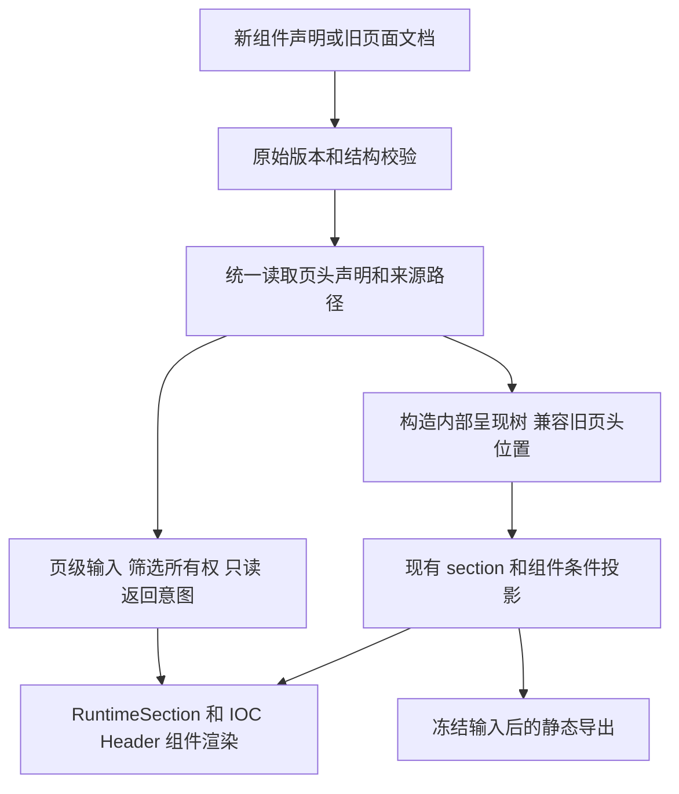

# IOC Header 组件化方案

日期：2026-11-02。状态：本仓实施与本地验收收口；尚未提交/推送，真实集成另验。分析基线：`552ef5c1228ce292ad9a2ec66673fa82e1c67ba4`，Schema 6.80。本文承接本次用户确认；不以现行根级协议反推新设计。

## 1. 已确认的目标

- IOC Header 使用普通组件结构 `id / type / layout / props`，放在首个 section 的第一个组件位置，固定占满该 section 的可用宽度。
- 每页最多一个；不要求专用 section，同一 section 可以继续放正文。
- 页头跟随所在 section 的条件显隐和分组切换，不额外禁止 section 隐藏，不强制在其他位置重现页头。
- 保留现有吸顶、下拉弹层、折叠、动态文字、筛选、只读和返回语义。布局位置变化不把页级筛选改成局部筛选。
- 旧根级 `iocHeader` 继续读取；新写出采用组件。新规范未声明页头时不自动生成默认页头，历史缺省行为继续兼容。
- 同页混用根级页头与组件页头报错，不择一、不叠加。

本次不改变 DQE 请求协议、查询执行、数据源、关联、分页、候选资格或 `approver-name` 参数绑定，不把 `reportHeader` 的所有功能合并进 IOC Header。

## 2. Schema 调整

新增组件判别值 `iocHeader`，新增组件外壳，复用现有 `iocHeaderZ` 定义的业务属性作为 `props`，不复制第二份属性闭集。保留 `identity / filterIds / back / readOnly / note / presentation` 的名称和含义。

以下为目标版本的完整结构示例。当前分析基线为6.80，暂以 **6.81** 标识新版本；实施前 fetch 最新 main 后分配实际版本，本文不预占版本号。

```json
{
  "schemaVersion": "6.81",
  "id": "ioc-header-section-placement",
  "layout": "dashboard",
  "meta": { "title": "IOC 页头组件化" },
  "dataSources": {},
  "filters": [
    {
      "id": "period",
      "type": "timeRange",
      "display": "period",
      "precision": "month",
      "label": "统计期间",
      "required": true,
      "default": { "mode": "month" }
    }
  ],
  "sections": [
    {
      "id": "main",
      "container": "plain",
      "components": [
        {
          "id": "page-header",
          "type": "iocHeader",
          "layout": { "span": 12 },
          "props": {
            "identity": { "title": "IOC 页头组件化" },
            "filterIds": ["period"],
            "presentation": {
              "layout": "inline",
              "density": "normal",
              "collapse": "none"
            }
          }
        },
        {
          "id": "explanation",
          "type": "text",
          "layout": { "span": 12 },
          "props": { "body": "页头与正文可以处于同一个 section。" }
        }
      ]
    }
  ]
}
```

此示例是拟议协议，不声称已被当前引擎支持。正式验收页须加入筛选结果可观察的完整数据场景。

### 2.1 路径和校验

| 对象 | 规则 |
| --- | --- |
| `sections[0].components[0]` | 唯一允许放置新 IOC Header 的位置；其他 section、非首位、Tab、组合卡和 detailViews 中出现时定位到实际路径报错 |
| `layout` | 使用公共组件布局结构，`span` 固定为12；渲染占满 section 的当前列轨道，不新增 width、placement、fullWidth 开关 |
| `props` | 复用现有页头属性；空页头、未知字段、重复身份项等继续校验；错误指向 `/sections/0/components/0/props/...` |
| 可见性 | 接入现有公共条件，不新建页头专用条件语言；父 section 隐藏覆盖页头，组件自身条件沿用公共规则 |
| 数量 | 按完整声明树统计，最多一个；隐藏不能让第二个声明合法 |
| 筛选认领 | 引用页级 filters，保持可见性、重复认领、图表独立及详情私有筛选约束；页头隐藏不让认领关系失效 |
| 其他业务页头 | 保留与 projectDetail 等页面身份页头的互斥及期间筛选归属校验；不能因插入新组件导致旧位置检查整体错移。旧文档先按原路径校验，新文档按身份角色和真实路径检查 |
| 数据槽 | 页头不是取数组件，不引入 data/main，不创建独立数据源 |
| 新旧并存 | 新组件与根级 `iocHeader` 或旧 `dashboardToolbar` 混写报错；旧根级 IOC 与 toolbar:hidden 的既有合法组合保持兼容 |

注册 `Component` 联合、组件 Schema、组件目录和纯呈现分类；从 `DataComponent` 中排除新页头。不要让注册组件后自动获得所有嵌套容器准入。

### 2.2 版本和字段净变化

- 能力登记拟用 `ioc-header-component`，新组件具有新版本下限，且显式设置 `legacyReadable:false`，禁止借5.x只读兼容通道使用新声明；不要与示例页面 id 同名，避免页面 id 中立性门禁误判。
- 旧根级属性保留在读取契约中并标记兼容用途；新写出器移除根级 `iocHeader`、`dashboardToolbar`。
- 新作者填写的页头业务属性净增 **0**，额外配置开关 **0**；正式根级字段减少，增加的只是统一组件外壳和一个判别值。
- 旧 JSON 的能力检测仍检查原路径；新组件属性中的 TextValue、可信期间事实等检查实际组件路径。不能先合成新组件，再用其新版本下限拒绝原本合法的旧文档。
- 新版本没有任何页头声明时，不自动补默认页头。显式旧根级声明仍可按兼容入口读取；新写出器不生成该写法。旧版本没有显式声明时，仍按对应版本的 Dashboard 缺省工具栏规则呈现。

## 3. 架构调整

核心是区分**声明中的页级语义**与**当前可见的组件投影**。前者决定 URL、只读和筛选所有权，后者决定页头是否渲染。



### 3.1 一个页头读取入口

在 `packages/page/src/` 建立内部 `header-binding.ts`，集中处理新组件、旧根级 IOC 和旧工具栏。拟提供 `resolveHeaderBinding(page)`，返回只读的页头属性、组件/section 身份、原始路径及来源类别；没有页头返回 undefined。命名可随代码惯例微调，职责不拆成多套消费者开关。

来源类别至少区分 `component / legacy-root / legacy-toolbar / legacy-default`。**存在页头不等于开启 IOC 模式**：新组件和旧根级 IOC 使用 IOC Region 规则；旧显式/隐式 Dashboard 工具栏保持原有普通 Region URL 规则。此差别由内部来源推导，不新增作者配置或 `iocMode` 字段。旧工具栏的静态导出资格也由来源保持，不能一律导出。

所有直接读取根级页头的消费者改用统一结果，并按所需语义取值，禁止统一替换为 `!!binding`：

- `pageFiltersReadOnly`、IOC Region URL 编解码、导航输入投影和严格 URL 校验。
- Region 单选树及 filterIds 校验、Report 期间筛选归属、通用正文筛选排除。
- 集成应用是否把返回入口交给运行时的判断。
- 页头 TextValue 缺值处理、可信期间事实校验与同一修订的文字投影、目录标题回退。

读取入口不依赖当前 section 可见性、挂载状态或 DOM。组件隐藏不切换 IOC 模式，不丢弃 URL 输入，不解锁全页只读，不重置已经应用的筛选。

旧工具栏声明中的页级只读等语义也不能依赖是否生成了可见 Header。例如旧 Report 文档包含工具栏属性时，应保留现有页级属性效果，不能因该布局不绘制 Dashboard 工具栏而丢弃。

该入口只进入仓内接口；不要顺带扩张稳定公开导出。受影响的内部导出快照按实际意图更新。

### 3.2 读取兼容和写出迁移分开

不把渲染用的虚拟组件写回旧 `PageDocument`，不制造“旧 schemaVersion 内含新组件”的持久化文件。

1. 先按原始版本和原始结构校验，保留现有错误分类、原始路径和有序错误列表。
2. 合法的旧根级 IOC 或默认工具栏，读成统一 HeaderBinding。
3. 内部呈现计划为旧页头生成一个常显的兼容首 section 和 Header 组件，其他 section 的条件、id、分组和顺序不动。使用确定性、避冲突 id，不用随机 UUID。兼容前导分区和原始正文分区在计划中分开持有；旧自定义布局仍接收原正文分区，不把虚拟首 section 塞进其参数。
4. 新组件声明直接使用原 section。它可以随该 section 隐藏；不再插入另一份根级页头。
5. 显式升级时才按迁移资格物化兼容 section/组件、移除旧根级字段、写出新版本；保存原件和迁移报告。纯读取不自动重写历史修订。旧根级 IOC 的属性优先等价搬迁；旧工具栏转为正式 IOC 组件可能引入 IOC Region、返回和导出差异，必须单独检查，不能承诺一律自动升级。

自动给旧页头建立首 section 是兼容转换手段，不是新页面必须使用专用 section 的限制。不能直接插入旧首 section，否则旧首 section 的条件隐藏会改变原本始终可达的旧页头。

旧 `dashboardToolbar` 的缺省返回兼容还有 `legacyBack` 行为：仅有 back 回调时也可能显示。兼容读取须保留内部来源标记；不得把该标记变成新 JSON 属性。显式升级候选沿用 `back:true` 的正式契约，迁移报告列出 returnContext 接线待验项；在缺少来源入口的集成应用上不得宣称返回完全等价，保留原页作为回退。

迁移工具不猜 Region 树、候选或查询映射。旧工具栏的平面 Region 等声明无法满足新 IOC 约束时，返回具体路径的迁移错误，不写目标文件，原件继续兼容读取。旧工具栏原先不导出页头，改写成正式组件后会参与导出；自动迁移不得默默改变此行为，需列为有意变更并由人工迁移承接。缺少等价依据时停止该页自动改写，不增加序列化兼容开关。

### 3.3 渲染进入普通 section 组件管线

- `ComponentRenderer` 增加 IOC Header 分支，复用现有 `IocHeader.svelte`。它属于无需数据快照的纯呈现组件，不经 WidgetHost 的加载/空值通道。
- `RuntimeSurface` 不再单独从根字段画第二份页头；向组件渲染提供现有页级筛选控件、候选、阻塞说明、可信期间事实及集成应用导航能力。
- `RuntimeSection` 给页头使用既有无卡壳 header-cell 角色，并强制跨满列轨道；不能复制图表卡片的最小高度、内边距和 overflow:hidden。
- 页头与父 section 走同一条件投影；分组切换及定制 sectionsContent 不渲染该 section 时，也不额外显示页头。恢复可见时从现有页级状态读回值，不因重新挂载重建筛选状态。
- 页头隐藏时，已认领筛选不自动回流成另一份正文 FilterBar；候选合法性及查询阻塞规则照旧，不因为 UI 隐藏而放开验证。本次不新增隐藏页头的替代筛选入口。

页内分区导航仍由页级布局持有，不放进可能隐藏的 section。默认布局在含页头的首 section 之后放分区导航，再渲染其余 section；首 section 含正文时，正文也位于该导航之前。没有页头时沿用导航在内容之前的布局。旧页头的虚拟首 section 只有页头，因此保持旧的“页头—分区导航—正文”顺序。必须通过混排与隐藏场景验证这一位置规则，不要求专用 section。

自定义 `sectionsContent` 保持现有 `Snippet<[readonly PageSection[], ComponentContent]>` 签名，每轮仍整体调用一次，不拆成首段和尾段两次回调。旧页面的兼容页头通过同一组件渲染入口放在页级导航之前，回调接收原正文的可见分区，保持原来的 id、顺序和数量。新组件页面的回调接收作者声明的可见分区，包括含 Header 的首分区；导航保持位于整次回调之前，不由引擎插入自定义布局内部。默认与自定义布局的导航位置差异须写入组合接缝说明，并覆盖创作器和 IOC showcase 的回归。

### 3.4 吸顶和弹层单独承接

仅保留现有 inline+compact 的整页吸顶，不把所有页头都改成吸顶。普通 section/cell 会缩短 sticky 范围，不能只保留原 CSS 便算完成。

内部技术候选是在 `IocHeaderFrame` 中承接布局：普通模式原位呈现；紧凑吸顶模式用 section 中的锚点和等高占位，按当前页面滚动容器定位同一个页头实例到页面内部的浮动层。浮动层限定在当前运行时根及 ShadowRoot 内，不移到全局 document.body，不复制控件或候选状态。此定位机制是待实现、待浏览器验证的方案，不是现有能力保证；必须验证宿主 containing block、嵌套滚动和弹层坐标系后确定实现。

- 父 section 隐藏、Header 自身条件隐藏、分组切换、条件投影移除、自定义布局卸载及运行时销毁时，均取消浮动显示与占位，关闭该组件弹层；不得留下悬浮页头。
- 定位宽度来自原 section 可用宽度，尺寸变化后重新量测折叠，不按浏览器窗口宽度推算。
- 滚动或吸顶切换不重建整份 Header，保留焦点和局部展开状态；隐藏或卸载后仅保证页级筛选、候选和只读状态保留，不保证组件局部展开状态或焦点恢复。
- 复用现有弹层能力和层级变量，避免被 section/cell 裁剪。
- 如原生 CSS 在实际容器下已满足全部验收，可收敛该内部定位实现；不得增加 JSON 开关让作者选择兼容路径。

### 3.5 导出、返回和文字

- 导出通过同一组件渲染入口处理 Header，移除 ExportView 的独立根级绘制，避免输出两份。
- 兼容读取保持旧导出范围：旧根级 IOC 导出；旧默认/显式 Dashboard 工具栏不因内部组件化而加入导出。新正式组件参与导出，不用运行时可见页头的存在性代替导出资格。
- 条件隐藏的 section 不导出 Header；分组/Tab 仍遵循既有导出展开规则，不把屏幕活动组误作全部导出范围。Header 不被强制搬到导出顶部。
- 冻结相同的筛选、参数、可信事实与修订，静态页头展示已应用的值，不显示吸顶、交互浮层和返回按钮；期间文字不重复输出。
- 返回意图仍由声明和集成应用接线决定。组件隐藏时返回按钮也隐藏，不自动切换到第二套集成应用返回入口；重新显示后仍只调用一次原回调。
- Header 标题、标签和 facts 的缺值、省略及参数/筛选文字规则走统一定位结果，不能只处理根字段而漏掉 props。

## 4. 代码与同步范围

| 范围 | 主要落点与职责 |
| --- | --- |
| Schema 与类型 | `packages/page/src/schema/ioc-header.ts`、新增组件 Schema、`schema/component.ts`、`page.ts`、组件目录及纯呈现分类 |
| 校验与版本 | `ioc-header.ts`、`validate.ts`、`version.ts`、`report-date-filters.ts`、条件和原始路径诊断；完整树的数量/位置校验 |
| 统一读取 | 新增内部 HeaderBinding；替换 `navigate.ts`、`text-value.ts`、`time-extension-validation.ts` 等根路径依赖 |
| 页级状态与导航 | runtime 的 navigation-inputs；runtime-ui 的 page-header、RuntimeSurface、filter-text、过滤器归属与返回接管判断 |
| 呈现与导出 | ComponentRenderer、RuntimeSection、IocHeaderFrame、IocHeader、ExportView；保持自定义 sectionsContent 签名、整体调用次数与旧正文参数契约 |
| 兼容与创作 | normalize/upgrade 读取与写出职责分离；旧工具栏、旧根级页头、隐式缺省、无页头及混写向量；模式分析器和页面属性编辑器（若该入口持有组件目录） |
| 正式文档 | PAGE-METADATA.md、PAGE-PARAMETERS.md 的文字取值路径、docs/page-metadata/page.md、组件参考及条件/导出相关说明；明确旧读新写 |
| local-authoring | 页头迁移手册删除“只能根级”的正式指导；组件知识、示例、独立校验器、能力版本与哈希清单由产品真源重生成 |
| MC 与分发 | source identity、契约快照、知识及桥接器、诊断夹具和锁文件按生成命令更新；不手改摘要 |

不需要改 DQE、数据网关、数据源计算、取数包请求编码及业务字段字典。

## 5. 实施顺序

| 批次 | 内容 | 退出条件 |
| --- | --- | --- |
| P0 | 从最新 main 核对版本和本批路径；冻结旧根级、旧缺省、toolbar:hidden、含条件/分组的页面与当前业务页 | 输入版本、来源字节、旧行为及复杂度基线可复验；隔离并行未提交工作 |
| P1 | 新组件 Schema、版本下限及 legacyReadable:false、纯呈现分类、数量/位置/混写校验和 HeaderBinding | 正式声明通过；5.x及旧6.x手写新组件准确拒绝；旧错误有序列表与旧能力边界不变 |
| P2 | 兼容呈现树、页级状态消费者、组件渲染、条件显隐、默认页头策略和定制 sectionsContent | 新旧形式读到相同页级语义；新 Header 随 section 隐藏，筛选/只读/URL 不漂移 |
| P3 | 吸顶/弹层、分区导航布局、导出、返回及动态文字 | 真实浏览器下正常/紧凑/窄容器/ShadowRoot/隐藏恢复通过，无双页头或重挂载状态丢失 |
| P4 | 显式升级工具、正式示例和业务页候选、产品文档、local-authoring 与 MC 生成 | 原件可恢复、升级确定且重复运行不重复插头；不等价的旧工具栏拒绝自动改写并给出具体缺口；仓外独立安装校验通过 |
| P5 | 完整验收、影响清单和交付说明 | Playground、回归、生成一致性和复杂度验收完成；真实集成未验部分单列 |

用户已确认执行本方案；P0—P4已落地，P5验收结果见实施记录。本批尚未提交/推送，后续Git交付按本仓scoped-main-delivery处理。

## 6. 验收矩阵

| 场景 | 必须观察到的结果 |
| --- | --- |
| Header 与正文同一 section | Header 为第一个组件、全宽；正文正常；不要求独占 section |
| 非首位、半宽、重复、嵌套或混写 | 校验明确拒绝并定位真实路径，不自动重排作者的新文档 |
| section 条件隐藏及恢复 | Header 和正文一起消失/恢复，没有残留浮动层；筛选值、URL、候选门禁和全页只读不被清空或绕开 |
| 首 section 参加分组切换 | Header 随组切换；页级分组导航保持可用，能够切回 |
| Header 自身条件与布局卸载 | 与父级隐藏一样清理占位、吸顶和弹层；恢复不重置页级输入，不要求恢复局部展开和焦点 |
| 默认与自定义 section 布局 | 默认顺序按上文；旧回调正文参数不变且每轮只调用一次；新回调拿到声明分区；创作器/IOC showcase 无重复页头，导航可切回 |
| 正常/紧凑/折叠/窄宽 | 页面及嵌套滚动容器、ShadowRoot 下原有布局、整页吸顶、折叠和搜索/弹层可用；section 底边不提前终止吸顶，开着下拉滚动也不漂移 |
| 返回及隐藏恢复 | 直接打开无来源上下文时隐藏正式返回；有真实上下文时只调用一次；Header 隐藏期间可能没有可见返回按钮，集成应用不自动补回 |
| Region URL、只读与可信事实 | 新旧写法的输入投影、条件和文字相同；不因根字段消失而关闭 IOC 约束 |
| 旧工具栏的普通 Region | 显式/隐式工具栏有页头但不开启 IOC Region 模式；URL 编解码和导航仍按旧契约；无法等价承接的 Region 升级报错且不写文件 |
| 隐藏时仍有候选阻塞 | 查询仍阻塞，不另造筛选入口；切回后可见原阻塞原因和重试入口 |
| 条件与静态导出 | 父级条件隐藏 Header 不导出；分组/Tab 按既有展开策略；无重复页头/期间、无交互浮层 |
| 旧根级、旧缺省、旧隐藏工具栏 | 按原版本读取；原数据、布局、默认筛选、note、只读和兼容返回语义保持 |
| 旧页头导出 | 根级 IOC 仍导出；默认及显式 Dashboard 工具栏仍不导出；不因内部兼容组件增加导出内容 |
| 新规范无页头 | 不自动生成标题、工具栏或默认返回；集成应用入口按既有接线工作 |
| 显式升级 | 原件字节留存；id 避冲突且稳定；二次升级 unchanged；查询体、参数、数据与绑定不变 |
| 商务决策实际响应回放 | approver-name 仍是参数，只进入主查询；两行可显示，不重引入隐藏候选筛选；日期 warning 与此迁移分开记录 |
| 仓外安装与目录 | 独立 local-authoring 能校验新组件并解释版本；页面目录、公开面快照和页面 id 中立性检查通过 |

完整 Playground 场景放在能力目录并配 README，覆盖混排、显隐、分组、吸顶和导出；用现有合成候选和可回放 HTTP 验证，不把用户私有响应提交到仓库。示例页 id 与能力登记名分开。

测试使用仓库命令入口 `pnpm test <paths>`，并按影响执行类型检查、`pnpm validate`、构建/安装消费及浏览器。生成使用 `pnpm authoring:contracts`，之后同步 MC 诊断夹具并执行一致性检查；使用项目锁定 Python。独立 Skill、MC 与真实集成分层报告。

## 7. 完成口径与风险

本次方案只修改文档，没有改可执行函数或分支，因此不伪造复杂度测量。实施时用 metriccanvas-ts-ast/1 对修改函数及全部新增回调测量 selfCC，新函数目标不超过15；存量超限不得增长，并记录前后值与未拆原因。

主要风险是根字段存在性漏改、兼容树被误写回旧文档、把旧工具栏误作 IOC 模式、全页只读/URL在隐藏后漂移、自定义布局输入变化、吸顶实例重复、弹层裁剪、导出范围改变以及旧返回上下文缺口。必须通过统一读取入口和上表行为检查关闭，不靠新增页面配置规避。

页面元数据、架构和分发验收通过只证明本仓实现；真实集成应用的来源上下文、部署采用版本及真实 DQE 接线另行验收。内网先升级引擎读取能力，再采用新组件 JSON；旧引擎不支持新组件，保留原件作为回退。

## 8. 实施记录

Schema实际版本为6.81，独立local-authoring版本为1.18.0。[实现与验收](../evidence/ioc-header-section-component/README.md)记录实际模块、命令、复杂度与本地/真实环境边界。旧非法JSON的结构诊断从同一产品Schema派生旧组件联合，避免新增分支改变历史有序错误列表。
