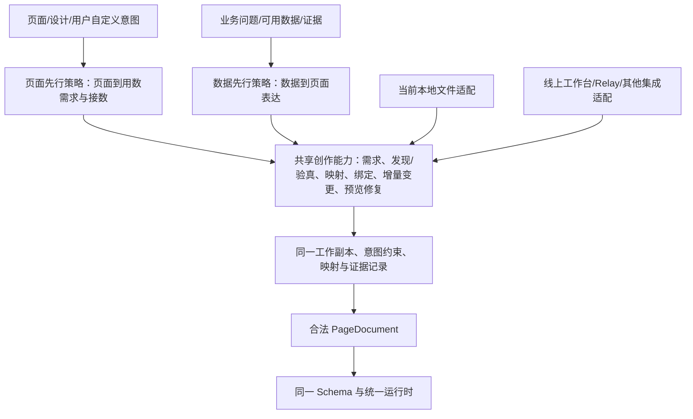

# 两种创作逻辑、共享能力与宿主适配的架构预划分

> **2026-11-03 执行更新：** 用户已确认[四项交付与 Relay 拆分规划](four-artifact-delivery-plan.md)。本文保留 11 月 2 日的模块分析和行为要求；其中“公共 MCP/状态/保存编排整体留在 MC”“暂不拆产品工具”等归属与顺序由新规划修订：MC 保留确定性规则，实际在线执行及 MCP 装配由 Relay 维护。后续实施从新规划 B0 开始，旧任务映射见其第 7 节；不要按旧归属直接实施。

日期：2026-11-02。第四版。页面先行/数据先行的上层划分保持；已接收 Relay 私有检出的静态报告，未直接访问其代码或部署。底层产品/Relay 接线职责保持公共用例不迁私有。主入口为[演进策略](../2026-11-02-product-relay-evolution.md)，能力逐项位置见[盘点](authoring-capabilities.md)，实际接缝、报告修正和首批实现范围见[接缝规格](implementation-seams-v1.md)。

## 1. 架构先按两种创作逻辑，再按宿主和技术职责划分



页面先行和数据先行是创作策略；本地和线上是宿主维度。当前 local 主要承载页面先行、Relay 参考主要承载数据先行，未来线上也要运行页面先行。两种策略在同一工作副本上可相互衔接，不以工具调用和直接写文件定义根本差别。

### 1.1 共享能力的实际落点

| 共享能力 | 现有基础 | 提取/补齐方向 |
|---|---|---|
| 页面用数需求与影响范围 | local `scanPageData`、`scopePageData`、分析报告 | 提取无文件路径假设的核心，保留组件/源/字段位置和依赖闭包 |
| 需求、口径、发现和真实查询验真 | 公共取数单元、discover/query、data 能力 | 两种策略复用；页面提取出的需求也可进入同一查询链，不另建离线/在线查询语义 |
| 材料匹配/数据映射与证据 | local draft/check/prepare、公共字段与结果记录 | 区分文本证据、元数据确认和真实执行，建立需求到输出字段的可核对关联 |
| 页面变换与保留约束 | local 最小对象修改、公共 compose/edit、工作台文档修改 | 保留用户固定结构、已有可信绑定；补线上源/映射/绑定增量操作，不能整页重建代替接数 |
| 校验、预览、自助修复 | 产品校验、local 快照/升级、MC inspect、平台预览 | 同一产品语义，按宿主返回事实；单位/刻度、格式和绑定检查收进现有用例，不增加模型闸门；不得把一种路径的检查当另一种路径验收 |
| 共同创作记录 | 工作副本、取数单元、local 分析报告、公共结果与工作稿状态 | 小步关联需求/映射/意图/证据，不先新增通用会话系统或把中间状态写进渲染 Schema |

共用的是产品知识、确定性能力和业务连接契约；两种策略保留不同起点与顺序。技能分发目录可暂时保留两个，先统一能力，再决定线上是否提供同一入口下的两种策略。

## 2. 真正需要独立拆的 Relay 部分

| 层 | 内容 | 目标维护位置 | 是否进入 MC 真源 |
|---|---|---|---|
| 创作策略与 Skill 流程 | 页面先行/数据先行策略、需求澄清、确认、内容取舍和采用 | 可复用策略/流程真源投影到两套 Skill；Relay 特有步骤单独保留 | 方法论与产品事实分清；不将数据先行策略绑死在 Relay SDK |
| Skill 工具包装 | tool_mc_query/compile/inspect 的参数包装、ToolResponse、有界返回、注册与 allowed-tools | Relay 原生 scripts/tools.py 及加载配置 | MC 提供确定性函数和调用契约；包装不复制函数逻辑 |
| 可信上下文 | actor/workspace/session/turn、当前页/工作副本映射、授权上下文注入 | Relay/云宝 Adapter | 公开 Interface/错误语义由 MC 定义，真实身份实现由接入方维护 |
| 程序产物 | 精确 artifactRef/spec/request 关联、模型摘要分流；结构化返回或可信旁路须明确 | Relay 调用桥 | 产品产物形状仍由 MC 提供；报告称当前丢弃 structured_content、以文件/plugin 交接，不能假定已经保留 |
| 预览与交接 | 现有卡片/标记注入、组件通知、SDK 生命周期 | Relay/云宝/集成应用 | 公开预览回执保留 MC 文档；私有注入代码独立 |
| 安装与状态接线 | MC 包路径/版本/缓存重载、MCP 启动、取消、持久存储 Adapter | 部署项目 | 可核对的公共接口和依赖声明留产品，部署值不进产品 |
| 私有扩展 | publish_page/list_urls/submit_body/tool_mc_* 等 fork 新增入口的代码、权限与回执 | 独立扩展目录及清单 | 已有静态报告线索，未取得完整源码/运行证据；不按报告标签直接变成公共默认工具 |

这些层可以作为同仓独立参考/接线目录交付，也可以在内部 Relay 项目维护；本次不凭空创建私有仓库或 SDK。参考 Skill 不能代替真实安装验收。

接收报告后确认需另列公司服务适配：Java/DQE/元数据、认证与存储具体实现继续在内部 adapters 维护。Relay 报告的稳定 session hash、temp_subprocess、SQLite 和卡片分支是实现线索；可信轮次、CAS、引用和精确产物仍是产品 Interface。先统一调用与副作用，再决定目录搬迁。

## 3. 不能因为被 Relay 调用就迁走的 MC 能力

| 当前位置 | 产品归属与提取方式 |
|---|---|
| `packages/page/`、`packages/engine/`、`packages/data-execution/` | 页面协议、渲染与共享执行真源；不引入 Skill/Relay 依赖 |
| Python `pages/components/`、`composition/`、`editing/`、`validation/` | 公共装配/变换/校验；可独立提取纯产品 Module，不变成私有 Relay 工具 |
| `pages/referenced.py` | 分离纯页面构造与产品结果引用消费；引用作用域仍由公共服务执行，真实身份由 Adapter 注入 |
| `pages/platform_authoring.py` | MC 公共应用协调。可拆读/查询/修改/恢复用例，不把整文件搬到 Relay Skill；保持单次保存与 partial 语义 |
| `data/results.py`、`data/discovery/`、`semantic_catalog.py` | 产品的受控取数、语义、证据和通用作用域规则；拆接口/用例/Adapter，保留权威实现 |
| `work/state.py`、`work/authoring_turns.py` | 提供方无关的工作版本、CAS、预算和可信轮次校验是公共服务规则；真实上下文获取才是 Relay 实现 |
| `assets/drafts.py`、`assets/lifecycle_ports.py` | 通用冻结提交、单发送者、回执/未知保存处理由 MC 用例维护；Java HTTP/身份具体接线经 Adapter 提供 |
| `delivery/preview.py`、`delivery/ports.py` | 精确产物、定义/initial 分离和回执验证仍为公共契约；实际卡片注入在接入侧 |
| `pages/parameters/` | 产品参数变换与公共提取/填值用例；内部区分纯变换与作用域/记录，不让 local 依赖在线记录 |
| `entrypoints/mcp/platform_mcp.py`、公共 bootstrap/adapter_contract | 公共工具注册/模型输入和提供方无关 Interface 仍由 MC 维护；真实适配器加载/配置可以独立装配 |
| `tools/mc-content/`、生成 MC、contracts、知识/版本和错误 | 完整产品事实，包含完整 MCP 输入和保存/预览语义；不是只有 Schema 字段参考 |

这套归属沿 ADR-0090 的产品工具责任。可以让公共 MCP 服务与浏览器引擎各自安装和运行，但其能力变化仍需同批更新产品内容，不把“运行在 Relay 子进程中”当所有权判据。

## 4. 模块 Interface

产品内部可进一步提取：

```text
页面变换 Module：
  compose(受控计划, 已验证源记录, 程序确定的页面标识) -> 候选页面/逐项结果/诊断
  edit(完整基线, 受控操作, 已验证源记录) -> 候选页面/逐项结果/诊断

MC 公共创作服务：
  现有 9 个 MCP 工具及其权威输入/结果
  维护通用工作稿、版本、结果引用、授权核对、单次保存与恢复

部署 Adapter：
  current_turns / analysis_authorization / lifecycle_service /
  lifecycle_identities / relay_preview / data_context / dqe / store 等现有端口
```

产品变换无保存副作用，不读取 Relay SDK；公共服务验证引用和轮次后调用它。Relay 不提交任意完整 JSON/记录作为授权依据。当前 local 则直接形成 PageDocument 并调用独立产品校验，这是已有适配方式。未来页面先行的需求提取/映射/接数应通过线上受控接口复用；两种策略不必使用同一种创建输入，但共用需求/证据与增量变更语义。

## 5. 目录预划分

优先沿现有目录澄清职责，避免先全量搬家：

```text
产品开发仓
  packages/{page,engine,data-execution,metric-canvas,embed}/
  metriccanvas-authoring/tool/       MC 公共创作与 MCP 服务
  metriccanvas-authoring/contracts/  公共契约
  tools/mc-content/                 产品知识/工具事实作者源
  metriccanvas-authoring/mc-content/ 生成的独立 MC 包
  metriccanvas-authoring/skill/
    metriccanvas-local-authoring/    当前完整独立本地 Skill；页面先行策略可迁线上
    metriccanvas-platform-authoring/ 当前数据先行参考；可复用策略 + 生成事实投影
  integrations/relay-reference/     候选：独立接线参考与兼容说明

内部 Relay / 部署项目
  实际 Skill 方法论、scripts/tools.py、loader/SDK/权限/产物桥
  MCP 启动配置、包安装、私有 Adapter、私有扩展工具
```

`integrations/relay-reference/` 是推荐新位置，尚未创建。现有 `tool/metriccanvas_authoring/adapters/` 已为内部维护区；公共同步保持它的所有权和字节，后续迁移由部署项目按清单处理。无需将完整 MCP 事实迁出 MC，也不拆出与 mc-content 竞争的第二份公开工具真源。

## 6. 按策略与宿主组织闭环验收

- **页面先行逻辑**：页面意图 → 用数需求 → 匹配/查询验真 → 映射绑定 → 保留结构的增量变更 → 预览复验。当前验证 local 文件路径；线上工作台接数是待补齐目标。
- **数据先行逻辑**：业务需求/口径 → 发现/查询证据 → 页面表达 → 预览复验 → 可继续定制的工作副本。当前主要验证 Relay 参考的公开工具路径。
- **双向衔接**：数据先行生成页后进入页面先行定制；页面先行中的新分析问题经数据先行补查后回原页。保留意图、身份和有效证据，不清空工作或强制重新 compose。
- **宿主适配**：本地文件/快照与线上工作副本/权限/保存分别验证；线上闭环不要求用户在二者之间手工搬文件。
- **人工参与**：工作台与创作画布可参与任一策略，AI/人工与页面先行/数据先行是不同维度。

## 7. 验收拆分是否成立

1. 产品公共服务不安装私有 Relay SDK 可导入、注册和使用合成 Adapter 验证；纯页面能力不依赖 FastMCP/存储/Java。
2. MC 包完整保留公开工具契约和程序，仓外可用；local 整目录独立安装，不读兄弟 MC 或开发仓。
3. 每项产品能力核对页面先行与数据先行的完成路径，并单列当前宿主支持；同时有跨策略接续与线上页面先行闭环的验收，不能只比工具支持列表。
4. Relay 方法论或私有预览接线变化不改产品规则；产品新增字段必须核对 MCP 表达，不让 Skill 自行扩枚举。
5. 包更新、缓存、并发、取消、unknown 保存与回退仍按既有约束；公开保存语义不因拆分新增或丢失。

本次为第四版预划分及接缝细化，没有运行代码改动。Relay 静态报告已进入差异台账；实际注册/安装/服务回执仍另验。线上页面先行闭环仍属目标，未以现有工具名称或新增/删除组件流程冒充完成。
