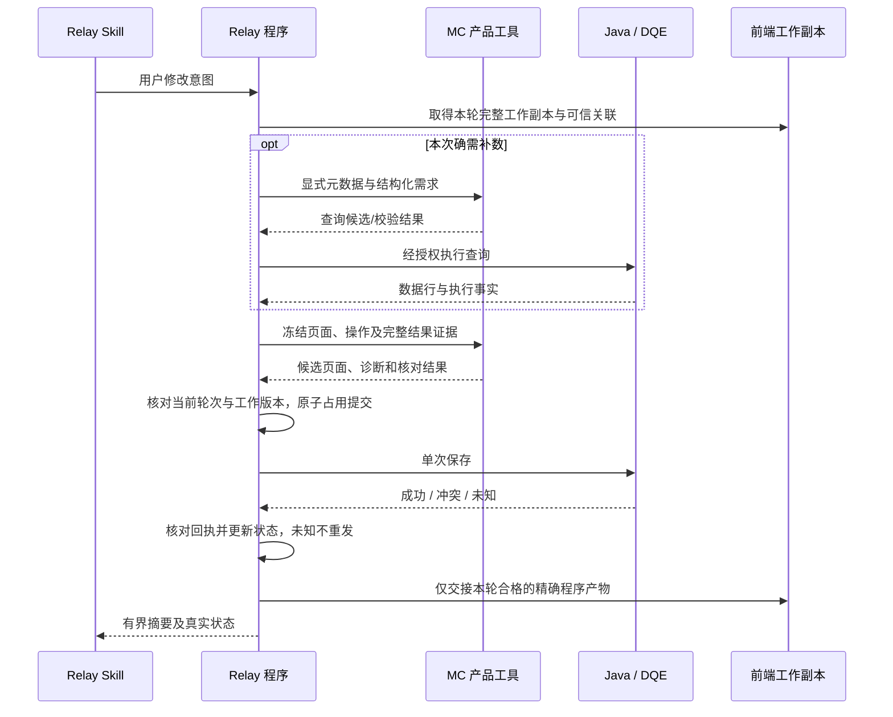

# MC 四项交付与 Relay 职责拆分实施规划

日期：2026-11-03。状态：用户已确认目标与运行标准；[Spec](relay-reference-spec.md)已落盘，[执行台账](relay-reference-execution.md)记录 A/B/C 交付和最新主线基线上的 MC 本地集成验收。四项产品候选已生成；真实 Relay 接入/采用仍待实施，未提交主线。

本文是本专题后续实施的执行入口。它承接[主计划](../2026-11-02-product-relay-evolution.md)的页面先行／数据先行整合目标，**更新 11 月 2 日方案中“公共 MCP、状态与保存编排仍整体留在 MC”的归属**：MC 保留确定性产品规则；真实接口、MCP 装配与完整程序过程交由 Relay 维护。旧评审稿 v1.0/v1.1 和报告原件保留为时间点证据。旧接缝规格中的产品不变量继续有效，职责分配、分发形态与实施顺序以本文为准。

## 1. 目标和完成定义

Relay 首次准备好 Python、Node 和约定第三方依赖后，每次普通更新只同步以下四项，随后直接运行：

```text
Relay Skill/references/
├── mc-content/       产品资源：协议、知识、模板、示例、索引
├── mc-content.md     资源导航与任务路由说明
├── mc-tool/          可直接运行的产品工具与预构建程序
└── mc-tool.md        调用方式、输入输出、诊断及接入约定
```

验收同时满足：

- 不运行 pnpm 构建，不安装本仓 wheel，不读取本仓其他目录，不在运行时联网安装依赖。
- 四项来自同一冻结发行批次；兼容信息、资源摘要和依赖清单放在目录内部，不增加第五项必需同步文件。
- 四项的对外布局、调用入口、资源标识及输入输出语义保持稳定；内部重构由 MC 导出层适配。普通兼容更新可由 Relay 自动检查、切换和回退，不要求每次修改包装代码或重新人工全量联调。
- MC 工具的产品核心不发 Web 请求，也不通过回调或注入 Port 间接执行外部请求。Relay 提供完整输入，工具返回结果、候选页面和诊断。
- Java/DQE/元数据获取、可信身份与创作轮次获取、实际存储/CAS、保存恢复、前端产物交接和真实 MCP 装配由 Relay 自有代码维护，不随这四项覆盖。
- 两种创作逻辑复用同一 Schema、引擎语义、产品规则与工作副本；既有 local-authoring 保持仓外独立使用。

**拆分可行，但现状尚未具备上述完整闭包。** 可复用纯页面变换、扫描/范围和 Node 打包机制；需进一步拆开在线编排，关闭 Bundle 根路径、传递导入和参数程序的仓库依赖。可以在本地验证产品能力和四项分发；完整程序过程须使用 Relay 实际包装代码联调。

## 2. 基线、已有成果与尚未完成项

| 范围 | 当前依据 | 后续处理 |
|---|---|---|
| 主目录 | 存在大量并行未提交改动；11 月 2 日首批基线为 `552ef5c1228ce292ad9a2ec66673fa82e1c67ba4`、Schema 6.80 | 每批重新核对 main、工作树和文件来源；不整体复制、覆盖或暂存脏目录 |
| I08a 百分比确定性纠错 | 已在独立工作树实现：保留已知百分比刻度、格式调整和精度受限诊断 | 定向集成维护真源，合并后重新生成及验收；不宣称已进入主线 |
| I05a 纯扫描/读取范围 | 独立工作树已提取 `packages/page/src/authoring/data-scan.ts`、`data-scope.ts`，CLI 保留文件包装 | 复用产品实现和行为向量，继续处理报告关联；不重写 Python 扫描器 |
| 当前工具分发 | Python 工具仍使用 Bundle 根及嵌入快照，现有 MCP 用例混有在线协调 | 形成明确产品导出面，重做四项运行资源定位和导入闭包 |
| 当前参数程序 | 测试和 Adapter 仍可依赖仓内 `pnpm exec tsx` | 从同一 TS 真源构建可直接执行的 Node 程序，纳入 mc-tool |
| Relay 接入 | 当前掌握静态审计/反馈；版本、存储和 turnId 证据仍有矛盾 | 对实际检出、工厂、注册与运行回执核对，不用本仓替身关闭 |

已有实现和历史检查见[首批历史回执](../../evidence/2026-11-02-relay-first-batch/README.md)。该批只完成 I08a/I05a；历史回归中两项原 main 失败仍有记录。本文没有重新执行那些测试，不将旧数量当作新基线通过数。后续集成须将被采用的必要证据纳入本仓证据目录，避免长期依赖工作树绝对路径。

## 3. 职责划分与完整程序过程

### 3.1 MC 产品规则和 Relay 实际执行

| 能力 | MC 维护和交付 | Relay 维护和执行 |
|---|---|---|
| 产品资源 | Schema、组件/绑定知识、模板、示例、资源导航与版本摘要 | 装载四项，按任务选择资源，维护 Relay Skill 策略 |
| 页面读取/修改 | 文档投影、用数扫描、依赖闭包、compose/edit/upgrade/validate、参数确定性处理 | 获取完整当前工作副本和用户意图；持有轮次、调用工具并处理回执 |
| 查询与结果 | 从显式 Schema 元数据及结构化请求推导/校验查询；归一化返回行、映射字段、判断完整性和呈现 | 真实数据发现、授权、DQE 执行、结果记录存储及可信来源获取 |
| 作用域与版本 | 根据显式事实检查版本、范围、关联及状态转换条件，返回可测试的决定 | 确认事实真实性，持有状态，执行原子 CAS；禁止把文件落盘当作 CAS |
| 保存与恢复 | 候选页面合法性、保存前置条件和回执匹配的确定性规则/向量 | 当前记录核对、单次发送 Java 保存、冲突/unknown 恢复，不重复发送 |
| 前端交接 | 定义合格页面及精确产物关联的检查规则 | 生成/保存程序产物、预览调用、与当前请求关联、取消及迟到结果隔离 |
| 模型可见工具 | 产品能力说明和可复用输入输出定义 | MCP 注册、可信注入、唯一工具绑定、模型摘要与程序产物分通道 |

工具可以判断两个 scope/hash/version 是否匹配，但输入中出现 `authorized: true` 或某个 hash 不等于授权。真实身份、完整证据、权限和记录的新鲜度必须由 Relay 的可信程序通道取得；模型不能自行补齐这些值。与产品无关的公司权限规则归 Relay，产品通用的合法性检查保留 MC 单一实现。

此处拆的是**创作工具交付与线上接线**。页面渲染期既有数据网关、DQE 执行适配与统一运行时不因本次拆分被删除或迁到 Relay；也不在 PageDocument 新增创作轮次、查询结果引用或保存中间态。

### 3.2 “修改并保存”由 Relay 程序完成



图示是程序职责，不是要求模型逐步调用或新增确认步骤。保存与取消的竞争按现行规则处理：是否已经发送由程序状态决定，保存后未能预览不再次保存；取消或迟到结果不得覆盖其他轮次。Relay 复用 MC 规则，但状态记录和原子性须由 Relay 自身实现证明。

## 4. 四项内容与运行布局

### 4.1 资源和执行各自只维护一个实现

| 交付项 | 包含 | 不承接的职责 |
|---|---|---|
| `mc-content/` | 生成的产品契约/Schema 快照、知识索引、模板、示例、诊断说明与来源摘要 | 不再独立实现 compile、inspect、页面升级或参数执行 |
| `mc-content.md` | 页面先行/数据先行/局部编辑等任务路由；模块职责、资源路径、按需阅读方式 | 不承载全量 Schema，不加入每轮必读的巨大工作流 |
| `mc-tool/` | 产品 Python 源码、最薄启动入口、由 TS 真源构建的 Node 程序、工具契约与分发自检 | 不包含真实 MCP 工厂、Java/DQE Client、Relay Adapter、在线状态存储或保存循环 |
| `mc-tool.md` | 程序调用/CLI 调用、资源定位、输入输出及错误语义、可信供给责任、版本/依赖及示例 | 不把候选输出称为已经查询、保存、发布或完成前端交接 |

建议构建产物写入 `dist/relay-reference/`，其直接子项严格为这四项；该路径及下面的内部目录是实施目标，当前尚未创建。作者源码继续按现有产品包、`tools/mc-content/`、Python 工具及生成器的职责维护，不以发行目录成为新的手工真源。

```text
mc-content/
  product-contracts/、knowledge/、templates/、references/ …
  [现有索引、版本与摘要，随导出适配]
mc-tool/
  cli.py                       # 薄启动入口，名称在 B0 冻结
  python/metriccanvas_authoring/ # 仅导出的产品模块；不整包复制
  node/                        # 已构建的扫描/校验/参数等程序
  [工具 Interface、依赖锁定清单、批次及内容摘要]
```

运行时依据工具自身位置定位同级 `mc-content/`；允许程序明确传入根目录，不依赖当前工作目录、Bundle 根、绝对开发路径或本仓环境变量。Python 包的 `__init__`、类型导入及传递依赖也必须闭合，不能只删除入口中的网络调用。产品核心不使用网络，CLI 可读取明确指定的本地输入文件、写入指定输出；目录发现和 I/O 不混入纯变换函数。

现有 Content 的脚本和公开名字逐项对账：执行实现移入 mc-tool，旧入口仅在过渡期委托同一实现；最终 Relay 新装载面使用工具入口。薄资源读取可以保留。local-authoring 继续由同一产品真源生成自身所需 Node 程序和知识，保持单独复制安装、无需 Python 或上述相邻目录；这是同源分发，不是第二份算法。

### 4.2 Interface 的约定

- 以少量程序入口承接现有产品能力，配一个 CLI Adapter 方便 Relay 进程调用；不要求 MC 再启动 MCP 服务，也不要求模型持有整个页面或业务行。
- 输入明确区分页面/Schema 版本、操作意图、数据上下文快照、返回行和执行事实。需要的可信记录由 Relay 解析后传入，不从不透明 resultRef 回调查网络。
- 输出区分页面候选、查询候选、产品诊断与证据缺口；关联到数据源/组件/字段，保留既有有序错误及原输入不变性。不凭工具成功推断外部副作用成功。
- 尽量复用现有类型和诊断，B0 冻结实际导出、兼容策略、大小/超时及批次契约。不预先制造通用事件总线、会话系统或大量一一对应的公开工具。
- 对模型既有工具名能保持则保持，由 Relay 包装产品能力；实际 MCP `inputSchema` 和注册描述以 Relay 的运行导出为准。MC 旧九工具快照保留为迁移基线，不能标成新 Relay 的完整契约。
- Relay 只依赖明确公布的稳定入口和资源索引，不导入内部 Python 模块、调用内部 Node 文件或遍历内容分片目录。对外兼容面及自动更新规则见第 9 节。

## 5. 源码迁移处置表

下表路径以仓库为根；Python 简写前缀为 `metriccanvas-authoring/tool/metriccanvas_authoring/`。这是职责处置清单，不是允许整目录复制/删除的清单。

| 当前位置 | MC 保留/提取 | Relay 接收或替换 | 关键验收 |
|---|---|---|---|
| `packages/page/src/authoring/`（首批工作树），`tools/scripts/local-authoring-data-{analysis,scope,cli}.ts` | 扫描、范围、报告/候选的确定性核心；本地文件包装保留 | 当前页面与证据供给 | CLI/程序一致、完整有序诊断、输入不变 |
| `pages/editing/page_editing.py`、`pages/referenced.py` | 受控编辑、依据明确结果构建页面；去掉 resolve/current 等可 I/O 回调，显式传入所需事实 | 解析结果引用、检查当前记录、调用产品变换 | 旧操作回归、完整候选校验、无需在线 Prepared 对象 |
| `pages/composition/compose_page.py`、`pages/platform_authoring.py` | 提取内部确定性装配/核对；不直接把现有 create_compose_page 或 mutate 标成纯工具 | 现有取数、保存和交接协调 | 当前 compose 可执行 DQE；必须沿真实调用图拆开 |
| `data/query.py`、`data/results.py`、`data/authorization.py` | 查询推导/产品合法性、字段映射、行归一化、完整性/呈现及通用作用域规则 | 元数据获取、公司授权、DQE 执行、结果状态和重用时重新核验 | 重用不绕过权限/新鲜度；查询与结果来源不由模型自证 |
| `work/state.py`、`work/authoring_turns.py` | 纯状态转换/前置检查、页面读取投影、版本和回执匹配规则 | 当前轮次获取、状态读写与真正的原子 CAS | 跨进程竞争、取消、恢复和旧轮次隔离 |
| `assets/drafts.py`、`delivery/preview.py` | 候选、回执与精确产物关联的确定性检查 | Java current/save/recovery、产物存储及预览调用 | 单次发送；unknown 不重发；预览失败不重存 |
| `pages/parameters/*`、`packages/page/examples/parameter-program.ts` | 参数确定性处理和同源可运行 Node 程序 | 参数记录的实际存储、TTL 和可信作用域供给 | 仓外无需 pnpm/tsx 或仓内 cwd |
| `entrypoints/mcp/platform_mcp.py`、`bootstrap/*`、`adapters/*` | 提供已验证的迁移说明、产品规则 Interface 和契约向量 | MCP 入口、真实工厂与在线接线由 Relay 维护 | 逐项接收/注册回验；当前内部所有权目录不盲删 |
| `runtime_assets.py`、`pages/validation/*`、`tool/hatch_build.py` | 导出闭包、Node bridge、资源定位和摘要校验机制 | 初始运行环境供给 | 摆脱 wheel/_bundle/source parents 假设 |
| `tools/scripts/{mc-content,mc-content-pack,local-authoring-projection,export-authoring-contracts}.*` | 从唯一产品真源生成/预构建四项和 local 投影 | 采用四项及版本检查 | 不手改派生协议或摘要；无仓外源路径回退 |

## 6. 分批实施、依赖和退出条件

```text
B0 基线 / ADR / Interface 与迁移清单
 ├─ B1 产品核心提取 ─→ B2 四项独立分发 ─┐
 └─ R1 Relay 包装迁移与本地准备 ────────┤
                                      ▼
                          B3 实际 Relay 本地联调
                                      ▼
                          B4 采用 / 环境验收 / 旧路退役

B0 → B5 后续能力增量（各批按依赖接入；不阻塞 B2 首版）
```

### B0：冻结本批基线与迁移契约

**MC**：核对最新 main 与各工作树，仅集成确认的 I08a/I05a 维护真源；重新生成派生物。登记当前能力覆盖、基线失败、导入/资源依赖、四项文件清单及最小运行环境。优先复用合适隔离检出，保留主目录和其他工作树。

按 ADR 索引→主题→现行原文核对，新增职责调整 ADR 并同步领域/主题入口：区分 MC 规则与 Relay 线上执行，修订现行技术归属，保留可信创作轮次、单次保存和前端工作副本语义。编号在实施时重新扫描确定；本规划不将旧 ADR 当作已被代码替代。

**Relay**：核实实际加载根、默认 data-exploration-report 与显式 platform-authoring、现有 tools/factory/store/turn 来源；提供当前注册的完整描述/inputSchema/摘要及程序产物路径。先解决报告矛盾，不从静态工具数推断运行版本。

**退出**：来源及失败可复现；产品 Interface、支持矩阵、环境依赖、迁移接收清单和兼容策略有明确版本；冻结第 9 节稳定入口、资源 ID、兼容样本及自动更新判据。Relay 私有材料缺失只阻塞对应接线验收，不阻止 MC 纯核心与分发工作。

### B1：提取无网络产品工具

按“读取/扫描 → 校验/升级/参数 → 查询推导/结果处理 → compose/edit → 状态/回执规则”的顺序切小批，每批保留可回归的旧行为。复用 I05a/I08a；将在线 Prepared、可联网回调和存储依赖从产品入口移出。新旧入口临时调用同一核心，不长期维护两套实现。

对照第 5 节执行调用图和传递导入审计。产品层测试从公开 Interface 进入，覆盖失败与输入不变性；通过禁网实际运行证明，而非仅靠字符串搜索。MC 不新建生产用的 Relay 替代编排。

**退出**：约定首版能力均可用显式输入离线执行；产品入口不触达在线 Client/store；旧调用方保持行为或明确列出迁移项。代码复杂度测量和相关回归达标。

### B2：构建四项交付与两份指南

MC 构建侧生成 `dist/relay-reference/` 四项，预构建所有必需 Node 程序，资源和执行分离；改造 Bundle 定位、Python 导入闭包和参数程序。运行依赖清单由实际传递依赖审计得出，不能直接宣称去掉 fastmcp/httpx 后零依赖。

当前 Python 工具声明 Python ≥3.12，Node bridge 为 Node 22+；先以现有锁定环境为候选基线，再实测冻结支持版本。第三方依赖在初次环境准备完成；普通复制更新不得隐式扩大依赖。JS 构建在 MC 侧完成，Relay 不依赖根 node_modules。

两份指南按任务提供短路由、可执行调用示例、限制和诊断入口；资源全文按需读取。构建检查指南引用、资源摘要和工具契约一致，避免手写第二套 Schema。发布侧可生成压缩包和检查报告，但解包后的必需输入仍只有四项。

**退出**：第 8 节 L1–L4 通过；在清洁仓外环境只复制四项即可执行首版全部承诺能力；没有需要从其他目录补拷的隐藏资源。同一冻结输入连续两次导出逐文件路径/字节一致，兼容报告和旧调用回放通过。此时可称“四项交付本地成立”，仍不能称真实 Relay 完成。

### R1：Relay 接收线上执行与 MCP 装配

在 Relay 代码中迁移真实查询、可信注入、状态/CAS、Java 保存/恢复、产物和预览协调；用产品 Interface 替换原内部产品逻辑。不要让 Skill/model 自行协调多次写入、猜测 unknown 或解析私有完整产物。

核对唯一提供方，特别是 `tool_mc_query/compile/inspect` 同名入口；`list_existing_page_urls`、`submit_ai_summary_body` 和产物读取补齐可信上下文，不豁免 Gate。默认/显式两个 Skill 的 references、allowed-tools、loader 和缓存同步验收。

Relay 一次性实现第 9.4 节自动更新程序，对接稳定入口、兼容清单和固定冒烟；后续普通更新仅替换四项。更新程序属于 Relay 自有接线，不放入 MC 产品核心，不靠模型解释两份指南来判断机器兼容。

**退出**：Relay 实际包装能载入 B2 产物；完整输入/输出、状态转换和注册符合契约，旧模型可见名字的兼容去向明确。MC 内旧在线文件暂保留至采用证据齐备，不继续在两仓分别演进同一实现。

### B3：本地联合验收

将四项放入 Relay 的真实 references 路径，执行实际 Relay 入口，Java/DQE 使用受控本地 HTTP fixture。普通本地开发需能重复跑“读取 → 修改 → 保存 → 前端程序产物交接”，并有查数/无查数两条路径；服务地址与测试凭据由本地配置注入，不进入四项。

MC 提供可移植契约向量和产品输出；Relay 对其真实包装执行同一向量及状态竞争/崩溃恢复测试。可在本机并列检出两仓运行，不要求 MC 单独复制一个伪 Relay 才能做全链路。

**退出**：第 8 节 L5 通过；报告明确为“实际 Relay + 合成本地服务”。既有进程内 MCP、stdio/HTTP fixture 测试只作迁移回归，不能替代这一步。

### B4：采用、升级与旧路退役

Relay 环境首次准备、采用四项、验证实际注册/资源/产物来源，按第 8 节 L6 补真实内网证据。进行 A→B 普通更新和 B→A 回退演练，验证两次都只替换四项；依赖或 Interface 不兼容时明确列为环境/集成升级。

在 MC 停止维护旧线上实现前，逐文件记录 Relay 接收位置、采用版本、测试及恢复责任。只清理被确认接收且无其他消费者的在线代码和过渡入口；保留共享规则、产品契约、契约向量及离线工具。更新 ownership、导出/生成名单和文档，完整回归后再移除旧公开 MCP 快照的现役声明。

**退出**：四项普通更新可重复、Relay 独立维护线上接线、四项交付无残留在线依赖，MC 不再维护这批 Relay 线上实现；新路径采用并具备明确回退办法。真实环境未验项不能标绿；如尚缺真实采用证据，保留旧路径并记录负责人/条件，不提前删除。

### B5：沿既有 I05–I08 补齐能力与精简流程

| 子批 | 产物 | 主要依赖与退出条件 |
|---|---|---|
| I08 剩余正确性 | Tokens 百万规则、最终绑定/轴/标签/Tooltip、local 同源语义及诊断 | I08a 集成后逐项实施；不改原值/刻度，不自行发明统一小数位策略；产品行为证据到位后删除重复提醒 |
| I05 报告关联 | 用数需求、取数单元、查询结果和页面位置的可核对关联 | 复用 I05a；保留来源与 `execution:not-run`，同一核心供 CLI 和程序调用 |
| I07 普通源接数 | 保留表格/字段 ID、列、布局、交互的受控换源和全部共享消费者影响检查 | 依赖相关 I05/I08、当前工作副本及 B3 交接；不依赖全部多槽能力先完成 |
| I06 多槽创建/编辑 | 每槽查询/字段/行键/期间/完整性证据及受控装配编辑 | 独立能力批；Schema 最小化审查，单源回归、缺行/重复键/空结果/失败槽/分页均验 |
| I07 多槽接续 | 页面先行接数、多槽换源与两策略接续 | 依赖相关 I06；接续同一工作副本，不整页重建替代增量修改 |
| 工作流减负 | 两种策略短入口、任务路由、按需资源和已有 Relay 改良归并 | 工具承接检查后逐段精简；用固定普通任务对比步骤/加载量，不把实施文档加入 Skill 必读链 |

首版四项按冻结支持矩阵交付现有可验证能力，明确未支持项；不把整个 B5 设成打包前置，也不将“能够 validate”夸大为“能够 compose/edit 所有合法 Schema”。每个功能批仍遵守页面试验场、页面文档、local-authoring 同步和浏览器验收要求。

## 7. 对旧任务的继承关系

| 旧任务 | 本规划承接 | 继续有效的内容 |
|---|---|---|
| M0 / I00–I02 | B0、B2、R1、B4 | 原始证据、来源与版本对账、实际唯一注册；I00 接收完成不等于发行冻结 |
| M1–M2 / I05 / I08 | B1、B2、B5 | 共享分析、结果关联、呈现正确性、同源生成；I05a/I08a 仅独立工作树已有 |
| M3 / I03 | R1、B3 | 逐请求完整工作副本、可信关联、只读分析、取消和迟到隔离 |
| I04 | B1 的纯规则、R1/B3 的实际交接 | 精确程序产物和有界模型摘要；实际 preview/save 编排归 Relay |
| T1 / I06 | B5 独立多槽批 | 多槽支持矩阵和产品/知识/注册采用；不阻塞普通源接数 |
| M4–M5 / I07 | B5、R1/B3 | 保留意图接数、同页两策略接续、默认/显式路由、工具承接后的流程减负 |
| M6 | B2、B4、B5 各增量发行 | 同源完整覆盖、独立安装、兼容、升级及回退 |

## 8. 本地测试和接入验收矩阵

| 层级 | 测什么 / 在哪里运行 | 通过后能证明什么 |
|---|---|---|
| L1 产品规则 | MC，禁网环境经实际工具入口运行扫描、compose/edit、查询推导/结果处理、参数、校验及范围/版本/回执规则；比对完整有序诊断和输入不变性 | 产品确定性行为可离线使用 |
| L2 语义同源 | MC，产品/工具/local 同一行为向量，原百分比修复、单源/多槽覆盖矩阵；相关引擎与数据执行回归 | 没有因语言/分发路径产生另一套页面规则 |
| L3 四项独立运行 | 仓外清洁临时目录，只有四项与预装依赖；使用无关 cwd，清除本仓根/PYTHONPATH/Node 解析回退；禁网；无 wheel/editable install/root node_modules；执行首版全部承诺入口 | 同步四项即可运行；不把本机开发依赖当作闭包 |
| L4 分发与页面 | 检查来源/契约/摘要/引用、缺项和版本不匹配的明确失败；双次导出一致、冻结旧调用/资源兼容回放、A→B/B→A 仅四项更新；local-authoring 独立安装；相关页面试验场浏览器场景和诊断 | 稳定入口及生成可复验，更新与回退可用，local 保持独立，页面表现和工具结果一致 |
| L5 实际 Relay 本地联调 | Relay 真实 loader/MCP/程序包装 + 本地 Java/DQE fixture；成功、空数据、权限拒绝、过期结果、版本冲突、真正并发 CAS、保存前后取消、进程重启/unknown、预览失败、迟到隔离及精确产物 | Relay 实际协调与产品契约在合成服务下成立 |
| L6 真实环境 | 真实身份/数据权限、Java/DQE、当前前端工作副本、真实注册与程序产物交接 | 实际内网采用完成；与本地合成结果分别记录 |

已有 `test_platform_v2.py`、`test_platform_main_flow.py`、HTTP fixture 和分发测试可保留为迁移基线，但顺序的跨进程过期 CAS 检查不能替代同时竞争测试。真实存储的原子性、崩溃/恢复和保存未知必须在实际 Relay 实现验证。

未来本地命令应收敛为“产品检查、导出四项、仓外回验、Relay 联调”四类可重复入口；具体脚本名随 B0/B2 实施提供，本文不将尚不存在的命令当作可运行指令。MC 定向回归使用锁定 `METRICCANVAS_PYTHON` 环境；工具移动执行 repair/发行回归，收口按 `pnpm skills:check` 验证，其他 Skill 与真实 DS 模型专项不默认扩展。

每批证据写入 `docs/evidence/`，记录源码/发行来源、输入夹具、实际命令/环境和失败。分开报告源码单测、仓外四项、local 独立安装、浏览器、Relay 合成联调、真实服务、真实模型和 CI；未运行的层级保持未验，不能从上层文档或历史测试推断通过。

## 9. 稳定交付、兼容与自动更新

用户补充要求：每次生成的交付结果相对稳定，MC 内部重构不得反复迫使 Relay 改包装、重做人工适配和全量接入验收。**这是发行约束，须有自动检查支持；不是仅在文档承诺“尽量兼容”。** 自动检查仍每次运行，扩大人工/真实环境复验由契约或行为影响触发。

### 9.1 冻结消费面，内部结构由导出层适配

| 稳定消费面 | 约定 | MC 内部重构的处理 |
|---|---|---|
| 四项名称及相对位置 | 固定四个顶层名字，普通更新不改 references 接入位置 | 导出器负责组织目录，内部源码包名不透传 |
| 工具入口 | 以固定 `mc-tool/cli.py` 为主要进程调用面；操作名、参数、JSON 请求/回执、退出码及 stdout/stderr 用途版本化 | 可改变内部 Python/Node 文件及调用关系，稳定入口在同一契约主版内承接旧调用 |
| 机器可读 Interface | 固定 `mc-tool/interface.json`，公开操作及其输入输出/能力描述 | 从同一产品定义生成；Relay 不扫描源码生成契约 |
| 资源索引 | 固定 `mc-content/index.json` 入口和公开资源 ID；对外文档链接使用稳定路径 | 内容分片、内部哈希文件可以变化，由索引解析；旧公开路径保留别名至下一契约主版 |
| 发布清单 | 固定 `mc-tool/release.json`，含四项批次、文件摘要、契约/环境/页面支持范围及兼容变更摘要 | 统一来源和校验规则；不增加第五项同步文件，不以修改时间判断变化 |
| 两份说明 | 根级职责、路由章节和调用示例保持连续；引用可自动检查 | 新增内容就地扩展，内部重排不要求 Relay 改 Skill 正文 |

上述文件名是本次规划提出的稳定目标，尚无可运行实现。B0 冻结首版字段和命令语法后，B2 实现；首版之前允许完善设计，首版之后按本节兼容规则执行。若确需直接 Python 调用，必须另有明确版本化的公共 facade；本表中 `python/metriccanvas_authoring/` 不是默认可依赖的内部导入面。

“稳定”包含必填/可选、缺省值、空值、失败类别、错误码/路径/顺序、结果字段及副作用含义，不能只保持同名函数。新增可选返回字段也须证明旧消费方可忽略；否则用能力协商/显式选择，不能假定所有解析器宽松。新能力可以加入能力清单，旧工作流不会自动启用新操作。

Content 资源 ID 不从正文哈希派生。正文变化可换内部存储地址，ID 不变；拆分资源时保留旧 ID 的兼容解析。直接展示给模型的公开资源路径也属于兼容面，避免每次更新都要求修改 references 链接。

### 9.2 确定性生成与变化范围

同一冻结源码、输入、依赖锁及工具链连续导出两次，四项的文件列表、相对路径和字节必须一致。导出器固定遍历/序列化顺序、编码和换行；不嵌入当前时间、开发绝对路径、临时目录名或随机 ID。摘要按实际稳定内容计算；发布清单采用无循环自引用的规范化校验方式，B0 写入格式约定。

跨版本按真实内容更新，不因全局批次改变就重命名全部知识分片、给每个文件写入构建时间或重排无关内容。导出差异报告列出公开路径、契约、资源 ID、依赖及行为变化；内部哈希/压缩文件的合理变化可存在，但不得导致公开入口和无关资源跟着漂移。文件名不变但字节变化仍须计入摘要。

这项要求约束交付包生成及确定性产品执行，不承诺自然语言模型每次生成完全相同的页面。相同完整输入与同一产品版本应产生相同确定性结果；跨版本修复可改变错误行为，必须说明影响、覆盖回归，不能通过自动重录期望值掩盖破坏。

### 9.3 更新分类和兼容证明

| 更新类型 | 可否普通自动更新 | 必须满足 |
|---|---|---|
| 文档/示例修正、内部重构、兼容缺陷修复 | 可以 | 公共消费面与环境要求兼容，产品/旧调用/分发及固定 Relay 冒烟通过；行为修复有明确影响记录 |
| 可选新能力、可忽略的可选字段、兼容资源扩展 | 可以 | 旧请求及旧包装不改即可运行，新增能力显式选择；旧页面/引擎支持范围未被静默缩小 |
| 必填输入改变、删除/改名、错误或保存含义变化、旧输入被收紧拒绝、资源 ID 消失 | 不可当作普通更新 | 升契约主版，先给迁移说明、兼容包装和接入验收，再由 Relay 显式采用 |
| Python/Node/第三方依赖不兼容、页面引擎要求提高、持久记录需迁移 | 不可当作普通更新 | 归环境/集成升级；保留当前可用发行，准备兼容运行环境或记录迁移，再显式切换 |

分别记录发行版本、工具 Interface 版本、内容索引格式、页面 Schema/引擎支持范围和运行环境要求，不用一个版本号代替全部。四项来自同一发行批次，并不要求这些独立版本每次一起上涨。当前契约主版内不移除已公开能力；废弃先标记，删除在新主版实施。主版升级不由自动同步默默接受。

MC 每批自动比对最后采用发行及同主版承诺的最早受支持消费版本，运行其固定请求/页面/资源样本；旧请求和消费约束由独立冻结夹具保存，不能每次从新代码重新生成后自证兼容。还需通过真实 Relay 包装的固定兼容回归；本仓消费样本不替代 Relay 包装实测。

兼容报告列明旧请求是否仍接受、旧回执能否解析、旧资源能否读取、支持范围及语义差异。修改缺省行为、校验收紧或修复使旧合法调用失败，即使代码称为 bugfix 也按实际破坏处理。跨多次跳跃更新必须对目标消费版本给出证明；没有证明则保持当前发行。

### 9.4 Relay 自动更新的固定过程

首次迁移包含 Relay 包装改造、初始依赖准备和更新程序接线；此后在已声明兼容范围内由同一个程序执行：

1. 将候选四项完整同步到暂存位置，校验来源批次、文件摘要与互相配套关系，保留现用四项。
2. 读取固定清单/Interface，对照 Relay 已采用契约、初始环境、前端引擎及记录要求；不兼容或缺少证明时保持现用版本并给出具体升级原因。
3. 调用固定自检/描述入口，执行禁网产品冒烟和 Relay 已有包装的本地 fixture 回归；自检不调用真实 Java 保存，不产生业务写入。
4. 通过后以完整批次切换四项并重新加载程序/资源缓存；发布锁或 Relay 已有切换机制保护四项，不能在覆盖到一半时被读取。Relay 自有 Skill/配置/包装代码不被替换。
5. 校验稳定入口、实际唯一注册和固定结果；若失败，恢复原来的四项及缓存版本。输出机器可读的采用/拒绝/回退回执。

固定自检、描述和兼容检查的命令语法由 B0 冻结、B2/R1 实现，不能在之后每次发版改变。自动更新程序归 Relay 维护，MC 提供稳定机器契约和兼容证据；模型无需阅读变更全文才能完成更新。这里定义采用机制，不创建定时同步任务。

在途轮次按原批次完成或明确冻结，不能混用不同批次工具与内容；若采用时无法保持该条件，等待在途处理结束再切换。unknown 状态不得因升级或回退被清空后重发。旧批次暂存、发布锁和切换状态由 Relay 更新程序管理，不增加新的 MC 必需交付项。

### 9.5 稳定升级的完成条件

- 同一冻结输入双次导出路径/字节一致；无关改动不造成公开资源重命名或无关内容整体漂移。
- 使用上次采用的 Relay 包装和冻结发行夹具，模拟至少两次兼容升级及一次回退；还需覆盖同主版受支持的跳跃更新。首版可用兼容/不兼容测试发行建立回归，后续持续纳入真实发行。全过程不改包装、Skill、配置和已冻结调用样本。
- 删除旧入口/资源 ID、增加必填参数、引入缺失依赖、产生混合批次、改变不兼容回执等负例被检查拒绝，现用版本仍可运行；切换后失败可恢复完整旧四项。
- 升级/回退及进程重载不触发重复保存、不丢 unknown 或污染其他轮次，Relay 状态和前端关联保持正确。
- 兼容更新走固定自动回归；只有实际契约、环境、行为影响或检查失败触发额外适配/专项联调。首次真实采用及破坏性迁移仍完成相应真实环境验收，不能据此宣称以后无需任何测试。

## 10. 开始实施时的第一批范围

先执行 B0，再做 **B1 的只读/校验/参数产品入口与 B2 最小四项闭包**，以最早的仓外运行证据暴露资源/依赖问题；compose/edit 与查询结果处理随 B1 后续小批接齐。最小闭包可演示不等于完整首版达标，首版完成仍须覆盖冻结支持矩阵全部能力。

R1 可在 B0 的 Interface 和事实清单冻结后准备，B3 等完整首版和实际 Relay 包装均就绪再验。B5 各批按产品依赖推进，生成真源与共享文件集成串行，避免不同工作树各自产出互相覆盖的分发。

规划阶段未修改可执行分支；当前新增 Spec、ADR 和发行检查器的范围/验证见执行台账，未改变页面 Schema 或 Skill 行为。实施各批必须编码前测相关职责、编码后实测修改函数及全部新辅助函数，按仓库规则报告前后值和未关闭项。Git 提交、push、CI、部署及工作树清理在实际交付阶段按仓库既有流程执行，本规划不将其标为已完成。
