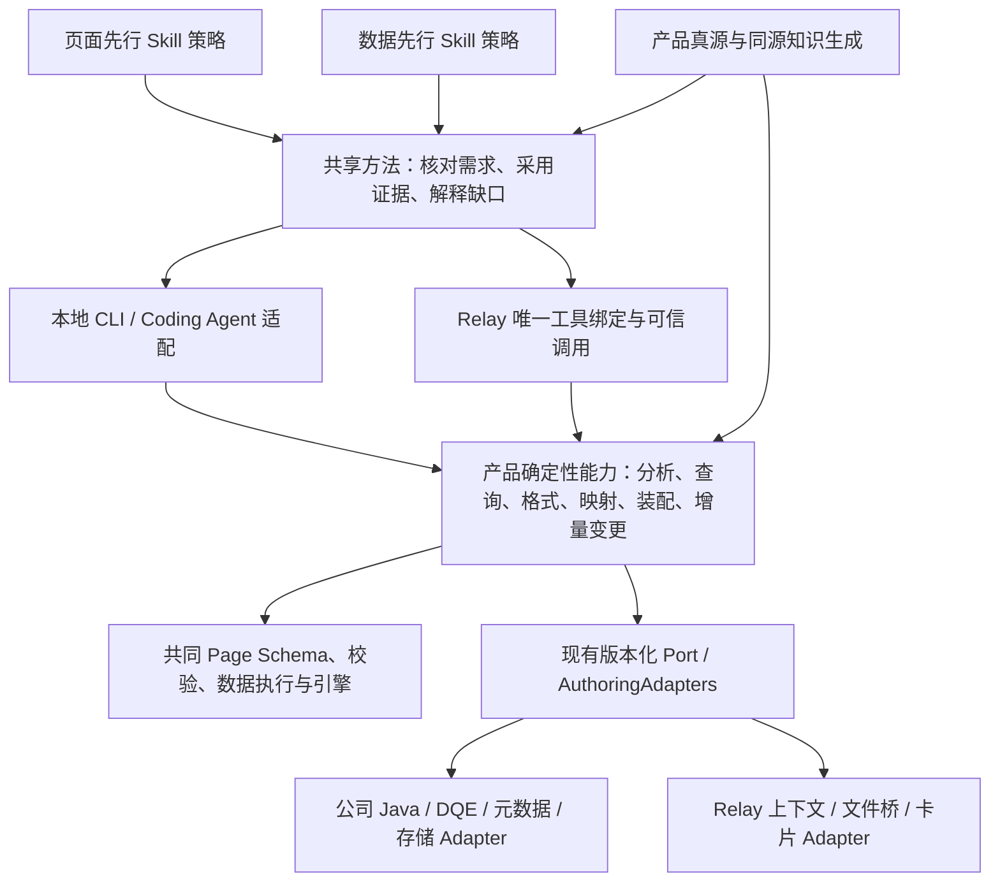
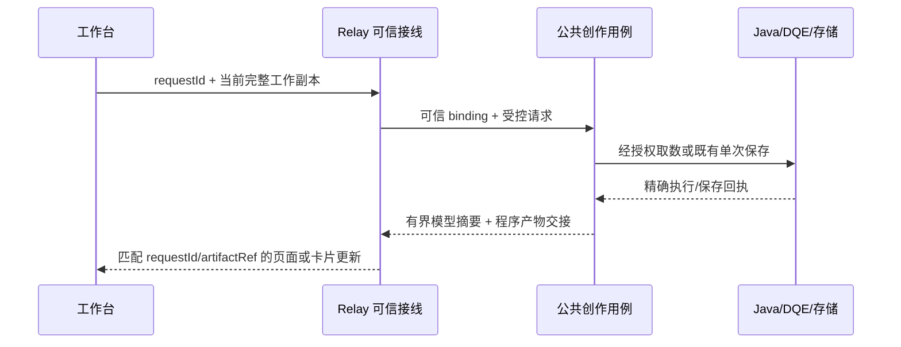

# MetricCanvas 统一创作能力与 Relay 接入演进方案

版本：内网评审稿 v1.0　日期：2026-11-02

评审对象：MC 产品维护方、Relay Skill/工具维护方、公司 Java/DQE/元数据适配维护方。

**建议结论：保留页面先行与数据先行两种创作逻辑，共享产品 Schema、引擎、确定性创作能力及知识真源；独立维护 Relay 接线和公司服务适配。先收敛现有职责与采用接缝，再补共享分析、呈现正确性、多槽表达和保留页面意图的增量接数。工具承担正确性后，Skill 的阅读与步骤应减少。**

本文件可以单独阅读；评审包内的 evidence/ 用于按需复核，不是模型每次创作的必读材料。本文是设计及兼容评审，尚未实施所提改造。标为“建议”“候选”的 Interface 和 JSON 不能当成当前可调用协议。

## 1. 本次希望 Relay 评审什么

请核对本方案是否适合真实加载器、临时子进程、当前状态存储、工具注册、工作副本输入和产物交接。重点反馈：**哪个假设与现状不符、哪条 Interface 无法兑现、哪些已改良能力会丢失，以及最小兼容改法。**

本轮只评审和离线取证；无需为了回应本方案执行升级、移动目录、覆盖 Skill、真实业务查询或保存发布。若已有相关真实回执，可脱敏引用。可以按 Skill/加载、工具/产品、状态/交接三条线合理分工，主评审需核对相互矛盾之处。

请按第 14 节的 R01–R18 逐项回填；第 15 节给出格式。证据取得不到时填“未知/未运行”，并指出影响哪一实施批次。不要把所有未运行项都解释为全部工作不能启动。

本方案不要求评审方认可某个物理目录名，也不要求预先重写 Relay SDK 或统一所有实现语言。评审通过的标准是职责、Interface、副作用、兼容与完成条件一致。

## 2. 背景、基线和证据等级

### 2.1 已取得的输入

| 输入 | 已知事实 | 证据边界 |
|---|---|---|
| MC 当前探查检出 | HEAD `2133241a6b4f259fc19ff54bfdd9a0dcb9c96e06`；存在并行未提交修改 | 非干净发行快照，未证明远端最新状态 |
| MC 公共工具 | 本轮离线 FastMCP list_tools 导出 9 个工具的完整 inputSchema | 未加载内部 Adapter，不证明 Relay 实际注册或服务可用 |
| MC 产品/分发 | 页面协议 6.77，产品契约 1.0.0-rc.4，Bundle/authoring 契约 0.3.1 | 相同版本号不能证明相同源码或私有 diff |
| Bundle 检查 | 既有 check_bundle.py 退出 0，6,464 项摘要核对通过 | 当前本地内容一致性，不是所有行为回归或部署验收 |
| Relay 合并审计 | 报告源提交 `663da7ea7f4a662f0e4bec678b7feea02951dc97`；列出 15 个工具入口 | 源码/配置静态取证；无实际 list_tools、隔离探针或真实服务回执 |
| Relay 版本读取链 | 报告推导运行代码标记 6.54、MC 内容 6.77、旧 lock/manifest 6.11 | 是源码读取链推导，不是进程观察；不能据此断言每份 snapshot 都不被使用 |
| 创作规范讨论 | 用户明确要求避免 Skill 越来越厚；“百万仅用于 Tokens”的本轮呈现约定 | 已纳入目标；格式修复、方法删减和模型效果尚未验收 |

早前本地定向回归为 218 项：206 通过、3 失败、9 报错；失败台账包含旧版本断言、过期页面路径及待重新归因的日期/时间候选用例。另有表格行对齐/页面契约 15 项补充检查通过。这些是各自时间点证据，本方案没有把它们合并成“整体通过”，也没有重新执行全部回归。

### 2.2 接收 Relay 报告后的修正

1. 报告内 JSON 是静态概要，有 6 处未解析引用、2 处仅含说明的 Schema 节点，并使用 nullable 表达空值；不能作为完整 JSON Schema 或实际注册导出直接采用。原文和 JSON 保留，不篡改原始报告。
2. 新增组件后删除旧组件，是已存在的替换工作流；它尚不能证明组件身份、列配置、顺序、交互、引用和共享消费者均保持。不能据此关闭“保留页面意图的增量接数”缺口。
3. session hash 稳定不能单独证明逐指令轮次隔离；必须检查完整 binding 及 requestId/runId/turnId 的实际映射。
4. ToolResult.content 名为 modelSummary，不证明其中只有摘要；报告描述的 data-agent 分支含完整压缩预览。structured_content 被丢弃时，程序交接实际依赖文件/plugin 旁路。
5. 同一个工具集可供两条策略使用，不代表两种逻辑的能力对称或闭环已完成。新建/编辑页面也不是页面先行/数据先行的判据。

这些修正用于明确验证责任，不否认已有 Relay 改良。恢复公共基线时必须保留已实际使用的私有能力。

## 3. 产品目标与范围

### 3.1 两种创作逻辑

| 维度 | 页面先行创作 | 数据先行创作 |
|---|---|---|
| 起点 | 页面、设计源、固定结构或用户自定义意图 | 业务问题、用数需求、可用数据与查询证据 |
| 主要过程 | 页面结构 → 用数需求 → 数据发现/验真 → 映射接数 → 完善页面 | 需求/口径 → 发现/查询验真 → 证据形状 → 页面表达 |
| 优先保留 | 已确认组件/字段身份、布局、交互及可信绑定 | 口径、授权、粒度、期间、字段契约和结果依据 |
| 数据不足 | 保留意图，标明具体缺口，再决定是否调整结构 | 不补造结论；据证据收敛表达，并保留覆盖说明 |
| 当前主要载体 | local-authoring 的 JSON 编辑、用数扫描、材料匹配及候选准备 | Relay 已迭代 Skill 的发现、查询、装配和编辑流程 |
| 长期目标 | 本地独立使用，也进入线上用户自定义闭环 | 线上为主要载体，并可由其他可信程序接入 |

“本地/线上”是运行与交付维度。未来线上用户固定结构后补数据，仍属于页面先行；在已有页面新增一个分析问题，可以采用数据先行。

两种逻辑可以接续同一工作副本：先根据数据生成页面，再固定结构换源；或先分析页面缺数，再查一个新问题回填原页。切换不重建会话、不丢未保存修改，也不无条件复用过期 resultRef。

### 3.2 本轮统一什么

统一产品事实、确定性分析/变换、需求与证据的关联、字段/语义映射、影响范围、受控变更和回执。保留两条策略的任务顺序和表达选择。

当前两个 Skill 安装标识可以保留。先整合能力和方法，再根据真实使用决定线上是否采用一个入口下的两条路由。首批不建立总控 Skill、独立验证管理器或新的通用会话数据库，也不一次开放全部合法 Schema 的在线修改。

## 4. 目标架构：Skill、脚本与协议



没有 Mermaid 支持时，按以下三条理解：Skill 决定本轮要做什么；产品程序决定受支持的变更如何正确执行；Adapter 提供身份、实际服务、存储和交接。图中的检查职责都放在现有调用内部，不自动变成额外模型步骤。

### 4.1 所有权与依赖方向

| 内容 | 产品侧维护 | 内部/Relay 侧维护 | 接缝原则 |
|---|---|---|---|
| 两种创作策略 | 可复用方法和产品参考工作流 | Relay 特有任务规则及采用方式 | 单一方法作者源、固定投影；先盘点真实改良 |
| Schema/引擎/执行 | 页面协议、校验、渲染、查询/计算/导出语义 | 实际引擎安装和数据网关注入 | 产品核心不依赖 Relay SDK |
| 公共创作用例 | discover/query、装配/编辑、结果作用域、工作版本/CAS、保存协调、参数、精确预览契约 | 端口具体实现 | 不因运行在 Relay 子进程就迁入私有实现 |
| 产品脚本 | 用数扫描、范围闭包、MC 查询/编译/检查、升级/校验 | CLI/MCP/Skill 调用包装 | 不重复写业务算法来适配不同语言 |
| 公司服务适配 | Port、公共语义和可复用纯转换 | Java/DQE/元数据端点、认证、字段响应映射、存储后端 | firstparty 名称不等于整目录可进入公共发行 |
| Relay 接线 | 公共 Interface 和错误/回执约束 | loader、SDK、上下文、tool permission、文件桥、占位符、卡片风格 | 接线独立演进，业务规则不分叉 |
| MC/local 知识 | 完整事实与生成链 | 安装、版本组合和部署回执 | 生成副本允许物理重复，禁止重复维护真源 |

现有 ownership.json 将整个 adapters/ 作为内部所有权。公共升级保留其字节；需要回收的通用算法逐项审查，不能整体覆盖 firstparty/ 或 Relay/。

### 4.2 目录预划分

```text
MC 产品仓
  packages/page、engine、data-execution          页面与执行真源
  metriccanvas-authoring/tool/                  公共创作用例、MCP、Port
  metriccanvas-authoring/contracts/             公共创作契约
  tools/scripts/local-authoring-*               共享分析源与本地包装
  tools/mc-content/                            知识/脚本作者源
  metriccanvas-authoring/mc-content/            生成的完整独立内容包
  metriccanvas-authoring/skill/
    metriccanvas-local-authoring/              独立本地安装投影
    metriccanvas-platform-authoring/           平台方法参考与事实投影
  可选共享方法作者目录                         具体文件表在实施冻结

内部 Relay 项目
  实际 Skill 作者文件、scripts/tools.py
  loader/SDK、turn_provider、preview_bridge
  MCP 启动与依赖、公司 Adapter、状态存储
  私有扩展清单与兼容实现
```

这是逻辑归属。首批保持主要包路径和入口，不先搬成 mc-tools。若后续改包，需同时处理 import、资源寻址、wheel、入口、锁和消费者；“只移动文件、不改 import 即无行为变化”不是成立前提。

## 5. Skill 与 MC 内容如何整合和减负

### 5.1 模型的共同主线

**确定本轮改动 → 必要时取得可信证据 → 组织表达与变更 → 消费回执并交接。**

| 任务 | 最短路径 | 条件读取 |
|---|---|---|
| 配置问答 | 读必要配置 → 回答实际证据 | 命中属性；不读新建/数据/布局流程 |
| 标题、列宽、顺序 | 定位目标 → 局部 edit → 核对回执 | 命中操作/属性；不强制查数或选模板 |
| 页面先行补数据 | 分析用数与保留约束 → 必要发现/查询 → 核对映射 → 增量接数 | 数据任务片段与受影响契约 |
| 数据先行新分析 | 口径成形 → 发现/查询 → 组织表达 → compose/edit | 需要布局启发时才查组合 |

MC 保留完整协议、错误、能力限制和示例。实际工具 Schema 已注入时，不要求模型重读整份参数手册；只在约束未展开或有疑问时查询精确节点。没有实际 Schema 时要报告调用缺口。

模板保留“适用问题、信息关系、可选组合、常见误用”，允许裁剪、重排和替换，不要求先选编号或固定章节。用户已确认的结构意图优先；产品真实能力仍需校验。

### 5.2 方法源与私有改良

先将实际 Relay Skill 的正文/引用与可取得的共同基线对账，逐项分类为共享方法、产品事实、Relay 接线、公司环境规则。git log 的次数不能代替 diff。未取得历史基线时，先冻结当前作者文件，不能用公开参考覆盖它。

共享方法由一个作者源维护，构建时投影进两个安装目录；产品事实继续来自产品/MC 真源。local 安装内必须含完整依赖和正文，运行时不去兄弟 MC 目录或开发仓取文件。当前阶段不机械合并成一个巨大 SKILL.md。

**删减顺序：先由工具承接并验证，再删对应重复提醒。** local 直接编辑 JSON 的路径也覆盖后，才删除其兜底。安装/部署维护材料留维护侧，不加入普通创作必读链。

## 6. 共享脚本与业务连接

### 6.1 已有基础及缺口

| 已有基础 | 当前限制 | 处理 |
|---|---|---|
| scanPageData / scopePageData | 分析模块混有 Node hash、材料处理和文件包装 | 提取显式输入的纯扫描/闭包核心，保留原 CLI 导出与行为 |
| draft/check/prepare | 材料候选与相容性检查；execution 必须 not-run；不执行、不保存 | 保留证据边界，与真实查询记录建立关联 |
| discover/query 与 resultRef | 有授权、版本、策略、作用域及真实执行链 | 两种策略共用，不另建查询算法或结果缓存 |
| compose/edit 与批处理 | 有闭集操作、依赖、回滚、partial、完整页验证与保存 | 增加必要的受控表达，复用现有协调 |
| 工作台 DialoguePageRequest | 已有完整未保存快照、hash、requestId、锁及迟到处理 | Relay 端接入同一输入，不改为读远端旧页面 |
| MC/local 同源生成 | 已有知识、脚本、Schema、实际工具事实导出 | 扩展现有链，不新增第二套公开事实源 |

### 6.2 最小业务连接记录

以下是创作期数据要求，不是新增 Page Schema，也不是已注册的序列化协议。实施时扩展现有 DataUse、分析报告和查询记录，避免第二份状态持有者。

| 信息 | 要求 |
|---|---|
| 输入身份 | 完整页面及对应字节摘要、Schema 摘要；有材料时记录材料身份；线上关联当前 binding/workVersion |
| 页面用数 | 页面/组件/源/槽/字段身份、pointer、嵌套或子表上下文；重排后重新定位，不以 pointer 充当永久主键 |
| 保留意图 | 身份、列、布局、交互、固定项及允许变化范围；已有可信绑定和共享消费者 |
| 用数需求 | 口径、单位、粒度、行身份、期间、筛选/参数及完整性要求；未知显式记录 |
| 映射 | 用数位置 → 取数单元 → 程序持有的结果字段；一个组件可以消费多个源 |
| 证据 | 材料引用、元数据声明、真实执行分别记来源；材料 matched 不等于执行成功 |
| 呈现 | 可信单位/原始刻度、提供方建议、用户意图与程序决定的出处分开 |
| 候选变更 | 绑定精确输入/workVersion、目标、结果与影响闭包；候选不等于保存回执或授权 |

文件原始字节摘要和前端 canonical JSON 摘要分别对应各自真实输入，不相互替代。格式变化导致报告身份不一致时重新分析/核对，不修改旧摘要来复活报告。

### 6.3 共享程序调用方式

首批提取现有 scan/scope，保持无 I/O 的 Interface：页面对象和活动 Schema 显式传入，返回用数、字段/源投影、范围及诊断，输入不变。Node hash、文件读取、manifest 和退出码留包装层。

线上先通过现有 Node 程序/Bridge 方式消费，不直接把 node:crypto 放进浏览器，也不重写一份 Python 扫描器。在线只读分析优先接在既有读用例的明确分析分支/可信程序调用中；默认 read 或标题修改不自动跑全页分析。具体暴露参数需对实际注册评审，本文不宣称已有新 MCP 工具。

完整页面、候选与原始查询留程序侧；模型消费有界需求、映射和缺口。选择组件只控制读取范围，完整报告检查与最终校验仍覆盖影响闭包和全局规则。

## 7. 协议与运行接缝

### 7.1 四类协议分别演进

| 协议 | 内容/权威方 | 兼容要求 |
|---|---|---|
| Page Schema 与引擎语义 | 产品维护页面、绑定、查询/计算、呈现和执行规则 | 旧页可读、可迁移、人工处理分别说明 |
| 公共创作工具协议 | 产品维护完整输入/输出、错误、partial、保存和预览行为 | 业务实现、真实注册与 MC 同批更新；嵌套 request Schema 不冻结在 Relay |
| 适配 Interface | 产品 Port / AuthoringAdapters；公司/Relay 实现 | 保留 authoring-adapters/1.0 现有必需项；变化按接口兼容性处理 |
| 集成与产物交接 | 工作副本输入、可信上下文、artifact/preview 回执 | request、binding、产物与页面必须精确关联；传输实现可变 |

Bundle、产品契约、作者工具、Page Schema、MC 内容摘要、Skill 软件和外部 API 版本各有含义。新增创作操作不自动要求 Page Schema 升版；没有升版的语义变化仍需同步验收。

### 7.2 实际工具与唯一提供方

当前公共离线注册：read_page_context、discover_data_context、query_data、compose_page、edit_page、page_metadata_emit_preview、extract_page_parameters、apply_page_parameter_selection、resolve_page_parameters。

Relay 报告另列六个名字，迁移归属先按下表处理，不按报告的 public-MC 标签直接提升为公共默认入口。

| fork 新增入口 | 初步归属与兼容策略 |
|---|---|
| publish_page | 保留实际发布流程；查公共生命周期语义与公司发布接线的分界，决定通用用例是否回收；不新增第二次保存循环 |
| list_existing_page_urls | 页面 URL 查询及唯一性能力与公司接口映射分开；不要求其他集成默认具备 |
| submit_ai_summary_body | 预览正文 spool 与持久页面定义分开；保留实际已用能力，不据函数名推断正文应持久化 |
| tool_mc_query / compile / inspect | MC 确定性脚本归产品；MCP/Skill 包装和精确产物解析归接入；消除同名双提供方 |

page_metadata_emit_preview 本身已有公共入口，Relay 卡片代码是对它的扩展，不能把整项能力都定为私有。

建议保持既有模型可见名字，装配时显式选择一个提供方；初始优先评估 MCP 提供方是否能保留完整功能与可信交接，再关闭重复 Skill 绑定。若两入口实际语义不同且必须并存，显式改名并更新 allowed-tools/工作流。选择前不得删除现有实现，也不能依赖覆盖顺序。

完整 inputSchema 从真实 FastMCP 注册取得；Relay 需核对 loader/SDK 是否裁剪、缓存或手写了第二份描述。工具顶层名字不变，不代表内部 Schema 不变；兼容内容升级的目标是无需手改调度算法，但描述、缓存、包和回执需要更新。

context_ref 仅对实际接受该参数的入口注入。报告称 turn_provider 只处理某个十工具集合，而工具清单为十五项；需核对三项 MC 桥接、参数工具及新增操作的触发覆盖。未知 kwargs 不能强塞给 FastMCP。程序读取静态知识与需要作用域的产物检查也应分别对待。

### 7.3 可信轮次与当前工作副本

既有前端 Interface 摘要如下，是真实输入，不是由模型拼装的授权对象：

```ts
interface DialoguePageInput {
  pageId: string | null;
  documentJson: string | null;
  documentSha256: string | null;
  persistedRef: {pageId: string; resourceId: string; revisionId: string} | null;
}
interface DialoguePageRequest {
  requestId: string;
  sessionId: string;
  intent: 'create' | 'adjust' | 'publish' | 'confirm-save';
  question: string;
  input: DialoguePageInput;
}
```

Relay 拥有会话，可信 Adapter 取得身份/工作空间并映射当前请求。sessionId 可稳定；requestId、runId、turnId 以及整个 binding 的关系须可解释。同一请求多次临时子进程调用使用同一有效 binding，新请求/目标变化/取消可被识别。context_ref 是关联引用，不能独自构成授权。

区分两个集成模式：

- **当前工作副本模式**：以传入完整 documentJson 及其摘要作为本轮输入，保留人工未保存修改；persistedRef 作为已有资产修订依据。保存仍执行原有服务端条件更新，不能先读 Java 旧页面覆盖当前输入，也不强制发送前回读整页。
- **旧 current_match 模式**：保留原先读取和核对远端基线的行为，按明确的可信接入模式选择。新模式不能机械套用旧版 Adapter 文档中“每条新指令都重新读已保存页面”的前提。

两模式都保留权限、精确身份、版本竞争和未知保存处理。公共服务中已有强远端文档相等前置的分支，需要按模式核对；不能只改 Relay 插件而宣称完整工作副本支持已完成。

### 7.4 状态、结果引用和取消

现有 AuthoringAdapters 主要 Port：current_turns、store、analysis_authorization、lifecycle_service、lifecycle_identities、relay_preview、data_context、dqe；semantic_catalog 等按现有能力选配。采用唯一的公共类型定义；复制 dataclass 到两个包可能导致 isinstance/类型身份不一致，不能靠相同字段名保证兼容。

报告描述 temp_subprocess 每次工具调用建立临时子进程。因此预算、工作稿、查询记录、CAS 和冻结提交必须由实际跨进程存储承载。SQLite 是一种 Adapter，不是把公共工作规则迁给 Relay 的理由。请以真实工厂装配核对，不以模块里存在某个类认定已使用。

resultRef 继续重核完整 binding、数据上下文版本、验证策略、授权与 ready/empty 状态。跨策略可复用仍有效业务依据；跨轮次是否可继续使用记录须经现有规则重核或重新查询，不直接搬引用。

取消使当前请求失效，迟到回执不更新另一个请求/页面。保存 unknown 保留冻结尝试，按现有恢复能力查询事实，不重发原写入。可清理的预览缓存与必须保留的提交记录分开管理，不使用统一 TTL 清除全部状态。

### 7.5 模型摘要与程序产物



图表示目标职责；结构化返回或文件桥哪条实际生效，需要运行取证。保存与预览仍沿现有用例顺序，图不增加保存前“全页采用审批”。

公共 preview Port 的既有输入含 binding、operationId、artifactRef、ref、document、previewJson；回执匹配精确引用。document 的持久定义与预览 initial 按原产品规则分开。MC inspect 还需关联原 inspectionSpec/compileInput；“correlation checked”不等于授权、已保存或已部署。

报告称 Relay Core 丢弃 structured_content：首批可保留现有文件/plugin 桥，但写入、读取、回执必须匹配请求、作用域和产物摘要。按目录扫描命中 artifactRef 后仍需核对，不以“最新文件”或 model 传入路径作为可信依据。

完整 previewJson、gzip/base64 卡片数据交程序处理，模型只拿有界摘要/引用。先验证 pangu 和 data-agent 两种卡片、流式替换及最终兜底，再删除旧 spool。预览失败不能倒退已经保存的事实，更不能触发再次保存。

## 8. 两项产品能力的候选设计

### 8.1 保留既有页面意图的增量接数

首条切片：一个已有合法表格，保留页面/组件/字段身份、列配置、布局和交互，用同粒度、角色/类型相容的已验真结果替换普通查询源。

建议由程序形成绑定候选，关联精确基线、workVersion、目标源和结果记录。模型仅表达采用目标和可变范围；候选是待核对的程序记录，不赋予授权。确认需求/映射按原策略执行，不能新增对所有修改的人工审批。

在现有 edit 操作中增加一个原子接数操作是首选方向，具体名字与字段在实际契约评审冻结。它需：

1. 重核绑定方案与引用的作用域/版本；定位全部消费者及依赖。
2. 校验字段身份、角色/类型/单位、粒度、rowKey、期间、筛选/参数与交互引用；不能只检查列名。
3. 在单个逻辑候选中更新必要源定义及映射，保留未要求变化的配置；按产品规则失效不再有效的 initial/派生状态。
4. 完整页验证后交原批处理与保存协调；失败不留下半个绑定。其他独立操作的 partial 行为保持。
5. 条件冲突或不能保持意图时返回精确缺口，不偷偷重新 compose 或删除/新增组件冒充换源。

源被多个组件共用时，必须明确用户是替换所有消费者，还是仅为目标隔离新源。已有程序能证明隔离合法且符合意图才采用；不能仅因选中了某组件就改共享源。

### 8.2 多槽表格：同步机制的验证案例

产品 Schema/引擎已支持具名槽；普通行以 main 定序，辅助槽按 rowKey 读取，不是全外连接。当前 DATA_BLOCK、block_component 和组件构造仍是单源，上游也有缺口。只更新 Relay 快照不能修复。

当前 add_source_component 的主路径是 section_editing.py → block_component；不能机械修改材料所列 text_map_building。ExecutableUnit 是一个取数单元对应一个页面数据源，首选在装配职责组合多个源，不为呈现槽任意扩大取数单元。

建议保留旧单源分支，新增仅适用于 table 的多源分支。顶层 sources 仍是 sourceId→resultRef；block 内 sources 是 slot→sourceId。候选示意如下，**当前工具尚不接受**：

```json
{
  "title": "收入分析",
  "sources": {
    "revenue": "result-ref-main",
    "revenue-yoy": "result-ref-yoy",
    "revenue-mom": "result-ref-mom"
  },
  "sections": [{
    "id": "detail",
    "pattern": "custom",
    "blocks": [{
      "id": "revenue-table",
      "type": "data",
      "component": "table",
      "title": "代表处收入明细",
      "sources": {"main": "revenue", "yoy": "revenue-yoy", "mom": "revenue-mom"},
      "rowKey": "org-id",
      "columns": [
        {"field": {"data": "main", "field": "org-name"}},
        {"field": {"data": "main", "field": "revenue"}},
        {"field": {"data": "yoy", "field": "change"}},
        {"field": {"data": "mom", "field": "change"}}
      ]
    }]
  }]
}
```

倾向复用现有字段绑定表达，而不是同时引入含混的 fields 与另一套 columnBindings。最终是否直接用 columns、支持哪些列属性，需结合现有受控表格呈现契约冻结；不得由示例自动认定完整 Page props 可透传。

首批建议限制为普通查询结果、同粒度、明确主行域及可验证覆盖的多源表；query 分页、pagedJoin、pinnedTop 等特殊组合另列支持范围。已有合法部分结果页继续按原契约显示；首批自动装配的支持范围不是新增全产品保存限制。

必须校验：main、每槽合法引用、稳定同名同类型维度 rowKey、明确列槽归属、同名字段、单位/期间和结果作用域。重复键、缺键、空槽、失败槽、截断/分页覆盖不能静默取第一条或补零；按既有产品语义返回具体结果，发现规则缺口则先明确再实现。

新建多槽表、引用已有源加表、从多个结果加表、修改已有表、合并两张表分别登记支持。不能因新增多源 block 就宣称合并/重绑定已完成。F5 为何分查询属于待核对环境约束；多槽、期间计算、pagedJoin 和 resultBindings 级联不是同一能力。

## 9. 呈现正确性与创作自由

### 9.1 事实、建议和意图区分

可信单位、币种、原始刻度、指标含义与期间是业务事实。defaultFormat 是展示建议，必须通过语义相容性核对。用户明确要求与已有人工设置，在相容时优先；不能仅因某值非空就永久锁死上轮自动决定。

本轮明确约定“百万仅用于 Tokens”用于显示决策，不能反向篡改可信原始单位。原值已按某数量级计量时不再重复缩放；字段名包含 Tokens 或“同比”不足以证明语义和原始刻度。

百分数值和小数比例必须区分，当前 percent 格式按百分点消费。已知 % 的语义不能因为只返回 20/29 行而消失；结果不完整只限制依赖全量分布的自动尺度/完整性推断。

### 9.2 检查进入现有调用内部

| 位置 | 产品内部职责 | 模型收到 |
|---|---|---|
| 描述/字段映射 | 核对可信单位/刻度与提供方格式建议，保留未知及来源 | 可用、冲突或待补证的具体字段 |
| query_data 返回前 | 相容默认格式、百分比语义、精度、非零舍入、重复缩放及覆盖缺口 | 可用字段/格式证据、调整与限制 |
| compose/edit 应用前 | 最终槽/字段绑定、默认继承和显式覆盖、单位/期间关系 | 原有 applied/failed/skipped 与具体问题/调整 |
| 本地分析/校验入口 | 复用同源适用规则；需要数据证据时显式输入或报告未证实 | 结构与语义证据分别说明 |
| 元数据/可用预览 | 验证最终有效声明及实际呈现，回溯上游遗漏 | 结构、数据、视觉、保存各自的证据 |

确定且相容的默认可由程序修正候选并记理由；用户显式设置冲突或存在多个业务解释时，返回缺口而不静默覆盖。显示决策不改 query、原始值、计算或排序语义，完整性/权限/partial/保存沿原规则。

精度先在现有格式能力中按字段用途处理；本方案没有决定全产品统一几位，也不新增无限场景策略矩阵。微小非零值的精度问题不能通过删除单位解决；若现有格式闭集不足，按协议能力更新另行处理。

### 9.3 已有独立呈现实现的复用

已只读定位 presentation-knowledge 工作树，含未提交的 analyze-presentation.mjs、mc_presentation.py、presentation-policy.json 及相关说明。当前 JSON 策略是单系列柱图轴空档策略，不证明所有百分比/格式缺口已修。

实施前逐函数核对可复用能力、依赖和测试向量，再按需吸收；不整包覆盖当前真源，不新增平行策略实现。Relay 普通创作只依赖其已取得的数据、完整性和组件声明，不要求分辨率、DOM 或截图；数据策略回执不能宣称视觉可读性或已应用运行时。

## 10. 同步、发布与回退设计

### 10.1 一次能力演进的完整链

```text
产品语义/实现/测试向量
  → 活动创作契约与真实注册
  → MC 与 local 知识/脚本/校验器投影
  → 两种策略的实际可调用路径和方法说明
  → 独立包回读与安装
  → Relay/引擎/服务组合的采用回执
```

MC 保留完整公共 MCP 事实，不缩成纯 Schema 目录。local 保留完整独立安装；其知识与 MC 来自同一产品图，不从安装副本回读生成事实。方法正文与产品事实分开维护。

同一批冻结来源、输入、生成器和版本组合，串行运行现有生成/检查链，不手改生成知识、锁或摘要。既有命令包括 authoring:contracts、authoring:contracts:check、mc:content:check、skills:check、check_bundle.py；实际命令/依赖以实施检出的 package.json 为准。行为修改同时补页面试验场可观察场景、页面元数据文档及 local 同步。

### 10.2 采用回执的最小内容

记录公共源完整提交/摘要、私有 diff、工具完整 Schema 摘要、活动 Schema/目录/validator/引擎、MC 内容摘要、Skill 作者文件、Adapter Interface/内部版本、实际加载路径、注册提供方、测试与部署层级。可沿现有 manifest/回执记录这些关联，不另建万能版本服务。

内容升级兼容时，Relay 调度算法可不手改；实际描述、缓存、安装和启动依赖仍更新/检查。temp_subprocess 下代码内 lru_cache 不跨调用，不代表 loader/客户端描述无缓存。

### 10.3 分发和切换

整包使用新版本目录，验证完整字节、依赖、Schema、注册与代表回放后，再切换激活路径。同一活动请求固定其产品/MC/脚本组合；不能一个调用读旧工具、下个调用读新 MC。具体目录/指针机制由 Relay 确认，不假定已有热更新。

公共更新保护内部 Adapter 和作者方法；私有变更先分类为需要回收的产品能力、内部适配或 Relay 扩展，再定向重放。CRLF/BOM/文本或二进制变化按原始字节处理，通过原包恢复或整包生成；不以运行时补丁修改 digest 或重算 LOADED_CODE 掩盖混装。

正式切换前清点活动工作稿和 unknown 提交。回退使用完整已验收组合，保留原操作身份与恢复记录；状态格式不兼容时需要显式迁移/只读处理，不只回退代码后重发写入。回退不保证已经保存的数据自动逆转。

## 11. 迁移批次、责任与依赖

| 批次 | 主要工作 | 责任位置 | 退出条件 |
|---|---|---|---|
| I00 / M0 接收 | 原文、契约概要、公共实际注册和差异台账 | MC | 已完成本地接收/对账；干净发行冻结及部署实证仍未完成 |
| I01 / M0 采用 | 冻结公共源、完整私有文件与真实注册，形成版本组合 | MC 分发 + Relay 部署 | 文件/依赖/注册/知识一致，内部改良保留；无静态占位被当成契约 |
| I02 注册 | tool_mc_* 单一提供方、allowed-tools 和上下文触发覆盖 | Relay loader/工具包装 | 每个模型工具名来源确定；实际调用与输出可追踪 |
| I03 输入 | 完整工作副本、逐请求 binding、旧模式兼容 | 平台已有输入 + Relay Adapter + 公共接入分支 | 未保存修改不丢；并发/取消/迟到/身份切换正确 |
| I04 产物 | 精确程序交接、有界模型摘要、两类卡片与恢复 | 公共 preview Port + Relay plugin | 产物精确采用；预览失败不重保存；unknown 可恢复 |
| I05 / M1–M2 | 分析连接与只读共享核心、CLI 包装、独立投影 | MC TS/Node/生成器 | 同输入同完整有序结果，输入不变、无 I/O 副作用；仓外安装可用 |
| I08 正确性 | 现有映射/格式/页面应用纠错，local 同源承接 | MC 公共用例 + local 适用入口 | 百分号/精度/百万和证据边界的正反例通过；不扩模型步骤 |
| I06 / T1 | 多槽受控表达与同步验证 | MC 产品 + Relay 采用 | 单源无回归；受支持多槽各路径、注册/知识/安装一致 |
| I07 / M3–M5 | 线上只读分析、增量接数、双策略接续、方法减负 | MC 用例 + 两策略作者源 + Relay | 保留意图接数及两方向回放；对应工具覆盖后再删提醒 |
| M6 扩展 | IOC/期间、query 分页、父子表/导出等按业务逐项补 | 产品 + 内部集成 | 每项声明/执行/知识/策略/部署证据完整 |

两条线推进：产品线可先做 I05、I08、I06，呈现纠错优先在现有职责内解决；Relay 线做 I01–I04。I08 相应工具验证是生产方法删减的前置，不阻塞 I05 的只读提取。线上完整闭环需要输入/交接/增量能力共同完成，不以“并行”降低集成条件。

正式编码前核对当前 main、隔离工作树和相关基线，保留并行工作。每批测量修改及全部新增函数复杂度，新增函数目标 CC≤15，存量超限按仓库规则处理。纯文档整理不伪造复杂度改善。

## 12. 验收矩阵

| 场景 | 必须证明 | 首先由谁验证 |
|---|---|---|
| 改标题/列宽/顺序 | 不重查数、不强制读新建/模板；无关配置不变 | MC 用例 + Relay 回放 |
| 只读页面分析 | 来源精确、用数/嵌套/子表/多槽覆盖、共享闭包完整、零保存 | 共享核心/CLI + 线上程序 |
| 现有普通表换源 | ID/列/布局/交互及共享引用保持；不兼容明确失败 | 公共 edit 正反例 + 工作台 |
| 多槽表格 | 主行域、键/列槽、同名字段、空/错/重复/截断和作用域有确定结果 | 产品装配/页面/数据执行 + Relay |
| 数值格式 | 完整/部分结果、上游 number 的百分比、未知刻度、已缩放、微小非零、非 Tokens 百万、显式覆盖正确 | 格式/绑定/实际格式器向量 + local/Relay |
| 双策略接续 | 同页/同意图保留、证据重核，未保存修改不丢 | 工作台/程序 fixture + Relay |
| 单请求多子进程 | 持久状态一致、CAS 竞争单胜、查询记录不丢 | 真实装配的隔离探针 |
| 同 session 多请求/页面 | request/binding 正确、取消迟到隔离，不把稳定文件名当证明 | Relay/plugin + 公共 Gate |
| 保存 unknown/预览失败 | 不重发写入；冻结记录保留；保存与展示事实分开 | 公共用例 + Java/Relay 接入 |
| 两种卡片 | 精确当前产物、流式/最终兜底有效、全文不经过模型 | Relay 程序交接与前端 |
| 旧页与安装 | 可读/可迁移/人工分类，local 仓外闭合，整包无混装 | MC 分发/产品 + 部署 |
| recall/级联 | 实际执行每槽、参数/权限、resultBindings、空集合与失败传播 | 召回/插件维护方 |

证据分别记录：源码/配置、实际注册、隔离探针、真实服务、模型任务回放、浏览器/视觉、分发安装和远端 CI。某层通过不代替其他层。真实 DS 模型与业务接口调用按明确验收范围执行，不为设计评审自动追加。

减负验收同时看根入口和命中材料的去重字节、实际输入/读取轨迹、工具调用/修复轮次、任务正确性和布局自由度；不能由文件变少或字节下降推导 token/费用/效果改善。对相同输入/模型/环境多次回放时，模板与自由组合的正确性标准相同。

## 13. 已确定与待冻结事项

| 类型 | 内容 |
|---|---|
| 已确定 | 两种策略共享产品底座；线上包含未来页面先行；Relay/公司适配独立；公共状态/保存规则归产品；MC 完整、local 独立；工具先承接再删提醒 |
| 已有实现 | 9 个公共工具及部分编辑/装配、分析/候选基础、工作台快照入口、同源生成和 Port；按本文件证据等级理解 |
| 已确认产品缺口 | 上游多槽受控表达、保留现有意图的完整接数操作、格式语义与完整性耦合等 |
| 待接口冻结 | 只读分析如何暴露、绑定候选/新增 edit 操作字段、多槽 block 列表达及首批边界 |
| 待内部核对 | 真实注册/提供方、完整 Skill 改良、逐请求身份、当前工作副本、产物交接、真实发布/召回、切换/回退机制 |
| 业务默认仍需实例收口 | 各用途精度及极小值处理；未知单位/刻度保持未知，不用全局默认伪造事实 |

上述待确认不妨碍产品侧独立工作启动；真正跨仓采用和正式切换要满足相应退出条件。内网评审若发现会改变上述已确定目标的必要事实，请提出具体替代及影响，不默默改变目标。

## 14. 请 Relay 逐项核对的细节

| 编号 | 核对问题 | 希望取得的最小证据/决定 |
|---|---|---|
| R01 | 6.54/6.77/6.11 分别由谁加载？schema.json/catalog/validator/引擎实际是什么？ | 进程/离线注册对应路径、文件摘要、加载链；无环境则源码与未知项分开 |
| R02 | 三个 tool_mc_* 的 MCP/Skill 同名如何解析？ | 真实工具列表/提供方或隔离装配；建议保留哪条及遗漏能力 |
| R03 | turn_provider 十工具集合与十五入口如何对应？何处可注入 context_ref？ | 实际集合和签名、触发路径；静态知识工具与 scoped inspect 的差别 |
| R04 | sessionId/requestId/runId/turnId 如何生成和变化？ | 两次同 session 指令的脱敏 binding；取消/并发/目标切换规则 |
| R05 | 能否完整接收 DialoguePageRequest，保留未保存工作副本？ | SDK/CONFIG 实际传输、大小限制、摘要校验和旧模式选择；需要产品补哪个分支 |
| R06 | temp_subprocess 工厂实际使用什么 store？ | work/query/budget/submission 的读写和 CAS；重启/跨进程隔离探针或缺口 |
| R07 | structured_content 真正被谁消费？压缩预览是否进入模型？ | MCP→Core→plugin→前端字段流及两种卡片分支；推荐程序承载路径 |
| R08 | 文件桥如何匹配 scope、request、artifact/spec？ | 写入/读取/回执、扫描校验、过期与清理规则；不能仅给文件名 |
| R09 | unknown 保存及取消后怎么恢复，是否会重发？ | 原操作身份和冻结记录、Java 状态读取能力/限制及回放 |
| R10 | fork 新增六入口哪些必须保留？ | 实际用例、调用者、公共/内部算法差异；可拆位置与兼容窗口 |
| R11 | 当前 Skill 相对公共参考有哪些真正改良？ | 作者全文/引用清单与可比 diff；无共同基线时冻结当前文本与规则出处 |
| R12 | 单位、原始尺度、比例刻度、格式建议及来源能取得哪些？ | 真实描述字段映射与脱敏样例；未知/冲突如何输出，不能以名称补足 |
| R13 | 本轮呈现约定与已有显示意图是否冲突？ | Tokens 百万、部分百分比、极小值、原始已缩放、显式 number 的边界实例；精度诉求 |
| R14 | 多槽表格需要支持哪些装配/编辑/分页形态？ | 主行域、rowKey/重复键/缺行/覆盖规则；现有列表达与候选 sources/columns 的兼容建议 |
| R15 | 只读分析和绑定候选如何接入最小？ | 既有 read 程序分支、Node 桥可用性、edit 原子操作建议；保留意图与共享消费者实例 |
| R16 | recall-report/unified_dsl_execute/nl2sql_prefetch 在哪里？F5 限制是什么？ | 仓库/插件/版本与调用代码；多槽/级联/空集合/权限的真实规则，静态与回执分层 |
| R17 | 当前如何安装 wheel/MC/Node 并处理路径、换行和旧包缓存？ | 部署命令、依赖和原始字节检查；CRLF digest monkey-patch 的原因与退出办法 |
| R18 | 能否整包原子切换、固定活动轮次组合并安全回退？ | 激活路径与请求 pin、活动/unknown 清点、状态格式兼容；旧 manifest 声明缺失项是否裁剪 |

这十八项不要求本轮全部运行真实服务。优先给足可静态/隔离核实的证据，注明必须等部署或明确业务范围才能完成的项目。

## 15. 回填格式与评审完成条件

建议回复一份 Markdown，必要附件单独给出。每条编号使用如下结构：

```text
Rxx：认可 / 需调整 / 不适用 / 未知
实际情况：
证据层与来源：源码路径/符号/行号、注册摘要或脱敏探针
与方案的差异：
建议修改：具体 Interface、职责或支持范围
影响批次：Ixx / Mx
是否阻塞：阻塞什么；哪些独立工作可继续
```

再给三张清单：①可直接保留的现有实现；②必须保留/迁回的私有改良；③缺失但已明确责任的能力。实际工具契约尽量给完整 list_tools/inputSchema，不用说明占位替代；附所对应的代码/安装身份。

评审完成的条件：R01–R18 均有状态；所有“需调整”有具体建议和影响；关键矛盾给出证据或明确未解；没有把静态实现描述为线上已成功；没有以“不在报告里”推导能力不存在。若分工评审，主评审应整合冲突，保留不同结论与依据。

## 16. 来源索引与证据包说明

为便于内网脱离本地路径阅读，本文件已自包含设计结论。评审包另带以下时间点证据，不要求一次性加载全部：

| 文件 | 内容/用途 |
|---|---|
| evidence/relay-report.original.md | Relay 合并审计原文；SHA-256 为 `2ad1f843c7aa360b11ce0f49ef36340f9d163b74433c0dda2ed90623083e0bf9` |
| evidence/tool-contracts.reported.json | 从上述报告原样提取的概要，不能用于精确兼容校验 |
| evidence/tool-contracts.mc-current.json | 本轮 MC 公共工厂实际离线导出的 9 工具完整输入及摘要 |
| evidence/contract-intake.json | 名称/结构差异与未解析引用/占位诊断 |
| evidence/check-bundle.json、check-bundle.stdout.txt | 本地一致性检查及原始结果 |
| evidence/legacy-material-probes.json | 单源通过、多源被工具契约拒绝的探针及早前补充检查范围 |
| evidence/thread-decisions.json | 「优化 mc-content 创作规范」会话的来源和采纳结论 |
| evidence/adapter-interface.current.md | 现有公开 Adapter 说明；其旧远端基线前提须结合本方案 7.3 评审 |
| manifest.json | 评审包逐文件摘要；是交接资料清单，不是可安装产品 Bundle |

主要代码定位，均相对 MC 产品仓：`tools/scripts/local-authoring-data-analysis.ts`、`local-authoring-data-scope.ts`、`local-authoring-data-cli.ts`；`metriccanvas-authoring/tool/metriccanvas_authoring/` 下的 `data/results.py`、`data/field_presentation.py`、`pages/referenced.py`、`pages/composition/page_structure.py`、`pages/editing/section_editing.py`、`work/authoring_turns.py`、`work/state.py`、`assets/drafts.py`、`bootstrap/adapter_contract.py`；`apps/platform/src/lib/integration/contract.ts` 和 `workbench/working-copy-agent.ts`；`tools/scripts/mc-content.ts`、`mc-content-knowledge.ts` 与 `export-authoring-contracts.ts`。

维护侧既有计划为统一演进、迁移同步、implementation-seams-v1 和 skill-flow-simplification。评审结论将回收到这些现有真源；本交接稿是 v1.0 冻结评审快照，不进入日常 Skill 必读链，不新增生产发布通道。
