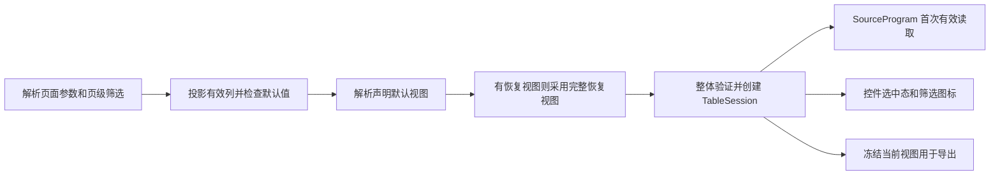

# 表格列头筛选默认选中值方案

日期：2026-11-03。状态：Schema6.82、引擎实现、浏览器/HTTP和分发验收已完成。实施证据见[验收记录](../evidence/table-header-filter-defaults/acceptance.md)；按用户要求继续集成、推送main并核对对应CI。

首期仅支持 `select` 多选枚举，默认值由页面 JSON 声明固定值。在叶子列的 `filterable` 下增加 `defaultValues`，由引擎在第一次有效读取前转换为现有表格查询视图。默认条件与用户后续提交的条件走同一执行路径，不能只在控件上勾选。

## 1. Schema 变化

### 声明及同层字段

以下列声明已由6.82支持：

```json
{
  "field": "status",
  "title": "审批状态",
  "enumValues": [
    { "value": "pending", "label": "待审批" },
    { "value": "approved", "label": "已通过" }
  ],
  "filterable": {
    "mode": "select",
    "defaultValues": ["pending"]
  }
}
```

声明路径为 `table.props.columns[*].filterable.defaultValues`，也适用于分组列 `children` 中的叶子列。分组节点不声明默认值。`enumValues` 仍在列上拥有值与显示名；`defaultValues` 只引用原始值，不复制 label 或 options。

正式类型为：

```ts
type TableColumnFilter =
  | { mode: 'select'; defaultValues?: (string | number)[] }
  | { mode: 'dateRange' | 'numberRange' };
```

产品 Schema 保持严格对象校验。只有 select 分支接收新字段，日期与数值范围分支继续拒绝它。不新增默认值来源、初始化时机、缺项策略、恢复策略、查询来源或宿主配置开关。

| 项目 | 规划规则 |
| --- | --- |
| 字段净变化 | 新增一个可选属性 `defaultValues`；不删除现有字段，不改 `TableQueryView` 的形状 |
| 省略、空数组 | 省略与 `[]` 都表示初始无该列条件；显式出现新字段仍触发能力版本检查 |
| 类型 | string 或有限 number，保持原始类型；`1` 与 `"1"` 不等价；拒绝 null、布尔、对象和引用表达式 |
| 字段契约 | 继续要求 select 的维度字段契约；默认项还须符合字段类型，不从展示格式反推值 |
| 重复值 | 按类型和值判断，重复项报错，不静默去重 |
| 静态字典 | 有 `enumValues` 时，每个默认值必须属于字典；不新增字典，不限制已有字典的适用范围 |
| 动态候选 | 无 `enumValues` 也可声明默认值；候选不是合法值白名单，不以当前页或一次候选结果判定值非法 |
| 字段绑定 | 首期带默认值的列仅允许静态 `main` 字段绑定；拒绝 `byFilter` 和其他数据槽绑定，避免字段切换与仅按字段名存状态的歧义 |
| 子表 | 维持行内子表不允许列筛选的规则；不得因复用 TableColumn 类型而开放 `rowExpansion.table` 的默认筛选 |

错误使用现有 `SCHEMA_ERROR`，定位到具体列、`defaultValues` 或数组元素。未知字段和错误模式在结构层拒绝；类型、字典成员、数据源所有权和组合源冲突在语义层检查。不要以新增字段为由放宽任何已有拒绝规则。

### 版本及兼容

这是可选声明的增量能力，按现行版本策略分配新的次版本和能力扫描项。基线 `versionPolicy` 为6.80，主工作区已有并行页面使用6.81；本批在隔离工作树采用6.82，能力标识为 `table-select-default-values`，交付时已集成main正式发布的6.81 IOC页头组件，保留双方能力。

旧文档不填写新字段时保持原行为；是否可读仍由现行 `supportedVersions` 决定，不承诺扩大历史读取范围。新能力不允许写在能力下限之前的版本里。扫描器必须定位分组列、详情 Table 和行内子表模板中的新字段，非法位置也不能漏过版本检查。

## 2. 架构变化

### 所有者与执行路径

当前 `defaultSourceView` 只知道页面数据源，默认 `predicates: []`；远程 `TableSession` 按 sourceId 持有，本地会话按 tableId 持有。列声明不能直接塞进数据源默认视图，否则共享数据源的其他消费者和内部成员查询也会被影响。

推荐在 `data-execution` 增加内部的表格初始视图解析职责，输入为当前执行作用域内的表格声明、已解析页面条件、已有源默认视图和可选恢复视图，输出按表格实例与按远程数据源分别组织的初始视图及诊断。只为经过所有权检查的远程表格建立 sourceId 映射。`defaultSourceView` 保持数据源级职责。

列投影的纯逻辑目前在 `runtime/src/table/column-presentation.ts`。将这部分无 DOM、无 Svelte 的计算下沉到 `data-execution`，由运行时兼容转出；初始视图解析、屏幕和导出复用同一份投影，不复制三份显隐规则。`TableSession` 保留生命周期、提交与取消职责，UI controller 保留草稿与事件适配，`QueryRunner` 继续管理实际请求的去重、缓存和取消。

初始化顺序为：



所有默认项一次性转换为现有 `in` 谓词，再整体验证；不逐列调用提交方法，不产生初始化中间请求。恢复视图是完整替代，不能逐字段补默认值；已恢复的空 predicates 必须保持清空。缺省视图与显式空视图使用 Map.has 等存在性信息区分，不新增页面字段。

会话内部要区分“声明默认视图”和“当前视图”：恢复用户视图只改变后者；完整重置回到当前作用域的声明默认视图，不回到某次用户恢复的状态。旧页面沿用现有语义，不将本批扩为全量会话重构。

### 执行范围

| 路径 | 变化 |
| --- | --- |
| inline、明确完整且无查询窗口的 query | 保持表格实例本地筛选，数据源可共享；不把局部条件下推到共享源 |
| 普通 query 的远程筛选 | 查询前建立源会话，继续编码现有表头条件和 queryField 映射；表格必须独占会受其视图影响的数据源 |
| pagedUnion、完整执行的 pagedJoin | 使用既有组合计划与全局过滤语义；不按当前页筛选，不新造完整结果能力 |
| 按需查询分页 pagedJoin | 全部有效默认条件与声明默认排序须来自同一允许选页的成员；跨成员直接诊断，不能静默丢条件或改用全量查询 |
| createPageDataExecutor 等共享取数入口 | 调用同一初始视图解析职责，向 SourceProgram.read 显式传入视图；不能只修浏览器 RuntimeSurface |
| 详情中的普通 Table | 在该详情自己的条件和完整结果作用域中建立本地视图，不继承来源页表格会话 |
| 行内子表 | 保持拒绝列筛选；父表的默认筛选只约束父行范围及现有父子导出范围 |

对远程表格的独占检查不能只统计组件 `data` 引用。还需识别 AI 总结、结果绑定、组合查询成员及其他依赖消费者是否会读到被筛选的源。首期对存在这类共享影响的非本地源给出诊断，要求作者显式拆分页面数据源；不修改内部成员的共享查询定义。

## 3. 冲突及处理建议

下列是实施前必须关闭的设计冲突或现有路径风险，不代表已经复现的线上故障。

| 编号 | 当前依据与冲突 | 处理建议 |
| --- | --- | --- |
| C01 声明与会话归属 | 默认值属于列，但远程会话按源持有；直接遍历表格覆盖源视图会出现顺序依赖 | 独立编译表格初始视图，远程源检查唯一所有者；本地视图按实例隔离 |
| C02 静态查询条件 | 把默认值写回查询 filter 会混淆固定业务条件和可清空的用户条件 | 不改查询定义；页级条件、固定条件与表头条件继续 AND 收窄，空交集走正常空结果路径 |
| C03 pagedJoin 成员切换 | `pagedJoinMemberView` 会清除其他成员条件；逐列初始化会导致最后一列获胜。声明默认排序也可能与默认条件跨成员 | 初始化按完整集合预检，包含默认排序；冲突时准确指出列与排序来源，拒绝执行，不借助列顺序决定结果 |
| C04 恢复与清空 | 以“当前没条件”为由补默认值，会把用户的清空操作覆盖 | 只在新会话初始化或明确的完整重置时应用；显式空视图完整优先 |
| C05 列隐藏及条件待定 | 隐藏列不得参与查询；反复投影时补默认值又会复活已清除条件 | 初始仅消费有效可见列；隐藏后清除，重新显示不自动补回。影响有效字段的输入未就绪时门控该表首次远程读取，不能先发无默认条件请求 |
| C06 组织父子表重置 | controller 的层级选择变化会调用 `resetDefault()`，已有约定要求恢复声明默认状态，与上一版“页级筛选变化都保留选择”冲突 | 普通业务条件变化保留已提交条件；`rowExpansion.selection` 的地区选择变化属于完整重置，恢复当前可见列默认值；文档明确例外，保留既有父子表约定 |
| C07 展示字段切换 | `fieldSelectionIds` 变化会调用 `resetPresentation()` 清空条件，与无条件保留规则冲突 | 首期默认列不接收 byFilter；仍沿用其他字段切换引发的展示状态清理，不自动补回默认值。不能一面承诺保持既有重置、一面强制所有筛选变化都保留 |
| C08 自动页大小 | orchestrator 推导 pageSize 后用全新 `defaultSourceView` 纠偏，新增初始 predicates 可能被抹掉 | 仅更新当前会话 pageSize 和必要页码，保留已应用条件、排序与搜索；新增无显式 pagination 的回归 |
| C09 普通 source.initial | `reusableInitialSnapshot` 已拒绝与普通初始视图不匹配的条件；但共享取数若将已筛选结果写回无视图信息的普通 initial，用户清空后可能误当全量复用 | 保留现有复用拒绝。普通查询按表格条件执行后不把结果写成无条件 initial；首期不增加 source.initial 的公开元数据字段 |
| C10 执行回执 | `executionSourceKey` 只含 fields/query，orchestrator 回执匹配还检查页级 filters，却未核对表格视图 | 首期对声明非空远程默认条件的源及受影响下游禁用无视图证明的回执复用，包括恢复视图为空的情况；未来如增加私有视图指纹再单独演进执行契约 |
| C11 候选缺项 | 动态候选受其他条件影响，默认项可能不在当前候选页；删除它会扩大查询 | 保留已选值并允许取消，优先复用现有失配已选值呈现；候选失败不撤销条件，不把字典当权限证据 |
| C12 完整导出 | 导出已有冻结的 tables、headerFilters、sourceViews；重新从声明补默认值会覆盖用户操作 | 导出只消费冻结的已提交视图。显式空映射不回退声明默认值；独立导出任务不触发新会话默认初始化 |
| C13 作用域与字段身份 | 表头谓词按字段名存储，其他数据槽同名列和动态绑定可能别名碰撞；行内子表复用列类型却禁止筛选 | 首期默认列限定静态 main 绑定；原有重复字段绑定检查保留；所有非法位置的 Schema、语义与版本扫描一致拒绝 |
| C14 协议与并行分发 | 新属性可能被旧版本接受或分发遗漏，工作区还存在并行版本内容 | 增加独立能力扫描、有效/无效向量与独立安装校验；版本在实施时分配，派生文件从隔离后的产品真源生成，不混入并行修改 |

普通业务条件改变时，若默认值与当前条件无交集，结果为正常空态；不得改成全部，也不自动挑选一个新候选。候选与查询的权限、失败和完整性规则保持原样。

## 4. 生命周期约定

新页面运行实例应用声明默认值；同一实例内的 Tab 切换、刷新数据、排序、翻页、候选刷新和用户清空不重复初始化。列隐藏后重新显示保持条件已清除。关闭详情后重新打开是新的详情作用域；原页面的会话保留规则不因此改变。

地区层级选择触发的完整重置恢复当前声明默认值，并依当前有效列再次投影；普通业务条件只重置页码。恢复会话后的完整重置也回到声明默认值。首期不新增用户可见的“恢复默认”按钮，也不增加 URL、跨页传递或本地持久化格式。

页面修订改变导致现有运行实例重建时，默认值按新修订重新初始化；不设计运行中把新声明合并进旧用户状态的策略。对依赖输入从待定变就绪的首次读取，要保留“尚未初始化”与“已经初始化但为空”的内部区别。

## 5. 决策与实现落点

| 真源或模块 | 计划修改 |
| --- | --- |
| `packages/page/src/schema/components/table.ts` | select 默认值结构、递归 TableColumn 类型同步、其他模式继续严格拒绝 |
| `packages/page/src/table/`、`validate.ts` | 默认值语义、静态 main 绑定、消费所有权、非法作用域及组合成员冲突检查；新职责放在 table 目录，不继续堆进大校验函数 |
| `packages/page/src/version.ts`、列属性扫描 | 新能力下限与所有声明位置扫描 |
| `packages/data-execution/src/` | 共用列投影与初始视图解析，已有谓词和计划预检复用；共享取数、普通 initial 写出规则同步 |
| `packages/engine/runtime/src/table/`、`orchestrator.ts` | 声明默认与当前视图区分、初始化顺序、重置语义、自动页大小纠偏、回执复用门禁 |
| `packages/engine/runtime-ui/src/table/` | 本地初始化、候选缺项回显、冻结导出接线；控件不拥有默认状态 |
| `docs/adr/` | 实施时新增决策并合入主题页；局部澄清 ADR-0086 的“用户会话态不进文档”：只持久化作者默认意图，用户实际选择仍不进页面文档 |
| 相关 ADR | 保持 ADR-0108 的执行/状态归属、ADR-0114 的失配已选值规则、ADR-0125 的单成员操作约束及现有列显隐约定；不扩大组合查询能力 |
| 产品文档与生成分发 | 同批更新 PAGE-METADATA、Table 正文、完整示例、契约向量，再从真源生成 local-authoring、独立校验器及清单 |

本方案不需要新增数据网关端口、不改 DQE 请求协议、不新增页面级表格状态容器，也不把列默认值放到 dataSources。若既有网关不能编码某个有效默认条件，沿用能力不可用诊断，不能退回当前页过滤。

## 6. 实施顺序与验收

1. 协议与前置诊断：落实 select 分支、值类型/字典/位置检查、所有权及组合成员冲突、能力扫描。编写正反契约向量，再分配次版本。
2. 共享执行与状态：建立共用初始视图解析，原子初始化和恢复、重置、本地/远程一致；关闭 C08–C10 的快照与页大小风险，接通 headless 路径。
3. 页面与导出：落地 `pages/capabilities/table/table-header-filter-defaults.json`，入口 `/pages/table-header-filter-defaults`；静态场景使用 inline，远程场景明确标识 DQE Sim。目录 README 写操作和预期结果，更新根主题入口。
4. 文档与分发：执行既定功能验收和 local-authoring 维护流程；仓外独立安装验证。未完成浏览器前不得标记功能验收完成，真实 DQE/Relay 与部署证据另列。

关键验收至少覆盖：

| 场景 | 必须观察到的结果 |
| --- | --- |
| 单列、多列、字符串与数值默认值 | 首屏控件、数据、总数与初始请求一致；多列一次性生效，没有无约束主查询 |
| 共享 inline 与完整本地结果 | 两表各自默认值互不干扰，其他消费者结果不变 |
| 普通远程 query 与自动分页 | 首请求含默认条件；页大小推导、翻页与重试不丢条件 |
| 静态字典与动态候选缺项 | 正确显示 label 或原始值；候选未加载、失败、分页缺项不清除条件 |
| 用户清空与显式恢复空视图 | 条件保持为空；刷新数据、Tab 切换和导出不补回默认值 |
| 固定业务条件与页级筛选 | 条件取交集；空交集正常空态，不发送无约束请求 |
| 列显隐、字段切换与待定条件 | 首次只用有效列；隐藏后再显示不恢复；必要条件未就绪时没有先行无条件请求 |
| 层级父子表完整重置 | 切换地区按现有约定恢复声明默认，清旧子实例；普通条件变化按既有作用域规则处理 |
| pagedJoin 与 pagedUnion | 支持范围走既有全局计划；按需 pagedJoin 的跨成员条件/默认排序冲突明确拒绝，不丢条件 |
| initial、执行回执与独立取数 | 不复用缺乏视图证明的远程结果，不写出会冒充未筛选结果的普通 initial |
| Excel 与整页静态导出 | 使用冻结的已提交条件；用户清空后导出保持清空；父表独立置顶汇总沿用原范围 |
| 非法声明与历史页面 | 逐项路径诊断、能力版本拒绝、行内子表拒绝；不填写新字段的可读页面保持原行为 |

取消、迟到响应、候选并发、重复初始化与导出期间修改筛选由行为测试覆盖。代码实施前测修改函数基线，实施后用同版 `metriccanvas-ts-ast/1` 测全部修改函数与新增辅助函数的 selfCC，目标不超过 15；存量超限按仓库规则处理。实际测量见验收记录：全部新增函数selfCC≤15，start从26降到25；parsePage31保持，存量保留项有明确记录。

## 7. 当前依据

- [Table Schema](../../packages/page/src/schema/components/table.ts)、[字段绑定与所有权校验](../../packages/page/src/validate.ts)、[Table 校验职责](../../packages/page/src/table/validation.ts)。
- [TableSession](../../packages/engine/runtime/src/table/session.ts)、[UI controller](../../packages/engine/runtime-ui/src/table/controller.ts)、[运行编排](../../packages/engine/runtime/src/orchestrator.ts)。
- [SourceProgram 与 defaultSourceView](../../packages/data-execution/src/source-program/session.ts)、[initial 复用规则](../../packages/data-execution/src/source-program/range-policy.ts)、[共享取数入口](../../packages/data-execution/src/execute.ts)。
- [执行回执的源指纹](../../packages/engine/runtime/src/execution.ts)、[按需 pagedJoin 视图](../../packages/page/src/paged-join-view.ts)、[导出状态冻结](../../packages/engine/runtime-ui/src/table/export/task.ts)。
- [查询主题决策](../adr/topics/data-fetching-and-query-model.md)、[文档结构主题](../adr/topics/page-document-structure.md)、[模块职责主题](../adr/topics/domain-modeling-and-package-boundaries.md)。
