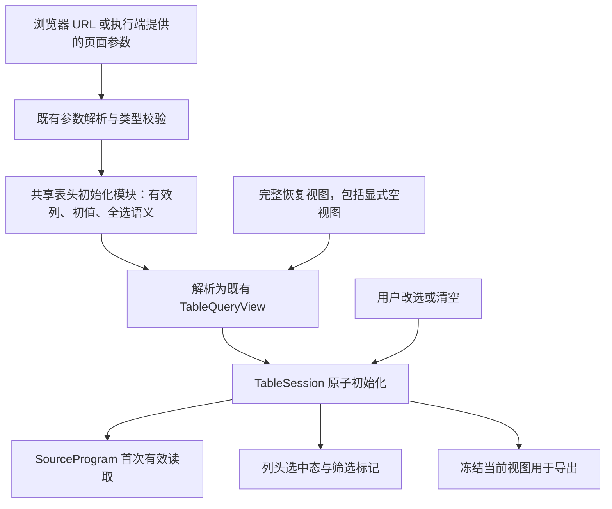

# 表格列头筛选的页面参数初始化方案

日期：2026-11-04，实施更新：2026-11-05。状态：已在隔离工作树基于 `cbba8e94f` 实现 Schema 6.85；local-authoring 1.23.0 同源生成。以下方案正文保留已确认的设计基线，第 8 节末尾记录实际实施与验收。本地验收按用例闭合；用户已授权提交并推送 main，本批已合并最新 main 基线 ad81479e6 后交付，真实业务原件与实接另验。

## 1. 目标与基线

`business-decision-details` 的“是否有效意见”列从下钻输入取得首屏选择：有效意见数进入时选择“是”，决策总次数进入时不限；用户进入后可以改成“否”或清空。清空后翻页、刷新、切换 Tab 和导出均不得重新套用打开时的条件。

原始业务页面依据用户交接材料。当前工作副本未发现材料中的 `pages/business-decision-details.json`、`pages/region-auth-norms-detail.json`，实施时须取得精确文件与部署版本，不能用相似页面替代。

本地证据存在版本差异：主工作副本 HEAD 为 `552ef5c12`，产品真源为 6.80；本地 Git 对象 `6c21164a9110f6330cd06e71503c44c319585b81` 含 6.82 静态 `filterable.defaultValues` 和共用初始表格视图实现。交付回执在 [artifacts](../../artifacts/table-header-filter-defaults-6c21164a9/README.md)。本计划以该实现为前置能力，不把它重复开发一遍；实施时重新核对实际目标分支，不在混合工作副本中回退或覆盖其他任务。实施已fetch核对origin/main基线cbba8e94f及其CI运行41809392718，13作业全部success；本次未提交代码的远端CI、部署未执行。

现有静态默认值的范围见[原方案](2026-11-03-table-header-filter-defaults.md)。本文件是其参数初始化扩展的唯一规划入口，不改写原方案的历史实施状态。

已用当前实现验证两项行为：

- 页级“是”与表头“否”按交集得到空集；清空表头仍保留页级“是”。隐藏页级筛选可以表达持续限制，无法等价表达用户可取消的表头初值。
- 多值 URL 使用重复键 `?is-valid=是&is-valid=否`；JSON 数组字符串不是现行维度 URL 编码。

## 2. Schema 最小化与推荐声明

现有协议不足以表达两项相互独立的业务意图：表头初值来自哪个页面参数，以及选中全部枚举时是否表示不限。引擎不能从列字段名自动认领 URL 参数，也不能从展示字典 `enumValues` 推断“全选不限”。

推荐仅在 select 叶子列的 `filterable` 增加两个可选属性：

| 属性 | 本批类型与省略语义 | 作用 |
|---|---|---|
| `initialParam` | 页面参数 id 字符串；省略保持静态 `defaultValues` 或无默认值 | 引用打开实例时已解析的参数，只初始化一次 |
| `allBehavior` | `"values" \| "unrestricted"`；缺省 `values` | 明确全选仍按值过滤，还是省略该列谓词；初始化与手动操作一致 |

`defaultValues` 与 `initialParam` 互斥；不允许“URL 没传时再取另一份静态默认值”的双重来源。需要缺省初值时，在所引用参数的现有保存值中声明。`allBehavior` 沿用页级维度筛选的词汇，但不改变已有页级筛选声明。

Schema 净变化：**新增两个可选属性，删除零个属性**。其中仅提供参数初值需要一个属性；本业务还要求 `是+否` 不传条件，因此纳入第二个。复用现有参数形状、`TableQueryView`、`in` 谓词和查询编码，不新增参数类型、表达式、URL 状态容器或网关端口。

以下为本批已实现契约的最小声明，内联数据为合成；本批实际分配 Schema 6.85，完整可观察示例见现有两个表头默认值页面及新增来源入口。

```json
{
  "schemaVersion": "6.85",
  "id": "table-header-param-demo",
  "layout": "dashboard",
  "meta": { "title": "表头参数初始化" },
  "params": {
    "query": {
      "dimensions": [
        {
          "id": "is-valid",
          "dim_name": "是否有效商务决策",
          "required": false
        }
      ]
    }
  },
  "dataSources": {
    "decisions": {
      "fields": {
        "record-id": { "type": "string", "role": "dimension" },
        "is-valid": { "type": "string", "role": "dimension" }
      },
      "source": {
        "type": "inline",
        "rows": [
          { "record-id": "合成记录1", "is-valid": "是" },
          { "record-id": "合成记录2", "is-valid": "否" }
        ]
      }
    }
  },
  "sections": [
    {
      "id": "details",
      "container": "card",
      "components": [
        {
          "id": "decisions-table",
          "type": "table",
          "layout": { "span": 12 },
          "data": { "main": "decisions" },
          "props": {
            "columns": [
              { "field": "record-id", "title": "记录" },
              {
                "field": "is-valid",
                "title": "是否有效意见",
                "enumValues": [
                  { "value": "是", "label": "是" },
                  { "value": "否", "label": "否" }
                ],
                "filterable": {
                  "mode": "select",
                  "initialParam": "is-valid",
                  "allBehavior": "unrestricted"
                }
              }
            ]
          }
        }
      ]
    }
  ]
}
```

参数仍是 `params.query.dimensions`：它是查询意图的输入，可由表头初始化间接消费；**声明参数不自动给所有查询增加固定条件**。新表头引用必须被参数消费者扫描识别，不能被误报为“没有消费者”。`params.display` 仍不接受维度数组，不新增第二套表头参数分组。

## 3. 类型、全选与错误边界

首期规则：

- `initialParam` 只接受现有分组维度参数；首期初始化字符串维度列。不将 URL 的 `"1"` 转成数值 `1`。既有数值 `defaultValues` 保持支持；数字列参数化不借本批扩大参数类型。
- `initialParam` 继承静态默认值的静态 main 叶子列约束：分组节点、byFilter、其他数据槽、日期/数值范围及行内子表不开放。普通详情中的 Table 只消费该详情实际获得的页面参数，不重新读取外层 URL；没有参数声明或输入时不得借用来源表会话。
- 远程查询必须能解析最终字段到成员及 `queryField`；可定位时核对参数 `dim_name` 与实际查询目标。不从字段标签猜字段或组织归属。inline/完整本地表只按字段原始类型检查，不伪造 DQE 映射。
- 同一参数不得既初始化该列表头，又通过固定 paramBindings、DQE 原位引用或同源隐藏页级筛选永久约束同一查询目标；新引用的校验须定位并拒绝这种重复控制。与该参数独立的业务固定条件、其他页级筛选及权限条件继续按交集生效，不改变既有约束。
- `allBehavior: "unrestricted"` 必须有显式 `enumValues`，不接受从当前页、动态候选的某一页或搜索结果推导“全部”。初值必须是字典内、类型正确且无重复的原始值。
- `unrestricted` 是作者明确选择的“不限”语义，不是“物理数据只有字典内值”的推断：枚举全集被选中后省略该列条件，结果可包含原本就存在的空值或未知原始值。若业务需要排除这些行，使用缺省 `values`。
- 非空真子集生成一个 `in` 谓词；集合比较保持类型、忽略次序。全选且 unrestricted 时不生成该列谓词，控件统一呈现“不限”，不维护另一份“全选但无谓词”的已提交状态。用户草稿仍归控件所有。
- 静态 `defaultValues`、参数初值、手动提交及恢复视图共用同一归一化。旧页面未填写 `allBehavior` 时行为不变；动态候选缺项不撤销有效选择，不能用候选列表替代权限校验。

| 输入/状态 | 初始显示和查询行为 |
|---|---|
| 可选参数无 URL、无保存值 | 不限，无该列条件 |
| 参数保存 `dim_value_list:["是"]`，URL 省略 | 应用该保存值；后续可清空 |
| `?is-valid=是` | 初始选择“是”，首个有效请求含该字段条件 |
| `?is-valid=否` | 初始选择“否” |
| `?is-valid=是&is-valid=否`，unrestricted | 不限，省略该列条件；其他业务/权限/时间条件保留 |
| 相同输入，缺省 values | 保留 `in ["是","否"]`，不宣称与不限等价 |
| 必需参数未提供且无保存值 | 沿用缺少必需参数诊断，不能查询全部 |
| 显式空值、JSON 数组字符串、重复值、错误类型、字典外值 | 对该新初始化输入报告定位明确的错误，相关表不发无条件请求；不回退保存值 |
| 用户清空或显式恢复空视图 | 保持不限，不补回参数初值 |

可选维度参数的缺席与空数组不等价：现行参数的 `dim_value_list` 要求非空；本批不放宽它。当前业务可沿用总次数入口传 `是、否` 的链接，避免依赖导航在空数组时的键删除行为。

拟议引用/字典/位置冲突继续使用 `SCHEMA_ERROR` 并定位到具体列及数组元素；输入错误复用参数解析诊断。显式非法输入的拒绝仅作用于本能力，不能顺带改变所有存量可选参数的宽松 URL 行为。新次版本和能力扫描在实施时分配，旧版本文档不能偷渡新属性；旧引擎继续严格拒绝未知能力。

## 4. 架构归属与初始化流程

保留 `TableSession` 为已提交表格视图的唯一写入者。参数是打开时的不可变输入，页级 FilterState 不承担这次列头筛选；控件只持有草稿和上抛事件，数据网关继续只接收现有生效查询。



浏览器 Adapter 负责把 URL 转成已有页面参数；Node/Relay Adapter 消费已填写的 metadata 参数值。共享逻辑不访问 `window.location`，也不再解析一次 URL。`createPageDataExecutor.execute(metadata)` 公开接口不变。

共享初始化职责放在 `data-execution` 的既有 `table-defaults` 路径，输入为页面、有效展示上下文、已解析参数和可选恢复视图，输出仍为初始视图、声明基线及待定集合。参数已完整物化时才调用，不用 `undefined` 混同“尚未完成初始化”和“合法缺席”。

将“选值到谓词”的纯规则集中到 table 领域职责中，供初始化和手动操作共用；避免在 RuntimeSurface、controller、Node 执行器和导出分别复制。`TableSession` 的 prepare 路径在归一化后再做既有组合计划检查，因此全选不限不会错误占有某个 pagedJoin 成员。`TableQueryView` 无需增加新的状态字段。

初始化优先级：**显式恢复视图整体替代初始化视图，包括空 predicates；没有恢复视图时才使用本实例解析出的参数初值或静态默认值**。参数输入须先完成必要校验，恢复视图不能把非法输入伪装成正常无条件查询。维持声明基线与当前视图区分，恢复视图不反向改写声明基线。

不采用下列路径：表头与隐藏页级筛选持续双向同步；按 field id 自动认领同名 URL；将参数直接永久写入 DQE body；为两个入口复制业务页面；在每次重绘时修改 defaultValues；为本批新增独立表格 URL 持久化协议。

## 5. 生命周期、组合查询与快照

| 场景 | 规划规则 |
|---|---|
| 首次打开、新页面实例 | 参数解析后整表一次初始化，首请求与控件一致；不先发无初值请求 |
| 改选、清空、候选刷新、翻页、排序、数据刷新 | 只消费已提交视图，不重新应用参数 |
| 普通页级筛选变化 | 保留表头当前条件，按现有规则重置页码；条件无交集则正常空态 |
| Tab 切换、已访问面板恢复 | 同一会话保留；首次激活的表格使用已冻结的实例参数 |
| 列隐藏后重显、展示字段变化 | 沿用静态默认值既有清理规则，不复活参数初值；首次输入待定时门控相关表 |
| 组织父子表完整重置 | 沿用既有完整重置约定，按当前有效列恢复本实例的参数初值基线；该例外不扩到普通页级筛选变化 |
| 页面重新打开或修订重建 | 新实例重新解析输入；页内操作不回写参数，不新增实时响应地址栏变化 |
| 普通详情重新打开 | 新详情作用域初始化；原页表格会话保留按既有约定执行 |
| inline、明确完整无窗口 query | 按表格实例本地过滤，可共享原始源，不改变其他消费者或 raw/compute/resultBindings |
| 普通远程 query | 按查询字段映射下推，延续远程默认表格的数据源独占检查 |
| 完整执行 pagedJoin/pagedUnion | 走既有全局计划，不退回当前页过滤，不改成员固定条件 |
| 显式查询分页 pagedJoin | 所有有效初始条件与默认排序须满足同成员/选页能力/records 限制；不合规拒绝，不逐列应用产生最后一列获胜 |
| 用户之后操作其他成员的列 | 继续既有“最后操作成员生效”的规则，可能清理先前成员的表头条件；本功能不把初值升级成不可移除的跨成员条件 |
| Excel、整页静态导出 | 冻结当前已提交表格视图；导出任务不重新初始化，不从参数补回用户已清空的条件 |

**快照与复用是本次主要架构风险。** 不能只改 `headerDefaultValues`：

1. `hasHeaderDefaults`、远程归属识别、待定条件门控和 protected-source 扫描都必须识别 `initialParam`；即使当前参数缺席或归一化为空，也保留“启用了该能力”的身份。
2. 参数变化时，受表格远程条件影响的数据源及下游进入已有失效图；引用关系扫描、`changedParamSourceIds` 不能只看 DQE body 和页级 filterBindings。本地表的组件私有投影不扩大为原始源重查。
3. 无表格视图证明的远程 ordinary initial 和执行回执，沿用静态默认值的保守复用规则；用户清空后不得复用旧的“仅有效”行并当作全部。
4. 单次取数必须使用同一初始视图；受远程表头条件影响的普通 query 结果不能回填为无视图信息的 ordinary initial。即使清空/全选后当前谓词为空，也不能从声明有能力误判为无能力。
5. 组合源自带视图的 initial 继续核对条件和视图；输入、成员或视图不匹配就重查。完整重置、自动 pageSize 纠偏保留本批已经提交的谓词。
6. 对启用新 allBehavior 的恢复视图，在恢复时执行相同类型/字典检查和全选归一化，随后作为完整视图采用；不借恢复绕过新规则，也不逐字段补初值。

## 6. 修改落点与冲击评估

| 模块/契约 | 改动 | 冲击 |
|---|---|---|
| `packages/page/src/schema/components/table.ts`、派生 TableColumn 类型 | select 新增两属性、互斥及范围约束 | 小；纯增量 |
| `packages/page/src/table/header-defaults.ts` 及 table 语义 | 识别参数初值、字典/原始类型/所有权/组合成员校验；共享选值语义 | 中；复用静态默认值前置实现 |
| `page-param.ts`、`resolve-page-params.ts`、参数引用扫描 | 识别新消费者，参数类型/目标检查、受影响源失效；不要求额外 paramBindings | 中；容易出现漏消费者和漏失效 |
| `data-execution/src/table-defaults.ts` | 使用有效参数解析初始视图、全选归一化和声明基线 | 中；集中新增行为 |
| `data-execution/src/execute.ts` | 向同一初始化模块提供参数，沿用视图传递和 initial 写出限制 | 中；公开 execute 接口不变 |
| runtime orchestrator、TableSession、presentation 调和 | 首查原子性、完整恢复优先、prepare 归一化、重置和快照保护 | 中到高；最重要的行为回归面 |
| RuntimeSurface、table controller | 传已解析参数、本地/远程一致、界面回显；仅对新引用补充显式非法 URL 输入校验 | 中；不引入第二套表头状态 |
| table export、执行回执消费 | 冻结当前视图；沿用保守复用，不从参数重建已清空条件 | 中；大部分复用前置规则 |
| 参数提取/创作工具 | 既有声明和引用必须可读、可保存、不被误删；识别表头消费者。首期不从当前手动表头状态自动抽取新参数，不扫描列字典生成取数条件 | 小到中；不扩大参数发现算法 |
| PAGE-METADATA、PAGE-PARAMETERS、Table/参数正文、local-authoring、契约向量 | 新语义、能力下限、示例和独立校验器同源生成 | 必选；派生物不手改 |
| DQE 服务、数据网关 HTTP、集成应用公开输入 | 继续使用既有参数、谓词和 initialSearch | 无新协议；实际字段和分页能力仍需真实服务验真 |

`allBehavior` 对本地与远程、静态与参数默认值、手动筛选共用，避免仅在 URL 下钻场景硬编码“是/否”。它不修改权限、固定条件或其他页面筛选；“不限”仅省略该表该列的可变条件。

## 7. 业务页迁移与实施顺序

业务页拿到精确文件后，依次盘点：目标表 `data.main`、组合源 projection、`is-valid` 的实际成员、该成员 canSelectPage/records、默认排序、固定业务/权限条件、两个来源入口和当前部署版本。

目标页添加可选维度参数 `is-valid`（无保存初值，未传即不限），在列上声明 `initialParam` 和 `allBehavior:unrestricted`。删除仅为此次下钻初始化而存在的隐藏 `is-valid` 页级筛选、对应 filterBindings 和失效的 notApplicableFilters 项；逐引用核对，不删除其他独立业务用途。**不新增该参数到 DQE 的固定 paramBindings/原位引用**，否则用户清空仍受固定输入限制。

来源页可先保留原有两个导航参数和传值：有效意见传“是”，总次数传“是、否”。它们仅供导航的消费关系继续合法。若现有页面已用 iocHeader，核对后沿用；如精确原件仍有旧页头，迁移按仓库既有必选规则另行等价盘点。

| 阶段 | 产出与完成条件 |
|---|---|
| P0 基线与最终契约 | 核对静态默认值实际分支/版本和业务原件；给出完整声明、字段净变化、同层约束和正反输入；分配新次版本，不预占 6.83/6.84 |
| P1 Schema 与纯规则 | select 联合、消费者扫描、参数/字段/字典/全选/所有权/组合限制；正反向量和能力扫描；维度空数组仍拒绝 |
| P2 共享执行与会话 | 共用初始化和手动归一化；浏览器本地/远程、Node execute、重置、initial/回执及下游失效同批闭合 |
| P3 Playground 与业务迁移 | 扩展已有两个静态默认值示例，不另复制演示体系；增加来源下钻入口、参数版本、错误夹具；有原件再迁移两业务页 |
| P4 产品文档与 local-authoring | Table/参数正文、版本、完整示例和引用索引；从产品真源生成契约、知识、独立校验器，仓外安装验证 |
| P5 交付与实接分层 | 对实际包完成构建/Embed基线、适用浏览器和检查；按授权执行 Git交付与CI/清理。真实 DQE、Relay、部署与内网来源页分别验收 |

实施阶段按实际目标分支在合适隔离工作树中进行，保留主工作区并行改动。编写代码前识别职责并测基线，实施后以同版 `metriccanvas-ts-ast/1` 实测全部修改函数及新增函数/闭包，目标 selfCC ≤15；存量超限遵循既有规则。不得只测外层工厂替代内部方法。

## 8. 验收矩阵与完成边界

| 验收 | 必须观察到的结果 |
|---|---|
| 有效数入口/总次数入口/直接打开 | 是/不限/不限；首屏图标、行、总数和请求一致 |
| 改否、清空后刷新/翻页/Tab/导出 | 用户状态保持；没有隐藏页级条件继续限制，也没有初值复活 |
| 全选 values 与 unrestricted | 前者保留显式值集合；后者完全省略该列谓词，其他约束保留；含 null/未知原始行时结果差异可观察 |
| 参数缺席/保存值/必需缺失/非法 URL | 遵循输入表；非法不会变成不限或悄悄回退初值 |
| 字符串/数值区分、重复、字典外值、字典缺失 | 精确路径诊断；数值静态默认值旧行为不变，数字参数初值首期拒绝 |
| 恢复非空视图与显式空视图 | 整体优先、不补默认；非法恢复值诊断；全选同规则归一化 |
| inline 同源两表、普通完整 query | 各表私有投影互不影响；raw/compute/resultBindings 未被表头初始化改变 |
| 普通查询分页及自动页大小 | 首个有效请求带初值；翻页/纠偏保留当前条件 |
| pagedJoin/pagedUnion | 全域筛选、成员及排序限制生效；不合规有诊断；跨成员后续操作符合既有覆盖规则 |
| 条件列、父子重置和普通详情 | 隐藏/待定/重显/完整重置/新作用域规则逐项可观察 |
| 普通/组合 initial、执行回执和 headless | 相同输入初查一致；更换参数或清空后不复用错误视图结果；不错误写回普通 initial |
| 旧页面与静态 defaultValues | 不填新属性行为保持；新属性低版本及非法位置拒绝 |
| local-authoring 与 Embed 分发 | 生成一致、仓外校验闭合；运行时交付时每个发布 JS≤1,000,000 字节及 ES/global 浏览器门禁通过 |

页面通过 `/pages/table-header-filter-defaults`、`/pages/table-header-filter-defaults-query` 及新增来源入口观察；在所属 README 写明 URL、操作、数据环境与预期。DQE Sim 与内联合成结果分别标识，不当作真实服务证明。取消、迟到响应、重复初始化、导出期间修改条件由相关行为测试覆盖。

正式实施还须形成 ADR 并合入数据获取/文档结构/模块职责相关主题，说明“作者声明初值、用户会话持有当前值”与既有静态默认能力的关系；本轮不提前把未实现契约写成现行 ADR 或产品参考。

**2026-11-05 实施台账（本地，未提交）：**

| 阶段 | 当前实施与证据 |
|---|---|
| P0 | fetch 后基线 `cbba8e94f366e0acd6041419ebc19bc1771f0e9d`，前置 6.82 已在 main；当前 6.84 上分配 6.85。主工作区并行改动保留，代码位于 `/Users/moon/.codex/worktrees/table-header-param-initial/DataDashboard`。两份精确业务 JSON 仍缺失。 |
| P1 | select 新增 initialParam/allBehavior，净增2属性、删除0；版本扫描、消费者、互斥、字典/类型/映射、重复控制与反向契约向量已实现。 |
| P2 | 共用初始视图，参数物化到实例副本；会话后续独占选择；本地/远程手动及恢复归一化；待定门控、失效、ordinary initial/回执保护、Node 禁止错误 initial 写出已覆盖。 |
| P3 | 扩展原两个示例并增加来源按钮页；内联“是/否/null/未知值”、values/unrestricted、Tab、DQE Sim 查询分页及实际 Excel 下载已由 Chrome 通过。真实业务原件未迁移；普通详情浮层真源禁止全部表头筛选，本批保持拒绝并补充定位反例，没有据规划推测开放该位置。 |
| P4 | PAGE-METADATA、PAGE-PARAMETERS、Table/参数正文、引用索引及 ADR-0130 与三个主题页已同步；契约和 Skill 同源生成，仓外 Skill 归档检查已通过。 |
| P5 | 定向192项通过；产品453文件4014通过、5项跳过；Skill主套件236通过，1项超时在原门限定向重测通过，另有入口16项；最终MC52项及整链检查通过；Embed 构建及 check:dist 通过，Chrome 分发273项通过，完整归档16个JS、最大929901字节。真实服务/部署与Git交付未执行。 |

复杂度口径：同版 metriccanvas-ts-ast/1 / TypeScript 5.9.3，覆盖修改函数与所有新增函数/闭包。changedParamSourceIds 16→6，拆出的 changedQueryParamSources=12；materializePageParams 11→15；columnDefaultErrors 10→12；initialTableViews 7→8；pageParamErrors 13→13；resolvePageParams 35→35 与 parsePage 23→23 保持存量复杂度，以独立语义校验接入避免扩大解析行为。新生产模块函数最高12，全部新增函数不超过15。原始结果与各层检查日志见 `artifacts/table-header-param-initial/`。

真实内网 DQE、Relay、权限服务、目标部署、Windows 原生构建与远端 CI 未由本批验收。本地验收后，用户于 2026-11-05 授权提交并推送 main；交付时保留上游诊断仅控制台呈现的修复，重新从合并后真源生成契约与 local-authoring 1.23.0。远端提交和同 SHA CI 结果由交付回执另记。


[完整本地验收记录](../evidence/table-header-params/acceptance.md)包含最终日志、超时与复测、复杂度、归档和实际证据边界。
